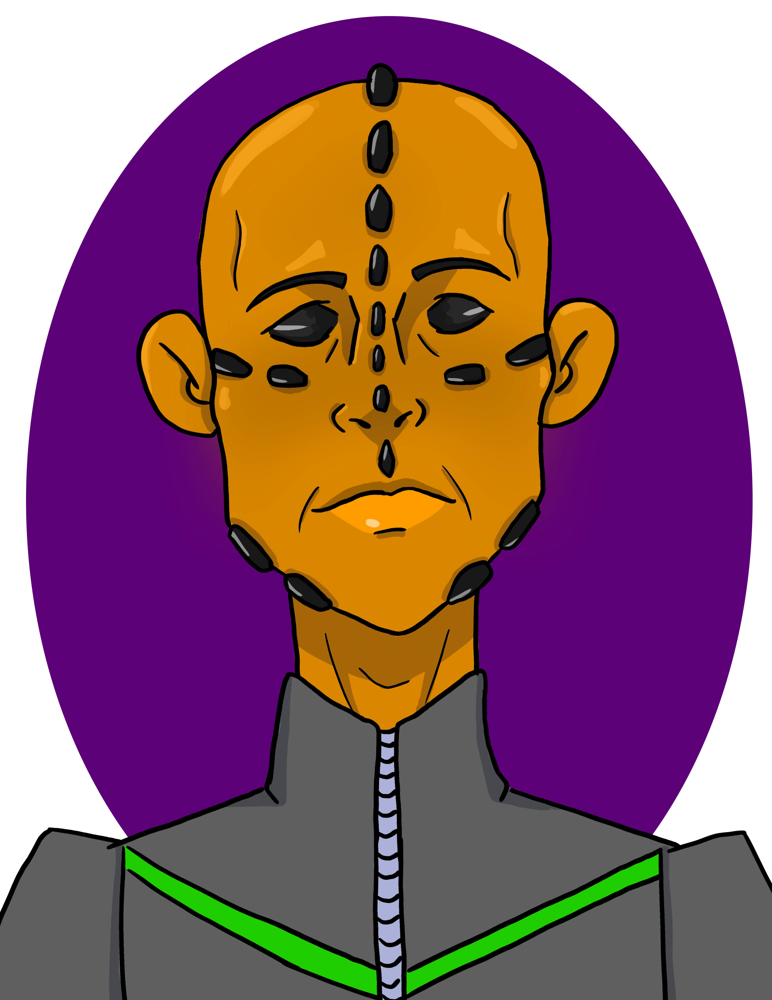

# J'Shashia

- **Source:** https://clear-skies-rpg.fandom.com/wiki/J'Shashia
- **Retrieved:** 2026-11-16
- **Wiki page ID:** 342

| Field | Value |
| --- | ----- |
| Type | Humanoid |
| Place of origin | [Jateran](../locations/jateran.md) |
| Status | Living |
| First appearance | [Episode 09 New Civilizations](../episodes/ep-09-new-civilizations.md) |

The **J'Shashia** are a humanoid species originally from the planet [Jateran](../locations/jateran.md).

## Description
### Appearance
They are humanoid, and roughly the same size as humans. They have orange-yellow mottled skin. Their eyes are glossy black, with no whites. They have glossy black stones in their faces; they run down the center of their faces, and along their jawlines. They have some sharp teeth and some rounded. Their hair is glossy black. They are generally shorter than humans (5' 7" is considered tall for a J'Shashian).

### Disposition
Diverse, but generally open and friendly.

### Physiology
The black platelets on their faces get larger with age. They also allow the J'Shashians to detect magnetic anomalies.

## History
The J'Shashian species survived two different mass extinctions in the previous 100,000 years.

Approximately 300 years before the events of *Clear Skies*, the various countries of the J'Shashians united to form a global government.

In 2381, [USS Ross](../ships/uss-ross.md) visited [Jateran](../locations/jateran.md) in order to deliver scientists which had been rescued from [Space Ring Observer](../locations/space-ring-observer.md). This was Starfleet's first contact with the J'Shashians. 
They discovered a Tholian dreadnaught, [Ketikess](../ships/ketikess.md), already in orbit, and the planet in the middle of a crisis. In the ensuing chain of events, a young [Crystalline Entity](https://memory-alpha.fandom.com/wiki/Crystalline_Entity) emerged from the "dead" hemisphere of the planet. The Tholians escorted the Entity away from the planet. At the same time, the [Defense Minister](keah-nobal.md) led an unsuccessful coup attempt to depose the [High Regent](alu-zazz-keel.md). ([Episode 10 The J'Shashia](../episodes/ep-10-the-jshashia.md)).

After first contact, the United Federation of Planets began accelerated negotiations to admit the J'Shashians. ([Episode 34 Trial Runs pt. 1](../episodes/ep-34-trial-runs-pt-1.md))  Later, Dr. [Yugoss](yugoss.md) became the first J'Shashian to become an official member of a Starfleet vessel. ([Episode 35 Trial Runs pt. 2](../episodes/ep-35-trial-runs-pt-2.md))  Soon after, Starfleet began construction of a research facility on [Jateran](../locations/jateran.md).

## Society
The J'Shashians have a planetary government, led by a High Regent. The government involves some aspect of elections.

## Culture and tradition
J'Shashians use tattoos on their faces to mark their accomplishments. The tattoos give a sort of record of their lives and achievements. They seem to style their hair based on their role in society.

There is a large comet in the same system as Jateran. The J'Shashians call it "Orphan". They have several myths surrounding the comet. One story is that is was a child of the gods, and was left behind when the gods left Jateran. It stays behind to watch over the J'Shashians to await for the days the gods return. Another story states that, one day, Orphan will realize that the gods will not return, and it will come home to Jateran to die. When it does, all of Jateran will be destroyed.

The J'Shashians incorporate crystals into large aspects of their culture. The seat of planetary government, the Palace of the High Regent, is made entirely of various kinds of crystal.

### Food
During a visit to Jateran, the crew of [USS Ross](../ships/uss-ross.md) were served warm moss-covered rocks.  When the moss was scraped off, small worms emerged.  The J'Shashians ate the moss with the worms.  ([Episode 35 Trial Runs pt. 2](../episodes/ep-35-trial-runs-pt-2.md)).

## Technology
J'Shashians are a post-warp society, but only barely. They have one deep space station, [Space Ring Observer](../locations/space-ring-observer.md), which was sent to the Jotaym system to study a particle fountain.

They have an unusually advanced understanding of subspace, even more advanced than starfleet. They have the ability to predict the emergence of particle fountains, something which starfleet has been unable to do.

Perhaps because of their knowledge of subspace, they have weapons with [isolytic](https://memory-alpha.fandom.com/wiki/Isolytic_burst) warheads. This technology is banned by the major powers of the alpha and beta quadrants.
