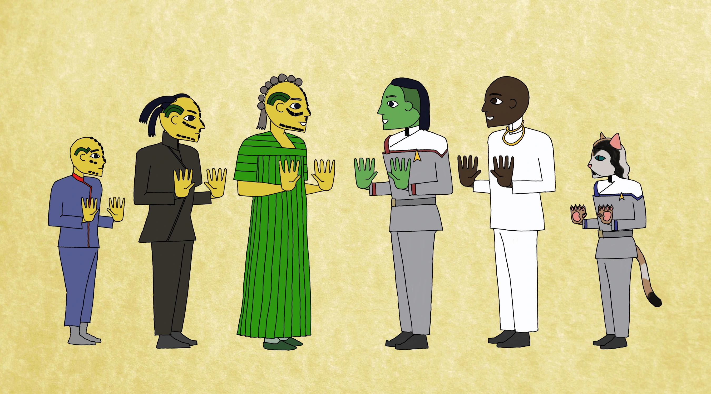
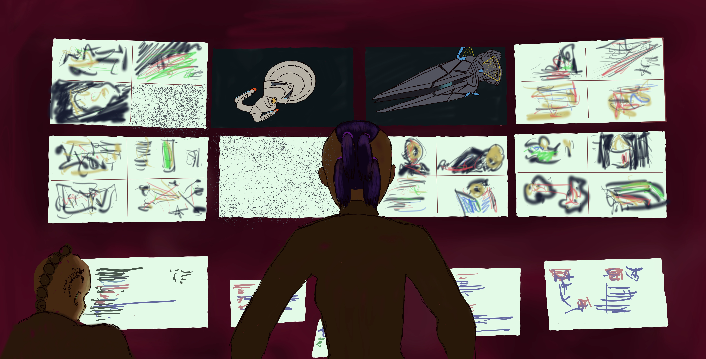

# Episode 11 Food of the Gods pt. 1

- **Source:** https://clear-skies-rpg.fandom.com/wiki/Episode_11_Food_of_the_Gods_pt._1
- **Retrieved:** 2026-11-16
- **Wiki page ID:** 290
**Episode 11 — Food of the Gods pt. 1**

| Field | Value |
| --- | ----- |
| Air date | 04/13/2020 |
| Run length | 161min |
| Broadcast | Twitch [YouTube](https://www.youtube.com/watch?v=OAEkXfQcebU) [Spotify Podcast](https://open.spotify.com/show/4XRHFGJ4s4EV7LufmohEnQ?si=_ryT3XVATmiTtDsrx3Yt8w) |
| Cast | Eric Campbell Revati Dhomse Gina DeVivo Sam de Leve Aki Xander Jeanneret Bonnie Gordon |
| Previous | [Episode 10 The J'Shashia](ep-10-the-jshashia.md) |
| Next | [Episode 12 Food of the Gods pt. 2](ep-12-food-of-the-gods-pt-2.md) |

> "I think your planet is getting ready to have a baby."
>
> — Olyn

## Plot Synopsis
### Brief Overview
Captain Sull, still on the planet, orders the [USS Ross](../ships/uss-ross.md) to open communication with the Tholians, who give the Ross 20 minutes to leave or they'll be destroyed. On the planet, the [J'Shashia](../characters/jshashia.md)n [High Regent](../characters/alu-zazz-keel.md) has a disagreement with the [Defense Minister](../characters/keah-nobal.md), who distrusts the Ross crew. They leave to have a private argument, and when they return the Defense Minister tells Sull that the comet 'Orphan' has been redirected to imapct with the 'dead' half of the planet, which is covered in crystalline structures.

On the Ross, Lakat and EXEO realize there is a baby [The Crystalline Entity](https://memory-alpha.fandom.com/wiki/Crystalline_Entity) within the planet, but that the comet's impact will not be enough to crack the planet open and let the Entity escape. On the planet, Olyn convinces the J'Shashians to let them use the planet's command center to communicate with the Tholians and share what the crew has learned. They ask permission to help the Entity emerge, and find a food source that isn't the J'Shashian people. The Tholians agree, and back off.

M'Qrell is volunteered to perform a C-section on the planet using the Ross phasers. While she practices, the rest of the crew starts to hunt for a nearby planet to use as an alternative food source.

### Pre-Break

The episode opens with the [Tholian Dreadnought](https://memory-beta.fandom.com/wiki/Tarantula_class) appearing on the view screen of [USS Ross](../ships/uss-ross.md). The ship is at yellow alert. CAPT Sull, AMB Olyn, and LTCDR M'Qrell are currently on [Jateran](../locations/jateran.md), the home-world of the [J'Shashia](../characters/jshashia.md), on a first contact mission. Sull orders LTCDR EXEO to open a channel with the Tholian ship. MCPO Theq walks onto the bridge, screaming "THOLIANS!" LTCDR Prahl opens a channel with the Tholians, and an audio link is established. The Tholian ship is named [Ketikess](../ships/ketikess.md). It is commanded by CDR Vozrax. Vozrax refers to USS Ross as "Federation Murderers" and inform them that they have 20 minutes to leave orbit or be destroyed. EXEO attempts to ask what a Tholian ship is doing so far away from Tholian space, but there is no response. Prahl reports that Ketikess is raising shields and altering course to intercept USS Ross; intercept time is 2 minutes.

On Jateran, Sull asks [High Regent Keel](../characters/alu-zazz-keel.md) if the planet has been experiencing any unusual phenomena recently. Keel begins to answer, but the door to the banquet room suddenly bursts open. A woman storms in, wearing a seamless black suit which covers her from neck to toe. Her hair is tied in a ritualistic series of pony tails, and she has several tattoos indicating her accomplishments. She begins to protest Keel's actions, but she sees the crew of USS Ross and freezes in her tracks. She lets out a gasp of shock and horror. Keel introduces her as [Keah Nobal](../characters/keah-nobal.md), the defense minister. Sull attempts to explain the situation to her, and repeats their question about unusual happenings around the planet. Keel begins to speak, and Nobal once again cuts him off. The two argue. Nobal mentions during the argument that the J'Shashia have been experiencing unusual seismic activity over the last six months, and have also detect alien ships in orbit multiple times in the last three weeks. She becomes increasingly angry, and even suggests that Keel may be selling out the J'Shashia to aliens in order to gain personal advantage, or win the upcoming elections. At that, Keel gets angry and shuts her down. Sull tries to speak calmly and get the conversation back on track, but Nobal only looks at the crew with revulsion. Olyn can sense fear and rage within Nobal, and even the beginnings of distrust towards Keel. Nobal asks for a private meeting with Keel, but Keel suggests they wait until the immediate threat is over.

On the bridge, EXEO hails the Tholian vessel again. She states that they are peaceful and had no intentions of violating Tholian space or interests, but there is still no response. Prahl notes that their weapon systems are still powered down. Theq and Lakat scan the Tholian ship for an explanation of how it got here without anyone noticing (Tholians are not known to have cloaking technology). The scans detect some [chroniton](https://memory-alpha.fandom.com/wiki/Chroniton) particles on the hull, but not enough to definitively determine if time shenanigans are involved. The scans also show that the ship had been constructed about 10 years ago. Theq also determines that there is no conclusive evidence that the crystals on the planet are related to Tholian biology. EXEO gives the bridge a pep talk as Prahl orders the entire ship to battle-stations.

On the planet, Nobal again insists on a private conversation with Keel. Keel concedes, and they leave the banquet room, leaving behind the ceremonial guards. Olyn and Sull discuss the difficulties of the situation, and the and the need to get Nobal to trust them. M'Qrell is feeling a little useless, and so is focusing on acquiring pieces of food from the table to take back to Theq. Sull gives M'Qrell a knowing look at the door, and she attempts to overhear Keel and Nobal's conversation using her superior Caitian hearing. She can hear the two yelling. Keel is shouting at Nobal, and Nobal is keeping up. M'Qrell hears discussion of the comet, as well as tectonic activity. M'Qrell walks nearer to Sull. She attempt to use the food on the table to communicate what she heard without alerting the guards. Keel and Nobal return to the room. Keel appears agitated. Nobal asks what Sull is willing to tell them.

On the bridge, the Tholians enter weapons range. Prahl request permission to scan their weapon systems. EXEO gives the order. The scans show that they have a powerful weapons array. EXEO uses her adaptive personality routines to model Sull's mannerisms and speech patterns; she hopes to help calm the bridge crew. She reminds Lakat, Theq, and Prahl that there is still a cloaked vessel nearby. Theq suggests using the comet probe to scan the area. EXEO hails Sull to ask permission.

On the planet, Sull tells Nobal to ask whatever questions she must in order to build trust between them. Nobal then asks why Sull's starship decided to alter the course of the comet to collide with Jateran. Sull cuts her off to ask EXEO to confirm the trajectory of the comet. On the bridge, EXEO looks to Lakat, who scans the comet and confirms the trajectory. She discovers that it is headed for the center of the "dead" hemisphere of Jateran. Sull orders Lakat to determine the effect of the impact on the planet. [Dr. Yugoss](../characters/yugoss.md) is shocked at the news, and looks to Keel. Keel states that the government had kept the information secret in order to not cause a panic. Someone mentions the comet's name, Orphan, and Nobal begins to tell the rest of the myth of Orphan. She tells that when Orphan realizes the gods will never return, she will decide to come home to Jateran to die. When she does, Orphan will take the entire planet with her. Sull asks Olyn why the Tholians would involve themselves in the mythology of another race. Olyn suggests that USS Ross be an intermediary between the Tholians and the planet.

Olyn recalls that the Tholians referred to them as "Federation murderer." Olyn requests they go to a communication station on the planet so they can talk to the Tholians. Keel suggests they go to the command center. Nobal objects, saying it is unacceptable to bring aliens into their critical facilities. Olyn makes an impressive diplomatic plea, and Nobal submits. They all move to the command center. The J'Shashia there are shocked to see the crew, and look to Nobal for an indication of how to respond. Nobal takes over the console and brings up satellite images of USS Ross and Ketikess.

On the bridge, Lakat scans the surface of the planet at the expected point of impact, while Theq scans the space around the planet. Lakat finds that the Tholians intentionally moved the comet into its current trajectory two weeks ago. The computer examines the composition of the rocks and crystals at the projected impact site, and finds a match in the Federation database. Jane looks up at the holographic projection of its findings to see...

[The Crystalline Entity](https://memory-alpha.fandom.com/wiki/Crystalline_Entity).

### Post-Break
At the science station on the bridge, Lakat looks at the image of the Crystalline Entity as the computer brings up the relevant details. Ketikess hails USS Ross, to inform the crew they have only 10 minutes remaining. Lakat and Theq identify a large electromagnetic energy source under the surface of the planet. EXEO walks over to ask what's going on. Lakat starts explaining, but EXEO cuts her off when she mentions the Crystalline Entity. EXEO calls Sull. EXEO concludes there is a Crystalline Entity inside the planet, and that the Tholians are trying to crack open the planet using the comet. Olyn and Sull tell the J'Shashia that their planet is giving birth to a Crystalline Entity, but they aren't convinced. Olyn informs them that, after the Crystalline Entity is born, it will consume all biological life on the planet. It is likely the reason for the "dead zone" on the "Western" hemisphere.

Lakat gets EXEO's attention. She says that Orphan is large, but not large enough to significantly damage the crust of Jateran. She suggests they find a way to free the baby Crystalline Entity without using the comet to crack open the planet. Sull orders Olyn to negotiate with the Tholians to figure something out. Olyn calls the Tholians using the J'Shashia's command center, and makes their case. Suddenly, the Tholians take over every screen in the command center. The image of Commander Vozrax appears everywhere, and their voice projects from every speaker. The J'Shashia are horrified. The Tholians state that they will protect the Crystalline Entity with their lives, although the Universal Translator is unable to translate their word for the Entity. Olyn makes a diplomatic speech, and requests they allow USS Ross to help with the emergence of the Entity. The Tholians state that the life of Jateran will still be the food for the baby Entity. Olyn suggests finding alternate food sources for their child. Vozrax corrects Olyn, saying the Entity is not their child, but the Universal Translator is unable to translate their word for what it actually is. The Tholians say the crust of the planet is too thick, and it is making things difficult for the Entity, which is why they threw the comet at Jateran. Vozrax asks Olyn to propose an alternate solution.

Sull calls EXEO to obtain scans of the Entity, and orders Prahl to determine how to use the ship's phasers to cut open the crust. EXEO asks M'Qrell if she is ready to perform a planetary Caesarean Section. Olyn asks about alternate food sources. Sull recalls that starfleet knows how to lure the Crystalline Entity using graviton pulses; now they need a destination. Sull asks Keel for all the J'Shashia info on the seismic activity. The crew determines that the growth pulses of the Entity coincide with mass extinctions on the "dead" side of the planet, the unusual seismic activity, and the growth of the crystal mountain ranges.

As the crew of USS Ross determines the plan, a few things happen. They communicate the plan to the Tholians, who tow the comet back into its original orbit. Prahl determines that the weapons systems on Ketikess are deadly to ships and shields, but less effective against solid rock than a phaser. He determines they used the comet as a last resort. As USS Ross moves over the area of the planet where the Entity is emerging, EXEO looks at the surface and can see the ground literally cracking. Ketikess is nearby, but not interfering. M'Qrell calls Theq. She asks for a hologram of the planet which she can cut with a laser scalpel connected to the ship's phasers. Theq, ENS Dari and Lakat build the interface over the course of an hour.

Sull orders the crew to prepare probes and to acquire any data the J'Shashia have on nearby class-M, class-L, and class-N worlds. Lakat goes to visit Dr. Yata in Cetacean Ops to ask for the Odanians' assistance in identifying a planet. Theq and Dari start building the probes over the next 30 minutes. He uses J'Shashia's improve understanding of subspace to boost the communication speed of the probes. Over the next hour, USS Ross launches all of the probes.

On the planet, the ground begins to rumble.

## Cast 
-  Eric Campbell - Game Master
-  Revati Dhomse - Jane Lakat (absent)
-  Gina De Vivo - EXEO
-  Sam de Leve - Azeri Sull
-  Aki - Olyn Madzhin-Nil
-  Xander Jeanneret - Theq Lynadas
-  Bonnie Gordon - M'Qrell

## Non-Player Characters
-  Yeri Prahl
-  Vozrax
-  Zhyliss Vrenn
-  [Alu Zazz Keel](../characters/alu-zazz-keel.md)
-  [Keah Nobal](../characters/keah-nobal.md)
-  Yata
-  Aulyn Dari
-  [Yugoss](../characters/yugoss.md)

## Locations
-  [Jateran](../locations/jateran.md)

## Ships
-  [Ketikess](../ships/ketikess.md)

## Notable Lines
> "Federation Murderers will not be accepted in the vicinity of this planet."
>
> — Vozrax
> "Do you see this gravy boat? It actually kind of looks like a Tholian Dreadnought if you move it to the left."
>
> — M'Qrell
> "Do it as un-agitatingly as you possibly can."
>
> — EXEO
> "I think your planet is getting ready to have a baby."
>
> — Olyn
> "Holy shit!"
>
> — Lakat
> "Oh, we're going to birth a planet. I love it."
>
> — M'Qrell
> "I had a moment where I had to figure out for myself that your sentences had periods, but I did find them."
>
> — Yata

## Notes and Trivia
-  The Crystalline Entity is Aki's favorite part of Star Trek.
