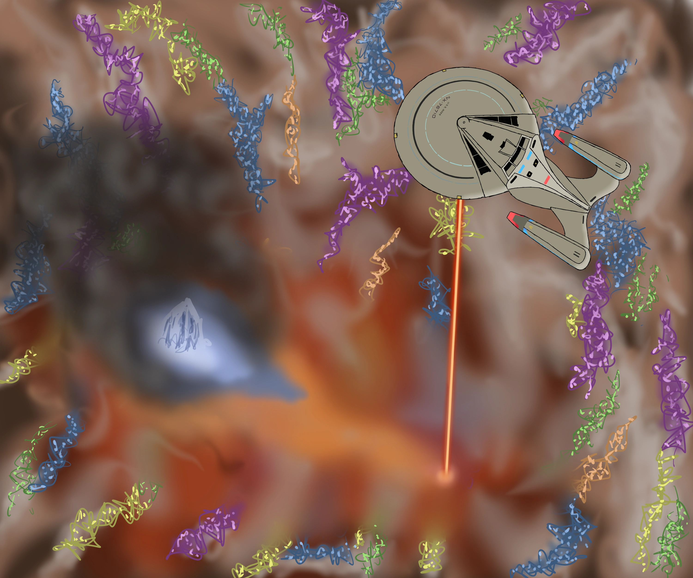

# Episode 13 Food of the Gods pt. 3

- **Source:** https://clear-skies-rpg.fandom.com/wiki/Episode_13_Food_of_the_Gods_pt._3
- **Retrieved:** 2026-11-16
- **Wiki page ID:** 292
**Episode 13 — Food of the Gods pt. 3**

| Field | Value |
| --- | ----- |
| Air date | 05/04/2020 |
| Run length | 196min |
| Broadcast | Twitch [YouTube](https://www.youtube.com/watch?v=zLma9N29v-k) [Spotify Podcast](https://open.spotify.com/show/4XRHFGJ4s4EV7LufmohEnQ?si=_ryT3XVATmiTtDsrx3Yt8w) |
| Cast | Eric Campbell Revati Dhomse Gina DeVivo Sam de Leve Aki Xander Jeanneret Bonnie Gordon Aliza Pearl |
| Previous | [Episode 12 Food of the Gods pt. 2](ep-12-food-of-the-gods-pt-2.md) |
| Next | [Episode 14 Farther from Home pt. 1](ep-14-farther-from-home-pt-1.md) |

> "May you receive value for all the value you have given."
>
> — Azeri Sull

## Plot Synopsis
### Brief Overview
Lakat is unable to determine what the [J'Shashia](../characters/jshashia.md)n missiles are targeting before the missiles fire, and the crew rushes to find a way to hack the missile guidance system. On [Jateran](../locations/jateran.md), Captain Sull uses their pheromones to escape their guards and return to Olyn, who senses something is wrong, and that [High Regent Keel](../characters/alu-zazz-keel.md) is oblivious.

The planet begins to quake and M'Qrell begins her procedure while Theq and Lakat deflect the missiles. The J'Shashian guards are split between those who side with [Nobal](../characters/keah-nobal.md) and those who side with Keel and the Starfleet aliens, but eventually Nobal's actions are revealed and she is arrested.

The [Crystalline Entity](https://memory-alpha.fandom.com/wiki/Crystalline_Entity) emerges and Dr. Yata gives the crew coordinates. The Entity and the Tholian ship follow to what ends up being a planet covered in plant life with a single animal lifeform. The Ross receives a a mysterious message from the lifeform, and the Entity begins to feed on the far side of the planet. Sull organizes an away team to meet this lifeform, who introduces herself as Ree. She's an unknown species, and has been alone on the planet for millions of years. Ree gives Sull a datapad with information about the [Shackleton Expanse](../locations/shackleton-expanse.md), and warns them that the Tholian Commander Vozrax is not of this timeline. Her work complete, Ree's body slowly turns into a tree.

### Pre-Break
The episode opens immediately where [Episode 12 Food of the Gods pt. 2](ep-12-food-of-the-gods-pt-2.md) left off. [USS Ross](../ships/uss-ross.md) is in orbit over the planet [Jateran](../locations/jateran.md), preparing to help a [Crystalline Entity](https://memory-alpha.fandom.com/wiki/Crystalline_Entity) emerge from it's crust. A Tholian ship, [Ketikess](../ships/ketikess.md), is also in orbit. The Tholian captain, Vozrax, has pledged to defend the Entity with their lives, and to destroy USS Ross and any of the [J'Shashia](../characters/jshashia.md) if required. CAPT Sull and AMB Olyn are on the planet. Sull has just discovered that Defense Minister [Keah Nobal](../characters/keah-nobal.md) has ordered a launch of missiles. On the bridge, LTJG Lakat has determined that the missiles are armed with [isolytic](https://memory-alpha.fandom.com/wiki/Isolytic_burst) warheads. A weapon capable of tearing holes in the fabric of space-time.

Lakat scans the warheads, but interference prevents her from determining their exact number or intended targets. Lakat asks MCPO Theq to assist with the scans. LTCDR Prahl wonders aloud if [Ketikess](../ships/ketikess.md) can also detect the weapons arming. LTCDR EXEO orders the ship to Red Alert. Theq transfers full power to shields. Prahl detects the weapons being fired. Sull orders USS Ross to hack the missiles' guidance systems. Theq speculates that they could use a probe to detonate an energy pulse which might disable or distract the missiles, but warns that it might cause them to detonate. Prahl suggests using photon torpedoes to intercept the missiles, but Sull is concerned that would provoke the Tholians. Sull orders USS Ross to prioritize hacking the guidance systems. Prahl reports that the Tholians have probably detected USS Ross going to red alert (which involves arming the torpedo bays), and [Ketikess](../ships/ketikess.md) is coming about to approach USS Ross.

On the planet, Sull (still in the bathroom) leaves to go find Olyn. They are stopped by the two guards escorting them. The guards brandish their weapons and "ask" Sull to come with them. Sull is not pleased, and orders them to stand down; Sull uses their Orion pheromones. The guards lower their weapons in a daze. Sull informs them that they are going to their ambassador. As Sull starts to walk away, one of the guards asks if he will ever see them again. Sull walks away. When Sull gets back to the side room, they try to enter but get blocked by those guards as well. The guards ask where Sull's escort is, but Sull plays dumb. Sull uses their pheromones again and orders the guards to stand aside.

When Sull enters the room, Olyn immediately picks up that they are agitated and is using their pheromone ability. Using their empathic abilities, they sense that some of the guards in the room are hostile to them. They also sense that High Regent [Alu Zazz Keel](../characters/alu-zazz-keel.md) is completely oblivious. Sull casually walks over to Olyn and discretely guides them to a part of the room with better cover. Suddenly, the entire room starts to vibrate and seismic activity is detected all over the planet.

On the bridge of USS Ross, Prahl looks at the scans of the planet and informs LTCDR M'Qrell that it's time. M'Qrell gives him one final pep talk, ending with "Let's go make a baby." Vernon snickers, and LTCDR EXEO orders them to focus on watching Ketikess. MCPO Theq begins to panic, and suggests to EXEO that they eject one of the warp cores to disable or distract the isolytic missiles, recalling that USS Enterprise-D once repaired the subspace tear of an isolytic warhead by detonating a warp core. EXEO replies that there isn't enough time. She orders Theq to proceed with the idea of firing an energy pulse, but to use the main deflector of USS Ross. She also prepares to launch a spread of photon torpedoes to intercept the missiles in case the pulse fails. Theq and Lakat use the main deflector dish to fire a powerful electromagnetic pulse.

Meanwhile, in sickbay, M'Qrell begins the procedure to free the Crystalline Entity. The Entity slowly emerges as the missiles harmlessly explode in the atmosphere. Lakat is able to determine that the pulse disrupted their arming mechanisms, and that they were aimed at USS Ross and Ketikess. Prahl reports that Ketikess is approaching, but the work to free the Entity is not yet complete. Theq reports that they can't boost power to the shields since USS Ross is pumping so much energy into the phasers. EXEO orders Prahl to keep cutting, no matter what.

On the planet, the rumbling sets off the guards. Half of them raise their weapons and start shouting in J'Shashian. However, the other half raise their weapons and aim them at the first half. Sull, Olyn, Keel, and Yugoss are stuck in between. All of the civilian scientists in the room hit the deck. Olyn tries to diffuse the tension, assisted by Keel. Sull also assists, using their pheromones. The doors open and Nobal enters with three more guards. Her guards now outnumber the other side. She looks at all of the guards and orders them to carry out her orders. Olyn tries to talk her down, but she accuses USS Ross of causing all of the destruction. She claims USS Ross planted the Entity as a pretext to take over her planet. Olyn tries to convince her otherwise, but is unsuccessful. Someone in the back of the room report that the missiles were destroyed. Keel is shocked and quietly angry that Nobal ordered the launch of their orbital weapons without his permission. He orders the guards to arrest Nobal. There is a tense moment when the guards hesitate. Olyn makes a plea for peace; they say that USS Ross will back Keel, if necessary. Nobal orders the guards to kill all of them. This call for violence seems to end the indecision; the guards arrest her.

EXEO calls Sull to announce the birth of the Entity. Sull and Olyn transport back to USS Ross, with Keel's apology. On the view screen of the bridge, they all watch the Entity break atmosphere. It's appearance is more chunky and jagged than the Entity encountered by USS Enterprise-D. It hesitates above the planet, seemingly confused. Sull relieves EXEO and takes the center chair. Dr. Yata calls the bridge. He gives them coordinates and says that USS Ross must follow them. He states that the Entity will follow them. His tone is a little off. Sull orders LT Vrenn to transmit the coordinates to Ketikess. The ship proceeds to the coordinates at slow warp. For no apparent reason, the Entity follows them. Ketikess follows them both.

### Post-Break
LT M'rell contacts Lakat. The science department has been observing the Entity, trying to determine how it creates its own warp bubble. Lakat looks at the scans. It seems like the Entity learned to create a warp bubble by observing USS Ross. Lakat calls M'Qrell to ask if she's named the Entity yet. M'Qrell says the name is "Crystal". M'Qrell calls Theq to thank him for helping, and to advise him to change the phaser array back to its normal settings.

On the bridge, Vrenn suggests the name should be "Sharpy". Sull tells him to focus on flying the ship. Olyn walks to over to Prahl. They ask if he is enjoying his first exploration mission. Prahl replies that he is focused on preparing a tactical plan for combat with Ketikess. Olyn says they don't envy his position, having to both defend the Entity and prepare to destroy it if necessary. Prahl replies "That's why it has to be us." Olyn says that they think Vrenn is going to continue to surprise them. Prahl says that he only makes fun of Vrenn because he's an amazing pilot, and Prahl doesn't want it to go to his head.

Vrenn announces that USS Ross has arrived in the system. Prahl announces that the phasers have been returned to normal. Lakat scans the system. It has one planet, orbiting an enormous main sequence star. The planet is large and completely covered in plant life. There is only one animal on the entire planet; a single life-form. Yata calls the bridge to ask if they've arrived, with a slightly pensive tone of voice. As USS Ross gets closer, Lakat determines that the life-form is humanoid, but of no known species. She suggests hailing them. Prahl hails, and gets a text-only reply "Thank you. Everything should be fine. You are welcome to come down and visit."

The Entity emerges from warp. Sull orders Prahl to send another message, warning the life-form that they should evacuate the planet. The Entity passes USS Ross on its way toward the planet. Theq calls CPO Singh to target the life-form an prepare for emergency transport. Prahl sends another warning message, and gets another cryptic reply, "Just watch." The crew of USS Ross watches as the Entity enters geosynchronous orbit directly over the life-form. USS Ross detects energy pulses from the Entity, similar to what USS Enterprise-D encountered when they tried to communicate with the Entity they encountered. Lakat detects similar energies coming directly from the surface. The Entity moves away to the opposite side of the planet, and begins to feed. Sull orders Lakat to scan for technology on the planet. Lakat determines that the energy was coming from the life-form itself.

Sull asks Olyn if they will try to convince the life-form to come aboard. Olyn points out that they were invited. Sull orders an away team be assembled. Vrenn asks to go, and when Sull asks why, he replies that he never gets to go. Sull sternly replies that they didn't hear him, and they expect that a better reason will be the next words he says. EXEO smirks from her chair beside the captain. Theq suggests that EXEO's technology might not work on the planet, and he recommends that he go down, with Sull for backup.

Sull, Lakat, Olyn, Theq, M'Qrell, and Vrenn board the runabout. Vrenn disables the tractor beam and flies out manually. As the shuttle leaves USS Ross, they see Ketikess drop out of warp. Prahl reports that Ketikess seems focused on the Entity. As the shuttle enters atmosphere, the crew sees the planet. It has the appearance of a giant, untouched planet-wide rain forest. Vrenn detects a landing zone, and even some technologies. Lakat scans, and determines that the technology is organic, grown from the planet. As the shuttle lands, a figure emerges from the trees.

The figure is a humanoid, clearly of a species not yet encountered by the Federation. Her movement appears elderly. She squints and speaks softly to them. Sull introduces the crew. She says her name is Redeeus, or Ree. She thanks them for bringing the Entity, saying the planet was in need of some balance. She also says this is the first time she's seen sapient life in 2 to 3 million years. Vrenn is shocked that she welcomed a Crystalline Entity. Lakat is shocked that she's millions of years old. Olyn states that it is an honor to meet her. Ree asks if they've eaten. Theq is ecstatic. She leads them into the rain forest.

As they pass through the trees Lakat examines them. Some appear to be the technology detected from the shuttle. They are covered in bio-luminescent moss, which is pulsing with light. Lakat determines that the tree is scanning her, and she scans it back. She looks up, and sees the light pulses moving throughout the canopy; it is a biological computer made of a network of trees. They arrive at Ree's house. Its a multi-level home, square, with each level smaller than the last, like a wedding cake. It is covered in vines, and the walls appear to be petrified wood. All of the light pulses from the trees to the house. Inside is a faint amber glow, and there is heavy smell that smells of spices.

Ree leads them to the sparsely furnished interior. Sull compliments her on her computer, and Theq excitedly asks about the food. He joins Ree in the kitchens. Lakat mentions to Vrenn that this life, alone among the trees, is her ideal future. Lakat is uncomfortable being in someone else's home, but her curiosity is more powerful. She scans the home a bit, and then goes outside. Vrenn follows her. He offers to leave her alone so she can do science in peace. She says that he doesn't have to leave. They go to climb a tree. M'Qrell overhears and starts climbing a tree, too.

In the kitchen, the stove is a mound of earth topped by a basin made of petrified wood. Inside the basin is boiling water, with no apparent energy source. As they look out the window, the crew sees that this this part of the house is suspended 300 feet over a cliff, supported by vines and trees. Ree looks at Sull, saying that Sull has a gift for her. She removes a box from a shelf and gives it to Sull. The box is the only non-organic appearing item they've seen on the planet. Sull opens the box, and sees a data pad inside, which appears to be the only piece of original technology in the house. It appears to regenerate its own power. Ree places her hands on Sull shoulders and looks up at them. She speaks of an entire world that needs protecting, and she needs Sull to do it for her, because she is very tired. She says she was supposed to be relieved of duty a long time ago. She sensed the Entity, because one hasn't been born in a very long time. She says that there are some single-celled organisms on the other side of the planet that need a compound named bitrium to survive. She is unable to make bitrium, but the Entity produces it as a byproduct of feeding. Ree serves the food, a kind of gravy with vegetable dumplings. Theq digs in.

Sull get a chirp from Prahl. There is a Tholian transporting down to the planet. Sull goes outside, and asks Olyn to join them. They leave the data pad with Theq, who is busy eating. M'Qrell is the first to see it. It is an armored exosuit, about 9 feet tall at the shoulder. It resembles a multi-legged armored tank. Its armor is gold plated, with a blue glow and amber lights blinking from its legs. There is a giant opaque window on the front. A voice emanates from it, asking where is captain Sull. Sull emerges from the house, and reflects that no member of the Federation has been this close to a Tholian since [Captain Archer](https://memory-alpha.fandom.com/wiki/Jonathan_Archer) in the 22nd century. The tank exosuit has never been seen before. M'Qrell scans the suit. She determines the armor is incredibly thick, and there is some sort of beam weapon installed. The Tholian appears larger and older than ones previously seen.

The Tholian speaks, and says that they are CDR Vozrax. They say that they have come to meet Sull and get a measure of them. They are impressed that Sull kept their word and protected the Entity. Sull asks if they intend to stay, but Vozrax refuses to answer. Ree exits the house, she uses her empathic powers to sense Vozrax's guarded hostility. She also sense that they exist in and out of time, as though they don't belong in this timeline. She also senses a confidence, Vozrax believes they could kill everyone on this planet without fail. Ree walks towards Vozrax, holding a thick crystal walking stick. Sull gets a feeling that Vozrax is telling the truth, they just wanted to look Sull in the eye. Vozrax coming to the planet is an act of respect towards Sull. When Vozrax sees Ree, they back up nervously and transport off of the planet. Ree warns Sull that Vozrax is not of their timeline.

Ree starts to feel an overwhelming exhaustion. She says she must rest, her job is done. Theq emerges from the house to ask for the recipe for the dumplings. Ree replies that she doesn't have one. Ree seems to be dimming, like her inner "light" is going out. As Ree walks towards the house, her feet seem to meld with the petrified wood around the house. Olyn thanks her, and Ree says that she was glad she got to meet them all. Ree begins to merge with the forest. She begins to grow leaves, and a bio-luminescent glow starts to come from her veins. Ree feels like she gave the data to the right people; her people have probably been long extinct. Wood slowly grows over her face. The only hints that the tree might once have been a person is the gentle smile formed by the wood, and a small root growing out like an arm holding a crystal rod embedded in the ground.

Outside, the bio-luminescent lights in the tree tops pulse and scatter outwards. They stay out. Sull glances at the data pad. It is now showing all of the information in Federation standard. It contains star charts of the Shackleton Expanse. It also shows migratory patters and life cycles of creatures that live in deep space. Millions of years of collected data on an entire ecosystem that lives in between the stars. Sull kneels down in front of the tree. She makes a mark in the dirt, and says "May you receive value for all the value you have given." She orders Lakat to chart the system as the Redeeus system.

As they fly away, M'Qrell says she has decided on a better name for the Entity, Lucy. Vrenn states its full name as Lucy Sharpy M'Qrell.

## Cast
-  Eric Campbell - Game Master
-  Revati Dhomse - Jane Lakat
-  Gina De Vivo - EXEO (absent)
-  Sam de Leve - Azeri Sull
-  Aki - Olyn Madzhin-Nil
-  Xander Jeanneret - Theq Lynadas
-  Bonnie Gordon - M'Qrell
-  Aliza Pearl - Ree

## Non-Player Characters
-  Yeri Prahl
-  Zhyliss Vrenn
-  [Keah Nobal](../characters/keah-nobal.md)
-  [Alu Zazz Keel](../characters/alu-zazz-keel.md)
-  Yata
-  M'Rell
-  Ree
-  Vozrax

## Locations
-  [Jateran](../locations/jateran.md)
-  Redeeus (system)

## Ships
-  [Ketikess](../ships/ketikess.md)

## Notable Lines
> "Let's go make a baby."
>
> — M'Qrell
> "All that we want, all that we have ever wanted, is to meet new people and learn about them. And, if possible, to protect them."
>
> — Olyn Madzhin-Nil
> "This is the final day of the J'Shashian people."

> "I'm afraid you're going to find that it is the first."
>
> — Olyn Madzhin-Nil

> "Congratulations, Captain. It's a beautiful baby crystal."
>
> — M'Qrell
> "I don't know what to say, you saved our planet and we tried to kill you."
>
> — Alu Zazz Keel
> "Message to life-form: very impressive. Kindly obey physics; I'm told it's the law."
>
> — Azeri Sull
> "I never get to go, Captain."
>
> — Zhyliss Vrenn
> "There are so many buttons up here!"
>
> — Theq Lynadas *(to Zhyliss Vrenn)*
> "Alright, here we go. You and me, Theq, you and me. Two-by-two, people of blue. Ready?"
>
> — Zhyliss Vrenn
> "There is an entire beautiful world that you may not be aware of. And it needs guarding, and it needs keeping, and it needs protecting, and I need you to do it for me, because I am so tired."
>
> — Ree
> "I'm telling you, millions of years take their toll on you."
>
> — Ree
> "Where is captain Sull?"

> "Oh dear, I feel so under-dressed."
>
> — M'Qrell

> "Bipedal humanoids cannot be trusted. You have proven yourself. You have proven that you possibly could be friend."
>
> — Vozrax *(to Azeri Sull)*
> "May you receive value for all the value you have given."
>
> — Azeri Sull
