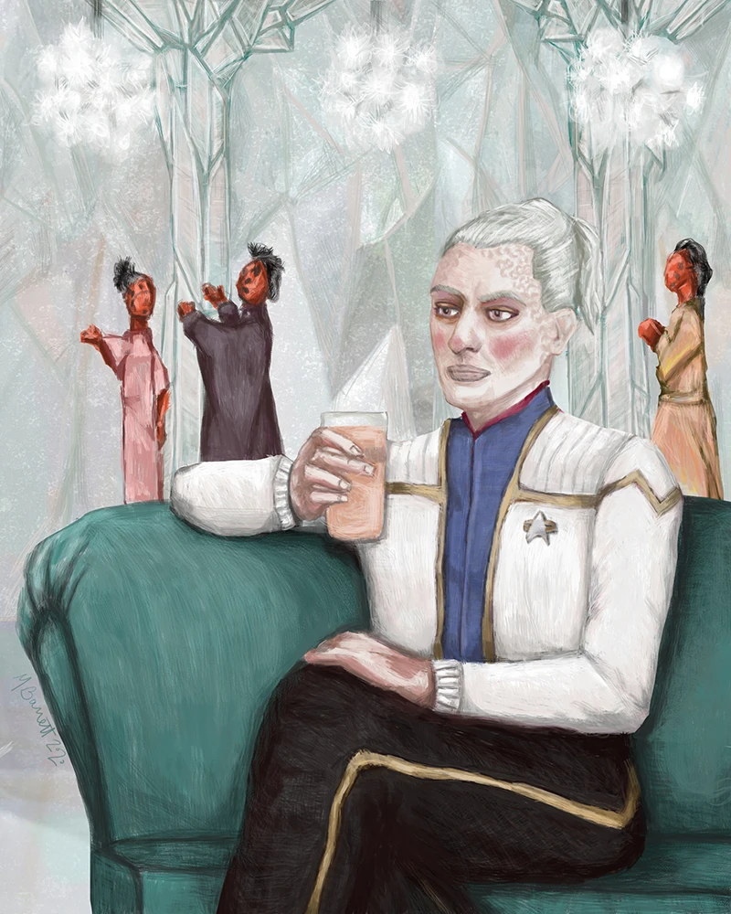
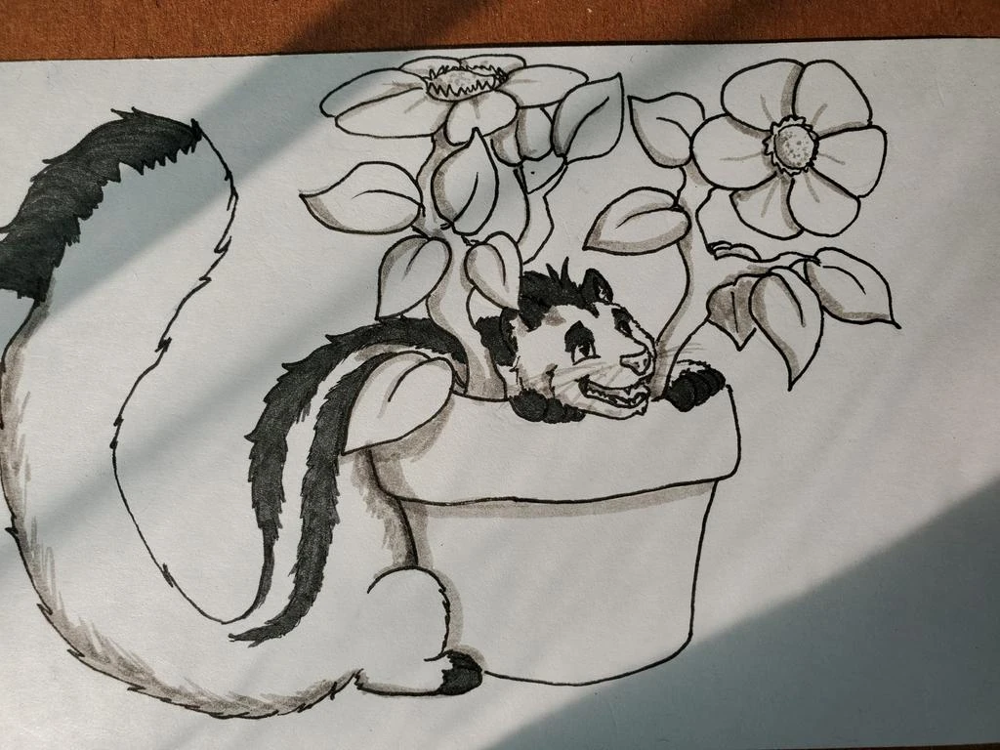
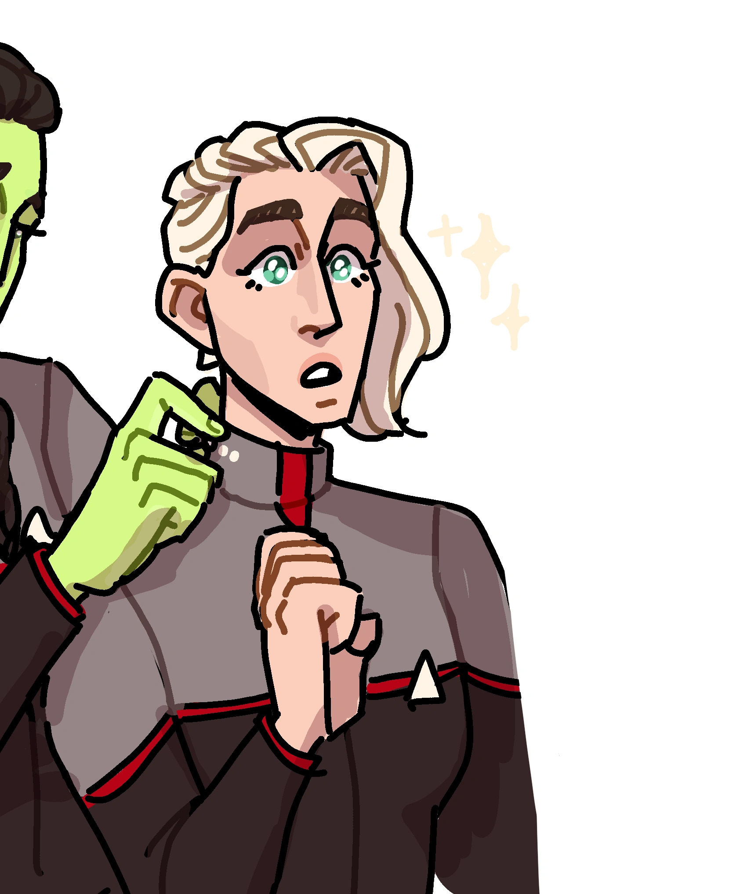

# Episode 14 Farther from Home pt. 1

- **Source:** https://clear-skies-rpg.fandom.com/wiki/Episode_14_Farther_from_Home_pt._1
- **Retrieved:** 2026-11-16
- **Wiki page ID:** 293
**Episode 14 — Farther from Home pt. 1**

| Field | Value |
| --- | ----- |
| Air date | 05/11/2020 |
| Run length | 170min |
| Broadcast | Twitch [YouTube](https://www.youtube.com/watch?v=RlZgJ_pBDKU) [Spotify Podcast](https://open.spotify.com/show/4XRHFGJ4s4EV7LufmohEnQ?si=_ryT3XVATmiTtDsrx3Yt8w) |
| Cast | Eric Campbell Revati Dhomse Gina DeVivo Sam de Leve Aki Xander Jeanneret Bonnie Gordon |
| Previous | [Episode 13 Food of the Gods pt. 3](ep-13-food-of-the-gods-pt-3.md) |
| Next | [Episode 15 Farther from Home pt. 2](ep-15-farther-from-home-pt-2.md) |

> "Out here, I **am** Starfleet."
>
> — April Hebert

## Plot Synopsis
### Brief Overview
The information given by Ree is provided to the Federation, and the [J'Shashians](../characters/jshashia.md) host a grand party for their new alien allies, with Admiral April Hebert in attendance. During the party she gets a priority one message, and tells command staff of the [USS Ross](../ships/uss-ross.md) that they've been temporarily reassigned to Starbase 105, to deal with a diplomatic situation.

The Ross returns Hebert to Narendra Station first, and along the way she promotes EXEO to the rank of Commander.

When the Ross arrives at Starbase 105 they find a Ferengi trade ship docked. Captain Sull and EXEO are ordered to meet with the admiral of the station, and are introduced to Skrag, who was delivering a 'package' for Starfleet Command. The package turns out to be a Vorta and two Jem'hadar soliders.

### Pre-Break
The episode opens three weeks after [Episode 13 Food of the Gods pt. 3](ep-13-food-of-the-gods-pt-3.md). Since the events of [Episode 13 Food of the Gods pt. 3](ep-13-food-of-the-gods-pt-3.md), the [J'Shashia](../characters/jshashia.md) population has been made aware of the events, Jateran has become an official ally of the United Federation of Planets, and the Federation has established it's first subspace relay in the [Shackleton Expanse](../locations/shackleton-expanse.md). The J'Shashian population have been overjoyed to meet their new interstellar friends. ADM Hebert has expressed her extreme satisfaction with the performance of [USS Ross](../ships/uss-ross.md).

The data provided by Ree has been sent to the Federation at large. From it, starfleet scientists have been able to determine that the electromagnetic and gravimetric eddies have not always been present in the Shackleton Expanse. They have also identified thousands of migratory patterns of creatures which live in deep space, including creatures of the same [species](https://memory-alpha.fandom.com/wiki/Space_vessel_lifeform) encountered at Farpoint Station.

The scene opens during a large party at the Palace of the High Regent. The entire senior staff, as well as much of the crew, are present, along with J'Shashian politicians, celebrities, and other influential people. Some of the bridge crew are getting a little exhausted answering all of the questions of the J'Shashians, but not LTCDR EXEO, who is in top form. AMB Olyn is also in their element, and sticking close to CAPT Sull to assist them. Sull and LTCDR M'Qrell are of particular interest; Sull as the captain, and M'Qrell as the person most alien to the J'Shashians. Hebert is having a wonderful time, free from the responsibilities of being a Starfleet admiral. MCPO Theq is holding court in one corner of the palace, dressed in the classic ["skant"](https://memory-alpha.fandom.com/wiki/Starfleet_uniform_%282350s-2370s%29%23Skant) uniform. The J'Shashians enjoy bringing him all sorts of different foods to taste, and he is loving it.

Meanwhile, LT Vrenn, LTCDR Prahl, and LTJG Lakat are hiding nearby. Vrenn has been getting a lot of questions about his antennae, to which his responses are getting increasingly bizarre. Lakat was "done" after about 20 minutes. Prahl is just uncomfortable. Lakat threatens violence against any more annoying questions, which surprises Vrenn and Prahl. Lakat deflects by suggesting they play "two truths and a lie." After an awkward encounter between Prahl and a J'Shashian woman, Theq stumbles over (clearly drunk) with an orange beverage in his hand. He notices that Prahl has the same drink, and the group realizes that Prahl is drunk. The others are excited at the prospect. Lakat asks Prahl what he does for fun, and he replies that he broods. Vrenn suggests that they all should brood together. EXEO notices them and walks over. Vrenn lets her know that Prahl is drunk, and she advises them all not to be too cruel with him.

EXEO rejoins Sull, Olyn, and M'Qrell, as M'Qrell poses for yet another selfie with a J'Shashian. High Regent [Keel](../characters/alu-zazz-keel.md) walks over, having the time of his life. Hebert joints them, wearing an uncharacteristic smile. She requests to have a meeting with EXEO and Sull in Sull's ready room the next morning. Suddenly, EXEO, Sull, and Hebert all get an incoming message from USS Ross. YEO3 Azzmi informs them that a priority 1 message has arrived from Starfleet command for Hebert. Hebert excuses herself and transports up to USS Ross. Keel comments that he loves watching the transporter process, and EXEO comments "Imagine how it feels."

M'Qrell walks over to Prahl and Theq. She scans the orange drinks they've been having, and then hands Lakat two hyposprays, "for the headache later". Lakat says that she will not be the responsible one, so M'Qrell hands them to Vrenn. As M'Qrell leaves, Vrenn turns to the others and suggests they dare him to inject both at once. M'Qrell's ears twitch as she walks away and Lakat grabs the hyposprays.

10 minutes later, EXEO and Sull get a communication from Hebert. She informs them that USS Ross has been ordered to return to Narendra Station at maximum warp. The crew needs to leave. Keel is sad to hear that they have to go. Sull extends a hand to Keel. They dance him around the room, gathering up all of the crew one-by-one as they move. Keel is exhilarated by the dance. Vrenn offers to teach him swing dancing when they next return. Sull wonders aloud if he does East Coast or West Coast swing dancing. Sull tells Prahl they are leaving, and Prahl immediately calls CPO Singh for a transport. Theq asks for one of the hyposprays and Lakat gives it to him. She pockets the other. Sull notices and deftly pickpockets it from her, handing it to Vrenn. The crew starts transporting back to USS Ross.

On the transporter pad, Hebert orders senior staff to the bridge. M'Qrell administers a hypospray to Prahl, since he never got one on the planet. In the briefing room, Hebert explains that she got very little information from Starfleet command. USS Ross is ordered to Narendra Station at maximum warp, after which they're being temporarily reassigned to Starbase 105. USS Ross will receive further orders once there. She says she has reached out to CDR Sivek, and there is no emergency at Narendra Station. Apparently, there is some diplomatic crisis that USS Ross needs to solve. Sull asks Hebert who sent the orders. Hebert replies that it was [ADM Janeway](https://memory-alpha.fandom.com/wiki/Kathryn_Janeway). Hebert compliments the work of USS Ross and her crew. She says she submitted a commendation for them.

As everyone leaves Olyn asks Lakat to join them for tea, and Hebert asks Sull to stay behind. Once alone, Hebert asks about Dr. Wellix. She asks about his medical condition, and Sull reports that he is degrading. Hebert comments that his life is in Sull's hands; Starfleet Intelligence probably isn't interested in him anymore. She asks Sull what they require to handle the situation. Sull replies "leeway." Sull heads to the bridge and watches Jateran slip away as USS Ross departs. EXEO walks over and offers Sull a cryptic "thank you." Sull replies "it's about damn time".

The scene moves to Olyn's quarters. Their quarters are full of plants, with a wide space in the center for Patience. There are various paintings and art from their travels, and a small kitchenette with a dining table. Lakat walks in with Orwell. Olyn can tell that she's angry, but not at them. Lakat begins venting about their "detour" away from the Shackleton Expanse. She says that she knew the data from Ree was too good to be true; USS Ross will never get to explore since they are too busy ferrying people around. She asks Olyn to use their negotiation skills to get Starfleet to let USS Ross stay. Olyn asks Lakat if she wants her regular drink; Lakat says "yes", but without alcohol since she's given up drinking (for the last three days, at least). Olyn asks Lakat how she is doing, and Lakat returns the question. Olyn says they are exhausted, elated, ecstatic, and confused. Lakat agrees with the exhausted part. Olyn says they are glad Lakat didn't throat punch anyone, but she thinks Lakat is better at socializing than she lets on. They say her enthusiasm is why they recommended her to Starfleet in the first place. Lakat thanks Olyn for being with her on the ship.

Olyn changes subjects, asking about the competition between the Science and Engineering departments. She asks why Lakat didn't invite Theq to join. Lakat says that opening up to Theq hits her too close to home. She doesn't think Theq likes her very much, and tells the story about her comment about his brother. Olyn suggests inviting Theq to join the competition might be an olive branch, and Lakat agrees to think about it. Olyn tells Lakat they are proud of her, and Lakat falls silent. The two of them move on to lighter subjects, as Orwell gets into a fight with a potted plant, and the plant wins.

### Post-Break

The next morning, EXEO is standing on the bridge as alpha shift begins. Sull and Hebert arrive, and EXEO greets them. Hebert moves the three of them to Sull's ready room. Hebert says one advantage of being so far away from the rest of the Federation is that she gets to do what she wants. She awards EXEO the rank of commander. Sull pins the pip to EXEO's collar. Hebert reminds her that she'll have to make a holographic pip herself. EXEO's cheeks go pink, and she begins to stutter a little. She says she is honored to receive the rank. Hebert invites her to go to the bridge, saying "There is a tradition to uphold." EXEO steps onto the bridge as the entire bridge staff applauds. EXEO reflects that she is surrounded by family. She thanks them all, and leaves (it's not her shift). EXEO goes to her quarters, and on the way she is greeted by applause in every corridor. She checks her messages, and finds she has one from Dr. Redgrave. It's a minor update; just checking in. Redgrave has quit smoking. EXEO composes a reply, informing her about the promotion, and thanking her for quitting smoking. She says that she has been inspired by Redgrave, and she hopes to be able to inspire those around her.

EXEO begins to compose a personal log about asking Theq for more 'memory food', when Theq chirps at the door. He has made her something, a mug of hot, steaming liquid. The mug reads "______.exe", and whenever EXEO sips from the mug, it will read her emotional state. As EXEO drinks, it evokes the memory of the crew applauding her. The mug reads "blissful.exe". Theq explains that, anywhere she goes on the ship, it will show her the crew there applauding. She thanks him, saying "this is perfection; you are perfection." She asks if he will make her something that evokes the smell of cigarette smoke.

Meanwhile, Lakat calls Azzmi to ask for a favor. Azzmi replies to meet her in holodeck 1. Lakat walks in very professionally, trying to be impressive. Inside the holodeck, she sees Prahl, Azzmi, and LT Selar engaged in zero gravity combat. They are wearing combat suits, using dummy phasers, and bouncing around in pure chaos and glee. As Lakat watches, Selar collides with Prahl and throws him across the room, but Azzmi hits him from above with a shot. Lakat feels jealous that she wasn't invited. As the three step out, Lakat declares Azzmi the winner. Azzmi asks Lakat what she wants, and Lakat replies that she needs help looking into somebody. She needs to find out about a dead person, and all she has is a name, species and some general information. Azzmi says that she needs to go change, and leads Lakat to the turbolift. In the lift, Lakat attempts some awkward small talk, before giving up. Azzmi adds "at least you tried." They get to Azzmi's quarters, which are full of Bajoran spiritual paraphernalia. Lakat is very uncomfortable being in someone else's space. When Lakat gives her the information about who she is looking for, Azzmi replies "you're looking for Theq's brother?" Azzmi remarks that she read Lakat's file, and she thinks it's very impressive. She asks if saying that makes Lakat uncomfortable, and Lakat says "yes". Azzmi suggests they hang out, and Lakat suggests 10 Forward and some BINGO. Azzmi asks if they can establish that the two are friends now, and if she can ask a question as a friend. Lakat agrees. Azzmi asks about Dr. Wellix, and Lakat replies evasively. Azzmi sees through Lakat's deception, but lets it drop. The two go to 10 Forward.

In sickbay, M'Qrell is working when Prahl walks in. His arm was dislocated when Selar threw him, but he tells M'Qrell that he walked into a wall. M'Qrell resets the shoulder, and gives him a hypospray for the pain. Prahl apologizes for getting angry with her after the mission on [Space Ring Observer](../locations/space-ring-observer.md) ([Episode 09 New Civilizations](ep-09-new-civilizations.md)). M'Qrell accepts the apology. She also reflects on Vrenn. She says that people think he is a bright light, but she sees darkness within him. Prahl agrees, noting that Vrenn served in the Dominion War. Prahl mentions that the Dominion War wasn't Prahl's first war, since he is joined. Prahl says he sees a lot of Vrenn in M'Qrell; they both smile a lot to hide something else. M'Qrell replies, "Some smiles can be genuine while being weighted down". Prahl leaves.

The scene moves to Narendra Station as USS Ross arrives. Vrenn reports that there are no other starships present, just normal civilian traffic. Hebert steps onto the bridge. Olyn asks her if people are playing nice on the station, and Hebert says "yes", praising Sivek. Olyn feels a spike of irritation from Prahl at the mention of Sivek's name. Sivek hails USS Ross, and says there is another priority 1 message for Hebert. She asks if it is ADM Mestis, and Sivek says "yes". Hebert requests a site to site transport to her office. A few minutes later she hails USS Ross. She says USS Ross is ordered to go to Starbase 105 to meet with Mestis. Hebert says she can tell Mestis is angry about something. USS Ross should expect to meet an "independent liaison" at the starbase, and to proceed at maximum warp. USS Ross makes the 8 day journey uneventfully.

At Starbase 105, Vrenn reports that there is a Ferengi [D'kora class](https://memory-alpha.fandom.com/wiki/D%27Kora_class) trader docked with the station. The starbase hails USS Ross, and says Sull and EXEO are to report to Mestis' office immediately. At the admiral's office they meet a young [Tellarite](https://memory-alpha.fandom.com/wiki/Tellarite) officer on their first day as the admiral's assistant. They are invited in, he greets them and they move to his ready room down the hall. They see two people: Mestis, who is a [Saurian](https://memory-alpha.fandom.com/wiki/Saurian_%28species%29) with deep pink skin and bright yellow eyes, and a Ferengi DaiMon dressed in finery. The Ferengi is introduced as DaiMon Skrag. Mestis explains that Skrag is a courier for something from Starfleet command. He has some sort of package, but Mestis doesn't know what it is. Skrag demands payment before he delivers the "package", but Mestis doesn't agree. EXEO tries some (very effective) flattery, but Skrag recovers and holds his ground. Mestis insists on delivery before payment, and Skrag finally relents. Skrag explains he has been a courier for a diplomatic contingent that needed to get to the Beta Quadrant discreetly. He says they are prepared to transport directly to the admiral's office. Mestis orders security to report to his office, and then agrees to the transport. Skrag states that he wants nothing more to do with his 'guests' and expects to wash his hands of the whole affair. Mestis agrees, and Skrag calls his ship, Liquidator, and they transport over...

A [Vorta](https://memory-alpha.fandom.com/wiki/Vorta) and two 7-foot tall [Jem'Hadar](https://memory-alpha.fandom.com/wiki/Jem%27Hadar).

## Cast
-  Eric Campbell - Game Master
-  Revati Dhomse - Jane Lakat
-  Gina De Vivo - EXEO
-  Sam de Leve - Azeri Sull
-  Aki - Olyn Madzhin-Nil
-  Xander Jeanneret - Theq Lynadas
-  Bonnie Gordon - M'Qrell

## Non-Player Characters
-  Zhyliss Vrenn
-  Yeri Prahl
-  Azzmi Shanto
-  [Alu Zazz Keel](../characters/alu-zazz-keel.md)
-  April Hebert
-  Selar
-  Sivek
-  Mestis
-  Skrag

## Locations
-  [Jateran](../locations/jateran.md)
-  Narendra Station
-  Starbase 105

## Notable Lines
> "If someone else asks me a question about prosthesis, I'm going to punch them in the throat. Just kidding, I don't do that anymore."
>
> — Jane Lakat
> "I was going to tell you about what I do for fun, but I actually realized that is not a very pleasant list."
>
> — Jane Lakat
> "We're brooding for Prahl; it's the name of our group now. We're 'Brooding for Prahl.'"
>
> — Zhyliss Vrenn
> "I'm thankful for you, Olyn. And I'm not very good at expressing that, and I don't think I will be for a long time."
>
> — Jane Lakat
> "He broods for fun."
>
> — Jane Lakat *(about Yeri Prahl)*
> "Out here, I **am** Starfleet."
>
> — April Hebert
> "There's a lot of people who I've heard talk ... that I didn't deserve this position. So, to receive this honor after proving myself, to myself, is more of an honor than you can possibly imagine."
>
> — EXEO
> "I'm going to go be commander in a different room ... so that I do not break protocol by crying."
>
> — EXEO
> "Some smiles can be genuine while being weighted down."
>
> — M'Qrell

## Notes and Trivia
-  Eric stated at the end of the episode that he had always wanted to play a Vorta in a Star Trek Adventures game.
