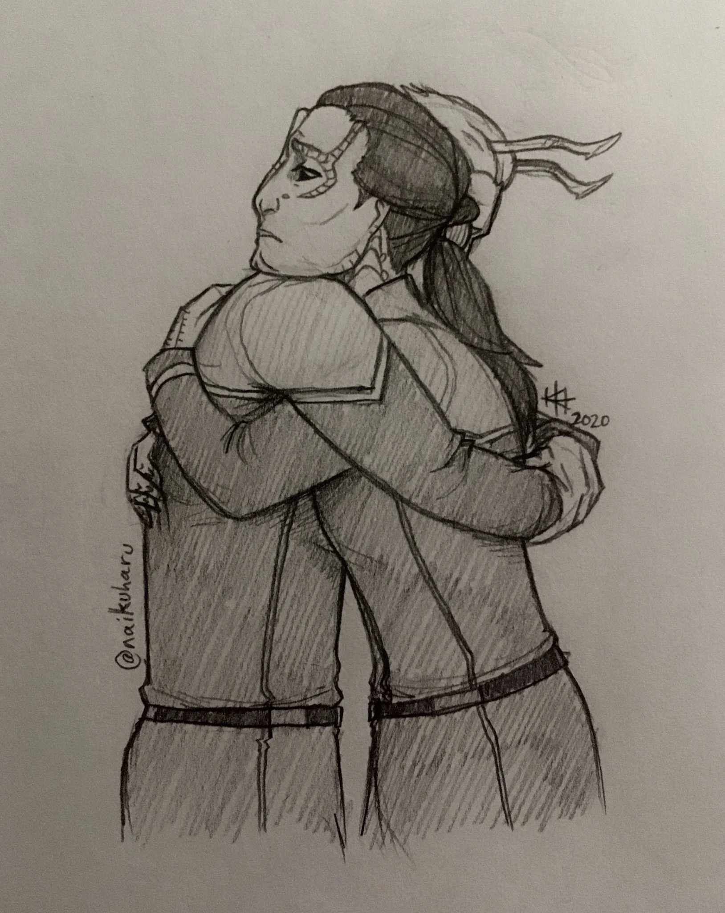
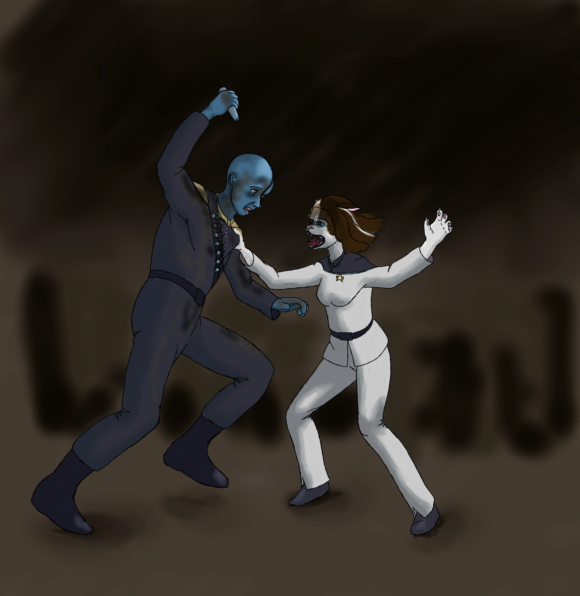

# Episode 16 Farther from Home pt. 3

- **Source:** https://clear-skies-rpg.fandom.com/wiki/Episode_16_Farther_from_Home_pt._3
- **Retrieved:** 2026-11-16
- **Wiki page ID:** 295
**Episode 16 — Farther from Home pt. 3**

| Field | Value |
| --- | ----- |
| Air date | 05/25/2020 |
| Run length | 187min |
| Broadcast | Twitch [YouTube](https://www.youtube.com/watch?v=xjbt_adhGc4) [Spotify Podcast](https://open.spotify.com/show/4XRHFGJ4s4EV7LufmohEnQ?si=_ryT3XVATmiTtDsrx3Yt8w) |
| Cast | Eric Campbell Revati Dhomse Gina DeVivo Sam de Leve Aki Xander Jeanneret Bonnie Gordon |
| Previous | [Episode 15 Farther from Home pt. 2](ep-15-farther-from-home-pt-2.md) |
| Next | [Episode 17 Farther from Home pt. 4](ep-17-farther-from-home-pt-4.md) |

> "You already know that there isn't a single person on this ship that wouldn't do anything for you, Lakat. Just don't forget that."
>
> — Yeri Prahl

## Plot Synopsis
### Brief Overview
Sull gathers the senior staff of the [USS Ross](../ships/uss-ross.md) to let them know what's going on. Everyone is tense, but M'Qrell promises to keep Wellix from seeing the visitors. Soon afterward, Nadran and his Jem'hadar beam over and are met by Olyn and a security team led by Prahl. They're escorted to a diplomatic suite through the promenande, where many of the Aux crew see them for the first time. Olyn is overwhelmed by the crew's feelings, but Sull uses their pheromones to calm them down.

Lakat and Vrenn decide to take a walk, where he tells her about his experiences during the war. Theq finishes building a device to test if someone is a Changeling. M'Qrell heads to Wellix's quarters and asks his permission to use Borg nannites in an experimental treatment to halt his degradation. Back in the diplomatic suites, Nadran tells Olyn and Sull that the Changeling is hiding on a pirate haven, and that the mission to retrieve this Changeling was authorized by [Odo](https://memory-alpha.fandom.com/wiki/Odo).

The Ross departs, and Prahl detects another strange warp signature. He shows this to Lakat, and they agree it may be a ship following them, and that it might have something to do with Wellix. Meanwhile, M'Qrell enters Theq's holodeck lab and is attacked by a paranoid Theq. He gives her his Changeling test, and she helps calm him down.

During the trip, Nadran makes a nuisance of himself, wearing out both Sull and Olyn. Sull confers with EXEO about Rhee's reason for giving them this mission, and Olyn asks Lakat to come sleep in their room, so neither of them are alone.

The next day the Ross arrives at Yukani Prime. Sull hails the planet, and is eventually greeted by a handsome Orion man.

### Pre-Break
The episode opens at the time appointed by ADM Mestis as the beginning of the mission, 0800. Senior staff gathers in the briefing room. CAPT Sull tells them the news about their mission to assist a Vorta, Nadran, and two Jem'Hadar, Ik'tat Et'lan and Ven'it Rex locate and retrieve a Changeling. MCPO Theq requests permission to build devices which can identify Changelings, developed during the Dominion War. Sull approves. AMB Olyn senses a cold, deadly rage building in LTCDR Prahl, LTCDR M'Qrell, LTJG Lakat, and Theq. M'Qrell expresses concern about the crew's composure. Sull replies that they have faith in their crew. Prahl requests permission to assign a permanent security team to Nadran and the Jem'Hadar, which Sull approves. LT Vrenn asks why there is so much secrecy; Sull replies evasively, which speaks volumes. Lakat confirms with Sull that the orders are from Starfleet. Sull asks M'Qrell to make sure Dr. Wellix is stable enough to avoid the "guests". M'Qrell asks if he should be made aware of the Dominion representatives; Sull says yes. M'Qrell says she will ensure they never meet. Olyn offers to use their empathic abilities to help reduce the crew's anxiety, but Sull suggests they focus on keeping Nadran occupied, instead. Prahl and M'Qrell suggest confining the "guests" to their quarters or the brig, respectively. Sull states that they will have free access to all non-secure areas of the ship. Lakat is having a hard time processing the situation.

The scene moves to the transporter room. CPO Singh begins the transport. The Jem'Hadar arrive fully armed, with rifles, sidearms, and blades. Nadran greets Olyn warmly, and he is clearly familiar with their work. Prahl enters with four security officers. Olyn and Nadran verbally spar. Olyn gets a little emotional (their mental state having been influenced by Lakat). Nadran orders the Jem'Hadar to disarm, and they do. The group moves to the diplomatic suites on the promenade. A large amount of the crew are gathered there, and they stop at the sight of the Jem'Hadar. Olyn receives a spike of anxiety from them all. Nadran speaks admiringly of the promenade, and he is clearly already familiar with USS Ross. He remarks that Federation ships have an air of comfort, while Dominion ships are all about power and efficiency. The group moves inside. Olyn stops Sull on the way in. Olyn tells Sull that they think they are too affected by the crew and their own emotions to handle Nadran. Sull says that Olyn leaving is a sign of weakness, and asks if Olyn will stay with them. Sull uses their pheromones to broadcast a calming effect. Sull looks to Nadran and the Jem'Hadar to see if the pheromones are affecting them; they are.

Meanwhile, on the bridge, Vrenn and Lakat sit at their stations. Vrenn is clearly pretending to work; he is pushing buttons randomly and humming to himself. Lakat gets the impression that he might be here to support her. Lakat stands up and loudly declares that she needs to take a walk; she hopes Vrenn will get the hint and follow, which he does. They enter the turbolift together. Lakat starts randomly pushing buttons to keep it moving. Lakat asks Vrenn how he is doing, and he replies that he is terrified. Lakat asks if she can speak openly with him. She says that she is going to need his help as a friend in order to not kill the Vorta. Her tone is deadly serious. Vrenn stops the turbolift. He says that war wounds don't heal fast, and he knows from personal experience. Lakat points out that he doesn't talk about the war often. Vrenn replies that he is her friend, so he will tell her the story.

He was part of a joint operation with Klingons. The mission to infiltrate a Dominion detention center where Starfleet officers were being held and tortured. He was the shuttle pilot. The detention center was in a nebula, which was mined. The Klingon shuttle hit a mine, and collided with his shuttle. They both went down onto an asteroid. As the Starfleet personnel were preparing to evacuate, Jem'Hadar soldiers swung open the doors to the shuttle and started gunning them down. The Klingons got behind the Jem'Hadar and took them down. The remaining six Starfleet officers requested to abort the operation, but they were ordered to proceed in the Klingon shuttle. They got in the shuttle and proceeded to the detention center. The Starfleet prisoners had already been executed. He was given a promotion, a medal, and a choice of commands.

Vrenn says that he was falsely labeled a hero, he didn't do anything worthy of the label. Lakat asks him to turn around, and she cries silently. She composes herself, and tells him to turn around again. When he does, he is also crying. Vrenn tells Lakat to avoid Nadran at all costs. If he sees a Cardassian in a Starfleet uniform, Nadran is going to take advantage of the situation. Lakat says telling her "no" makes her want to do it. They laugh together. Lakat hugs Vrenn.

Meanwhile, Theq has holed himself up in his holodeck lab/kitchen. He begins assembling the Changeling tests. When he's finished, he calls Prahl. Theq informs him the test are complete, and suggests they begin testing Nadran, the Jem'Hadar, and the Starfleet security detail immediately. Prahl agrees.

In the diplomatic suits, Nadran tells Sull, EXEO, and Olyn that they have the location of where the Changeling was working six years ago. They believe the Changeling is located in the Yukovar System. Sull is familiar with that system; it is a legendary pirate haven which the Federation never found. Sull asks why the Dominion have waited six years to retrieve the Changeling. Nadran replies that he is only three years old, and is not privy to the will of the Founders. He also says the mission was authorized by [Odo](https://memory-alpha.fandom.com/wiki/Odo). Olyn is surprised, and says that if Odo authorized the mission, it must be for a good reason. Nadran makes a point to say that Odo knows what it's like to be left behind, and Olyn comments that many people on USS Ross also know that feeling. Nadran says that he is sorry to hear that. EXEO tries to read Nadran's expressions. She gets the feeling that Nadran feels genuine reverence and adoration for Odo, but that all of his expressions of empathy and kindness are a lie. She is unable to determine if he is lying about Odo authorizing the mission.

### Post-Break
Meanwhile, M'Qrell goes back to her quarters and violently rips off some leaves off of her tea plants. She makes herself a strong cup and heads to Wellix's quarters. He invites her in. She says that she needs his consent for a radical idea for treatment. She wants to use modified Borg nanites. He says that he will wait until he hears what Sull thinks about the plan. She tells him that he needs to keep a low profile, and begins to explain the situation. She asks if he took part in the war, but he says he doesn't remember. M'Qrell says that she took an oath to help all people, but that she considers Vorta and Jem'Hadar to be monsters, not people. When she finishes explaining the situation, he is surprisingly nonchalant. He says that he admires the Dominion for their strength, despite hating them. She tells him to stay away from them, and he agrees. Wellix asks M'Qrell how she is going to hold back her fury when she encounters the "monsters". M'Qrell replies that she is a healer now, and advises Wellix not to make an enemy of her. He replies that he might be her only real friend.

The scene moves to the bridge, as USS Ross is about to depart. Mestis hails them. He says that he will keep asking questions, and that they have a friend in him and ADM Hebert. He is clearly furious with the admiralty, and not afraid to let the entire bridge crew of USS Ross know it. USS Ross departs for the Yukovar System. It is 12 hours away. Prahl asks for a moment with Sull. He reports that, as USS Ross departed Starbase 105, he detected another mysterious warp signature, similar to what they saw at [Jateran](../locations/jateran.md).

1.5 hours into the journey, Prahl speaks to Sull again. He says the Dominion guests wish to leave their quarters. Nadran wishes to see 10 Forward. Sull refuses, and says that Solun will provide them drinks on the promenade, instead. Sull suggests Olyn attend them, and EXEO offers her assistance, as well.

Later, Lakat is in her quarters when she gets a chirp at the door. Prahl is there, and asks to come inside. Lakat hesitates, but consent. Sensing her discomfort, Prahl suggests they use a meeting room instead. They head to one. Prahl asks how Lakat is doing, but she says they should get to business. Prahl tells her that they've seen the vanishing warp signature again. She brings up the sensor logs from Jateran, and he brings up the logs from Starbase 105. Lakat compares them, and determines that there are similarities, but it's not conclusive. Prahl asks what she thinks, and she agrees with him that it's a ship. He asks her why she thinks someone would be following them, and she says it has something to do with Wellix. Prahl agrees. Prahl says that it's strange if Romulans are following them, since their cloaking technology is near perfect; they shouldn't see any warp signatures from a Romulan ship. Lakat suggest bringing the information to Theq. She also suggests talking to M'Qrell about having Wellix help them. She codes the sensors to alert her if the signature is detected again.

Prahl asks Lakat if he can speak honestly; she replies that she hopes he always does, but he says that isn't the case. Lakat is surprised, and asks if he has ever directly lied to her. He says that he has. She is clearly displeased, but moves on. She speculates that Wellix might be a Changeling and laughs, but Prahl isn't laughing. He says that, during the war, sometimes there actually *were* Changelings present, and that her suspicious nature is a good thing. Lakat asks how he is handling having Jem'Hadar aboard. He says that he is fine, because he is confident he can kill them if they get out of hand. As they get ready to leave, Prahl says he will talk to Sull about having Wellix assist them with the vanishing warp signature. Lakat notices that he harbors some rage at Wellix for taking a Trill persona.

Meanwhile, Theq is in his lab/kitchen on Holodeck 4. Theq calls M'Qrell and asks her to come down. As M'Qrell enters the holodeck, she sees that the space is in complete disarray. Theq attacks her from behind, screaming and swinging a metal cylinder as a weapon. M'Qrell, already a ball of stress, mistakes him for a Jem'Hadar and strikes. For a moment, Theq thinks she is going to kill him, but she throws him against the wall instead. When M'Qrell calms down, she can see that Theq is covered in dirt and grime, he is wearing a bandoleer of metal cylinders, and his eyes are wide with paranoia. He demands that she prove she isn't a Changeling. She takes the test, and also cuts her arm with a claw, showing him her blood. He begins repeating "it's happening again", and sinks to the floor. M'Qrell kneels down next to him, and tries to reassure him. He calms down, and she takes him to sickbay.

Over the next 12 hours, the Vorta constantly makes requests for tours of the ship, and specifically asks Olyn to attend him. He asks to go to secure areas, and generally makes a nuisance of himself. At some point in the journey, as Sull goes to their quarters, they see Prahl waiting outside. He requests permission to have Wellix assist him and Lakat with the vanishing warp signature. Sull asks for his reasoning, and he replies that it is gut instinct. They give him permission, and Prahl says he will wait until the current mission is over. EXEO calls Sull, asking for a meeting; Sull approves. When they meet, EXEO asks Sull if the current mission is a "gift" from ADM Rhee, so Sull can finish their task of taking down the Changeling they had been pursuing during the war. Sull points out that Rhee was the one who helped them get away from intelligence work. EXEO counters that, since their departure, they've been repeatedly dragged into intelligence activities. Sull replies that they would do anything for Rhee, so it doesn't make sense for Rhee to be sneaky, unless he had concerns about security at Starfleet Command. Sull points out that their cover was burned in the syndicate, so they might be a last resort. EXEO speculates that perhaps Rhee picked Sull because he wants them to question the orders. They say goodnight.

The focus moves to Olyn. They are exhausted. Before retiring for the night, they go to Lakat's quarters. Lakat opens the door, but Olyn doesn't enter. They tell Lakat to pack a bag, she is sleeping at Olyn's tonight. Lakat asks Olyn if they don't trust her to be by herself; Olyn replies that they are the one who shouldn't be alone.

The scene moves to USS Ross arriving in the Yukovar system. Lakat detects heavy gravitational and magnetic interference in the sector. The Yukovar system has three stars; there are two main sequence stars orbiting a neutron star. There is one class M planet, with an asteroid belt nearby. The class M planet, Yukani Prime, is barely class M. It has extremely high surface temperatures, and has only a small amount of plant life and trees on the surface. Below the surface, it is habitable. Lakat scans the planet and detects a colony with about 10-15 thousand life forms and a lot of space ship traffic.

Sull asks if there is anything USS Ross could hide behind on their approach to the planet. Vrenn points out the asteroid belt, but add that there is probably a sensor net inside. Sull directs Vrenn to enter the asteroid field. Once inside, Lakat does another scan, and finds six unarmed sensor buoys. Sull orders Vrenn to have USS Ross "pose for the cameras". Lakat scans the planet again and detects large amounts of Kelbonite deposits, which make transporting to or from the planet impossible.

Sull hails the colony. A disheveled human appears. When Sull mentions their name, he disappears. A few minutes later, an Orion appears on the view screen. The person is wearing a thick leather jacket and an eye patch. He has broad shoulders, and a handsome face. He leans back with a swagger and says...

"Captain Sull, I have been waiting to meet you for so long."

## Cast
-  Eric Campbell - Game Master
-  Revati Dhomse - Jane Lakat
-  Gina De Vivo - EXEO
-  Sam de Leve - Azeri Sull
-  Aki - Olyn Madzhin-Nil
-  Xander Jeanneret - Theq Lynadas
-  Bonnie Gordon - M'Qrell

## Non-Player Characters
-  Zhyliss Vrenn
-  Yeri Prahl
-  Amandeep Singh
-  Nadran
-  Il'kat Et'lan
-  Ven'it Rex
-  Tirazz
-  Mestis

## Locations 
-  Starbase 105
-  Yukovar System
-  Yukani Prime

## Notable Lines
> "I don't know how I'm going to do this."
>
> — Jane Lakat *(about having a Vorta onboard)*
> "I don't know, Lakat, I don't know if I have any answers for you. Maybe sometimes it's just nice to hurt with somebody."
>
> — Zhyliss Vrenn
> "I think that anyone who knows me will tell you that the one consistent way to get me to do anything is to tell me not to do it."
>
> — Jane Lakat
> "It's amazing what you can learn when you don't say anything."
>
> — EXEO
> "I've been in the room with predators before, doctor. I know when I'm talking to one."
>
> — Wellix *(to M'Qrell)*
> "We all have monsters inside."
>
> — M'Qrell
> "This is not going to lay quietly. I assure you."
>
> — Mestis
> "You already know that there isn't a single person on this ship that wouldn't do anything for you, Lakat. Just don't forget that."
>
> — Yeri Prahl
> "It's happening again, doc. I need you to prove that you're you."
>
> — Theq Lynadas *(to M'Qrell)*
> "Doc, I might be the only real friend you have on this ship."
>
> — Wellix *(to M'Qrell)*

## Notes
-  Theq and M'Qrell's fight is the first case of PVP in Clear Skies.
