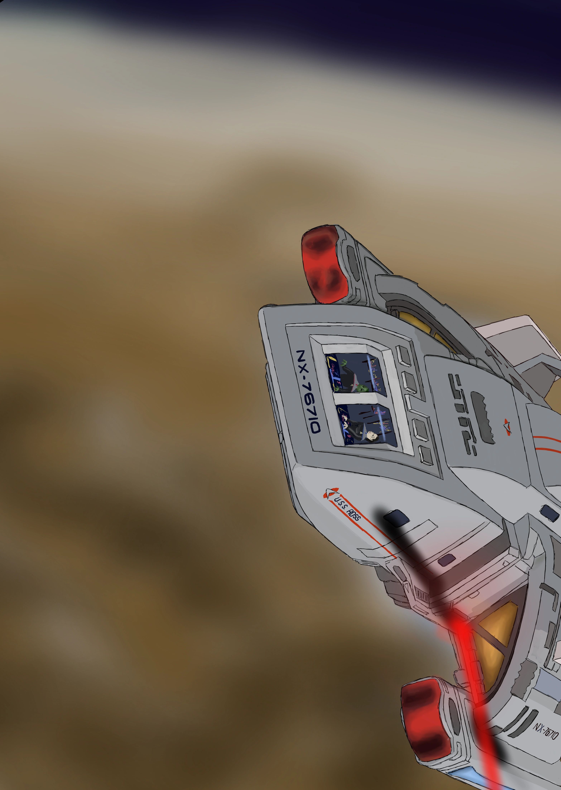

# Episode 18 Farther from Home pt. 5

- **Source:** https://clear-skies-rpg.fandom.com/wiki/Episode_18_Farther_from_Home_pt._5
- **Retrieved:** 2026-11-16
- **Wiki page ID:** 297
**Episode 18 — Farther from Home pt. 5**

| Field | Value |
| --- | ----- |
| Air date | 06/08/2020 |
| Run length | 171min |
| Broadcast | Twitch [YouTube](https://www.youtube.com/watch?v=Qxuslg1hPKg) [Spotify Podcast](https://open.spotify.com/show/4XRHFGJ4s4EV7LufmohEnQ?si=_ryT3XVATmiTtDsrx3Yt8w) |
| Cast | Eric Campbell Revati Dhomse Gina DeVivo Sam de Leve Aki Xander Jeanneret Bonnie Gordon |
| Previous | [Episode 17 Farther from Home pt. 4](ep-17-farther-from-home-pt-4.md) |
| Next | [Episode 19 Farther from Home pt. 6](ep-19-farther-from-home-pt-6.md) |

> "I want the record to show it was not my fault that we got shot."
>
> — Jane Lakat

## Plot Synopsis
### Brief Overview
The away team shuttle is fired on by two Nausicaan raiders, which turn to flee as the [USS Ross](../ships/uss-ross.md) intercepts. Captain Sull makes it back to the bridge, and intimidates the raiders before snatching one in a tractor beam. There's some combat, but eventually the crew of the third ship is beamed into the Ross's brig.

However, moments later the pirates are out of the brig, using personal transporters. The fight on the Ross resolves quickly as Nadran's two Jem'Hadar arrive on the scene, killing several of the pirates with Starfleet-issued weapons. Sull, Olyn, and Prahl go to confront Nadran, who's derisive and complains of being left out of mission planning. The conversation goes nowhere, and they leave. Later, the Jem'Hadar's personal transporters, which they used to steal the weapons, are confiscated.

On the planet, EXEO spies Tirazz and Sprak talking about someone named "Lee", who she realizes must be The Changeling. After Sprak leaves to go let Lee know what's going on, EXEO disguises herself as a Tellarite she saw earlier and chats with Tirazz, asking to be let in on the situation. Tirazz eventually relents, and asks her to meet him somewhere else.

After knocking out and hiding the real Tellarite, EXEO meets with Tirazz, Sprak, and Guzz, who notices that her disguise doesn't smell like a flesh and blood person. She subtly reveals herself to Tirazz, and promises she wants to help him, and he continues to bring her along.

THey take an elevator to a large hidden living space, with over twenty Orion children. An inanimate statue is suddenly revealed to be a Changeling, and then changes into an Orion woman, who the others address as Lee. Tirazz outs EXEO, who is forced to reveal herself to everyone present. Lee immediately recognizes EXEO as Dr. Redgrave's creation.

### Pre-Break

The episode opens as USS San Antonio, the Danube class runabout from [USS Ross](../ships/uss-ross.md), is struck by a disruptor blast. Aboard are CAPT Sull, LTCDR M'Qrell, and LTJG Lakat, who is flying the shuttle. The shuttle goes spinning wildly from the impact.

On the bridge of USS Ross, LTCDR Prahl watches two ships appear on sensors. They are Nausicaan Raider starships, a common pirate vessel. Prahl orders the ship to red alert, and he orders LT Vrenn to take USS Ross on an intercept course with the pirates. As soon as USS Ross begins to close the distance, both pirate ships turn around and accelerate.

On the shuttle, the crew take minor injuries, but Lakat recovers control. She flies the shuttle back into USS Ross, as Prahl extends the ship's shields to cover them on their approach. After the shuttle touches down, Sull and Lakat storm up to the bridge as M'Qrell follows, bandaging them on the way. As they arrive on the bridge, Vrenn announces that the pirates are diving into the atmosphere Yukani Prime. Lakat scans the pirates. She identifies weaknesses in their hulls and that they are headed for the colony. The ships are crewed by about 65 personnel each, mostly Orions and Nausicaans. Sull orders Prahl to open a channel. Sull orders the pirates to heave-to or be fired upon. The two vessels respond by increasing speed to near suicidal levels. USS Ross activates its forward tractor beam and snatches up one of the ships. The other ship turns around and prepares to fire at USS Ross. Lakat uses the main deflector to emit a field that interacts with the general magnetic interference of the Yukovar System, which scrambles the pirate ship's targeting system. It's shot goes wide.

MCPO Theq, down in engineering, moves to transporter room 1, and orders CPO Singh to prepare to transport the bridge crew of the free Raider. Sull orders Prahl to fire upon the Raider's engines. The blast rips through the Raider's shields, and completely destroys its engines. Theq orders Singh to beam their bridge crew to the brig. A couple Nausicaans and an Orion arrive in the brig. Theq reports to Sull that they have the pirates. M'Qrell starts to head to sickbay, but Prahl announces that the pirates are on deck 12. Sull orders defensive force fields and a security team be dispatched. Lakat looks at internal sensors, and determines that the pirates used transporters to beam out of the brig and onto deck 12. She sends the data to Theq, who identifies that the pirates have personal transporters; they are similar to those used by Jem'Hadar during the war. Theq floods USS Ross with particles that disrupt all transporter activity. Prahl reports that the security teams are engaged in combat and have taken injuries. M'Qrell heads to deck 12 to treat the wounded.

A few moments later, Prahl reports to the senior staff that the situation has been resolved. He patches in communication to a security officer, who reports that two Jem'Hadar arrived on scene and took down all the pirates. The two Nausicaans were disintegrated on site. The Jem'Hadar Second, Ven'it Rex, broke the neck of the Orion after he surrendered. The weapons the Jem'Hadar used were Federation phaser rifles. Two of the ship's security officers took direct hits and are on their way to sickbay with non-life-threatening injuries. Nadran and the Jem'Hadar have been confined to Nadran's quarters, with armed guards posted outside. AMB Olyn and Sull head to Nadran's quarters.

### Post-Break
Olyn and Sull approach Nadran's room. Prahl is already there. He reports that the two injured personnel are LT June Robinson and LT Kare Zegal. The Nausicaans had technology which allowed them to move through force fields, dangerous technology which can kill the user. They also had personal transporters. Prahl suspects that they wanted to get caught so they could attack from the inside. None of the pirates are talking. Sull asks Prahl to find out where the Jem'Hadar got the phaser rifles.

Olyn and Sull enter, followed by Prahl. Nadran is calmly eating, and politely puts down his napkin to greet them. He points out that Sull has an injury, and they dismiss his concern. Olyn sternly begins chastising Nadran about the incident, but he repeatedly ignores them to speak directly to Sull. Nadran says they were acting as friends of the Federation, and he will await their thanks. Olyn begins to respond and he interrupts them. Nadran gets agitated, complaining that USS Ross performed an away mission to the planet without consulting him. Olyn and Nadran verbally spar. Nadran says that Olyn and Sull cut him out of the planning on purpose. Olyn counters by asking why the Nausicaans had Dominion technology. Nadran derisively says that the Dominion gave a lot of technology and weapons to the Orion Crime Syndicate during the war.

Olyn asks Sull if they have anything to add. Sull points out that Nadran never directly asked to be included, and that he is smart enough to realize that something was being planned. Nadran declares it "his mistake" for trusting Sull. He then acts dismissively towards Olyn, calling them an "irrational being". Sull lectures Nadran about unauthorized weapons use aboard their ship, and then demands he promise not to let it happen again. They begin to leave as he returns to his meal. Sull says good evening to the Jem'Hadar as they walk out.

Outside Nadran's quarters, Sull asks Olyn if there are any Vorta that aren't smug. Prahl suggests one that has been stunned by a high intensity phaser blast. Sull orders Nadran and the Jem'Hadar confined to quarters for the rest of the mission. Olyn asks how the Jem'Hadar got to the pirates in the first place. Prahl suspects they also had personal transporters. He tells Sull he will get a report to them about the weapons. Sull suggests that Nadran is still lying about something. Sull leaves to question the pirates. Olyn leaves to go hit a punching bag with Nadran's face on it.

Later, Prahl reports that the Jem'Hadar did have personal transporters. They have been confiscated. The Jem'Hadar also knew exactly where the ships armory was and how to break in. Sull sends a report to Mestis. In sickbay, M'Qrell stabilizes Robinson and Zegal.

On the bridge, Lakat does more scans on the magnetic disturbances in the system to help the sensors compensate. Sull returns to the bridge. Lakat asks if they got to punch Nadran, and Sull says they didn't and mischievously added that they would never do so. Lakat informs Sull about the results of her scans, which gives Sull an idea.

On the planet, CDR EXEO has made her way back into Tirazz's hideout. She stands in earshot of a conversation between Tirazz and Sprak. Sprak asks what Tirazz is going to do, and Tirazz replies that he is going to play fair. He needs to be on the Federation's good side or they will get shut down. Tirazz suspects Sull is being played by someone in Starfleet, and that Sull knows it. He sees it as a chance to help each other. Sprak asks if they are going to tell someone named "Lee". It quickly becomes clear that "Lee" is the Changeling. Tirazz says he needs Sull's help, but that Lee will never agree to return to the Dominion. Sprak offers to be the one to break the news. Tirazz order Sprak to talk to Lee, and let them know that he will do whatever they need to help escape. Tirazz says they all owe Lee everything. Sprak leaves.

EXEO is currently disguised as a Tellarite named Bremmick. She walks up to Tirazz and, in her best Tellarite impression, asks why he appears so glum. They share a drink as she sits down. Tirazz is dismissive, but EXEO keeps insisting. Finally, he asks what useful things that she (Bremmick) can do. She replies that she is a tinkerer, and wants to work on Guzz's gun. Tirazz is suspicious, but EXEO is convincing. Tirazz begins to explain the situation. He asks her (Bremmick) if she remembers the Changeling which broke a bunch of them out of slavery. He says that the Dominion has come for them. He says that if the Dominion agents try to take Lee, they will all have to abandon Yukani Prime. He offers her (Bremmick) a spot on his team; he promises to contact them in half an hour.

EXEO leaves to go find the real Bremmick. She discovers him alone in the corner of a cargo bay. He is eating, quietly humming to himself, and absorbed in reading a PADD. EXEO attacks him from behind, and he passes out. EXEO lays him down, covers his food (so it stays warm), and moves some crates to hide him.

A few minutes later, she (Bremmick) shows up at the gathering site. There are lots of Orions, many of them former slaves, getting suited up and arming themselves. Tirazz reassures them that they will successfully take out K'noll. He mentions that two Nausicaan Raiders working for K'noll have been apprehended by USS Ross; K'noll will make his move soon. He orders them all to kill anyone they don't recognize, except for Starfleet. He tells EXEO (Bremmick) to follow him.

They move down the hallway towards an elevator, where Sprak and Guzz are waiting for them. Guzz is suspicious of EXEO (Bremmick). Tirazz tries to reassure him, but Guzz leans down towards EXEO, saying "he's not alive". Tirazz looks at EXEO, confused. EXEO adopts a different voice, and says she smells different because of the meeting earlier. She hopes this indicates who she is to Tirazz without alerting anyone else. Tirazz orders Guzz to go with Sprak. When they are alone, Tirazz tells EXEO she has one chance to explain. EXEO switches to her real voice, which Tirazz recognizes. He realizes that she has heard everything about his plans, and about Lee. He asks what she will do, and she replies that she will help him succeed. They get in the elevator, which descends several hundred feet into the ground.

They step out of the elevator and into a chamber. It is a large, comfortable living space. It has several dozen beds, and a waterfall in the back. In the chamber are 20 to 30 Orion children, who gleefully run up to Tirazz and Guzz, hugging them. In the distance, what appeared to be a statue transforms into a yellow fluid, and then into an Orion woman. Tirazz tells her that the Federation has arrived, and points directly at EXEO. Lee asks who they are. EXEO transforms from Bremmick into herself. Everyone is shocked. Lee turns to EXEO and says...

"I never thought I was ever going to meet Redgrave's creation."

## Cast
-  Eric Campbell - Game Master
-  Revati Dhomse - Jane Lakat
-  Gina De Vivo - EXEO
-  Sam de Leve - Azeri Sull
-  Aki - Olyn Madzhin-Nil
-  Xander Jeanneret - Theq Lynadas
-  Bonnie Gordon - M'Qrell

## Non-Player Characters
-  Yeri Prahl
-  Zhyliss Vrenn
-  Amandeep Singh
-  Azzmi Shanto
-  June Robinson
-  Kare Zegal
-  Nadran
-  Il'kat Et'lan
-  Ven'it Rex
-  Tirazz
-  Sprak
-  Guzz
-  Bremmick
-  Lee

## Locations
-  Yukovar System
-  Yukani Prime

## Notable Lines
> "I want the record to show it was not my fault that we got shot."
>
> — Jane Lakat
> "You may not be alive, but I can still eat you."
>
> — Guzz *(EXEO)*
> "Did you get to punch a Vorta in the face?"
>
> — Jane Lakat
> "The first rule is we don't hit the Vorta, because the Jem'Hadar would kill us ... the second rule is don't miss."
>
> — Azeri Sull
> "Nobody likes you, Sprak."

> "**Everybody** likes me, Tirazz."
>
> — Sprak

## Notes and Trivia
-  At the end of the episode, Eric predicted that the story arc would finish in one more episode (it took 3).
