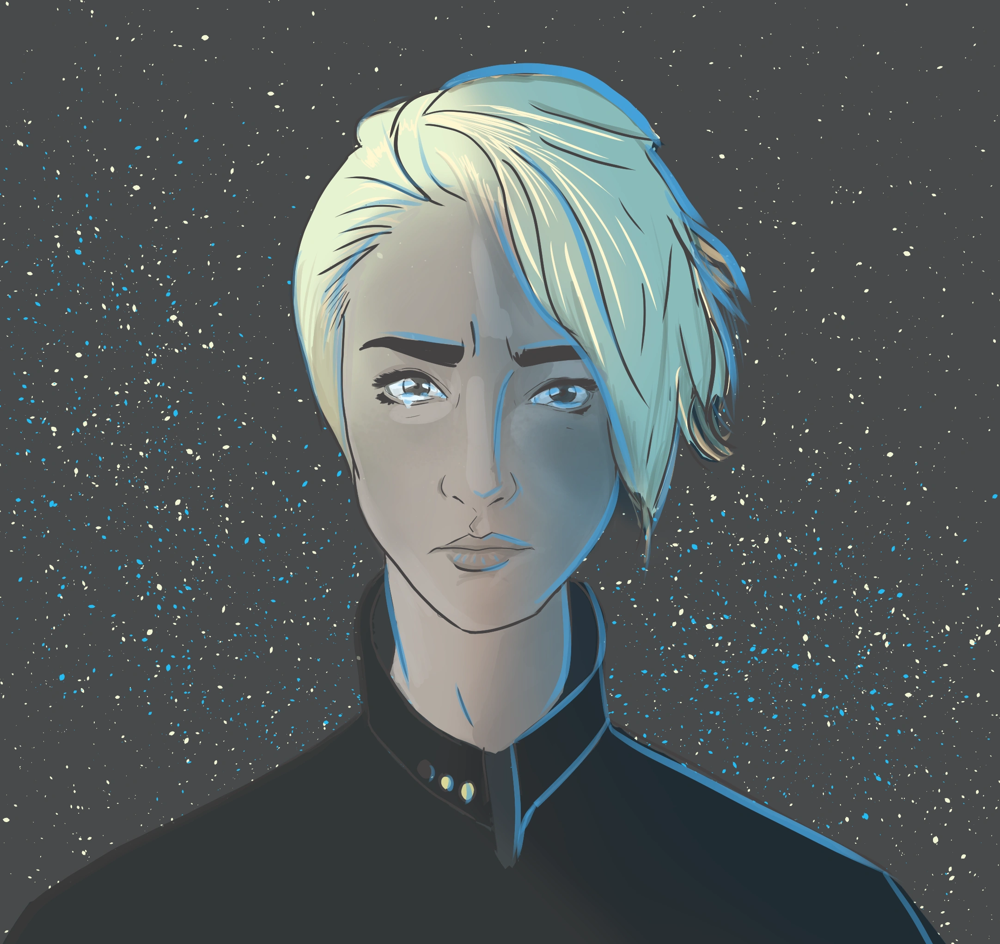
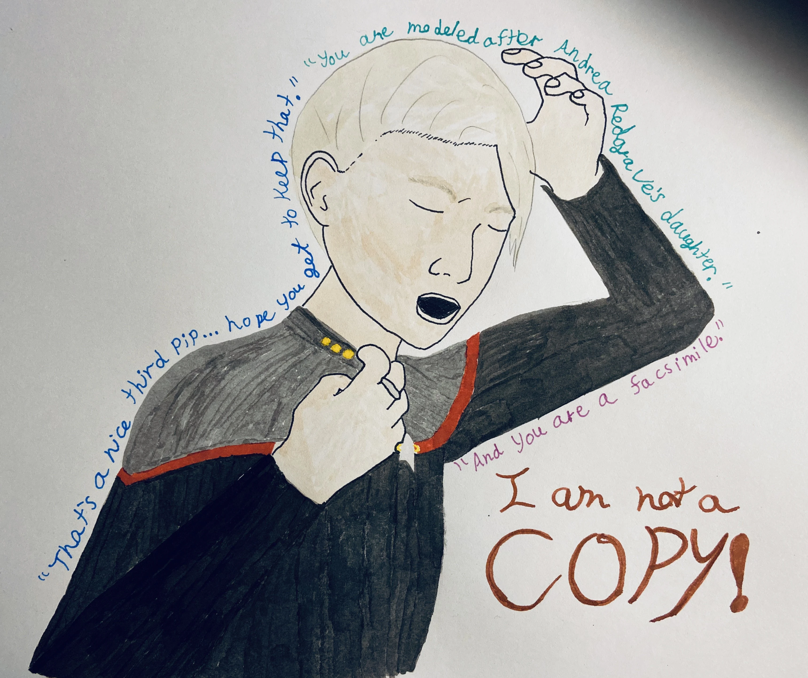

# Episode 19 Farther from Home pt. 6

- **Source:** https://clear-skies-rpg.fandom.com/wiki/Episode_19_Farther_from_Home_pt._6
- **Retrieved:** 2026-11-16
- **Wiki page ID:** 298
**Episode 19 — Farther from Home pt. 6**

| Field | Value |
| --- | ----- |
| Air date | 06/15/2020 |
| Run length | 191min |
| Broadcast | Twitch [YouTube](https://www.youtube.com/watch?v=6NP5RBU9wQI) [Spotify Podcast](https://open.spotify.com/show/4XRHFGJ4s4EV7LufmohEnQ?si=_ryT3XVATmiTtDsrx3Yt8w) |
| Cast | Eric Campbell Revati Dhomse Gina DeVivo Sam de Leve Aki Xander Jeanneret Bonnie Gordon |
| Previous | [Episode 18 Farther from Home pt. 5](ep-18-farther-from-home-pt-5.md) |
| Next | [Episode 20 Farther from Home pt. 7](ep-20-farther-from-home-pt-7.md) |

> "I'm not a replication. I am **me**. I am unique. I am **myself**. I am not a memory.""
>
> — EXEO

## Plot Synopsis
### Brief Overview
[pending]

### Pre-Break
The episode begins where [Episode 18 Farther from Home pt. 5](ep-18-farther-from-home-pt-5.md) left off. CDR EXEO is on Yukani Prime meeting with the Changeling Lee.

Lee has just finished saying that they never expected to meet Redgrave's creation. There is a long, silent pause. Tirazz looks to Lee with confusion, and then at EXEO. EXEO is clearly surprised. EXEO and Lee look each other over. Lee asks EXEO if she is wearing the ring, and EXEO shows it to them. Lee turns to Tirazz and tells him that he has been speaking to a living program. Tirazz smirks, and says that at least Sprak won't feel like he's going crazy anymore. EXEO asks Tirazz to correct Guzz the next time he says she isn't alive. EXEO asks Lee how they know about her. Lee directs Tirazz to leave, and he takes the others with him. Once EXEO and Lee are alone, they begin to speak.

Lee asks EXEO why she is here, and EXEO replies that she is here to return Lee to the Dominion. She explains that a Vorta and two Jem'Hadar are on USS Ross waiting to "rescue" Lee. EXEO adds that the Vorta is hiding something. She asks if Lee knows Nadran, and Lee says "yes", with some irritation in their voice. Lee asks EXEO what will happen if they refuse to leave. EXEO says that she doesn't know, but that as far as she is concerned, Lee has the right to refuse. Lee mentions that EXEO might want to save her sympathy; Lee committed several war crimes during the Dominion War. EXEO replies that she is aware, but that her mission is not to kidnap anyone.

The conversation turns to EXEO and Redgrave. Lee explains that much of EXEO's technology is ahead of Starfleet's time, by almost a decade. Lee emphasizes that the ring is especially advanced. Lee says that Starfleet needed some fixes to bridge the gaps in Redgrave's programs. Lee explains that, before the war, the Federation and the Dominion had a technology exchange related to the EXEO program. Lee suspects that it continued after the war ended. EXEO asks Lee if they ever met Redgrave. Lee says that they were undercover as an assistant to Redgrave for nearly a year. EXEO asks why they left; Lee says they were reassigned by the [Great Link](https://memory-alpha.fandom.com/wiki/Great_Link).

EXEO asks Lee why they won't return to the Great Link. Lee says that they found a new purpose on Yukani Prime. They say that the war was an atrocity perpetrated by the Great Link. They describe it as a wretched cycle of fear and distrust of all solids. On their own, Lee has come to see the Dominion for what it is. They express horror and disgust at the Vorta and the Jem'Hadar. Both are species that the Changelings genetically manipulated into their servants. Lee finishes by saying that they have no intention to leave. They add that, if the Vorta is a problem, EXEO should introduce them. EXEO says that she has no problem doing that.

Lee looks at EXEO, and then says that she was modeled after Redgrave's daughter. EXEO is shocked, and replies that Redgrave doesn't have a family. Lee replies that she did, and EXEO calls them a liar. Lee replies that they have no reason to lie. EXEO can tell that Lee is being truthful. EXEO is horrified. She asks if her face is the face of Redgrave's daughter. Lee says that they think it is. EXEO is traumatized. She stands up, exclaiming that she chose her face; it is *her* face. Lee asks her why she is so upset that she might have a parent. EXEO asserts that she is a unique individual, and not a copy. She recovers slightly, and says there isn't enough time to keep speaking. She asks Lee if they will meet with Nadran, and Lee agrees. EXEO steps out to go find Tirazz so she can contact USS Ross.

She finds Tirazz and Guzz in a side room covered in children. Tirazz walks over, and can see that EXEO is upset. She tells him that she needs a communication terminal. Tirazz walks her to a room with an old Klingon terminal. EXEO asks to be left alone, and Tirazz consents. His attitude is gentle; he can see that EXEO is very rattled. Once alone, EXEO disables her vocal program. She screams and cries, but no sound comes out. She collects herself, feels the pip at her collar, and goes to the terminal.

On the bridge, alpha shift is ending as Prahl reports a communication from the planet. Sull takes it on the bridge view screen. EXEO is overly stoic, and Sull can tell that she is very upset about something. EXEO asks if they are alright, and she explains about the Nausicaan Raider ships sent by K'noll. Sull says they handled it. EXEO reports that she made contact with the Changeling, and that they don't wish to return to the Dominion. She adds that she believe Lee genuinely disapproves of the Dominion. She says that Tirazz will protect Lee at all costs, but that Lee is willing to meet Nadran. Sull asks for EXEO's professional opinion. EXEO says that they should arrange the meeting. Sull decides that it will be on USS Ross.

EXEO asks what Starfleet's position will be if Lee runs away. Sull looks to YEO3 Azzmi. Azzmi turns around and starts researching interstellar law with regards to asylum claims and prisoner rendition. EXEO asks what they will do now. Sull says that the next step is to get her out. Sull mentions that Nadran did something bad, and makes a joke. EXEO smiles slightly for the first time. Sull asks for EXEO's location. EXEO calls Tirazz over, and he smirks when he sees Sull. EXEO says they need to get back to the ship. Tirazz is reluctant to have himself or Lee leave. He says he is worried about what will happen to his people on the planet if he or Lee is killed. Sull says that they will take responsibility for their safety. Tirazz, frustrated, leaves. EXEO and Sull say good-bye, and EXEO leaves to go find Tirazz.

She finds him in the living space speaking with Lee. Lee waves EXEO over to speak. Tirazz and Lee discuss the plan. Lee is resigned; Tirazz is obstinate. He says that all he cares about is keeping everyone alive and figuring out how to take down K'noll. EXEO interrupts to say that USS Ross is going to be taking down K'noll. Tirazz seems surprised. EXEO says that Sull already agreed to get rid of K'noll, and that Sull is very efficient at their work. Lee says that they know Sull's reputation. Lee says that no one else ever got so close to rooting them out and exposing them to the syndicate. Tirazz gives EXEO the location of a secret entrance to their section of the colony. He makes a snide comment and leaves. Lee tells EXEO to arrange the extraction, and she does.

On the bridge, Vrenn turns to Sull and asks to fly the shuttle. Sull assents, and Lakat mentions that it isn't her fault she got shot. Sull states that every ship in the system will be watching them. They order Vrenn and Prahl to come up with a plan and a diversion for the shuttle. Sull asks Azzmi about her legal research. Azzmi says that there is no precedent to any of this, and they can make it up as they go along. Since K'noll is a pirate, USS Ross has wide leeway to decide what course of action to take.

Prahl reports that they are receiving an incoming message for Olyn. Olyn takes it in Sull's ready room. It is a message from their father, AMB Daro Madzhin-Nil. He expresses concern for Olyn's safety. He says that, in his entire career, he has never been shut down so quickly when making an inquiry. He says that he will keep digging. Olyn composes a reply. They request that he not get into trouble on their behalf. They add that "Jane says 'Hello'" and send the message.

The focus moves to Theq in his lab/kitchen. He is working on building the tachyon net. Vrenn arrives, and he can see that Theq is very overworked. Vrenn tells Theq that Sull ordered him to make a diversion while the away team goes and gets Lee. Theq suggests a distraction, and Vrenn says they could use the tachyon net. Theq agrees, then (rather aggressively) asks Vrenn to leave. Vrenn asks Theq if he is alright, and Theq says that he isn't. He says he must finish the tachyon net, and doesn't have time to rest. Vrenn starts to leave, but Theq stops him to thank him for coming. Vrenn says that Theq shouldn't thank him; he is about to go tell Sull and EXEO that Theq isn't resting. Theq asks him to wait until after the crisis, but Vrenn refuses. He offers to help Theq instead.

Theq says that he needs a better idea of where to aim the tachyon net. Vrenn recalls a situation where [Commander Data](https://memory-alpha.fandom.com/wiki/Data) used a similar technology to uncover Romulan vessels ([TNG: "Redemption II"](https://memory-alpha.fandom.com/wiki/Redemption_II_%28episode%29)). Vrenn moves to a corner of the lab and begins researching. Theq moves to a different corner and calls Bobbydee, the leader of the support group which M'Qrell had suggested he attend. He asks Bobbydee when the next group session is, and Bobbydee replies that there is one on the Promenade today. Theq says he will attend. Vrenn overhears the conversation, but doesn't say anything. Vrenn finds out the details of the incident with Data. He brings up the logs and shows Theq. Vrenn suggests they use a series of probes to stagger the net and catch a wider area. He also notes that the incident involved [Sela](https://memory-alpha.fandom.com/wiki/Sela).

The episode skips to Vrenn preparing USS Cypress (the type 11 shuttle) for the mission. Theq, Lakat, and LT Nadra Badim go with them. From the bridge, Sull orders Lakat to use the unmanned sensor buoys in the system to enhance USS Ross' sensors when the tachyon net is deployed. Olyn suggests they get Nadran and prepare a meeting space on the promenade.

### Post-Break
The scene resumes in the shuttle. Lakat calls the bridge and asks Sull if they should bring in Dr. Wellix on the ghost ship hunt. Sull says they will bring him in after the fact. 
Vrenn flies off at a dangerously high speed, buzzing the starboard nacelle. At the same time, USS Ross fires off the tachyon net/burst. Lakat performs the sensor sweep, including the various sensor buoys in the asteroid field. They do not detect any cloaked vessels. They do find another Nausicaan Raider ship hiding behind an asteroid, waiting to attack. The burst subsequently interacts with the magnetic interference in the Yukovar System; it disrupts the sensors of every ship and facility in the system, including those of USS Ross and USS Cypress. Vrenn flies down to Yukani Prime by sight alone, while nearly every other ship is stationary. They quickly fly through a narrow passage in the caves.

As EXEO waits for them to arrive, and Orion child runs up to her to let her know a ship is coming. She warns the child to go hide in a safe place, and the child goes and gathers up all the other children to go hide. Sprak tells EXEO to be careful around Guzz, because he hates holograms. Guzz is suspicious of them because he doesn't understand technology very well. EXEO shoos Sprak away. Tirazz and Lee join EXEO as the shuttle lands; Guzz stands a little apart from them. Lee turns to Tirazz and assures him that he is prepared for what is coming. Tirazz begins to say a good-bye, but Lee cuts him off. Sprak, Guzz, and Tirazz walk away. Lee gets into the shuttle. Just as they are about to depart, Sprak runs up to the shuttle. He says Tirazz ordered him to go with them. He says that he is useless on the planet; EXEO asks how he isn't useless on the ship, too. He mumbles something about communication skills. EXEO glances at Tirazz, who smirks at her and walks away. EXEO calls to him "I'll send the little one back when we're done."

In the shuttle, Theq asks Badim to disarm the passengers. Badim turns to Sprak, and Sprak hands them a small energy pistol. EXEO looks to Badim and tells them to check Sprak's ankles. Badim stares at Sprak, clearly annoyed. Sprak apologizes and hands over two knives from his boots. Lakat can feel the eye of Lee upon her. Lee just stares at Lakat for several seconds, but Lakat refuses to look at her. Vrenn punches it, and the shuttle zooms out of the cave and up to USS Ross. On their return, they notice the Nausicaan Raider had left.

The shuttle lands in the main shuttle bay. The door opens, revealing Sull. Lee walks up to Sull, saying "I get to meet my hunter at last". The two shake hands. EXEO looks to Lakat and Theq to see how they are handling being so close to Lee. She can see that Theq has been staring at Lee constantly. Lakat walks off with Theq. Sull greets EXEO and offers to take back her ring. EXEO asks if she should attend the meeting between Lee and Nadran. Sull can tell that something is going on with EXEO's feelings towards Lee. Sull invites EXEO along, and EXEO leaves, keeping her ring. Lee looks to Sprak, and asks if he is coming, too. Sprak asks to go, but adds that he isn't sure what he's doing here. He mentions that it might piss off Nadran to have him there; Vorta hate Ferengi.

In the turbolift, Prahl waits for them with more guards. As they head up to the promenade, Lee leans in towards Sull. She says that she would like to speak in private, in order to compare notes, and so she can tell Sull how close they came to getting her. Sull points out that, in the end, they *did* get her. The doors open to the promenade.

Olyn has been setting up, but has refused to speak to Nadran the entire time. When Nadran sees Sull, he stands with great curiosity. Lee briefly turns into her liquid state, to signal Nadran, the First (Il'kat Et'lan), and the Second (Ven'it Rex) that she is a Founder. Nadran bows in awe. Il'kat stands proudly. Ven'it looks down and shifts his feet (Jem'Hadar are normally not allowed to see Founders). Lee tells Nadran to rise. She walks right past him, dismissively, and sits down. Nadran obediently sits down; he is clearly confused at Lee's attitude.

Lee suggests they begin. Nadran starts to fawn over her, but Lee tells him to shut up, and then she looks to Sull. Sull begins the discussion, and she says that Starfleet will not force Lee to return to the [Great Link](https://memory-alpha.fandom.com/wiki/Great_Link). Lee asks Nadran who sent him to find her. When Nadran says "[Odo](https://memory-alpha.fandom.com/wiki/Odo)", Lee asks why Odo wanted to find her. Nadran answers that Odo wanted him to rescue her, out of concern for her safety. Lee asks how the deal was arranged, she says her "friend", EXEO, has concerns. Olyn mentions that they know it was done without input from the Diplomatic Corps. Nadran hesitates, and he tells Lee they should speak in private. Sull and Olyn both accuse Nadran of questioning the will of a Founder. Nadran quickly denies it. He is now even more unnerved. Lee demands that he answer the question, now.

Nadran says that the deal was arranged through contacts in Starfleet Intelligence. The Dominion offered anti-cloaking technology in exchange for safe passage through Federation Space. (Note: the Federation is barred by treaties with both the Klingon Empire and the Romulan Star Empire from developing anti-cloaking technology). Olyn gets Sull's attention with a glance. Sull leans in, Olyn says that they think more is going on than a technology exchange. They think Odo wouldn't have gone through so much just to get a lost Changeling. Lee announces that she will not return to the Great Link. Nadran is completely shocked. He asks Lee what she intends to do, but she doesn't answer. Instead, she asks for the name of his contact in Starfleet Intelligence. She specifically asks if it's Nallas Rhee. Nadran says that it is. Lee turns to Sull, and she asks "wasn't he your boss?" Sull picks up that Lee is trying to show off the extent of her knowledge of Sull's activities during the war. Sull and Lee ask Nadran why Rhee chose Sull for the mission; Nadran says he doesn't know.

Lee asks Nadran how he got through Federation space. He replies that they took passage with a Ferengi. Sprak's ears perk up, and Lee asks if he wants to say something. He asks for the name of the ship. Nadran answers "Liquidator". Sprak turns into a ball of pure rage. He spouts a flurry of curses and starts screaming "that's my ship!". Olyn invites him to go for a walk with them. Sprak wants to ask one more question. He asks if it was Skrag. Nadran says yes, and Sprak freaks out again. Olyn walks him away from the others.

Lee turns to Nadran and says that he came for nothing. Nadran pledges himself to her, and he offers to stay in her service. Lee says that it isn't necessary. Lee looks to Sull, and then to the two Jem'Hadar. Lee begins speaking to the Jem'Hadar directly, which completely shocks Nadran (Founders never speak to Jem'Hadar directly). Lee asks Il'kat and Ven'it if they are loyal to the Founders. They reply in unison, "In life and death." Lee says that she could use them, but not Nadran. She looks at the Jem'Hadar and says "kill him." Il'kat and Ven'it charge towards Nadran. Sull shouts "not on my ship!" and moves to block them from reaching him. Prahl and the security team draw their phasers. When Lee sees Sull move, she holds up her hand to stop the Jem'Hadar. Lee asks Sull if they have a problem with this course of action. Sull says again "Not on my ship."

Lee orders Nadran to accompany her to the planet. Nadran begs Lee for his life; he says that he is sure he can be useful to Lee in some manner. Lee assents. She turns to Sull, and she says that they should discuss the situation on Yukani Prime. Lee apologizes for her behavior; she says that the Dominion does things differently, but she understands that the Federation "values life". Sull says that Sull has no jurisdiction over what happens on the planet, but that they cannot allow execution on a Federation starship.

At the "values life" remarks, EXEO blurts out a question. She asks Lee about the comments she made in the haven, whether they were true. EXEO examines Lee's attitude and behavior towards Nadran. She realizes that Lee considers Nadran and the Jem'Hadar to be objects, and not people. She has the same attitude towards "solids" as a typical Changeling. EXEO comes to the realization that Lee has played her from the start. She realizes the failure of her programming to detect it earlier. EXEO wonders if any of Lee's statements were true. She keeps pressing Lee with questions about her statements on the planet regarding the Founders treatment of the Vorta. She questions Lee about claiming to have changed, and claiming to value life.

Lee studies EXEO. She says that if EXEO is going to defend her right to be considered alive, she should think about what it means to be alive. Lee claims that Vorta and Jem'Hadar are not alive. She calls them an irredeemable atrocity of the Dominion. They are bred to serve, and not to think. She notes that there is another clone of Nadran just waiting to replace him when he dies. Lee describes the argument as "cultural differences" and says there isn't enough time to debate the issue. Lee tries to steer the conversation back to the plan to take down K'noll. EXEO calls Lee a fraud, and Lee says "and you are a facsimile of a human being. How are we so different?" Sull says that EXEO is nothing like Lee. Lee sighs, saying that she doesn't know why she thought this discussion would be fruitful, even after all she had done for EXEO. EXEO declares that Lee hasn't changed at all, and she is no longer required at the meeting. EXEO leaves.

Lee asks Sull whether they will help with K'noll. Lee says that they need weapons, but knows that Starfleet won't provide any. Sull says directly that they will capture K'noll. Lee seems surprised. Sull says that if K'noll is a pirate, they have a duty to capture him. Lee asks whether Sull will take K'noll if she can deliver him. Sull says they will need evidence. Lee agrees, and says that, in return, she will send a response to the Dominion, informing them of her decision. Lee mentions that she has a particular grudge with one of Nadran's prior clones. She says that the Nadran clone is unique among the Vorta; he tends to display more initiative than others. She says that initiative nearly killed her.

Sull suggests they focus on cooperation for now. Lee points to the Jem'Hadar. She says that they think they are already dead, and that they will only find life by dying by her command. She asks Sull if they think there is a path back for the Jem'Hadar. Sull says that they know there is nothing more important than searching for it. Lee looks down, silently.

Meanwhile, in 10 Forward, Lakat walks in and she sees Olyn and Sprak. Sprak is furious, and he keeps mumbling to himself about betrayal. Lakat walks up and asks what is going on. Sprak explains that Skrag is his brother. They had a disagreement about females. Lakat goes to get everyone drinks. Sprak looks to Olyn. He says that there is a revolution happening in the Ferengi Trade Union; females are being given equal rights. Olyn expects him to be unhappy with this development, but is surprised when he says that he approves. He says that he made a female his first officer in order to make a point to his crew, and then Skrag turned the crew against him. He makes a comment about how successful the Ferengi Trade Union has been since women were allowed to own businesses, and he says that it was idiotic to wait so long. Olyn gives Sprak a kiss on the forehead, and he gets a little flustered. Olyn says that they will help him find his ship, and they say that they are confident it will be his again, one day.

Lakat returns, and Sprak remembers something. He pulls out a data rod and hands it to Olyn. Lakat asks what it is, and Sprak says that he doesn't know. Tirazz had told him to wait until Lee was out of sight, and then to give it to one of the Federation officers. Lakat says they should bring it to Theq, but Olyn says they shouldn't interrupt his group counselling session. Lakat argues, but Olyn holds firm. They move to the promenade, and run into EXEO doing angry laps of the upper level. Lakat tries to get her attention, but can't. She calls EXEO on her communicator. She tells EXEO that they've gotten a data rod from Tirazz via Sprak. EXEO says they should open it; and they move to one of Olyn's private offices. The data rod is password protected, which drives EXEO to shout in aggravation. Olyn instinctively tries to calm her using telepathy, but can't because she is a hologram. EXEO hacks the data rod. The password is "ZAZRIT". The file opens, and it is a video. The video shows grainy footage of Tirazz's hideout. A gigantic Caitian-looking person walks into the room, and they conclude it is K'noll. K'noll looks around, and...

he turns into an orange liquid, transforming into Lee.

## Cast
-  Eric Campbell - Game Master
-  Revati Dhomse - Jane Lakat
-  Gina De Vivo - EXEO
-  Sam de Leve - Azeri Sull
-  Aki - Olyn Madzhin-Nil
-  Xander Jeanneret - Theq Lynadas
-  Bonnie Gordon - M'Qrell (absent)

## Non-Player Characters
-  Lee
-  Tirazz
-  Sprak
-  Guzz
-  Yeri Prahl
-  Zhyliss Vrenn
-  Azzmi Shanto
-  Daro Madzhin-Nil
-  Nadra Badim
-  Bobbydee
-  Nadran
-  Il'kat Et'lan
-  Ven'it Rex
-  K'noll

## Locations
-  Yukovar System
-  Yukani Prime

## Ships
-  [USS Ross](../ships/uss-ross.md)
-  USS Cypress

## Notable Lines
> "I'm not a replication. I am **me**. I am unique. I am **myself**. I am not a memory.""
>
> — EXEO *(to Lee)*
> "Tirazz. You look ... [pause] Tirazz."

> "Oh, I know"
>
> — Tirazz

> "I've worked with deflector dishes all my life, so I know a deflection when I see one."
>
> — Zhyliss Vrenn
> "We blue people gotta stick together. Y'know what I mean?"
>
> — Zhyliss Vrenn *(to Theq Lynadas)*
> "Just in case..."

> "I know, Tirazz. Go."
>
> — Lee

> "With all you have seen ... can you look at that [Jem'Hadar] and tell me there is a path back?"

> "With all that I have seen, I know there is nothing more important than to search for it."
>
> — Azeri Sull

> "Sprak is a unique, gorgeous name. It could be carved out of latinum. It is a name of royalty; it is a name of emperors."
>
> — Sprak
> "Did you know that, ever since women have joined the trade union, profits have increased over 476,000 percent? It's almost as if utilizing the other half of our population is a good idea."
>
> — Sprak

## Notes and Trivia
-  EXEO's challenging of her value in the conversation with Lee is the first case of challenging a value in *Clear Skies*.
-  The password for the data rod, "ZAZRIT", is a reference to Shield of Tomorrow.
-  At the end of the episode, Eric predicts (for the second time in a row) that the next episode will conclude the "Farther from Home" story arc.
