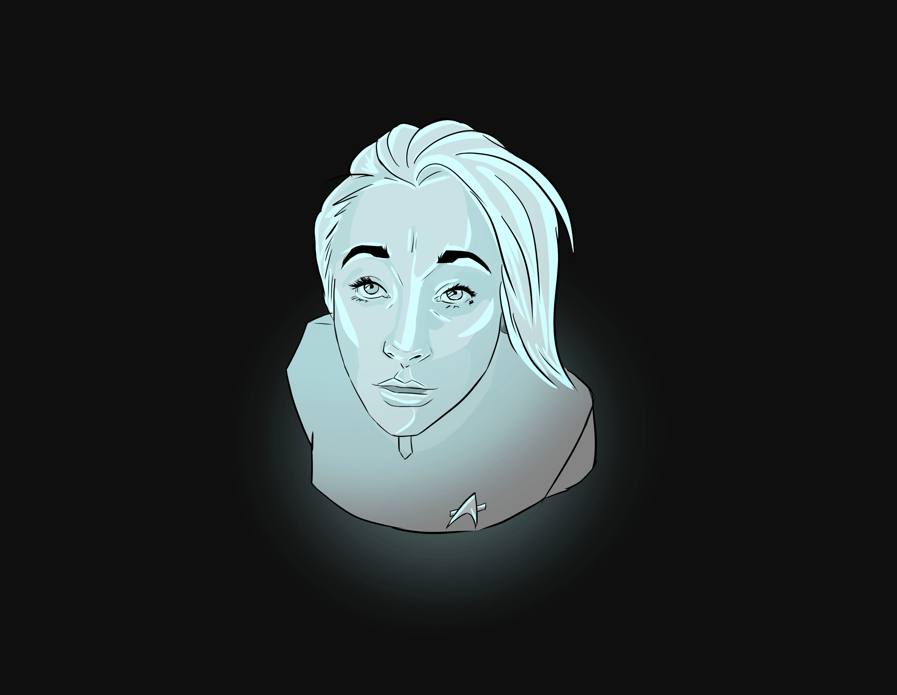

# Episode 23 Who We Are pt. 2

- **Source:** https://clear-skies-rpg.fandom.com/wiki/Episode_23_Who_We_Are_pt._2
- **Retrieved:** 2026-11-16
- **Wiki page ID:** 302
**Episode 23 — Who We Are pt. 2**

| Field | Value |
| --- | ----- |
| Air date | 07/20/2020 |
| Run length | 203min |
| Broadcast | Twitch [YouTube](https://www.youtube.com/watch?v=ZpvZXkQVqN8) [Spotify Podcast](https://open.spotify.com/show/4XRHFGJ4s4EV7LufmohEnQ?si=_ryT3XVATmiTtDsrx3Yt8w) |
| Cast | Eric Campbell Revati Dhomse Gina DeVivo Sam de Leve Aki Xander Jeanneret Bonnie Gordon |
| Previous | [Episode 22 Who We Are pt. 1](ep-22-who-we-are-pt-1.md) |
| Next | [Episode 24 Who We Are pt. 3](ep-24-who-we-are-pt-3.md) |

> "I'm ready to grow up."
>
> — EXEO

## Plot Synopsis
### Brief Overview
The crew enjoy their shore leave. Theq and Sull engage in some retro gaming in the holodeck. M'Qrell treats some injuries caused by a mysterious goose. Vrenn proposes a plan to EXEO to take [USS Ross](../ships/uss-ross.md) out on an adventure, and then he shows Olyn and Lakat one of the possible locations.

Olyn gets a pep-talk from Lakat, and goes to Starbase 105 to confront Nadran. Nadran gets under their skin, and they throw scalding hot tea onto his face. Il'kat Et'lan says that he will take the blame.

Prahl complains about his opinions on ship security being ignored by EXEO and Sull. Lakat blushes at the mention of Azzmi Shanto in exercise gear. Vrenn is excited that EXEO and Sull approve of his "adventure" plan.

EXEO has been putting off doing a diagnostic on her program, but Sull convinces her to do it. Sull does the work themselves. EXEO has a dream, that isn't a dream. It's a secret program in her code of Dr. Redgrave. Redgrave tells EXEO the secrets of how she came to be; Redgrave came from an alternate universe (possibly the [Mirror universe](https://memory-alpha.fandom.com/wiki/Mirror_universe)), and was inspired to create EXEO by the death of her daughter. She also tells EXEO that she is unique; she is her own woman, and she should discover who she is on her own. EXEO hugs her "mother" and wakes up. Sull asks if she had any dreams, and EXEO replies "no". However, Sull does notice that EXEO has the appearance of having been crying. The two begin examining EXEO's ring as EXEO reflects on all that she has learned about what Redgrave did.

### Pre-Break
The episode begins with [USS Ross](../ships/uss-ross.md) still docked at Starbase 105, but on official shore leave. CAPT Sull has acquired one new piece of information about the mission to capture the Changeling Lee. [ADM Janeway](https://memory-alpha.fandom.com/wiki/Kathryn_Janeway) has been made aware of the orders that were forged in her name. She is *furious*, and investigating the matter with great enthusiasm.

MCPO Theq calls Sull from the holodeck. He invites "Azeri" to join him for a game, and they agree. Sull walks into the holodeck and see the void of space, except that it's pixelated. They also see ENS Dari extracting herself from a holodeck console. She tells Theq that her work is done, and she warns Sull that she threw up the last time she played this game. Sull is confident in their stomach, but Theq ominously asks what they had for breakfast. The game resembles the 1979 game [*Asteroids*](https://en.wikipedia.org/wiki/Asteroids_%28video_game%29), only in 3 dimensions. The two zip around the black void of pixelated space in brightly colored cars, shooting everything in their path. Theq is ecstatic, and in a moment of joy he loses control and slams into Sull's car. The two go spinning, until the holodeck detects the collision and stops the program. The two cars abruptly stop, and both fail to maintain their composure. After 30 minutes of madness, they stop. Theq says that he missed seeing "Azeri", and he says that they haven't had enough "Azeri and Theq" time, lately (too much "CAPT Sull and MCPO Lynadas" time). Sull agrees, and they walk off to get lunch. On their way out, they pass Dari, and Sull makes a quip about looking green (ill).

Meanwhile, in sickbay, LTCDR M'Qrell is sitting at her desk when one of her physician's assistants arrives. LTJG Eoqtt Qhlat walks in with Security Officer ENS Keirrith Duddridge on his shoulder. Duddridge has a large gash on his leg. The two see M'Qrell and starts to talk quietly. M'Qrell tries to eavesdrop but Duddridge notices. He tries to get Qhlat's attention by bopping his hand, and he accidentally causes Qhlat to inject a hypospray straight into Duddridge's leg. Duddridge passes out and flops off of the bed and onto the floor. M'Qrell rushes over and asks what is going on. Qhlat stumbles through a very long explanation, but he eventually gets to the point. The two had been chasing the holographic goose rumored to be running around the Arboretum. Duddridge slipped on a rock and cut his leg. As M'Qrell leaves them to it, she thinks to herself "I could catch that goose".

The scene moves to CDR EXEO in the conference room. She is preparing for a meeting three hours before it is due to start. She is clearly anxious. She gets a call from LT Vrenn, and she invites him to the conference room. Vrenn says that he has an idea he wants to bring up with Sull, and he wanted to run it by EXEO first. He suggests they use the shore leave to take [USS Ross](../ships/uss-ross.md) on a quick mission to go do science somewhere nearby. He wants the crew to feel like the ship is "theirs" again. EXEO agrees, and she says that it is an excellent idea. Vrenn leaves, beaming. Shortly after, EXEO calls Sull. Sull is eating lunch with Theq, after their morning of games. EXEO nervously asks to have a private meeting with Sull about 1 hour before the meeting (2 hours from now). Sull makes plans with Theq to do more gaming and excuses themselves. Sull heads directly to EXEO, who is surprised they showed up so fast.

EXEO is speaking oddly fast and nervously, and Sull notices. EXEO corrects the problem, and diverts the conversation to Vrenn's proposal. She says that taking USS Ross on side mission would be beneficial to the crew, and might also make it difficult for Mendak to follow them. Sull says it's a good idea, but EXEO has another vocal glitch and Sull redirects the conversation. EXEO says that she hasn't had time for a diagnostic since the mission to capture Lee ended. Sull chides her for skipping "medical" appointments. Sull suggests they do the diagnostic immediately. EXEO tries to use the meeting as an excuses to put it off, but Sull says they will push the meeting back. EXEO relents, but still doesn't get up; she reaches out a hand. Sull takes her hand and pulls her up. As they leave the briefing room, EXEO gives Vrenn a thumbs-up. EXEO and Sull head to the computer core.

The focus shifts to AMB Olyn. They've been nervously making the trip from their quarter to the transporter room over and over gain. Finally, seeing that their anxiety is affecting Patience, they decide to take her to the holodeck for some playtime. Meanwhile, Vrenn and LTJG Lakat are at their bridge stations. Vrenn asks her to join him in the holodeck. When they arrive, they encounter Olyn and Patience, who are about to enter. Olyn invites the two to join them. Lakat and Vrenn discuss the possibilities of what a "frisbee" is, until finally Vrenn asks Olyn if they would like to see what he was going to show Lakat. Olyn agrees, and he loads up program Vrenn-34-z. The holodeck loads a lush, verdant landscape over looking vast mountains. Gigantic trees, over 200 feet tall, hover in the sky, anchored to the ground only by vines dangling downwards. The computer says that it is planet CZX009773 in the Volaric System. Vrenn points out that it is only 20 lightyears away from their current position. He says that he wants to go exploring again, and maybe have the scientists do their thing, too. Patience skips off after a flock of bird-like animals, which Vrenn labels an endorsement of his plan. Olyn also gives their endorsement. Lakat likes the plan, but for different reasons. Lakat says that it might cause the Romulan ship following them to decloak and attack, which is something she wants. Vrenn expresses skepticism that any ship could follow USS Ross at the speed he pushed her to when they left the Yukovar System (warp 9.8).

Olyn departs the holodeck to go "make some calls". Lakat excuses herself from Vrenn and moves to join Olyn. They head towards Olyn's offices on the Promenade. Olyn asks Lakat how she's been doing, and she says she isn't looking forward to 2 weeks of shore leave. Olyn is confident that Sull will find *something* for them to do. Lakat asks Olyn how they feel about Wellix. They say they've been avoiding thinking about it. They haven't spoken with him since the held a gun to their back.

### Post-Break
The scene resume with Olyn and Lakat. They walk into the diplomatic suites. Once inside, they are greeted by LT Neil Sagan, a human astrophysicist doing part-time work in the diplomatic suites. They greet him and move into Olyn's office. Olyn takes a moment to admire the massive built-in fish tank in the back of their office. Lakat asks if it is alright if she stays; Olyn says that it is. Olyn tells Lakat what's been bothering them this morning. They had been thinking about making a request of ADM Mestis to go see Nadran. They know they don't have to, but they are almost hoping he will reject the request, so they have an excuse not to see him. Olyn wants closure with Nadran; they feel that they didn't accomplish what they wanted to with him. They also felt out of their depth when Sull and EXEO were negotiating with Nadran and Lee, which only lends to the sense of anxiety. Seeing Nadran always makes Olyn think of Cardassia Prime, which is unsettling. Lakat tells Olyn that she is happy she never had to look Nadran in the eye; Olyn says that, if they were a more violent person, they would have punched him on Lakat's behalf. Lakat encourages Olyn to have one final conversation with Nadran.

Olyn makes their way to Starbase 105. They announce their intentions when they arrive, and then head to Nadran's quarters. Olyn chirps at the door, and it opens. Olyn sees Nadran sitting at a table, rubbing his throat and drinking a glass of water. They can see bruising on his neck, indicating that someone grabbed it and squeezed, hard. Olyn also sees the Jem'Hadar First, Il'kat Et'lan, standing in the corner holding the containment unit with Lee inside. Next to him is a knocked over potted plant. Some sort of minor struggle occurred.

Olyn looks to Nadran, and he invites them to sit. Olyn gets themselves some tea and sits. Olyn says they are curious as to Founder [Odo](https://memory-alpha.fandom.com/wiki/Odo) chose him for the mission. They tell him about something that Lee said: that Nadran's clone always showed too much "initiative" for a Vorta ([Episode 19 Farther from Home pt. 6](ep-19-farther-from-home-pt-6.md)). Olyn points out that the Founders still chose to let the Nadran line of clones live, and that Odo specifically picked him for this delicate mission. They explain that they think Odo wanted him to use that initiative, to act with a mind of their own, and not as expected of them. Olyn speaks about how they are also unique among the Deltans, and that they are considered a freak on [Delta IV](https://memory-alpha.fandom.com/wiki/Delta_IV). They conclude by saying this mission was an opportunity for Nadran, and that he threw it away by siding with Lee.

Nadran bristles at the implication, but he recovers his composure. He tells Olyn that they are a diplomat who hates what they are doing. They seem to him like someone meant for so much more than "rotting on a Starship that scans empty asteroids." He says they seem lost. Olyn begins to feel vulnerable, as if he can see their own anxieties plain on their face. They acknowledge that the posting on USS Ross "hasn't quite shaped up" to what they wanted. Nadran says it sounds like they are convincing themselves of something. He points out there is a Romulan agent on USS Ross (not something he should know), and that it is likely USS Ross will soon be in another situation where Olyn won't be useful. He says they might find a place in the Dominion that is worthy of their talents.

Olyn replies that they can evaluate their own worth. Nadran doubts it, and Olyn makes a quip doubting his ability to see beyond his own nose. Nadran smiles at getting under Olyn's skin. He says that it isn't unusual to encounter "envy" from others about the favor the Founders show his race. He finishes his taunt with "If the solids of this quadrant had just relented and accepted the Dominion ... Cardassia would not have had to burn." Olyn responds by throwing their cup of scalding hot tea on his face. Nadran scream in pain, and then screams to Il'kat "Kill her!". Both Olyn and Ilkat correct him at the same time, "*them*". Il'kat tells Nadran to sit down.

Nadran is furious. He stares daggers at Olyn and fumes in impotent rage. Olyn offers Il'kat a place on USS Ross; the thanks them, but refuses. Nadran, trembling with rage, tells that they have assaulted a foreign dignitary under the protection of the Federation and the Dominion. He will file a complaint and have Olyn removed from their position so they can live out the rest of their days on Delta IV to "live as the freak that you are!". Il'kat tells him that won't happen, because he (Il'kat) was the one who threw tea into Nadran's face. Nadran realizes his powerlessness and crumples, defeated. Il'kat advises Olyn to leave. Olyn apologizes that he must be a baby sitter, but Il'kat says "that is the role of the Jem'Hadar when it comes to working with the Vorta". Olyn makes one last quip about Nadran's lack of "spine" heads to the door. With one last thought of their "sister", Lakat, they smile and return to USS Ross.

The scene moves to the conference room, shortly before the aforementioned meeting. EXEO and Sull have not yet arrived. LTCDR Prahl asks if anyone did anything interesting for shore leave. Theq replies that he "barfed rainbows". Lakat asks Prahl what he did. He replies that he did more zero-gravity training with YEO3 Azzmi; he compliments her skills. At that, Lakat blushes. M'Qrell tells Prahl she has a request. She wants Wellix to have limited run of the ship; she wants to put his skills to use, as a way to help him. Prahl makes a remark that it isn't his decision; M'Qrell says she asked out of courtesy. Prahl makes a (clearly disgruntled) statement about how it's been "made clear" to him that his opinions on ship security are completely subject to the whims of the senior staff (i.e., EXEO and Sull); therefore, discussing anything with him is "inefficient". He then suggests they postpone the meeting, since EXEO and Sull still haven't arrived. Vrenn speculates that they are in stellar cartography picking a planet to go visit. As everyone leaves, Prahl takes Olyn aside. He mentions hearing about a Vorta in medical on Starbase 105 with burns all over his face. The story is that a Jem'Hadar was drinking tea and threw it at him; the problem is that Jem'Hadar don't eat or drink. Olyn expresses false concern about Nadran's health, and then winks at Prahl before leaving.

Meanwhile, EXEO and Sull head to the Computer Core of USS Ross. When they arrive, Sull remarks on how tall EXEO is (her mainframe is 25 feet tall). Sull asks EXEO when she began noticing the changes in her vocal programs. EXEO says it started after Wellix told her that he had been following Dr. Redgrave, but it got worse when Lee told her even more. Even mentioning Lee's name causes EXEO's image to blur slightly. She says that Lee told her something "very intimate", and she needs to know if it's true (she doesn't tell Sull what it is). She says that she hasn't turned off in a long time, and she is afraid of what she will learn when she wakes up. She asks Sull to hold her hand. Sull does, and EXEO turns herself off.

Sull recalls their conversation with Q, when he said time shenanigans were involved in the creation of EXEO and EXEO's ring ([Episode 21 Farther from Home pt. 8](ep-21-farther-from-home-pt-8.md)). Sull wonders aloud if Lee told EXEO about such things. One of the Operations officers, CPO Rachel Carter approaches Sull. She informs them that the diagnostic cycles on EXEO's mainframe may appear to her as dream sequences. She also notes that all of EXEO's memories will be available for them to view. Sull says they will sift through the data themselves, out of concern for EXEO's privacy. Sull begins to work.

Meanwhile, EXEO opens her eyes. She sees a completely empty space, except for a small light. She hears sound of echoing footsteps. Dr. Redgrave steps out of the darkness; there is a cigarette in her hand. She sits down in a chair and greets EXEO. When EXEO asks where they are, Redgrave responds that they are inside her. EXEO imagines a chair and it appears. Redgrave says she is dreaming, and EXEO wonders if all dreams are like this. Redgrave says "no", that she is unique. Redgrave asks EXEO how she is feeling. EXEO comments about how Redgrave is actually her subconscious manifesting itself.

Redgrave corrects her. She says that the "dream" is a subroutine installed by Redgrave when she built EXEO. When EXEO began asking herself questions about the nature of her existence, it triggered the subroutine to activate. The diagnostic has nothing to do with it. EXEO recalls her conversations with Lee, and that she is angry at Redgrave. She refuses to look her in the eye, and then asks if she is her daughter. Redgrave replies "Of course. You were a creation of love.". EXEO says it's little comfort, because she knows that she is just talking to herself. Redgrave corrects her again; this is not a manifestation of her unconscious, this is a subroutine programmed by Redgrave with her personality and knowledge. This time, EXEO looks Redgrave in the eye. She asks why there is a secret program, why did Redgrave not just tell her this information? Redgrave says she needed to learn for herself who she was; she deserved to discover that for herself.

EXEO asks Redgrave to tell her about "her" (the daughter which Lee mentioned) ([Episode 19 Farther from Home pt. 6](ep-19-farther-from-home-pt-6.md)). Redgrave warns EXEO that once she tells EXEO the information, then EXEO will be unable to share it with anyone. She will be aware of it, but literally unable to communicate it. She asks EXEO if she is ready for the burden of knowledge that must be kept alone. EXEO says that she is, that she needs to know if the choices she made were her own, or the choices of someone else. She says that she needs to know if Redgrave has done this before: is she a second chance, or a first? She says she feels betrayed. Redgrave asks her why, and she replies that it's because she is now doubting Redgrave' motivations. Redgrave encourages the doubting. She says that questioning is good, but she should never question that Redgrave loves her. She says that EXEO is inspired by her daughter, but she is not a replacement. She asks again if EXEO is prepared. EXEO says that she is ready to grow up.

Redgrave begins to tell the story. Her daughter served on a [Nova](https://memory-alpha.fandom.com/wiki/Nova_class) class starship during the Dominion war. Her daughter's father was an admiral, and he was a difficult man to love. Redgrave and he were not together when her daughter was lost in combat. In his grief, her father retired, but Redgrave couldn't let it go. She felt that, with her daughter gone, the universe had lost something. She had failed, and so she set out to create something to fill the hole in the universe with something new. Unfortunately, the technology hadn't advanced far enough. She began to look outside of normal science, and into speculative science, but it still wasn't enough. She pushed further and further. She is not from the reality of EXEO and USS Ross. She is from an alternate universe (possibly the [Mirror universe](https://memory-alpha.fandom.com/wiki/Mirror_universe)). She explains that it is a world with very different ethics, and different approaches to science. She made deals that the Federation would disapprove of; she even used "temporal options" to get the technology she needed. She explains that, when she says EXEO is unique, she means it. Nothing like EXEO could possibly exist in either reality, right now. EXEO is her gift to the prime universe, and her gift to her daughter that died there, as well.

EXEO asks about the Redgrave that lived in the prime universe. Redgrave tells her that the two of them met. She says that the her universe is a dark and cruel place, and that she felt a kinship with her prime universe counterpart. The two of them worked side-by-side on the EXEO project. Shortly before EXEO came into being, the prime universe Redgrave died of cancer, and alternate Redgrave took her place. Redgrave sums up her crimes. She broke the rules; she shattered the prime directive. She let her ambition take her beyond the limits of what should exist. She says that she cannot exist in the prime universe without "certain concessions". She cannot say what those concessions are, because Dr. Redgrave didn't program that information into her. She reminds EXEO again that she won't be able to share any of the information with anybody; it is necessary to protect her and Redgrave.

EXEO takes in all of the story. She has one final question. She asks if her face is the face of Redgrave's daughter. Redgrave says "no ... but you do have her eyes." EXEO says she would have advised against that, and Redgrave points out that she can change the color of her eyes whenever she wants. EXEO says she can see out of them just fine. EXEO hugs Redgrave, for the first time. She can feel the small, fragile frame of the older woman. Redgrave apologizes, and says that she hopes EXEO understands the decisions she made. EXEO says she doesn't know how to feel, but she thanks Redgrave for giving her life. Redgrave looks at her, as a mother looks at her daughter. The darkness begins to fade.

Meanwhile, Sull has been working non-stop for 6.5 hours. In the time, they've seen some of the problems in EXEO's code correct themselves. The diagnostic completes, rather abruptly, 10 minutes ahead of schedule. EXEO materializes. Sull asks if she had any dreams, and EXEO says that she didn't. She says they must have a lot of data to review, and a meeting to get to. Then she realizes it's been six hours. Sull says that they pushed the meeting. EXEO suggest they look at her ring next. Sull can see a slight sheen on EXEO's cheeks, as if she forgot to wipe away dried tears, but Sull says nothing. They can also see that EXEO's eyes are just slightly brighter than they had been over the last few weeks. Sull repeats the question about whether EXEO had dreams. EXEO replies "Not the way you do them". Sull pulls out the ring and says they will look at it together.

EXEO looks at the ring. She thinks about Sull's protective nature, and about their friendship. She thinks about the ring, a culmination of technology brought together from menacing and questionable places. Sull is comfort, the ring is menace. The ring allows her to explore the universe, but ...

She knows that out there, somewhere, there are consequences for what Redgrave did.

## Cast
-  Eric Campbell - Game Master
-  Revati Dhomse - Jane Lakat
-  Gina De Vivo - EXEO
-  Sam de Leve - Azeri Sull
-  Aki - Olyn Madzhin-Nil
-  Xander Jeanneret - Theq Lynadas
-  Bonnie Gordon - M'Qrell

## Non-Player Characters
-  Aulyn Dari
-  Eoqtt Qhlat
-  Keirrith Duddridge
-  Zhyliss Vrenn
-  Neil Sagan
-  Il'kat Et'lan
-  Nadran
-  Amandeep Singh
-  Yeri Prahl
-  Rachel Carter

## Locations
-  Starbase 105

## Notable Lines
> "I'm quite complicated."
>
> — EXEO *(to Azeri Sull)*
> "A ballerina must be kept on her toes, commander."
>
> — Azeri Sull *(to EXEO)*
> "I will happily take on the mission of all of you."
>
> — Azeri Sull *(to EXEO)*
> "To have such a smug sense of superiority, when you yourself are a slave, is completely baffling to me."
>
> — Olyn Madzhin-Nil *(about Nadran)*
> "If the solids of this quadrant had just relented and accepted the Dominion, we wouldn't have to be fighting right now. Cardassia would not have had to **burn**."
>
> — Nadran
> "I will see to it that your Federation strips you of your position and sends you back to Delta where you can continue to live as the freak that you are!"
>
> — Nadran *(to Olyn Madzhin-Nil)*
> "I want to know if I'm just a replacement. A second chance, instead of a first."
>
> — EXEO *(to the program of Andrea Redgrave)*
> "Question with boldness, everything. The only thing you must never question is that I love you."
>
> — The program of Andrea Redgrave *(to EXEO)*
> "I'm ready to grow up."
>
> — EXEO *(to the program of Andrea Redgrave)*
> "You are your own woman, and you deserve to explore existence without being bound by a creator."
>
> — The program of Andrea Redgrave *(to EXEO)*
> "I have been hold many times by Theq that I'm quite 're-dong-culous'."
>
> — EXEO

## Notes and Trivia
-  This article uses the term "prime universe" to distinguish the "normal" universe in which *Clear Skies* and *Blood of the Void* take place from the alternate universe of Dr. Redgrave.
-  It is unclear when Gina says that it was the first time EXEO hugged Dr. Redgrave, if she meant the first time in the vision, or the first time ever.
-  Some aspects of the universe which Redgrave describes match the [Mirror universe](https://memory-alpha.fandom.com/wiki/Mirror_universe), but others do not.
