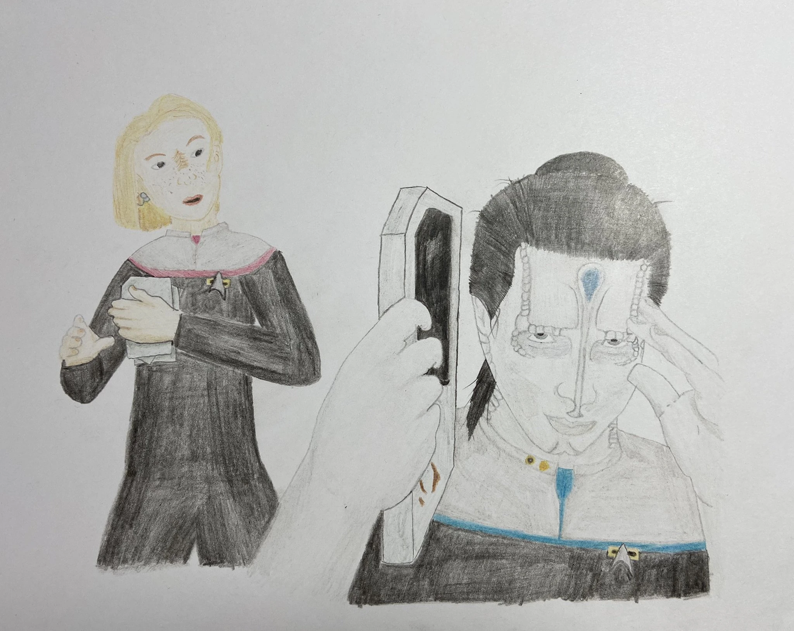
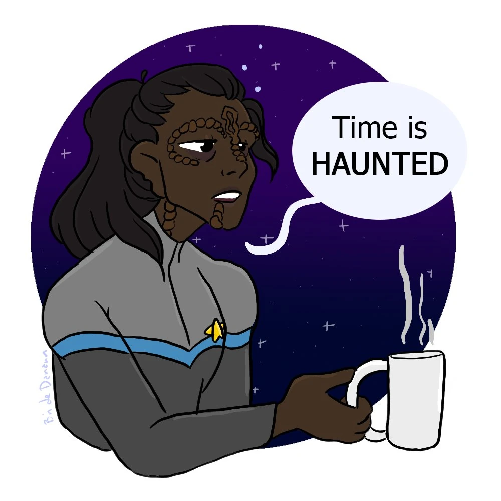

# Episode 25 Who We Are pt. 4

- **Source:** https://clear-skies-rpg.fandom.com/wiki/Episode_25_Who_We_Are_pt._4
- **Retrieved:** 2026-11-16
- **Wiki page ID:** 304
**Episode 25 — Who We Are pt. 4**

| Field | Value |
| --- | ----- |
| Air date | 08/10/2020 |
| Run length | 175min |
| Broadcast | Twitch [YouTube](https://www.youtube.com/watch?v=W4a2TasNgFI) [Spotify Podcast](https://open.spotify.com/show/4XRHFGJ4s4EV7LufmohEnQ?si=_ryT3XVATmiTtDsrx3Yt8w) |
| Cast | Eric Campbell Revati Dhomse Gina DeVivo Sam de Leve Aki Xander Jeanneret Bonnie Gordon |
| Previous | [Episode 24 Who We Are pt. 3](ep-24-who-we-are-pt-3.md) |
| Next | [Episode 26 Who We Are pt. 5](ep-26-who-we-are-pt-5.md) |

> "I regret everything I have ever said about the Federation.  Not just to you, but in my youth, in my training as an officer; the conditioning I received as a Romulan warrior of the Star Empire.  We are wrong about you."
>
> — Sorex

## Plot Synopsis
### Brief Overview
Lakat and Theq get as far as they can building the ESP for detecting cloaked ships.  They realize they need technology from the [J'Shashia](../characters/jshashia.md).  Lakat can't sleep and stays up talking to Yata.  He tells her that the Odanians experienced a phenomenon during the events of [Episode 13 Food of the Gods pt. 3](ep-13-food-of-the-gods-pt-3.md); they all simultaneously knew the location of the planet where Ree was located.  He brings up the events of [*Star Trek IV: the Voyage Home*](https://memory-alpha.fandom.com/wiki/Star_Trek_IV%3A_The_Voyage_Home) as being possibly related.

In the morning meeting, Lakat is haggard, and tells them all about her conversation.  Theq explains that they will need J'Shashian technology to perfect the ESP.  Sull says they have a higher priority: saving Sorex.  M'Qrell says she will operate on his appearance later that day.

M'Qrell successfully restores his original appearance, but Sorex falls into a coma.  She and Theq quickly move to do the necessary research to prove out their plan to use Borg nanites.  They are able to prove that it is safe, and Sull agrees to the procedure.  M'Qrell and Theq successfully save Sorex.  The nanites begin rebuilding his lost brain tissue.  Sorex wakes up, and tells Olyn that their father is a target for recruitment by the Tal Shiar.

### Pre-Break
The episode opens at 0200 in Cetacean Operations.  LTJG Lakat and MCPO Theq are starting to droop as they stand over consoles.  Dr. Yata floats between them, literally.  They get as much done as possible, but they discover that they will need the help of the [J'Shashia](../characters/jshashia.md) to finish it.  Yata asks what the J'Shashia were like, and he laments that he couldn't meet them.  Lakat says they were "jovial", and she and Theq demonstrate the greeting the use.  Yata laments that humanoids would think he was "cute" if he attempted to do such a thing. Humanoids always think Odanians are cute; Yata asserts that he is not.  An ensign walks by and offers to bring them drinks.  Lakat asks for two [raktajinos](https://memory-alpha.fandom.com/wiki/Raktajino).  Theq leaves to go to sleep, and he strongly hints that Lakat should, as well.

Lakat mumbles to herself about trying to sleep while being stalked.  Yata overhears, and he floats down, inquisitively.  He doesn't actually inquire further, however.  Instead, he echoes Theq's suggestion that she go to sleep.  Lakat tells him that he is a good friend.  She starts to pack up, but she still drinks some of the raktajino.  Yata begins to speak of her future.  He foresees that she will be exhausted tomorrow, and will get a strong lecture from CAPT Sull.  In the process, he does an amazing Sull impression.  Lakat says that she should not doubt the mind of someone who found an class M planet in the middle of nowhere ([Episode 13 Food of the Gods pt. 3](ep-13-food-of-the-gods-pt-3.md)).  Yata has a strange reaction to the comment, which Lakat notices.  Lakat doesn't press the issue.  She walks back to their room, finishes one of the raktajinos (Orwell knocks the other over), and goes to bed.

As she starts to rest, the ship is rocked by another bout of turbulence from the [Mutara class nebula](https://memory-alpha.fandom.com/wiki/Mutara_class) which [USS Ross](../ships/uss-ross.md) is currently within.  She recalls the last time she was in a dark place while the room shook and noises boomed outside: the orbital bombardment of Cardassia Prime.  She thinks of lying under a slab of concrete, wondering if her brother and the rest of her family were alive.  She realizes that she isn't going to sleep, and she gets out of bed.  She opens a data PADD and stares at the only message she sent for the Lalubell festival.  It is one word: "boo", and there has been no response.  She starts cleaning her plants to occupy her body while her mind wanders.  She thinks of the data PADD provided by Ree, and of all the interstellar life waiting for them in the [Shackleton Expanse](../locations/shackleton-expanse.md).  It reminds her of something else, and she heads to Cetacean Ops.

When she arrives, Yata swims over to greet her.  This time, she directly asks him about how he found the Redeeus planet in such a short time.  The perfect planet; one that is capable of sustaining a baby Crystalline Entity without risking the lives of sentient creatures.  Yata replies that he simply doesn't know.  He tells Lakat what happened.  At once, every single member of Yata's team simultaneously "knew" the location of the planet.  He says that it almost felt like they all heard a song in their heads.  Each of them also knew that each of the others knew.  Yata also felt an inexplicable sense of urgency to inform Sull.  Since then, the Odanians have been trying to figure out what happened, but have had no luck.  There are no unusual recordings on the sensor logs, there were no nearby spatial anomalies, no temporal effects, nothing.  The only "logical" explanation is a simultaneous mass hallucination (which makes no sense).  He shows Lakat all of the data they've collected before she can even ask.  He says that he'd like to return to Redeeus when they have some time.

Yata says that he does have one, very wild, theory.  He notes that phenomenon only occurred with the Odanians; none of the other species on board "heard" the song, not even the other cetaceans.  He was researching the history of the Odanians and the Federation.  In that work, he discovered one event that occurred 95 years ago, in 2286.  A mysterious and gigantic alien probe suddenly appeared over Earth, and nearly destroyed it.  The crew of USS *Enterprise*, in a commandeered Klingon bird-of-prey, identified that probe was emitting humpback whale song, and they travelled back to the 1970s and returned with two humpback whales (named George and Gracie).  The whales started singing, and the probe left.  ([*Star Trek IV: the Voyage Home*](https://memory-alpha.fandom.com/wiki/Star_Trek_IV%3A_The_Voyage_Home)).  Yata wonders if whatever advanced alien species sent the probe also communicated with the Odanian crew members aboard [USS Ross](../ships/uss-ross.md).  Lakat is fascinated, and spends the rest of the night absorbing all public information on the event.

The scene moves to the conference room, just prior to the morning meeting of senior staff.  LT Vrenn looks up at Lakat and notices her haggard appearance.  He gives her a look, and she replies "Whales ... time travel ... raktajino."  LTCDR M'Qrell starts scanning her, but only finds evidence of sleep deprivation.  YEO3 Azzmi starts passing out data PADDs, and Lakat shield her face so she can't see.  Sull choose not to say anything.

Azzmi hands a message to Theq; it's from Debluch Marrone, the engineer who helped design [USS Ross](../ships/uss-ross.md).  He says that the crew of USS Ross has done well, and also that USS Ross will never be able to upgrade to [bio-neural gel packs](https://memory-alpha.fandom.com/wiki/Bio-neural_gel_pack). Theq asks Lakat what happened to her after he went to bed.  Lakat replies "Time's haunted" and shows Theq the information she gathered last night.  The two start talking about "nightmares" and "time-travelling whales."  Sull asks for clarification and Lakat explains.  Sull says that they will revisit the issue once they have time.

Back on task, Theq explains that they will need some J'Shashian technology to finish their Electromagnetic Sensor Ping (ESP).  He asks AMB Olyn about contacting [Jateran](../locations/jateran.md).  LTCDR Prahl points out that [USS Ross](../ships/uss-ross.md) needs to travel closer to Jateran before they can do any real-time communications; Jateran doesn't have a subspace relay, yet.  Theq suggests they take the ship there, but Sull says that there are higher priorities.  Theq asks about using an away team, but Sull points out that none of the shuttles are fast enough.  Olyn asks Sull what the priority is.  Sull replies that they need to acquire life-saving technology for "a member of the crew".  Vrenn asks which crew member, and M'Qrell says it is Sorex.  Vrenn is confused that Sorex is being considered a member of the crew, and he says so.  Lakat slaps him upside the head.

M'Qrell says that she will be reverting Sorex's appearance to his original Romulan form later that day.  M'Qrell also says she wants to keep working with Theq and Lakat on using Borg nanites to help regenerate his brain.  Sull says that they will depart for acquiring a copy of the chip in Sorex's brain as soon as he provides a location; until then, they will stay in the nebula to keep IRW Aehallh at bay.  Vrenn points out that USS Ross is faster than IRW Aehallh, and so they could outrun them.  Sull says that they aren't fast enough to get out of range of IRW Aehallh's long-range sensors before they burn out the warp core.  Sull has a plan to emerge from the nebula at an unexpected location and then dog-leg their way to their destination.  Sull directs M'Qrell to look into the Odanian situation once the Sorex situation is resolved.  M'Qrell says that she will do so, and that she is ordering Lakat to take a personal day to sleep.
 
### Post-Break
The scene opens in sickbay, as M'Qrell stands over Sorex.  As she does the cosmetic surgery to restore his appearance, assisted by nurse ENS Leah Sky, she does a deep scan of his brain.  The surgery is successful; but, towards the end, Sorex has a small seizure and slips into a coma.  ENS Ahi Zaida assists her in stabilizing him.  Scans show that he has lost 12% of his brain mass.  M'Qrell calls Theq; she says they need to perform the procedure to use the Borg nanites very soon.  Theq says that it's too soon; they haven't done enough tests yet.  M'Qrell calls Sull.  She makes the pitch to use the nanites.  Sull says that they will need more assurances from M'Qrell before they are willing to authorize it.  M'Qrell says that she will take the next 24 hours to do the testing, but then a decision must be made.  Sull makes it clear that there will be very severe consequences if M'Qrell goes forward with the procedure without the necessary precautions.

The scene cuts to 24 hours later.  M'Qrell and Theq have completed the research and gotten Sull's permission.  They prepare to begin the procedure.  Rumor of the work spreads throughout the rest of the crew.  They discover that Sorex is actually a Romulan operative named Sorex, but they are generally supportive of him and concerned for his well-being.  Sull gives an inspiring speech before they start.  They refer to a "nigh omnipotent entity" which told them that the ship has a destiny (Episode 06).  Theq asks if the entity provided any other information that actually be helpful.

On the bridge, Azzmi informs everyone that the surgery is beginning.  At the same time, the ship enters a pocket of stability within the nebula.  The first part of the surgery goes very well.  Some of the nanites begin to fail, but Theq and M'Qrell compensate.  After six hours, the procedure is complete, and scans show that they nanites are actually rebuilding his lost brain matter.  M'Qrell turns to Theq, and tells him that his brother would be proud of him.  Theq says that he isn't proud of himself, and that maybe that is where his brother an he differ.  As he leaves, M'Qrell whispers to herself that they aren't different at all.

M'Qrell reports to Sull that the surgery was a success.  She praises Theq's efforts.  Sull says that they are proud of them both.  M'Qrell exits the surgery suite.  She sees LT Johla Sh'vhalis and LT Pyrrah Callum quietly studying cybernetics.  Pyrrah asks if Sorex is doing okay.  M'Qrell says yes, but to keep him isolated for now.  The two lieutenants say they will keep his room isolated.  M'Qrell reflects on the oddity of a struggle for life in one room, and normal life in the next.

Sorex wakes up in sickbay.  M'Qrell shows him his face in a mirror.  She informs him that they have stabilized his mind as well as restored his appearance.  Sorex asks her how she did it.  She says they used Borg nanites.  Sorex is shocked, but keeps his calm.  He asks to speak to EXEO and Olyn as soon as possible.

In the conference room, senior staff are gathered to wait for the final results.  Once she hears that Sorex is okay, Lakat leaves to go to sleep.  Before she exit, EXEO asks if she can send her some literature to read.  Lakat says "yes" and goes off to sleep.

EXEO and Olyn go to Sorex's bed.  Sorex looks at them.  He apologizes to them both for everything bad he ever said about the Federation.  EXEO says that she is pleased by his personal growth.  He looks at Olyn, and tells them that he chose them (on Earth) because he knew they would help him (Episode 01).  Olyn mentions that he once told them they were an easy mark.  Sorex says that he has remembered some things; he had dreams during the surgery.  He thinks they were memories.  He tells Olyn that her father, AMB Daro Madzhin-Nil is a target for recruitment by the [Tal Shiar](https://memory-alpha.fandom.com/wiki/Tal_Shiar).  Olyn accuses him of lying.  Sorex says that it's possible, since his memories might be false.  But, it is one of the reasons he chose Olyn to try to get on USS Ross.  He remembers being told Daro was a possible asset for the Tal Shiar.  Olyn asks him about what, but he says he doesn't know.

Sorex says that he knows his family was a lie.  He never had a family.  He also now knows the identity of the two menacing figures stalking his dreams.  One of them is [Sela](https://memory-alpha.fandom.com/wiki/Sela), and the other is ADM Mendak.  He doesn't know why, but he is important to them for some reason.  Sorex leans back and closes his eyes.  EXEO says a kind word.  Olyn exits swiftly and silently.

In her quarters, Lakat lies down on her bed.  She stares at the ceiling.  The ship is quiet now; it is inside the "eye" of the nebula.  Orwell jumps on her and lays down on her chest.  He rests is chin on hers, and he goes to sleep.  Listening to the sound of him snore, Lakat drifts off.

## Cast
-  Eric Campbell - Game Master
-  Revati Dhomse - Jane Lakat
-  Gina DeVivo - EXEO
-  Sam de Leve - Azeri Sull
-  Aki - Olyn Madzhin-Nil
-  Xander Jeanneret - Theq Lynadas
-  Bonnie Gordon - M'Qrell

## Non-Player Characters
-  Yata
-  Yeri Prahl
-  Zhyliss Vrenn
-  Azzmi Shanto
-  Leah Sky
-  Ahi Zaida
-  Sorex
-  Johla Sh'vhalis
-  Pyrrah Callum

## Notable Lines
> "I'm not cute, Chief Theq."
>
> — Yata
> "[It sounded like] the absence of noise in the universe ... almost as if the universe around us grew softer, so that we could hear a 'hum', but there was no 'hum'"
>
> — Yata
> "Whales were extinct on Earth for a while ... thanks to the hubris and stupidity of the human species, particularly in the 20th and 21st centuries."
>
> — Yata *(to Jane Lakat)*
> "Well that sounds like a problem for bio-neural gel packs."
>
> — Theq Lynadas *(about USS Ross not being compatible with bio-neural gel packs)*
> "I regret everything I have ever said about the Federation.  Not just to you, but in my youth, in my training as an officer; the conditioning I received as a Romulan warrior of the Star Empire.  We are wrong about you."
>
> — Sorex

## Notes and Trivia
-  The message that Jane Lakat sent for Lalubell was described in the Roleplay section of the [Streampunks](https://www.patreon.com/Streampunks) discord server.
-  At the end of the episode, Eric announces that the entire crew has earned a milestone.
