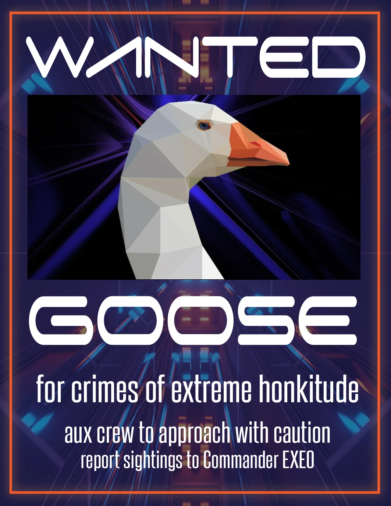

# Episode 26 Who We Are pt. 5

- **Source:** https://clear-skies-rpg.fandom.com/wiki/Episode_26_Who_We_Are_pt._5
- **Retrieved:** 2026-11-16
- **Wiki page ID:** 305
**Episode 26 — Who We Are pt. 5**

| Field | Value |
| --- | ----- |
| Air date | 08/17/2020 |
| Run length | 183min |
| Broadcast | Twitch [YouTube](https://www.youtube.com/watch?v=iLBSFHlonlc) [Spotify Podcast](https://open.spotify.com/show/4XRHFGJ4s4EV7LufmohEnQ?si=_ryT3XVATmiTtDsrx3Yt8w) |
| Cast | Eric Campbell Revati Dhomse Gina DeVivo Sam de Leve Aki Xander Jeanneret Bonnie Gordon |
| Previous | [Episode 25 Who We Are pt. 4](ep-25-who-we-are-pt-4.md) |
| Next | [Episode 27 Who We Are Meant to Be pt. 1](ep-27-who-we-are-meant-to-be-pt-1.md) |

> "I really can't wait to no longer be in hiding."
>
> — Olyn Madzhin-Nil

## Plot Synopsis
### Brief Overview
[pending]

### Pre-Break
The episode opens on the bridge at the start of alpha shift.  The ship is still inside a calm patch in the center of the nebula.  CAPT Sull informs LT Lakat that she will get a treat if she finds a new life-form inside the nebula.  AMB Olyn arrives on the bridge, without their dog, Patience, which Lakat notices.  CDR EXEO gets a message just before start of shift that MCPO Theq has requested a counselling session. EXEO has been working several projects related to Olyn's dilemma.

The scene moves to the conference room.  Theq reminds everyone that work on the "ESP" detector for finding the stealthed Romulan ship cannot continue without technology from the [J'Shashia](../characters/jshashia.md).  Sull asks LTCDR M'Qrell about the condition of Sorex. M'Qrell states that he is healing well, but staying out of sight since he now appears Romulan again. LTCDR Prahl reminds the table that sensors and shields do not function in the nebula, and communication is difficult. Olyn asks what it would take to send a message, and Sull speculates that they could load a message onto a probe and send the probe out of the nebula. Lakat reports that her scans of the nebula have discovered nothing of interest. Sull expresses mild disappointment at Lakat's lack of findings. Prahl reminds Theq that a holographic goose has been tormenting the staff, and that he needs to identify the source of the glitch. As everyone leaves, Olyn requests a private conversation with Sull, and departs. Prahl stays behind.

Prahl asks Sull the purpose of staying inside the nebula. Sull replies that it is to buy time to develop a plan. They discuss the nature of the threat following them. Prahl questions why ADM Mendak didn't destroy the shuttle with Sull in it at the Crime Planet (name). Sull suggests that Mendak is desperate to get a hold of Sorex, but doesn't know why. Prahl posits that Mendak won't destroy USS Ross as long as Sorex is aboard.

Prahl also questions why Mendak's ship is emitting neutron radiation which they can track. He points out that neutron radiation is associated with a cloaked Klingon ship from the 2260s, and not Romulan technology. He adds that [Praetor Shinzon](https://memory-alpha.fandom.com/wiki/Shinzon) had a ship which could fire while cloaked, and it did not emit neutron radiation. Prahl concludes that the neutron radiation surges are intentional decoys designed to fool USS Ross. Sull asks for the appropriate tactical response. Prahl states that they need Theq to modify the "ESP" to look for something other than neutron surges, but that they don't know what, yet. Prahl also suggests contacting the Klingon Empire to get allies.

Sull leaves and goes to their ready room to meet with Olyn and EXEO. Olyn informs Sull that Sorex claimed Olyn's father, AMB Daro Madzhin-Nil, is a recruitment target for the [Tal Shiar](https://memory-alpha.fandom.com/wiki/Tal_Shiar). EXEO states that she has been researching Daro and provides the data to Sull. Daro has had a very distinguished career, and is currently a member of the Federation President's inner circle. However, the last several pages of his service record is classified. Olyn is slightly alarmed as to why their father's record would be redacted. Sull wonders aloud what could make Daro vulnerable to recruitment by a foreign intelligence service.

Olyn shares that they only had two recent contacts with their father. They had him investigate the source of the order which sent [USS Ross](../ships/uss-ross.md) on the mission to retrieve a changeling. They also found out that he had helped them avoid consequences related to their misstep on Starbase 105 after USS Ross returned with the changeling. Sull asks Olyn if they might actually be their father's weakness, but Olyn can't think of a reason. Sull and EXEO brainstorm a bit over Daro's record, but they cannot find any obvious weaknesses. Sull asks Olyn what their father's loyalties are, and Olyn replies his family, the Federation, and Delta. Olyn speculates that he values their family above everything else. Sull wonders if the answer is hidden in the redacted portions of his record. Sull asks where Olyn's father was replying from during their recent contact. Olyn states that it was Earth, and that it has been a long time since he was stationed anywhere other than Earth. They decide that Olyn should try and send a covert message to their mother to find out what Daro has been up to. Olyn leaves, and EXEO remains behind. EXEO says they are next going to make dossiers on Daro's staff members, and on Sorex's Federation cover persona. EXEO points out that they don't know at what point Sorex's brain damage caused him to reach out to Olyn to 'protect his family'. She considers that it is possible Sorex being placed on USS Ross is exactly the leverage needed to recruit Daro.

### Post-Break
Sorex stops by sickbay for a regular checkup with M'Qrell and Theq. His brain has 100% healed, though it's full of Borg nanites, and not all of his memory has returned, yet. During the checkup, M'Qrell decides to test his reflexes by suddenly throwing a souvenir [Horga'hn](https://memory-alpha.fandom.com/wiki/Horga%27hn) at him. Sorex isn't paying attention, and it hits him in the chest. He drops it, confused. M'Qrell jokingly states that it's revenge for injuring her shoulder. ENS Sivath, a nurse, walks over and takes the Horga'hn to return it to M'Qrell's desk. M'Qrell tells Sorex she was just testing his reflexes. He stares at her, and she asks if he's trying to challenge her. As he gets up, Sorex suddenly pulls the hand phaser from the belt of a nearby security officer and points it, handle first, at M'Qrell's head. The security officer's snatch it out of his hand, restrain him, and escort him out of sickbay. M'Qrell calls Sull to request holodeck time for Sorex.

Meanwhile, EXEO is trying to figure out a way to keep the crew entertained while USS Ross slowly moves through the nebula. She concludes that they should hunt the goose. She goes to put up a WANTED poster for the goose on the promenade.

Meanwhile, Lakat has ordered all of the science department to find life-forms in the nebula. After her shift, she goes to the Arboretum to relax. Olyn heads there with Patience to find Lakat. When they arrive, Lakat completely ignores Olyn, and has a full conversation with Patience. She makes it clear she is upset with Olyn for not sharing their troubles with her. Olyn hands over a PADD with Daro's file, showing some of it is redacted. Lakat suggests they move to her quarters.

On arrival, Orwell excitedly greets Patience. Lakat questions Olyn as to why Daro's file is partially redacted. Olyn tells Lakat about Sorex's claim that Daro is a recruitment target of the Tal Shiar. Lakat speculates that Olyn may be the actual target. Lakat reads Daro's file to find out what he was up to just prior to the redacted session. It states he was on Earth working on post Dominion War relations. He specifically worked with the Federation Council on aid to Cardassia. Lakat invents a scheme to encode a letter to Olyn's mother. The message is loaded on a buoy, along with other messages from the crew, and the buoy is shot out of the nebula.

Four days later, just before USS Ross exits the nebula, M'Qrell contacts Lakat. She gives her a sample of bacteria which had mutated while the ship was inside the nebula. Therefore, it is a new life-form found inside the nebula.

The scene moves to the bridge, as USS Ross exits the nebula. Lakat scans the surroundings. She finds nothing of note, except USS Nye, a [*Nova* class](https://memory-alpha.fandom.com/wiki/Nova_class) federation science vessel. As soon as USS Ross is back in contact with the Federation networks, Olyn receives a reply to their letter.

Sull orders LT Vrenn to plot a course away from the nebula, maximum warp, for as long as they can hold it (about 3 days). Theq informs Sull that the ship will not be able to return to maximum warp again for a while once that is complete. Sull orders him to find a way to get more power. In the engine room, ENS Dari jokes to Theq that she knew there would come a time when Sull would demand more power. The two get to work tweaking the engines, and successfully rig the ship to regenerate the power used to maintain the warp. However, the ship will require maintenance once the next leg of the journey is complete.

The scene cuts to EXEO's office. Sull is speaking with Sorex. Sull tells him that they need a course heading. Sull needs the location of the schematics to the chip installed in his brain. Sorex says the destination is deep inside Romulan space; USS Ross cannot make the journey. Sorex recommends they acquire alternate transportation across the neutral zone, and a small team of operatives willing to do what is necessary. Sorex suggests they acquire a Romulan ship. He says they should go to Nimbus 3. Supposedly, there is a Romulan shuttle there. The other option is to murder the crew of a Romulan ship. Sull prefers the first option. Since Nimbus 3 is in the Romulan Neutral Zone, USS Ross cannot make the trip. Sull says they will take the ship closer to the border, and then make the trip with a shuttle while USS Ross leads Mendak away. Sull asks Sorex why Mendak wants him so badly, anyway. Sorex doesn't know. Sull asks if Mendak could be working for [Sela](https://memory-alpha.fandom.com/wiki/Sela), but Sorex isn't sure. He does say that Mendak is not a member of the Tal Shiar; he is a true patriot. Sull asks who in the Romulan Star Empire would be opposed to Sela. Sorex says the Romulan Senate, the supporters of Reman rights, those opposed to "vulcan reunification" (conquest), and any progressives within the empire.

Meanwhile, in their quarters, Olyn opens the message from their mother. Once opened, the text file disappears, and establishes a secure connection on an encrypted subspace channel directly to startfleet command. Olyn's father Daro is on the other end.

"Olyn, it's time to talk."

## Cast
-  Eric Campbell - Game Master
-  Revati Dhomse - Jane Lakat
-  Gina DeVivo - EXEO
-  Sam de Leve - Azeri Sull
-  Aki - Olyn Madzhin-Nil
-  Xander Jeanneret - Theq Lynadas
-  Bonnie Gordon - M'Qrell

## Non-Player Characters
-  Zhyliss Vrenn
-  Yeri Prahl
-  Azzmi Shanto
-  Sorex
-  Sivath
-  Aulyn Dari
-  Daro Madzhin-Nil

## Locations
-  [USS Ross](../ships/uss-ross.md)
-  Arboretum

## Notable Lines
> "On top of everything, it's an unremarkable puff-cloud, captain."
>
> — Jane Lakat
> "I really can't wait to no longer be in hiding."
>
> — Olyn Madzhin-Nil
> "Oh, you want to work on the project that's about haunted time and whales?"
>
> — Jane Lakat *(to a hypothetical Ensign in her department)*

## Notes and Trivia
-  Eric fully describes the arboretum on USS Ross for the first time.
