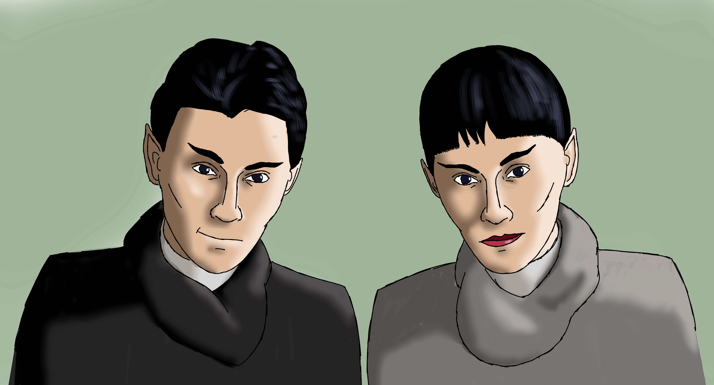
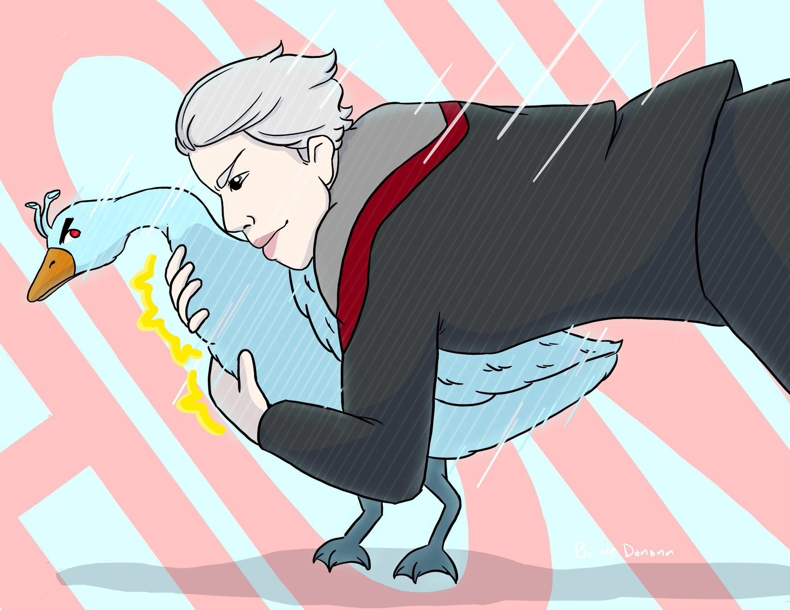
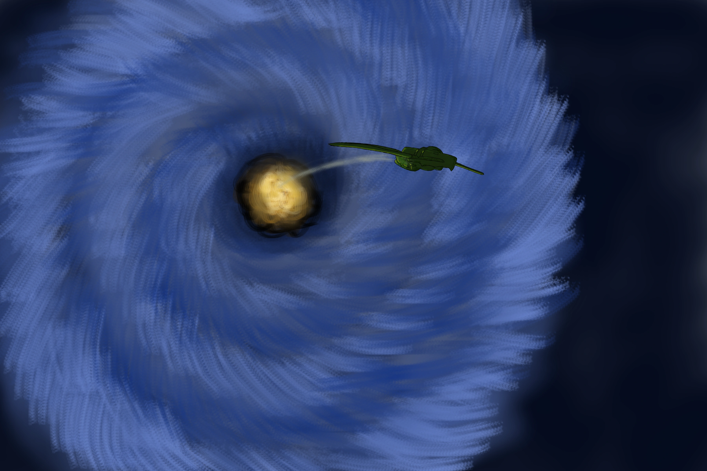

# Episode 29 Who We Are Meant to Be pt. 3

- **Source:** https://clear-skies-rpg.fandom.com/wiki/Episode_29_Who_We_Are_Meant_to_Be_pt._3
- **Retrieved:** 2026-11-16
- **Wiki page ID:** 554
**Episode 29 — Who We Are Meant to Be pt. 3**

| Field | Value |
| --- | ----- |
| Air date | 09/14/2020 |
| Run length | 181min |
| Broadcast | Twitch [YouTube](https://www.youtube.com/watch?v=-7dlfZlSyp8) [Spotify Podcast](https://open.spotify.com/show/4XRHFGJ4s4EV7LufmohEnQ?si=_ryT3XVATmiTtDsrx3Yt8w) |
| Cast | Eric Campbell Revati Dhomse Gina DeVivo Sam de Leve Aki Xander Jeanneret Bonnie Gordon Jody Houser Jackson Lanzing |
| Previous | [Episode 28 Who We Are Meant to Be pt. 2](ep-28-who-we-are-meant-to-be-pt-2.md) |
| Next | [Episode 30 Who We Are Meant to Be pt. 4](ep-30-who-we-are-meant-to-be-pt-4.md) |

> "They told us that a toaster was not alive. We proved them wrong, empirically. And then, that toaster became a member of the Federation Council."
>
> — Stavek

## Plot Synopsis
### Brief Overview
The episode begins where [Episode 27 Who We Are Meant to Be pt. 1](ep-27-who-we-are-meant-to-be-pt-1.md) left off. Theq and Vrenn are introduced to civilian scientists Stavek and T'Vek. Together, they come up with a plan to use a torpedo to detonate the particle fountain. The explosion will also fire holoemitters in every direction, hoping to strike IRW Aehallh. It will then upload the goose onto the ship, disrupting its systems.

EXEO and Olyn contact Mendak. Olyn tries to talk him down, but he is unmoved. Azzmi Shanto begins researching interstellar law regarding extradition of suspected criminals. Theq, Stavek, and T'Vek successfully build the device and EXEO successfully catches the goose.

[pending]

### Pre-Break
The episode begins where [Episode 27 Who We Are Meant to Be pt. 1](ep-27-who-we-are-meant-to-be-pt-1.md) left off. [USS Ross](../ships/uss-ross.md) is in the [Jotaym System](../locations/jotaym-system.md), in station keeping near a [particle fountain](https://memory-alpha.fandom.com/wiki/Particle_fountain_%28anomaly%29). Somewhere nearby is IRW Aehallh, a Romulan ship capable of firing while cloaked. It is captained by ADM Mendak. He has demanded that [USS Ross](../ships/uss-ross.md) hand over the Romulan [Tal Shiar](https://memory-alpha.fandom.com/wiki/Tal_Shiar) agent, Sorex, who has claimed asylum. They have two hours to turn him over, or Mendak will destroy the nearby space station, [Space Ring Observer](../locations/space-ring-observer.md), which is populated by civilian [J'Shashia](../characters/jshashia.md)n scientists. He will also destroy USS Ross. Sorex is currently undergoing a secret mission with half of the senior staff ([Episode 28 Who We Are Meant to Be pt. 2](ep-28-who-we-are-meant-to-be-pt-2.md)).

MCPO Theq and LT Vrenn are currently in Cetacean Operations talking to Dr. Yata. They want to build a device to detonate the nearby particle fountain and illuminate IRW Aehallh. Yata tells them that he is not the correct person to help, but that he does know who is. There are two civilian scientists who have been aboard USS Ross since it departed spacedock; they are rarely seen, and very eccentric.

Yata calls these mysterious scientists, named Stavek and T'Vek. In their messy laboratory, full of half-built projects, Stavek suggests they ignore the call. T'Vek answers, saying that it might be important. Yata tells them he could use their help in Cetacean Ops for a matter important to the survival of the ship. Stavek is annoyed; T'Vek points out that their work will be lost if the ship is destroyed.

Vrenn asks Theq if he's ever heard of these two. Theq remembers that they are twins from the [Daystrom Institute](https://memory-alpha.fandom.com/wiki/Daystrom_Institute), who have accomplished impressive things. They are never seen in social functions, but are known for doing out-of-the-box projects. Theq remarks that they remind him of [Binar](https://memory-alpha.fandom.com/wiki/Binar). The two arrive and Theq fills them in. Stavek cracks a joke using a citation/cetacean pun. He says it is important to shake up the thinking of those in a panic. They all head to engineering.

On the bridge, CDR EXEO calls a meeting with AMB Olyn, LT Roh Gerz, and YEO3 Azzmi. EXEO can tell that Azzmi is nervous; Olyn can empathically feel nerves throughout the ship. EXEO says they need to plan for the possible explosion. She says that she has no intention of fighting; she wants Olyn on the line for the next communication with Mendak. EXEO says it is a good thing that Mendak doesn't respect her; Azzmi says it might be an advantage. Azzmi points out that the United Federation of Planets and the Romulan Star Empire have a treaty, and that attacking a Federation starship is an act of war. Olyn says that they've been trying to contact the head of Romulan affairs in the Federation Diplomatic Corps, but they haven't had any luck. Azzmi suggests contacting AMB P'jeeno on Narendra Station. Olyn points out that Mendak has jammed communications between USS Ross and P'jeeno before. Gerz says that they might be able to break through the jamming, but EXEO is concerned that would provoke Mendak. Olyn says that communicating with Narendra Station first might escalate the situation.

EXEO says that step one is to de-escalate as much as possible. Step two is apprehend and arrest Mendak. They create an open channel that they know Mendak will monitor. EXEO sits in the center chair, submissively. Olyn stands next to them and speaks to the void. They ask that Mendak disengage; they say he is in violation of treaty and that any aggressive action risks the peace between the two governments. They ask that he leave the J'Shashians alone, since they are not a threat to anyone. A few minutes pass, and Mendak answers. He greets Olyn, and demands the return of Sorex. Olyn says that Sorex is ill, and only the doctor on USS Ross can treat him. Olyn also says Sorex has requested asylum. Mendak says that Sorex is a criminal, and he must be returned. Olyn asks what crime Sorex has committed; the Federation needs to know before they can extradite him. Mendak accuses Olyn of interfering in the internal affairs of the empire. He restates his terms. Olyn accuses him of "stooping so low" as to threaten innocents. Mendak abruptly ends the communication, but not before Olyn gets the sense that he isn't keen to attack the J'Shashians.

EXEO tells Azzmi to research who has the legal rights to hold an asylum seeker who is also a criminal. Azzmi gets to work. EXEO suspects that Mendak might back down if they can prove that he doesn't have a legal right to Sorex. Olyn wonders if they might be able to contact Narendra Station now. EXEO orders LT June Robinson to assist Olyn in making a secure call to Narendra Station.

Meanwhile, in main engineering, Vrenn is being left behind by all the math. Stavek immediately erases all of the work Theq has done making a blueprint on the holoprojector. Stavek starts building from scratch. Stavek and T'Vek discuss the importance of figuring out what to do *after* the torpedo reveals IRW Aehallh. T'Vek says they could use the particle fountain to power something. Stavek has an idea. He begins building something to go on top of the torpedo. He suggests a large amount of holo emitters placed on the torpedo. They will spread out in every direction upon detonation, and one of them will stick to the hull of IRW Aehallh. Then, EXEO can hack into IRW Aehallh's systems. Vrenn asks if the plan is to shoot EXEO at the Romulans; T'Vek corrects him. The plan is to use *a portion* of EXEO. Theq suggests the holoemitter project a hologram that appears as Sorex. Stavek points out that IRW Aehallh doesn't have any holoemitters inside. T'Vek suggests putting an emitter in an object for IRW Aehallh to retrieve.

Vrenn interrupts with an idea of his own. He says they should use the goose. Theq explains the nature of the goose; that it is a glitch which affects USS Ross' systems. Stavek clarifies that the goal is to infect IRW Aehallh so that its systems are "gooseified". Theq asks T'Vek if the plan is logical; T'Vek agrees. Theq tasks Vrenn with apprehending the goose. As Theq and Vrenn leave, Stavek turns to T'Vek. He is genuinely surprised that Theq and Vrenn agreed to his plan so easily; he expected to have to go around them and speak to EXEO directly. T'Vek says that it speaks well of the crew of USS Ross.

Vrenn informs EXEO of the plan, and she agrees to catch the goose. They begin building the device. They have a little under 2 hours before Mendak attacks. Theq brilliantly assembles the torpedo. T'Vek brilliantly completes the theoretical work on the emitters. Stavek brilliantly completes the emitters. EXEO brilliantly body tackles the goose.

### Post-Break
On the bridge, Azzmi informs EXEO that there is no solid legal grounds either way for their situation. The winner is "whoever bluffs the most".

In their offices, Olyn gets ready to call Narendra Station. LT Robinson makes the secure connection, and tells Olyn to be quick. Olyn sends a message to P'jeeno asking for help in stopping an attack from Mendak. A few minutes later, P'jeeno makes a live connection to USS Ross. He says that there isn't much he can directly do; Mendak has gone off the grid. Mendak was thought to be a [Sela](https://memory-alpha.fandom.com/wiki/Sela) loyalist, but recently he stole technology from the Romulan Imperial Navy and disappeared with it. No one knows his motivations. The connection ends. Olyn rushes to the bridge to tell EXEO that Mendak is operating outside the authority of the Romulan Star Empire.

Stavek taps into the ships messaging system to request a meeting with EXEO. On the bridge, EXEO gets Priority One (usually reserved for threats to ship safety) message. It contains a tiny hologram of Stavek and T'Vek requesting to meet EXEO. EXEO turns to Olyn and says "I believe I've just received my first fan mail." EXEO blips down to meet the twins. Stavek freaks out for a second before composing himself. He begins admiring EXEO, as a person, not a machine. T'Vek just nods to her. Stavek tells the story of how they won the Daystrom Prize. "They told us that a toaster was not alive. We proved them wrong, empirically. And then, that toaster became a member of the Federation Council." EXEO replies "that was you?". T'Vek adds that it was a very good toaster. T'Vek makes a small goose pun, and Stavek is very proud of her. She says that he is a bad influence on her. EXEO is clearly delighted at the conversation. The two brief EXEO on the function of the torpedo. As she departs, Stavek tells her to "Live forever, and prosper."

On the bridge, Gerz asks EXEO if they should arrest Stavek for hacking her chair; EXEO says "no". Olyn asks if they should warn Mendak. EXEO says that Mendak won't back down, they should just fire it. Olyn proposes firing it after the speak to him; EXEO agrees. They open a channel, and Mendak appears. EXEO stands, this time. Mendak seems impatient. Olyn informs him that they have orders from the Romulan Star Empire to take him and IRW Aehallh to the empire for arrest, and they cut the transmission.

Theq orders the torpedo to fire, but it doesn't launch. He gets a call that there is an intruder in the main torpedo bay, and then the torpedo launches. Gerz looks at sensors and shouts "incoming!". They look to the view screen to see a gigantic plasma torpedo headed straight for USS Ross from their ventral side. Then the particle fountain explodes. Theq is shown footage of an Andorian in an all-black body suit leaping over a torpedo containment unit and disappearing into thin air. Immediately after, a wave of [tetryon particles](https://memory-alpha.fandom.com/wiki/Tetryon) strikes everything in the area. Power drains from USS Ross; sensors and shields go down.

EXEO is suddenly overcome by dizziness, and then sheer terror. Olyn is stunned to realize they can empathically sense EXEO's fear (which shouldn't be possible). EXEO's image on the bridge flickers. EXEO blinks, and wakes up in the dark room from her dream, with Dr. Redgrave speaking to her ([Episode 23 Who We Are pt. 2](ep-23-who-we-are-pt-2.md)). She blinks again and she is on the bridge. Olyn tries to grab her hand, but they pass right through her. EXEO tries to focus; she asks for sensor readings. LTJG Talen reports from the science station that all sensors are down. Olyn tries to reach out empathically, but the sheer force of EXEO's confusion and terror nearly overwhelms them.

Olyn tells EXEO to breathe; EXEO reminds them that she doesn't need to breathe, but she does it anyway. EXEO calls Theq and the twins to the bridge. She also orders engineering to use the secondary warp core to recharge ship's systems. Some systems return: maneuvering thrusters, visuals, and a weak set of sensors. Weapons, shields, and the tractor beam are still down. Sensors detect massive detonations popping off all around the system; the explosion from the particle fountain seems to have triggered a large amount of smaller gravimetric disturbances. Theq looks at the data on the engineering console; the torpedo detonated one second too early, which indicates tampering. It also started giving off [polaric ion energy](https://memory-alpha.fandom.com/wiki/Polaric_ion_energy), which is usually only found near subspace fractures. Theq looks at all of the different detonations and sees a pattern; it looks like an intentional web of detonations.

Sensors also show that [Space Ring Observer](../locations/space-ring-observer.md) is completely without power, and flying out of its orbit. It is safe, though. The plasma torpedo has completely disappeared from sensors, but there is no indication of why. IRW Aehallh is spinning out of control through space; so is USS Ross. There is no direct evidence that the holoemitters worked, but they probably did. Theq forwards all of the data to Yata and T'Vek. Vrenn stabilizes the ship.

Stavek is focused on EXEO. He passes a hand through her to see if her holomatrix is still stable; it is. Stavek looks to Olyn and asks if they can sense anything. Olyn says they can feel fear from EXEO. They also realize the emotions are coming from EXEO's computer core as well as her holographic form. EXEO says it's impossible for Olyn to be empathically sensing her. Stavek starts recalling the historical record of incidents where sentient machines were detected by empaths; it is rare, but it has happened. Stavek advises EXEO to keep an eye on herself.

Talen screams, and tells everyone to look at the view screen. They all look, and see something approaching USS Ross. It looks like a giant carpet moving through space. Sensors indicate that it is alive. A giant, shiny flatworm-shaped thing moving through space. Olyn can empathically feel a wave of insatiable curiosity coming from the life-form. Olyn announces that there is an "explorer" approaching them. EXEO blips to the outside of the ship. USS Ross scans the life-form. It's never been seen before, it emerged from subspace through the particle fountain, and it's scanning them.

EXEO blips to the underside of USS Ross to look for IRW Aehallh, but it's too far away to see on visuals. Stavek runs scans of IRW Aehallh to see if the goose worked. He reports that "the goose is loose". Stavek advises Vrenn to pursue IRW Aehallh while they have the advantage. Vrenn tells him they still don't have impulse or warp engines. EXEO orders Gerz (the next ranking officer on the bridge) to continue pursuit of Mendak. She then tells Theq that she is going to take herself offline; he must divert power from her computer core to help repair USS Ross.

EXEO takes one last look at the space flatworm. It starts to turn back towards the particle fountain, and Olyn can feel a sense of alarm from the creature. EXEO turns herself off, but just before she loses consciousness, ship alarms and warnings go off all over the bridge. Talen screams "What now!?". Theq looks at the sensor readings. The chain reactions in the various gravimetic anomalies build and build. They reach a peak intensity, and a gravitational force field forms in front of the particle fountain. 

A [wormhole](https://memory-alpha.fandom.com/wiki/Wormhole) appears, and from it emerges an Orion Interceptor. Slibazz's voice comes over the communications, before Sull pushes him aside and asks to talk to EXEO. Theq replies that EXEO is offline, but it's okay because ...

They have TWO warp cores.

## Cast
-  Eric Campbell - Game Master
-  Revati Dhomse - Jane Lakat (absent)
-  Gina DeVivo - EXEO
-  Sam de Leve - Azeri Sull (absent)
-  Aki - Olyn Madzhin-Nil
-  Xander Jeanneret - Theq Lynadas
-  Bonnie Gordon - M'Qrell (absent)
-  Jody Houser - T'Vek
-  Jackson Lanzing - Stavek

## Non-Player Characters
-  Yata
-  Zhyliss Vrenn
-  Roh Gerz
-  Talen
-  Mendak
-  Azzmi Shanto
-  June Robinson
-  [Yugoss](../characters/yugoss.md)
-  Amandeep Singh
-  P'jeeno
-  Andrea Redgrave

## Locations
-  [Jotaym System](../locations/jotaym-system.md)
-  [Space Ring Observer](../locations/space-ring-observer.md)

## Ships
-  IRW Aehallh
-  Tirazz's Baby

## Notable Lines
> "[I] don't want to cause a panic but their is a cloaked Romulan ship aiming to destroy us in two hours."
>
> — Theq Lynadas
> "I think, in this case, he may have dramatically underestimated you."

> "People tend to."
>
> — EXEO

> "I was just going to start talking about explosions and that might not ease the anxiety in this room."
>
> — EXEO
> "We pull a card from our great Captain Sull and try to arrest him with the tractor beam."
>
> — EXEO
> "As you know, everything is better when it is alive."
>
> — Stavek
> "Commander EXEO is the future of all Starfleet captaincy, and captaincy will be redundant within the next generation; let us teach the Romulans this."
>
> — Stavek
> "We're gonna shoot EXEO at it; that's the plan."
>
> — Zhyliss Vrenn
> "I have an idea. Don't we have a goose?"
>
> — Zhyliss Vrenn
> "Where have you been all my life."
>
> — Theq Lynadas *(to Stavek and T'Vek)*
> "I believe I've just received my first fan mail."
>
> — EXEO
> "I understand that in non-Vulcan society it is customary to apologize, but I hope you will accept that I will not."
>
> — Stavek
> "They told us that a toaster was not alive. We proved them wrong, empirically. And then, that toaster became a member of the Federation Council."
>
> — Stavek
> "Live forever, and prosper."
>
> — Stavek *(to EXEO)*
> "Lakat is going to be so mad that she missed this."
>
> — Several different people

## Notes and Trivia
-  In the Graduation Day two-shot (Graduation Day), Sam de Leve played a young Andorian named Syril, who was recruited into the Temporal Defense Initiative at the end of the story arc.
