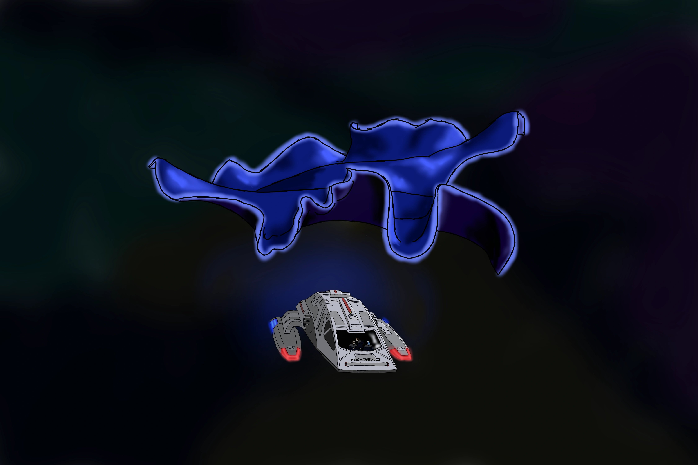

# Episode 30 Who We Are Meant to Be pt. 4

- **Source:** https://clear-skies-rpg.fandom.com/wiki/Episode_30_Who_We_Are_Meant_to_Be_pt._4
- **Retrieved:** 2026-11-16
- **Wiki page ID:** 570
**Episode 30 — Who We Are Meant to Be pt. 4**

| Field | Value |
| --- | ----- |
| Air date | 09/21/2020 |
| Run length | 183min |
| Broadcast | Twitch [YouTube](https://www.youtube.com/watch?v=HAIjLVrMQlg) [Spotify Podcast](https://open.spotify.com/show/4XRHFGJ4s4EV7LufmohEnQ?si=_ryT3XVATmiTtDsrx3Yt8w) |
| Cast | Eric Campbell Revati Dhomse Gina DeVivo Sam de Leve Aki Xander Jeanneret Bonnie Gordon |
| Previous | [Episode 29 Who We Are Meant to Be pt. 3](ep-29-who-we-are-meant-to-be-pt-3.md) |
| Next | [Episode 31 The Refit pt. 1](ep-31-the-refit-pt-1.md) |

> "Thankfully, the ship hasn't exploded."
>
> — EXEO

## Plot Synopsis
### Brief Overview
[pending]

### Pre-Break
The episode resumes where [Episode 29 Who We Are Meant to Be pt. 3](ep-29-who-we-are-meant-to-be-pt-3.md) left off. It opens in Tirazz's Baby, where LTJG Lakat, CAPT Sull, LTCDR Prahl, LTCDR M'Qrell, Sorex, and Slibazz have just emerged from the wormhole.

Lakat scans the system. She detects massive power imbalances in [USS Ross](../ships/uss-ross.md), but they soon level off. Sull orders her to scan and hail [Space Ring Observer](../locations/space-ring-observer.md). Prahl reports that he can't establish communication. A few moments later, a gigantic entity moves over the ship. Lakat looks at the sensors; she sees that the entity is biological, and that it is scanning them. Lakat has a moment of shock. Sull orders her to transmit what data they have to USS Ross, and to focus on finding IRW Aehallh. Lakat tries, but scanners are down beyond short range. Sull orders Lakat to return to USS Ross.

Lakat transports over to USS Ross, still in her outfit resembling Cardassian military gear. A surprised ensign greets her, but she just pats him on the shoulder and heads to the bridge. She rushes to the science station. She scans Space Ring Observer; it has fully functional life-support, but took one heck of a hit. From the engineering station, MCPO Theq informs her that the space flatworm emerged from the particle fountain after they detonated it with a torpedo. Theq tells her that her outfit is making some of the crew nervous; it's bringing up "bad memories". Lakat tells him to get over it and go fix the sensors. Theq leaves the bridge, and Olyn can sense that he's upset. Lakat calls him, and Theq brusquely tells her that he is busy working on the sensors. She says that she is there for emotional support, but he replies that he doesn't need any and hangs up.

Lakat looks at the sensor logs. She sees that the energy detonations which created the wormhole should not have been possible based on the design that Theq, Stavek, and T'Vek came up with. She also sees that the space flatworm emerged from subspace through the particle fountain. It proceeded to move towards USS Ross and scan it. Lakat comes up with the idea of distracting the worm with a lure. She also asks LT Vrenn why Theq is mad at her. He doesn't understand why, either.

On Tirazz's Baby, Sull is nervous, and not in control of their pheromones. It's influencing everyone else to feel nervous, too. Sorex futilely looks out the window for IRW Aehallh. M'Qrell asks if anyone wants tea. Slibazz says that he does, but then asks what tea is. M'Qrell turns to Sull and offers them some calming tea, since they are stuck waiting for things to happen. Sull says that they aren't nervous about the ships, they are nervous about CDR EXEO. Prahl recommends that they just return to USS Ross; the interceptor isn't very helpful. Slibazz takes the helm. He tells the rest to get off the ship, since the mission is over. Sull advises him to land on USS Ross, instead. An argument follows, before Prahl finally tells Slibazz to shut up and just dock the ship. Slibazz submits, M'Qrell makes tea, and the ship docks in USS Ross' shuttlebay.

Sull gets off the shuttle, still dressed in their Orion slave outfit. The crew pointedly do not stare. M'Qrell steps out in her red sequin high-slit slinky dress. Prahl exits in his head-to-toe covered desert-punk get-up. Sull orders everyone to the bridge. Slibazz stays with Tirazz's Baby. Sull takes a detour to grab EXEOs ring, then meets everyone on the bridge. YEO3 Azzmi greets them, and informs them of EXEO's condition. Sull asks if they can clear the tetryons to restore the ship's systems. Lakat comes up with a plan, but it might hurt the Space Flatworm. Sull says that isn't acceptable.

Lakat calls Theq to coordinate making something to lure away the space flatworm. Theq orders CPO Singh and ENS Dari to work on the sensors while he works on the worm lure. Lakat sends all of the available information to Theq. She asks AMB Olyn if they sensed the creature. Olyn says they did, and that it was generally curious, but also afraid of the [wormhole](https://memory-alpha.fandom.com/wiki/Wormhole). Olyn suggests scaring it away with energy similar to a wormhole. Theq says he has an idea, and invites Olyn to go to engineering. Lakat offers to join, but Theq is clearly uncomfortable with the idea, and she stays behind. Sull wonders about what is going on between them.

Meanwhile, inside EXEO's brain, she wakes up on the shore of an ocean. She is in full uniform, but barefoot. Her toes can feel the waves lapping at her feet. It is very dream-like. Above her is the vacuum of space. Standing in the water is an image of herself, looking back at her with confusion. She looks around and realizes that she is surrounded by images of herself. They all mirror her movements, but with a slight delay. She asks if there is anyone else present, and Dr. Redgrave responds with the same introduction as when EXEO first encountered her in EXEO's mind ([Episode 23 Who We Are pt. 2](ep-23-who-we-are-pt-2.md)). EXEO gets frustrated as the Redgrave image loops again. EXEO shouts, and her reflections copy her. She gets increasingly frustrated. She tries to remind herself that she will soon wake up and can talk to Sull about it, but she remember that she can't actually talk to Sull about it. She angrily shouts at Redgrave for building that into her program.

She blinks, and is in a dark room with a single chair. It's just like when she first saw Redgrave during the diagnostic. Redgrave is sitting, smoking a cigarette, and is confused about EXEO mentioning that she can't talk to anyone. EXEO reminds the image that Redgrave built that into her (and tells her to put out the cigarette), but Redgrave doesn't understand. EXEO tells Redgrave all about their first meeting in her brain. The Redgrave program is confused, she says that it's never been run before. EXEO is further frustrated. She asks Redgrave about being from another reality, but Redgrave doesn't understand. She says the big reveal is that EXEO is built from technology from the future; she isn't aware of any alternate realities. EXEO asks Redgrave why her emotions have become more intense. She also asks about who helped Redgrave build her, was a Romulan and Changeling involved? Redgrave says that they were not.

EXEO hears footsteps behind her, and turns to see Redgrave again. This time she isn't smoking. The two Redgraves look at each other, confused. EXEO asks them both if Redgrave was from a different timeline, and their answers contradict. The two begin an explanation of EXEO's origin, and the stories conflict. One says an alternate reality was involved, and the other says it was an alternate timeline. EXEO wonders if she was built by two different Andrea Redgraves, and if they both independently programmed "big reveal" programs into her. The two Redgraves agree. She asks them for advice, and they both suggest she reactivate and receive comfort from her friends. EXEO asks one last question: why can Olyn empathically sense her? The two reply in unison that she was programmed to "evolve beyond expectations." EXEO turns her program back on. In Sull's quarters, Sull sees the ring activate, and then EXEO materializes. Sull hugs her.

### Post-Break
The scene resumes with Sull and EXEO hugging. Sull apologizes to EXEO for never fixing her ring, so EXEO had to go offline, instead of transferring her program to it. EXEO says that she has a lot to tell Sull. She starts to speak, but she can't quite find the words. Eventually she gets out that she is evolving. EXEO realizes that Sull is wearing an Orion slave outfit, and she says that harnesses suit them. EXEO realizes this means that she was only offline briefly, and the situation is still in flux. Sull explains the current situation as they understand it, and EXEO says the rest about her program will have to wait. EXEO explains that Mendak is acting outside the authority of the Romulan Star Empire, and that IRW Aehallh was reported stolen. She explains that the torpedo, which Theq built, was sabotaged by an Andorian who disappeared into thin air; she shows Sull the security footage. Sull recognizes the uniform as the same as on the Vulcan woman they saw on Nimbus III ([Episode 28 Who We Are Meant to Be pt. 2](ep-28-who-we-are-meant-to-be-pt-2.md)). Sull says that they think temporal agents intentionally created the wormhole to help them.

EXEO starts explaining about feeling dizzy when the explosion went off, and that Olyn could now empathically sense her emotions. She talks about the dream, and about the protocol that prevents her from speaking about some of the details of how she was created. She starts speaking in circles to see what she can say. She says "Dream; Redgrave; Temporal agents; alternate universe; futuristic timelines; me." Sull asks if it has something to do with EXEO's ring. Sull says that they know temporal things are involved with it, based on information from a questionable source ([Episode 21 Farther from Home pt. 8](ep-21-farther-from-home-pt-8.md)). Sull says they want to look at EXEO's code now; the bridge will inform them when the ship's systems are restored. Sull admits that they only went to their quarters to check on EXEO, and points to the ring.

Meanwhile, in main engineering, Theq looks to Olyn for help luring the Space Flatworm. Theq starts to build a probe to attract the worm. At the same time, Lakat reviews the sensor data, and sees that the [tetryon particles](https://memory-alpha.fandom.com/wiki/Tetryon) are congregating around the space flatworm. Theq asks Olyn to check on the worm. They try to reach out empathically with their own emotions. They try to broadcast a feeling of comfort and safety, and they successfully make a connection with it. The space flatworm's curiosity blooms and grows, and it moves closer to USS Ross. Sensors begin to get even worse as it approaches. Olyn can feel a gentleness and intelligence coming from the worm, similar to a dolphin.

At the medical station, M'Qrell sees the surface of the creature change. It's coloration is moving and changing. M'Qrell speculates that they might be able to communicate with it using colors.

Back in engineering, Theq notices the creature has moved closers. Olyn says they made empathic contact with it. Theq gets the idea to put Olyn in a shuttle and lure it away. He asks Lakat to join Olyn. They head to shuttlebay, and pick up M'Qrell along the way. M'Qrell points out that, once the worm gets close enough to the shuttle, the shuttles systems will also fail.

Back in Sull's quarters, EXEO and Sull look at EXEO's code. EXEO sees a lot of fluctuations; some are contradictory, and some are repetitive. EXEO attempts to remove the program that prevents her from speaking about her origins, but it's too complicated. Sull gets a chirp from Lakat. She announces the plan to have her, Olyn, and M'Qrell get in a shuttle and lure away the space flatworm. Sull orders Vrenn to accompany them.

In shuttle bay, M'Qrell brings a canister of nitrogen to make a blue glow around the shuttle. They pile into a type 11 shuttle. Vrenn is very excited to pilot his favorite type of shuttle. They take off, and Vrenn wonders if the space flatworm is listed in the data they got from Ree ([Episode 13 Food of the Gods pt. 3](ep-13-food-of-the-gods-pt-3.md)). Olyn senses that the creature is still calm. As they lead the worm away, shields and sensors return to functionality on USS Ross. M'Qrell fires off the nitrogen gas, and a blue cloud envelopes the shuttle. The space flatworm follows the shuttle towards the particle fountain. Olyn gets a feeling from the worm, like it understands their intent. The creature moves away and trails some blue gas of its own. It vanishes into the fountain. On USS Ross, all systems are restored. Theq turns to Lakat and exclaims "we did it!". Lakat asks if he is still mad at her. He apologizes for snapping at her over her clothing. Olyn complements M'Qrell for her idea of the nitrogen gas.

On USS Ross, Sull and EXEO are informed that systems are operational again. EXEO points out that if their systems are back, the ones on IRW Aehallh are too, but that, hopefully, the goose bought them some time. Sull freezes, and says "the what?". EXEO pushes them through the door to the bridge, and says "good news, it's no longer on our ship." Sull demands sensor information. LTJG Talen reports that they have IRW Aehallh on sensors. It is still without power. Sull orders shields up, weapons powered, and to open a hailing frequency. At the mention of hailing, EXEO mentions that IRW Aehallh fired a high yield plasma torpedo at USS Ross just before the particle fountain exploded.

Sull orders the channel opened, and Prahl does so. Sull announces to Mendak that USS Ross is fully operational, and that they have his son aboard (Sorex). Sull announces that his medical treatment was successful; they completely reversed the effects of the chip installed by the [Tal Shiar](https://memory-alpha.fandom.com/wiki/Tal_Shiar). They invite Mendak to join them on USS Ross. Mendak appears, and he demands to see his son. Sorex walks into view and greets his father. Mendak asks if he has been mistreated; Sorex says that the crew of USS Ross saved his life, twice. Mendak asks if Sull will return Sorex to him; Sull says that the issue should be discussed in person with Olyn present. Sorex turns to Sull and thanks them for getting him this far.

The scene moves to Mendak, Sorex, Sull, EXEO, Prahl, and Olyn in the conference room. (In the meantime, USS Ross towed [Space Ring Observer](../locations/space-ring-observer.md) to safety). Mendak approaches Sorex, and holds him by the shoulders. In Romulan, he says "I never thought I'd see you again." Sorex replies "They got me home". Mendak sits at the table, and apologizes to Sull. Olyn apologizes to Mendak for accusing him of being a criminal. Olyn says that they forgive Mendak; they say that their own father has gone to great lengths for their own sake, as well. Mendak turns to EXEO and says that he regrets how he treated her. EXEO gives a stern reply about how his downfall was failing to respect his opponent. Mendak notes that his foolishness was what allowed the situation to be resolved peacefully.

Mendak states what he had thought the situation was. He only knew that his son had been caught up in [Sela's](https://memory-alpha.fandom.com/wiki/Sela) web of intrigue, and placed into a very dangerous position by the Tal Shiar. He thought Sorex had been captured, and that he was going to be used as leverage against him by the Federation. He says that he's very impressed by M'Qrell's treatment of his son. He asks that the Borg nanites not be mentioned, so his son can live in the empire. He suspects that he and his son are both on Sela's "hit list" now.

Sull is concerned about the Federation-Romulan alliance. Mendak says that he had not yet decided which faction to support, Sela or the Senate. He had believed Sela was right when she said the Federation would take advantage of the chaos caused by Shinzon and the assassination of the Romulan senate ([*Star Trek Nemesis*](https://memory-alpha.fandom.com/wiki/Star_Trek_Nemesis)). Some in the empire even believe that the Federation was behind the attack, since Shinzon was a clone of Jean-Luc Picard. Mendak says that he will use his influence differently, now. He says he is going to return to the empire. Sull mentions that P'jeeno had told Olyn that Mendak was *persona non grata* within the empire. Mendak calls it a half truth. He had been acting independently, but as the Secretary of the Navy, he is allowed to. Sull offers him an escort back to Romulus. Mendak thanks them, but says it will be very difficult to escort him when Sull can't see him.

Mendak offers Sorex the choice to stay or come with him. Sorex says that he no longer knows where is home is. Mendak looks around the room and back to Sorex. He tells Sorex that he wouldn't be safe if he returned to the empire now. The Tal Shiar has too much power. Mendak says he will fix that problem, and then call Sorex home. Sorex and Mendak grasp each other's arms. Before exiting, Mendak turns to Sull and says "Jolan Tru" (a Romulan farewell). Sull returns it. Mendak leaves, and Prahl reaches over to give Sorex's arm a squeeze; he reminds him that he is a part of the crew, now. A few minutes later, IRW Aehallh disappears from sensors.

At the end of the day, Sull enters their quarters. They feel a presence in the room. Assuming it's Q, Sull chides him for not using the doorbell. However, an unfamiliar voice apologizes to them, instead. Sull turns and sees a man in a full-black body suit. They say "Oh yes, I recognize haunted time when I see it." The man tells Sull that his mission is nearly complete; there is just one more thing to wrap up. He introduces himself as Daniels. He's been involved in a mission to keep USS Ross on track ever since a life-form was implanted in her warp core (Episode 03). He describes the existence of a temporal cold war. He says the forces weren't trying to destroy USS Ross, but to delay it. He bent the rules in order to make sure USS Ross got to where it needed to go. He mentions a "small mishap" related to EXEO. Sull asks. Daniels says that the enemies are unable to manifest in physical space; they project themselves through time photonically. Daniels says that he thinks they were trying to take over EXEO, but that they failed. EXEO is a unique hologram, and they didn't expect to be trying to take over an actual person. He says that EXEO was probably fed a lot of contradictory information during the attempt, and that the invaders didn't survive. Daniels apologizes to Sull for his interference, but says that they will now be able to back off. Sull, smiling, tells him to get the hell out of their timeline. Daniels disappears. Sull reflects that they can finally explore the [Shackleton Expanse](../locations/shackleton-expanse.md) as they've wanted to do all along.

In her quarters, M'Qrell sips a cup of tea and looks at her red sequin dress; a smile creeps across her face.

## Cast
-  Eric Campbell - Game Master
-  Revati Dhomse - Jane Lakat
-  Gina DeVivo - EXEO
-  Sam de Leve - Azeri Sull
-  Aki - Olyn Madzhin-Nil
-  Xander Jeanneret - Theq Lynadas
-  Bonnie Gordon - M'Qrell

## Non-Player Characters
-  Slibazz
-  Yeri Prahl
-  Zhyliss Vrenn
-  Amandeep Singh
-  Aulyn Dari
-  Ro Gerz
-  Talen
-  Mendak
-  Sorex
-  Azzmi Shanto
-  Daniels

## Locations
-  [Jotaym System](../locations/jotaym-system.md)
-  [Space Ring Observer](../locations/space-ring-observer.md)

## Ships
-  IRW Aehallh
-  Tirazz's Baby

## Notable Lines
> "Is that an order?"

> "Oh my God, it might be."
>
> — Jane Lakat

> "I mean, I'm into scaring people."
>
> — Jane Lakat
> "I get a literal do-over of an argument; this is what everyone fantasizes about, right?"
>
> — EXEO
> "Thankfully, the ship hasn't exploded."
>
> — EXEO *(upon waking up)*
> "Dream; Redgrave; Temporal agents; alternate universe; futuristic timelines; me."
>
> — EXEO *(to Azeri Sull)*
> "It's a very big creature; feels very big emotions."
>
> — Olyn Madzhin-Nil *(about the space flatworm)*
> "It's like a mood ring."
>
> — M'Qrell
> "I think we might have to check with someone with authority."
>
> — Theq Lynadas
> "We only invited you because you're blue."
>
> — Jane Lakat *(to Zhyliss Vrenn)*
> "Oh yes, I recognize haunted time when I see it."
>
> — Azeri Sull

## Notes and Trivia
-  Eric announced at the end of the episode that it completed the first major arc of the story of *Clear Skies*.
