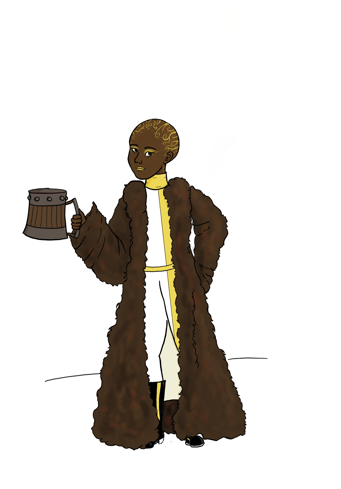
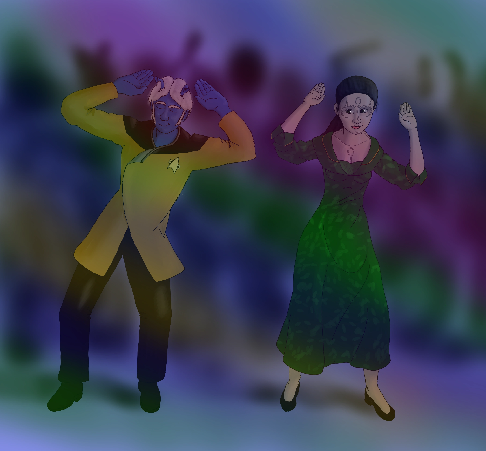
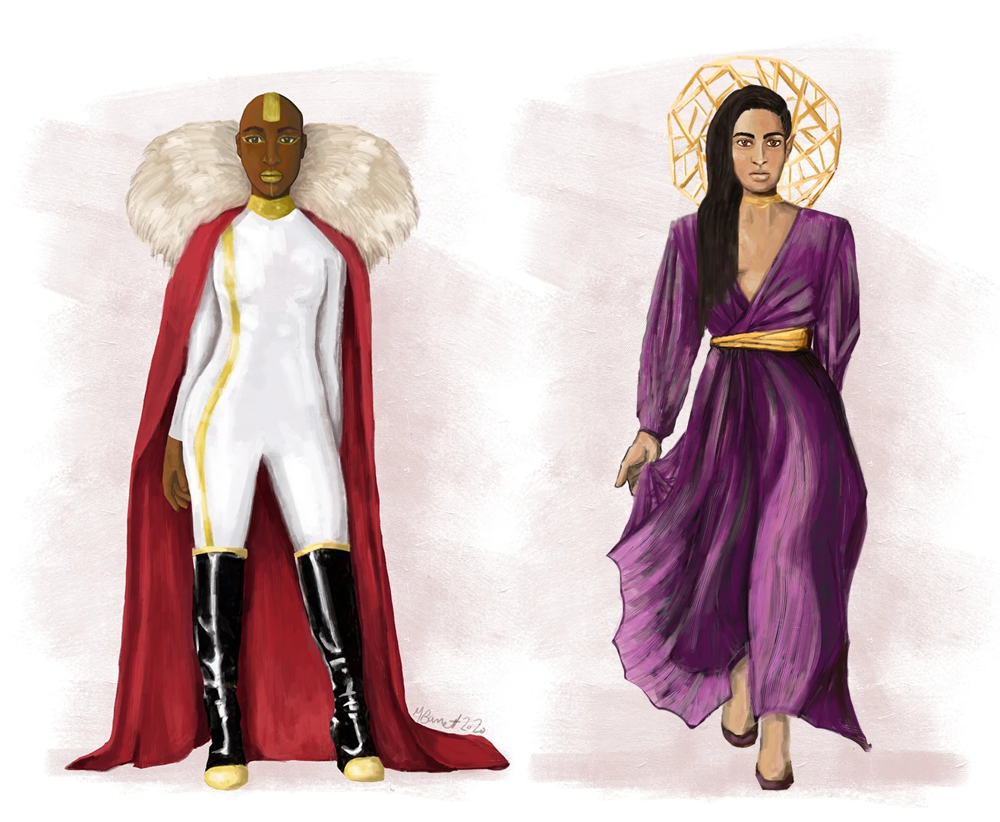

# Episode 31 The Refit pt. 1

- **Source:** https://clear-skies-rpg.fandom.com/wiki/Episode_31_The_Refit_pt._1
- **Retrieved:** 2026-11-16
- **Wiki page ID:** 605
**Episode 31 — The Refit pt. 1**

| Field | Value |
| --- | ----- |
| Air date | 10/05/2020 |
| Run length | 175min |
| Broadcast | Twitch [YouTube](https://www.youtube.com/watch?v=QVhh7hFcBn0) [Spotify Podcast](https://open.spotify.com/show/4XRHFGJ4s4EV7LufmohEnQ?si=_ryT3XVATmiTtDsrx3Yt8w) |
| Cast | Eric Campbell Revati Dhomse Gina DeVivo Sam de Leve Aki Xander Jeanneret Bonnie Gordon |
| Previous | [Episode 30 Who We Are Meant to Be pt. 4](ep-30-who-we-are-meant-to-be-pt-4.md) |
| Next | [Episode 32 The Refit pt. 2](ep-32-the-refit-pt-2.md) |

> "I know every captain thinks they have the best crew ever, but I'm very fortunate to be right."
>
> — Azeri Sull

## Plot Synopsis
### Brief Overview
[pending]

### Pre-Break
[USS Ross](../ships/uss-ross.md) arrives at Narendra Station for the first time in weeks. The ship currently has no orders. ADM Hebert has warned CAPT Sull that new orders are coming, and also that she will be performing an inspection upon their arrival. She also mentions a "guest" looking forward to meeting the crew, but does not say their name.

On the bridge, LT Vrenn gets a big grin on his face at the sight of Narendra Station. LTJG Lakat can see that he is beginning to look quite worn down. His eyes appear tired. Lakat takes a hair tie and flicks it at him to test his alertness. It hits him square in the face. Lakat says that the two of them should "take it easy" when the ship arrives on Narendra Station. Vrenn agrees to vague plans. Lakat asks him what has him wearing such a grin; he says that he misses Narendra Station.

YEO3 Azzmi reports to Sull and CDR EXEO that Hebert is planning a dinner after the inspections are over. Azzmi suggests it may be an attempt to relax now that the crew has arrived. Azzmi says that MCPO Theq wants to assist in any food preparation, and that there is likely to be an event at the *Wasted Space* (the main bar on Narendra Station). Sull worries about instigating a cooking feud between Narendra Station mess officers and USS Ross. Azzmi says she'll look into it. Azzmi turns to AMB Olyn and informs them that AMB Jahl has requested a meeting. Just before she leaves the bridge, she informs Sull that Sorex has requested a meeting with Sull or EXEO to discuss his future role on the ship. Sull and EXEO agree to handle it together.

On the viewscreen, Namenda Station appears quite busy. There are no Klingon ships in dock, but there is USS Jameson, a *Nebula* class starship. It is a previously unseen ship in the [Shackleton Expanse](../locations/shackleton-expanse.md). As Azzmi is leaving, Sull gives a meaningful look to Olyn, Lakat, and Azzmi. Olyn notices the look and concentrates on their empathic powers. Olyn picks up some stress signals from Azzmi; from Lakat they feel some concern for Vrenn, and strong attraction to Azzmi. They are also still sensing emotions from EXEO (she feels exhausted). Vrenn docks the ship. Over the next hour, the crew prepares for the admiral's inspection.

The scene moves to transporter room 1 as Hebert arrives aboard USS Ross in full dress uniform. Hebert greets Sull formally, but warmly. Hebert suggests they proceed with the inspection as soon as possible so they can move on to the rest of the plans. She tours the ship. She visits Cetacean Operations and chats with Dr. Yata about his work and about Odanians in general. She tours the secondary warp core in the saucer section. Hebert walks up to Theq to tell him a secret. Dr. Debluch Marrone came to Narendra Station on USS Jameson and wants to talk to Theq, but Hebert doesn't know why. She advises Theq to be prepared for a surprise. Hebert concludes the inspection. She tells EXEO, Sull, and Olyn that they have a meeting with her soon.

The scene cuts to Narendra Station. The promenade is full of new civilian shops. The station has become something of a hub since USS Ross' last arrival. There are a lot of families reuniting with their service members which were stationed on USS Ross. Sull, EXEO, and Olyn walk into Hebert's office. Hebert strips off her dress uniform and invites the other three to "kick your feet up." Hebert informs them that [USS Ross](../ships/uss-ross.md) is going to undergo a refit over the next two weeks. USS Jameson was sent Narendra Station specifically to assist with the refit. They all joke about how well Theq will get along with Marrone. Hebert authorizes the use of stun settings to calm things down if need be. The refit includes high resolution sensors. The first post-refit mission of USS Ross is test of the high resolution sensors: a "nice, relaxing sweeping scan of the Shackleton Expanse." Hebert also adds that the Federation Council is now in direct contact with the [J'Shashians](../characters/jshashia.md). The Federation has received a lot of data from the J'Shashians on how they detect subspace anomalies. She notes that there is one more surprise for them, which they will discover later. She reminds them that there is a dinner tonight, and she also gives permission for Theq to work with the station's chefs.

Hebert asks if they have any questions. Olyn asks about the current status of diplomatic tensions with the Klingon and Romulan ambassadors. Hebert says that things have been "sedate" on the station since Mendak's departure from the Shackleton Expanse. Hebert is unsure if the quiet is due to people getting along or people preparing to attack each other. There have been a few incidents of physical confrontations between Klingon and Romulan staff members. Olyn asks about the Remans. Hebert says she hasn't heard about any problems with the Remans. GEN Kargan is still constantly complaining to her about having Romulans on a station dedicated to the [Battle of Narendra III](https://memory-alpha.fandom.com/wiki/Battle_of_Narendra_III). However, Jahl has made it equally clear that the [House of Martok](https://memory-alpha.fandom.com/wiki/House_of_Martok) approves of the Romulans presence. She concludes by informing EXEO that the holoemitters on Narendra Station have been upgraded.

Outside Hebert's office, Olyn leaves to go see Jahl. EXEO tells Sull that she's written some letters of recommendation for the crew, and she asks Sull's permission to submit them to Hebert. Sull approves. She also request Sull add their own words to her recommendation for Theq. Sull coyly says that they have a "plan" for Theq. They walk down the corridor as Sull explains.

Olyn approaches the Klingon embassy. They encounter a staff member of the embassy, wearing the formal robes of the House of Martok. Olyn says that Jahl is expecting them. The staff member invites them in, and apologizes for Jahl's mood. Olyn asks her name, and she says it is M'qrah. Olyn enters, and they see Jahl in the middle of some sort of massage. He is slumped over a chair as a person punches and pounds on Jahl's back. When Jahl and the masseuse see Olyn, Jahl jumps up; he is wearing nothing except a towel around his waist. He dismisses the masseuse, a middle aged Vulcan with a pleasant expression.

Jahl sits down and grumpily informs Olyn that he has had no time to relax since AMB P'jeeno arrived. He says the station feels like it is going to explode, and it would have if not for the "voices of reason". He claims that he is the only such person left on the station; Hebert, apparently, takes no notice of the activities of the Romulans on Narendra Station. Jahl is also the only one trying to reign in Kargan from ruining everything. Olyn informs Jahl that they will be on Narendra Station for two weeks, and is eager to help. Jahl says he has a task that he needs their help with. He takes a moment to step into his quarters, and he returns wearing his big fur coat and offers Olyn a drink. Olyn asks if he is going to the party tonight, and he replies angrily that he had forgotten. Olyn asks if he would like to be their "plus one". He accepts, and notes that he hates Earth music, specifically jazz. Olyn points out that jazz can be fun to dance to, if one has the right partner and is drunk enough.

He decides to get to the point. He locks the door, and activates an anti-listening device. Olyn empathically reads his emotional state as agitated. He tells Olyn that he has a Klingon commander who believes she has uncovered evidence that Kargan is engaged in illicit activities on Narendra Station. He says that it involves the [House of Duras](https://memory-alpha.fandom.com/wiki/House_of_Duras). He suspects that members of the House of Duras might be allied with [Sela](https://memory-alpha.fandom.com/wiki/Sela) again, and that Kargan may be involved. He says that his source is the commander of IKS Borqu', stationed near the Romulan neutral zone. Jahl is suspicious, because Kargan has ordered IKS Borqu' to immediately return to Narendra Station, and Kargan is probably intending to "make an example" of B'emir. Olyn mentions that they met some of the crew on [Risa](https://memory-alpha.fandom.com/wiki/Risa), and they describe them as "very efficient." Jahl laughs, and calls the crew of IKS Borqu' "out of their minds". Jahl praises B'emir, and says that he is afraid she will be killed if she returns to Narendra Station. He asks Olyn for their help uncovering Kargan's crimes. Olyn agrees. Jahl says he will owe them a big favor for their assistance, and B'emir will, as well. Jahl asks if there is anyone on [USS Ross](../ships/uss-ross.md) who is familiar with espionage.

Jahl says that there is also captain in the House of Martok who is helping to keep B'emir alive. Olyn remarks that B'emir must be an impressive woman to have Jahl's protection and respect. Jahl begins to speak about himself as a true "Klingon"; he is loyal to the empire, he follows the teachings of [*qeyliS* (Kahless)](https://memory-alpha.fandom.com/wiki/Kahless), and he wishes to die in battle.  However, he also disapproves of the empire's treatment of women.  He praises B'emir as someone who is showing what it means to be Klingon, to be an honorable Klingon.  Olyn, again, agrees to help.  They also offer to pick him up on the way to the party.  He tells them to "dress as obnoxiously as you like".  Olyn asks if they can borrow his fur coat.  He tosses it to them, and they nearly drop it from the sheer weight.  Olyn walks out of the office, trailing the coat behind them like the train of a wedding dress.

The focus shifts to LTCDR M'Qrell.  She sits in her office going through paperwork.  She is surprised by Sorex standing in her doorway.  He asks if she is going to be leaving the ship at some point.  Sorex says that he came to ask her to to be his date to the party.  He qualifies that it can be as friends if she prefers.  He intends to act like "someone who is alive."  M'Qrell speculates that she should "dress appropriately", and suggests the red dress she wore on Nimbus III ([Episode 28 Who We Are Meant to Be pt. 2](ep-28-who-we-are-meant-to-be-pt-2.md)).  He flirts a little back at her.  She says she has "a few things prepared", and implies she might be singing.  They talk about enjoying jazz music.  Sorex says that he looks forward to it, and he leaves.  A member of her staff raises an eyebrow at her as he leaves, and M'Qrell says "I think I have a date".

The scene moves to Lakat and Vrenn as they walk to the transporter pad.  Lakat turns to Vrenn and informs him that he is her date for the party.  She also notes how tired he is, and suggests he might skip the party to rest.  Vrenn says he will be fine, and agrees to be her date.

### Post-Break
The party on the promenade begins.  [USS Ross](../ships/uss-ross.md) has acquired a reputation on Narendra Station for the extent of her exploits, and the station has turned out in style.  The senior staff have a special table reserved for them.  The party has been set up so [USS Ross](../ships/uss-ross.md) is directly outside the windows.

At the Klingon embassy, Jahl steps out in full Klingon warrior uniform.  He has his own mug in one hand, and a slightly smaller mug in the other.  Olyn is wearing the gigantic fur coat over a skin-tight white body suit with a gold strip down one side.  They have gold filigree painted up their face, with gold lipstick and eyeshadow.  Olyn begins to reach for the smaller mug, and then takes the larger, instead.  Jahl and Olyn both remark that the mug is too big for either of them to drink out of.  They compliment each other's appearances.

Lakat and Vrenn arrive.  Vrenn is wearing formal Starfleet dress uniform, and is a little embarrassed that no one else is.  Lakat remarks that she owns exactly one dress, and she's wearing it right now.  It is a traditional Cardassian dress, dark green with a leaf pattern and some slight gold accents.  Vrenn compliments her, and expresses his own lack of self-confidence.  Lakat says that he looks great, and that she's literally wearing her mother's dress.  Lakat sees Olyn and Jahl, and asks Vrenn if the two might be an item.  Vrenn says he isn't sure; Olyn can be hard to read.  Lakat asks if Vrenn knows how to dance to jazz.  He says "no", and Lakat says they will just have to make it up as they go (so they don't have to talk to anyone).  He waits for her to start, but she says he needs to.  He takes her hand in a walz posture, and she expresses confusion.  He turns dark blue in embarrassment.  They agree to observe everyone else and imitate.

As Lakat looks around and sees all of the crew of USS Ross enjoying themselves that this is the first time she's felt surrounded by family since before she left Cardassia Prime.  Her mood is broken when Vrenn compliments her shoulder (just the one).  She compliments his antennae.  He says it might be the most charming thing anyone has ever said to him.  She says they do a special "thing" when he's happy.  He is confused, but grins, and they start to do the "thing".  He awkwardly tries to restrain them.  She shifts the conversation by asks him about the space stations he grew up on.  He says they were mostly not Federation, and near to Andoria.  He says that his mother was a pilot.  He tells a story about how he wrecked a shuttlecraft when he was six.

Vrenn cautiously asks if it is okay to ask about Lakat's past.  She says that he can, but she will probably either evade the questions or refuse to answer.  He is about to ask a question, but first he tells her to look at something.  They rotate and Lakat sees Solun entering by themselves.  Solun is in full form; they are in a gossamer dress/suit with a huge headpiece.  They walk into the room looking like an member of ancient royalty, and they are beaming.  Vrenn says should have worn *that*, but Lakat says that she would have fought him for it.  Lakat returns the discussion to his question about her past.  They agree that he will ask, she might shoot it down, and he will pretend not to notice if she does.  He asks what her parents did.  Lakat starts to say something, but then redirects the focus back to Solun.  She recovers, and says that her mom was a scientist.  He asks about siblings; she says she is an only child (see notes).  He decides to ask about plants instead.  They have a silly conversation about plants, and how they grow and need water and stuff.  Lakat lets slip a statement about deciphering the appearance of plants through a notebook from a person she cared about.  Vrenn mentally notes the comment, but doesn't say anything.  Lakat says they need to get drunk.  She also suggests they get a [Taspar egg](https://memory-alpha.fandom.com/wiki/Taspar_egg) so he can try again (Episode 01).

Sull enters the party by themselves wearing a plum-colored suit with rose-gold metallic accents and high-heeled shoes.  The blazer is unbuttoned and they aren't wearing a vest or tie.  They stand in contentment as EXEO walks. she is wearing an emerald-colored 3-piece suit with no shirt under the vest. The suit appears holographic, but she is solid.  On her arm is Stavek.  EXEO acknowledges to Sull that they both wore suits.  Their eyes catch M'Qrell and Sorex entering together.  M'Qrell is wearing a floor length gown with a slit up the side; it's arctic blue and deep purple.  Sorex is in a gunmetal gray and silver-trimmed loose shirt and pants.  The clothes are covered in light patterning of feathers in silver thread.  His hair is notably not in the traditional Romulan style.  Sull also sees AMB P'jeeno.  He present in traditional Romulan ambassador robes.  Vrotek stands in the corner, hooded and intimidating, and he is closely watching P'jeeno.  LTCDR Prahl is notably absent, and Sivek is present.  Hebert is in a sparkling outfit chatting with P'jeeno.  CAPT Terrace, Captain of USS Jameson, is also present.

There is a break in the party as food is brought in.  Theq walks in with the chefs.  They are in Bolian chef hats and aprons.  They dramatically lift the silver domes off of the carts.  Everything is variations on the theme of "cooked goose."  The mostly holographic band strikes up jazz music.

During the party, Jahl wanders over to the food trays.  Olyn takes the opportunity to take off the fur coat (revealing a full cape) and goes to talk to EXEO.  EXEO sits with a plate of miniature holographic geese that have been "flavored" with memories of the goose hunt.  Olyn asks EXEO for a dance.  EXEO accepts.  Stavek offers to guard EXEO's geese.  EXEO suggests he talk with Theq about how they are made, and Stavek takes out a tricorder to scan them.  Olyn notes that they can empathically feel him; he expresses more emotions than most Vulcans, especially irritation, curiosity, and excitement.

EXEO and Olyn get together on the dance floor.  They see an intoxicated Lakat and Vrenn trying to dance.  Abruptly, they laugh and Lakat drags Vrenn off towards the kitchens.  Olyn reflects that they are also slightly intoxicated.  EXEO says "I'll lead" and starts leading Olyn in a tango.  Olyn takes the chance to ask her how she feels; she replies "Apparently, a lot."  Olyn notes that the last time they danced together was a very different situation ([Episode 14 Farther from Home pt. 1](ep-14-farther-from-home-pt-1.md)).  EXEO calls that an incredible understatement.  EXEO gets lost in her thoughts as she sweeps Olyn around the room an increasingly extravagant dance.  Some people move aside to watch the pair.  Olyn is slightly breathless.  EXEO says that she has never felt so exhausted, and it is wonderful.  She says that her emotions feel heavy, and Olyn comments that, with the right people around, they can also feel quite light.  EXEO says that sounds similar to dancing, and she takes the opportunity to lift Olyn into the air.  As they land, Olyn says that they are willing to help EXEO explore her new emotions, if she is interested.  EXEO discusses the nature of their mission, and of exploration.  She looks intensely at Olyn.  Gleefully, she says that she has realized how much she doesn't know about anything, and it's terrifying.  She says that she would love to keep exploring.

Jahl interrupts the moment when he shoves a plate of food at Olyn, asking if they want to eat.  He also offers some to EXEO, but she politely declines (she doesn't eat real food).  Olyn sample some of the [*gagh*](https://memory-alpha.fandom.com/wiki/Gagh), and takes the opportunity to introduce Jahl and EXEO.  EXEO compliments his armor.  He laughs and says he is trying to get fat enough that he won't fit anymore.  He abruptly takes the plate and heads to the food tables.  Olyn says that Jahl reminds them of their father; he is jovial, but can also be abrupt and serious.

Hebert takes the stage and walks up to a microphone.  She welcomes home the crew of [USS Ross](../ships/uss-ross.md).  She announces that M'Qrell has been nominated for a [Carrington Award](https://memory-alpha.fandom.com/wiki/Carrington_Award) for the work she did healing Sorex's brain.  Everyone applauds; Sorex applauds even louder.  Sorex tells M'Qrell that the honor is well-earned.  M'Qrell jokingly says she had a good patient; Sorex corrects her, saying he was awful.  She agrees.  Sorex tells her that he can see AMB P'jeeno coming over to speak to him.  M'Qrell offers to leave, but Sorex says that whatever P'jeeno has to say can be said in front of his own doctor.  M'Qrell corrects him; she is his friend and his date.

P'jeeno moves over.  He greets Sorex as "sub-commander Sorex".  Sorex corrects him.  He says that he doesn't have that rank since his defection.  P'jeeno says that Sorex did a great thing for the Romulan Star Empire, by betraying [Sela](https://memory-alpha.fandom.com/wiki/Sela).  He also expresses concern for Sorex's safety, since Sela is very powerful.  M'Qrell says that Sorex has the protection of [USS Ross](../ships/uss-ross.md), now.  P'jeeno tells Sorex that he has his support, and he has the support of the Romulan Senate.  Sorex is surprised.  P'jeeno says that betraying Sela placed Sorex firmly on the side of the Senate.  He says that he could arrange for Sorex to return to the empire whenever he wants.  P'jeeno keeps referring to Sorex as "sub-commander", and Sorex asks why.  P'jeeno says that Sorex has shown more loyalty to the empire than Sela ever has, and he offers to have Sorex's rank restored.  Sorex says that he'll think about it.  He also says they should stop talking about him, since he is on a date.  P'jeeno turns to M'Qrell and congratulates her on the nomination.  P'jeeno asks if she will share her techniques with the empire in order to help more [Tal Shiar](https://memory-alpha.fandom.com/wiki/Tal_Shiar) agents defect, but only if their governments agree to it.  M'Qrell agrees.  She points out the deliciousness of the food, and P'jeeno leaves after making some pleasantries.  As Sorex watches P'jeeno walk away, he tells M'Qrell that P'jeeno might be the most dangerous man he's ever met.  M'Qrell says that it is a good thing he has a very dangerous doctor on his side.  Sorex agrees.

The scene shifts to Lakat and Vrenn near the kitchens.  They are trying to convince Theq to replicate [Taspar eggs](https://memory-alpha.fandom.com/wiki/Taspar_egg) for them.  Theq says that it isn't appropriate to use food for a dare.  Lakat insists that Theq join the two of them for the egg eating.  Lakat grabs both of their hands and leads them to the kitchens.  Vrenn, very drunk, asks Theq what his antennae are doing.  In the kitchen, Lakat struggles to find the word "replicator", and Theq is still refusing.  Vrenn suggests that, since they outrank Theq, they could order him to do it.  Lakat tells Theq that she is "ranking him".  Theq relents and orders the Taspar eggs.  Lakat and Vrenn grab them and run out of the kitchen.  

Lakat and Vrenn count to three and down the eggs.  Vrenn immediately spits his out; Lakat has no trouble.  Vrenn's face is dripping, and Lakat rushes to find him a napkin.  She is having trouble finding one, before a hand reaches from her peripheral vision to hand one to her.  SHe looks up to see Azzmi Shanto in a form-fitting red dress, bare shoulders, and a bejeweled earring.  She smiles at Lakat and compliments her dress.  Lakat, shocked, takes the napkin and looks at Azzmi.  She says that she didn't think Azzmi was coming, and Azzmi says that she wasn't sure that she'd be able to.  Lakat says that Azzmi looks great, and that, if Lakat had antennae, they'd be moving.  Azzmi asks how, and Lakat demonstrates with her hands.  Azzmi thanks her for the compliment, amused.  Lakat tells her she looks great again, and asks if she's already said it.  Azzmi replies "no".  Lakat says it one more time and runs away to Vrenn, holding the napkin.  Vrenn is already cleaned up.  He looks down at the floor for the Taspar, but it is gone.  Lakat notes that the Taspar is alive and probably crawled away.  Vrenn is shocked to learn that Taspar eggs contain live Taspars.

Lakat asks Vrenn if he is feeling alright.  He says "yes", but she adds that he looks like he hasn't been sleeping.  He says that all the tension over the Romulans made it hard to sleep.  Lakat asks if the should "call it a night".  Vrenn agrees, and says "this is a night".  He then asks if she wants to go to sleep.  They discuss options, and decide upon Vrenn's quarters on the station.  He leads her off, singing to himself about navigation.

Meanwhile, Sull has been sitting at the bar observing everyone.  Hebert walks up to them.  She says that these moments are the ones she remembers from her commands.  Hebert brings up Sull's reports about the encounters with Q.  She asks if Sull knows what he meant about USS Ross needing to be in the [Shackleton Expanse](../locations/shackleton-expanse.md).  Sull says that they don't.  Hebert points out that the [Q continuum](https://memory-alpha.fandom.com/wiki/Q_continuum) hasn't interfered with the Federation since Jean-Luc Picard became an admiral.  Hebert wonders whether they are interested in Sull or the Shackleton Expanse.  Hebert also talks about all of the time shenanigans.  Sull says that there isn't time to worry about it.  Hebert agrees, and raises her glass in a toast.  Sull clinks the glass with their own, and uses their foot to discreetly push aside the Taspar wiggling on the floor.

Later on, M'Qrell takes the stage to sing.

(To the tune of *Fever* [https://en.wikipedia.org/wiki/Fever_(Little_Willie_John_song)](https://en.wikipedia.org/wiki/Fever_(Little_Willie_John_song)), written by Eddie Cooley and Otis Blackwell) 

"Never know how much I heal you 
Never known such medical care 
When I go and hypospray you 
I'll cure your fever 'til you're better than fair 
I'll cure your fever (hiss) 
When you're ailing 
Whether you're a child or full-grown 
Fever, virus failing 
I'll cure fibrous dysplasia bones" 

*Lyrics by Bonnie Gordon*

## Cast
-  Eric Campbell - Game Master
-  Revati Dhomse - Jane Lakat
-  Gina DeVivo - EXEO
-  Sam de Leve - Azeri Sull
-  Aki - Olyn Madzhin-Nil
-  Xander Jeanneret - Theq Lynadas
-  Bonnie Gordon - M'Qrell

## Non-Player Characters
-  April Hebert
-  Zhyliss Vrenn
-  Azzmi Shanto
-  Yeri Prahl
-  Yata
-  M'qrah
-  Jahl
-  Sorex
-  Amandeep Singh
-  Debluch Marrone
-  Solun
-  Niles Terrace
-  P'jeeno
-  Vrotek
-  Stavek (PC being played by Eric Campbell)

## Locations
-  Narendra Station

## Ships
-  USS Jameson

## Notable Lines
> "How do you suggest communal napping without sounding creepy?"
>
> — Jane Lakat *(in her thoughts)*
> "I don't sleep but I'm quite tired, Captain."
>
> — EXEO
> "Cry 'havoc!', and let slip..."
>
> — Azeri Sull
> "I have one [a weapon] behind my teeth, and it works pretty well."
>
> — Olyn Madzhin-Nil
> "Anything's a weapon if you throw it hard enough."
>
> — Azeri Sull
> "It's never to early to start [drinking] on Narendra Station, ambassador."
>
> — Jahl *(to Olyn Madzhin-Nil)*
> "Is there anybody in your crew that knows something about espionage?"
>
> — Jahl *(to Olyn Madzhin-Nil)*
> "It doesn't have to be anything more than two friends hanging out, *if you prefer*."
>
> — Sorex *(to M'Qrell)*
> "How do you feel?"

> "Apparently, a lot."
>
> — EXEO

> "When all has failed, distract a man with food."
>
> — M'Qrell *(to Olyn Madzhin-Nil about P'jeeno)*
> "Romulans, y'know?  Like ... everywhere and they're all invisible in space, and then they're trying to blow up my ship.  It's like, don't.  Don't do that."
>
> — Zhyliss Vrenn *(to Jane Lakat)*
> "I know every captain thinks they have the best crew ever, but I'm very fortunate to be right."
>
> — Azeri Sull

## Notes and Trivia
-  This episodes includes the first detailed description of the secondary warp core and secondary engine room. (00:47:00).
-  Lakat tells Vrenn that she is an only child, which is contradicted by flashbacks and memories in previous episodes.
