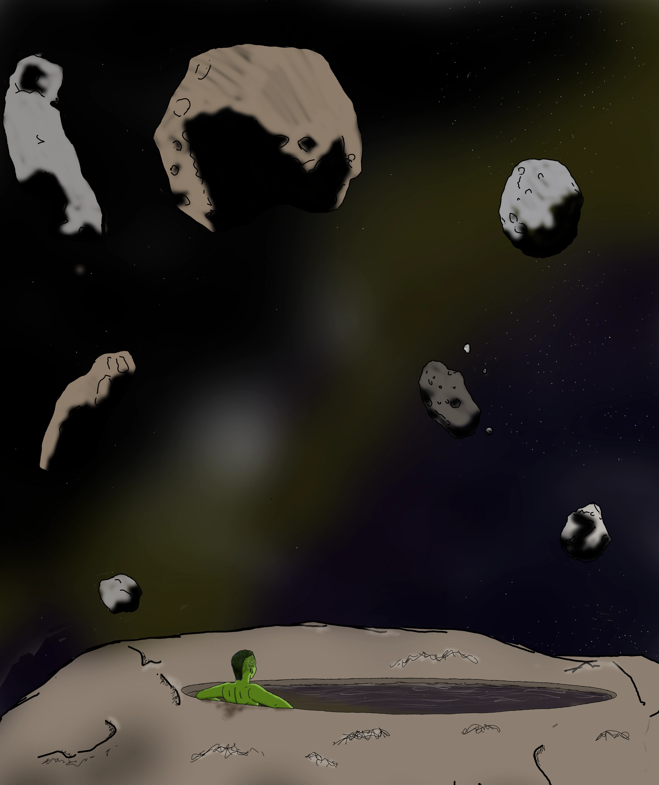

# Episode 32 The Refit pt. 2

- **Source:** https://clear-skies-rpg.fandom.com/wiki/Episode_32_The_Refit_pt._2
- **Retrieved:** 2026-11-16
- **Wiki page ID:** 625
**Episode 32 — The Refit pt. 2**

| Field | Value |
| --- | ----- |
| Air date | 10/12/2020 |
| Run length | 177min |
| Broadcast | Twitch [YouTube](https://www.youtube.com/watch?v=2V430nUoUfE) [Spotify Podcast](https://open.spotify.com/show/4XRHFGJ4s4EV7LufmohEnQ?si=_ryT3XVATmiTtDsrx3Yt8w) |
| Cast | Eric Campbell Revati Dhomse Gina DeVivo Sam de Leve Aki Xander Jeanneret Bonnie Gordon |
| Previous | [Episode 31 The Refit pt. 1](ep-31-the-refit-pt-1.md) |
| Next | [Episode 33 The Refit pt. 3](ep-33-the-refit-pt-3.md) |

> "My name's not Jane"
>
> — Jane Lakat

## Plot Synopsis
### Brief Overview
The episode opens the day after [Episode 31 The Refit pt. 1](ep-31-the-refit-pt-1.md). Aulyn Dari catches up with Theq to ask him to let her meet Debluch Marrone, since she is a huge fan. He agrees.

Lakat wakes up with a wicked hangover, still in the dress from the night before. She is in her quarters, and so is Vrenn (also fully clothed). She tries to sneak out, but he catches her. She dashes through the hallways to Olyn's room in order to escape the situation.

M'Qrell gets a message from the Federation Medical Council about her nomination for the Carrington Award. It states that they will be conducting a standard review of her Starfleet record as part of the process. M'Qrell is convinced that they will never let her win once they see her record. Upset and restless, she goes to Narendra Station and runs into N'ria. They have a drink together.

Sull wakes up in their quarters; they have a brief moment of solitude on the bridge before heading to Main Engineering. She joins Theq and they begin working. Debluch Marrone arrives, and Sull excuses themselves. They head to Holodeck 1 for some rare relaxation time. Marrone and Theq talk about the planned refit. Marrone says that Theq will have the lead. Theq says that he is going to assign Dari to follow Marrone around. Marrone is grumpy, but Theq is convincing.

Meanwhile, Lakat goes to the bridge for one last scan with the old sensors. When she arrives, she is all alone on the bridge. She takes a seat in the captain's chair, and she has a sudden realization that she wants to be a starship captain; she wants to command. She collects herself, and decides to scan for anomalies. She detects a small signature from Narendra Station. The energy pattern is completely unknown to Starfleet. She heads there to look for it. On the promenade of the station, she finds a shop called "Timok's Shop of Artifacts and Wonders". The owner, Timok is present and grumpy. He is closing shop because he has no customers. Lakat decides to be empathetic (since she now knows she wants to be a captain). She buys some strange objects, including a coin that is the source of the energy signature . She also gets a lesson in lying from Timok. She returns to the ship to give the coin to Theq. He says that he will get to it after the refit.

Olyn goes to meet Ambassador P'jeeno. Once there, they confront him about Mendak, and about him telling them that Mendak was a criminal. P'jeeno is evasive. Olyn decides to speak plainly; they tell him that they are unsure of his motives. They cannot decide if he means them harm, and if he actually wants to help the empire or if he's just acting in his own self-interests. P'jeeno pretends to be insulted, and kicks them out of his office (calmly and politely). However, Olyn can sense that it is a façade, and that they really got to him, somehow.

Olyn visit Sull in Holodeck 1, where they are in a bathhouse on an asteroid. Olyn tells Sull about P'jeeno, and about the request from Jahl ([Episode 31 The Refit pt. 1](ep-31-the-refit-pt-1.md)). Sull is disappointed that they are being dragged back into the spy business. Olyn suggests that they use Sorex, but Sull says that it is their duty as a captain. Olyn is apologetic. Sull is resigned.

Later on, in Main Engineering, Theq receives a priority message from Starfleet. His brother's remains have been found. He calls M'Qrell, and shows her the message. He tells M'Qrell that he cannot decide what to do with the remains without knowing more about how Reku died. M'Qrell tells the story of Reku's death. Theq can tell that she is lying to him.

### Pre-Break
The episode opens the day after [Episode 31 The Refit pt. 1](ep-31-the-refit-pt-1.md). MCPO Theq enters Main Engineering. ENS Dari is already present, and she hands him a cup of coffee. Theq teases her for being uncharacteristically early. She offers to run interference for him if he needs to get away from Debluch Marrone during the day. She wants to speak to Marrone; her dream is to become a ship designer. Theq agrees, and he tells her to be confident when speaking to Marrone. After she leaves, he makes a note in her record.

The scene moves to LTJG Lakat as she wakes up to the sight of LT Vrenn passed out in her bed. He is still in full dress uniform (complete with shoes) and is passed out, face-down. She quietly rolls out of bed, realizing that she is still in her dress from the night before. She looks around for her communication badge, and she finds it next to an empty bottle of Andorian wine that she doesn't remember bringing to the room. There is only one glass. She pulls out a tricorder and scans the glass and bottle. She was drinking from the bottle; Vrenn was drinking from the glass. She taps her badge and calls AMB Olyn. The sound of the chirp causes Vrenn to wake up; he sits up in the bed and says "what?" Lakat tries to slip out of the room without being seen; Vrenn obviously sees her. On their end, Olyn hears Lakat say "Jane to Olyn", followed by a voice in the background saying "what?" Vrenn asks Lakat what she's doing in his quarters; she corrects him, saying they are her quarters. Lakat repeatedly tries to get Olyn's location while also dealing with a disoriented and hungover Vrenn. Olyn says they are in their quarters.

Suddenly, Lakat remembers a bit of the previous night. She and Vrenn spent the night drinking and talking. She remembers that the last thing she said before going to sleep was telling Vrenn that "Jane" wasn't her name, but she isn't entirely sure if it's a real memory. She hopes that Vrenn's disorientation means that he doesn't remember the conversation. Vrenn looks around, and says that he lost a pip. Lakat lends him hers. Lakat says "Last night was great", and she runs out of the room. She runs to Olyn's quarters, still in her dress.

Lakat arrives at Olyn's quarters, and they invite her in. Lakat enters, silently, and sits down on the couch. Olyn makes some tea, and they sit down next to her. Lakat asks Olyn about her "date", AMB Jahl. Olyn says nice things, and then also tells Lakat about their exhilarating dance with CDR EXEO. Olyn asks if the voice they heard was Vrenn, but Lakat interrupts. She says that the two of them won't be talking about her night; she just needed to get out of a bad situation. She changes the subject to the relations between the Romulans and the Klingons. Olyn accepts the deflection. They say they will soon have something to discuss with Sull, and they think that Lakat will also be involved. They say that it, unfortunately, puts the ship back into a place "they had left behind". Lakat guesses that it will divert them from their exploration mission. They both sigh.

Olyn asks about Lakat's adventures on Nimbus III. Lakat praises M'Qrell's brilliance and Sull's acting. Olyn points out that acting was part of Sull's job in intelligence. Lakat asks Olyn what could make a person leave Starfleet Intelligence. Olyn pointedly suggests that perhaps people "get tired of living a lie." Lakat delfects; she tells Olyn that they are one of the most important people to her, and she thanks them for the tea. Olyn says they were thrilled when they heard that Lakat was assigned to USS Ross. Lakat's mood brightens. Olyn says they hope that they and Lakat get to do a mission together. Lakat agrees. Olyn offers breakfast. Lakat says she should change out of the dress first, and she asks to borrow some of Olyn's clothes. Olyn compliments Lakat's appearance, and says that Lakat's mother would be proud. Lakat thanks them. She goes to change her clothes.

The focus shifts to Sull waking up in their quarters. The ship feels very empty. Sull heads to the bridge. The only person there is YEO3 Azzmi. She is going through data PADDs. She says that there isn't a lot of work on Sull's plate today. Apparently, Solun threw a second party on the promenade for the people who couldn't fit onto Narendra Station. She says that Dr. Marrone has been asking for a lot of Sull's and Theq's time. Azzmi says she's been running interference for Sull. Sull tells her not to, and Azzmi says she'll let Marrone know. Sull says they will be in Main Engineering. Azzmi points out that the holodecks are free, and that Sull hasn't taken any time off in a long time. Sull repeats that they will be in Main Engineering. Azzmi departs. Sull takes a moment to be alone on the bridge. They walk down to the gap between the science and helm stations (where Lakat and Vrenn sit). They kneel down and whisper "Thank you for taking care of them", and they kiss the ship.

Meanwhile, a message arrives for M'Qrell as they are working at their station in sickbay. It's a pre-recorded message from the Federation Medical Council. A young woman in her early 20s appears. It is Dr. Maple Hernandez. She smiles wide at the camera, and she says that she will be M'Qrell's liaison with the Federation Medical Council regarding the nomination for [Carrington Award](https://memory-alpha.fandom.com/wiki/Carrington_Award) ([Episode 31 The Refit pt. 1](ep-31-the-refit-pt-1.md)). She also says that they will be conducting a "survey" of M'Qrell's career and Starfleet record as part of the process. M'Qrell is a little unsure of what to do next. She recovers and sends a message to N'ria, the Chief Medical Officer of Narendra Station, informing her that she is around and available to hang out. She leans back and sits in the awkward silence of an empty sickbay. She decides to go the holodeck. Just as she is about to leave, she gets a message from CDR EXEO (sent to the entire ship) letting everyone know that she is fully available for counselling sessions. M'Qrell forwards the message to Sorex, and also says that she is available for "any session?" (question mark included).

The scene moves to Main Engineering, with Sull and Theq working around the center console. A voice yells in the distance; it asks for Theq. Debluch Marrone stomps around the corner, furious. He screams at Theq, and Theq returns a spew of insults. Then Marrone claps Theq on the shoulders and laughs. The two laugh together. Marrone notices Sull and greets them. Sull excuses themselves for their lunch break, and they head to Holodeck 1. After they leave, Marrone turns to Theq and they get to work. He tells Theq that he will give Theq the lead on the refit. He offers to be Theq's "user manual". Theq says that he is going to assign Dari as his "sous chef" to be a liaison between Marrone and himself. Marrone is not too happy being told to talk to an ensign; he threatens to take [USS Ross](../ships/uss-ross.md) back with him to Starfleet Command. Theq tells Marrone that he's just trying to do Dari a favor, because she really wants to meet him. Marrone asks if she's a fan and good at what she does, and Theq says she is both. Marrone assents, and asks to be introduced. Theq gets ready to call her, but she runs out from around the corner; she was clearly eavesdropping. She gushes at him, but he stops her. He tells her to call him "Deebs". She says to call her "Dari". Marrone and Dari run out.

Meanwhile, Lakat heads to the bridge to do one last scan with the sensors before they go offline. When she arrives, she is all alone on the bridge. She goes to Prahl's station, and she notes the view of what her station looks like from his angle. She realizes that he can see the entire bridge from his elevated position from behind the captain; he has probably noticed every single time she and Vrenn have goofed off. She goes and "accidentally" falls into a sitting position in the captain's chair. She looks up at the viewscreen, and she activates it. She looks out into the void of space, and he imagines being in command of a science vessel of her very own, out exploring the universe. She thinks of the level of responsibility weighing on Sull each day. Lakat feels the call of the galaxy, and she realizes that she wants to be a captain. She whispers to herself "Oh no". She doesn't know why she wants it, but she wants it. She tells herself "not yet", and goes to her science station.

She looks at the sensor readings, and she decides to scan for any nearby anomalies. She detects a small anomalous energy signature from the main promenade of Narendra Station. The energy pattern is something never before recorded in Starfleet. Lakat transfers the data to her data PADD, grabs her tricorder, and heads for the station. When she gets to the transporter pad, she encounters a very nervous Saurian at the controls. Lakat gets the notion that this is the first time this Saurian has ever been alone at the controls of the transporter. Lakat tries very hard to be reassuring. She nearly surprises herself at how effective she is. The Saurian calms down a little bit, and introduces themselves as PO2 Rovass. Lakat introduces herself, in turn, and offers her hand. They shake. Rovass transports her over.

On Narendra Station, Lakat heads to the promenade. She keeps the tricorder stowed away, and instead she uses her own eyes to scan the people around her. After about an hour walking around the promenade, she finds herself in front of a shop of oddities. The shelves are full of strange alien objects and handcrafted goods. Inside is a Ferengi merchant. Above his head is a hologram that reads "Timok's Shop of Artifacts and Wonders". Lakat enters.

### Post-Break
The scene resumes as Lakat enters "Timok's Shop of Artifacts and Wonders" on Narendra Station. The shop keeper is busy looking at a data PADD. The shops is full of knick-knacks, curios, weapons, and even a few pets. Specifically, Lakat notices a small creature. It is the size of her hand. It is conical shaped and slightly wrinkly. It has two thick toes, big eyes, and a grinning mouth. It is hanging upside-down from a twig. Many of the items are in the process of being boxed. Timok gruffly tells her that he has nothing for discount; his "clearance sale" is not actually a sale. She asks why he is moving out, and he replies that no one is buying anything; he's broke. She wonders why, because she thinks he has many interesting things. He says that no one wants to buy them; he's a failure, just like his mother always told him he would be. Lakat tries to be empathetic. She points at a random object and asks where he got it; he says they are Mogari testicles, and he got them from a Mogari. He says they are supposed to be good in pie, and he asks if she wants to buy them. She asks to buy one (for Theq); Timok tells her that they come in pairs. She buys two using [Federation credits](https://memory-alpha.fandom.com/wiki/Federation_credits). She asks if there is anything in the shop he would recommend. He says that she must be a serious customer since she bought Mogari testicles (no one buys Mogari testicles).

He asks if there is anything specific that she is looking for. She makes up a lie on the spot. She says that it is her friend Sam's birthday (see Trivia below), and she's looking for a present for them. He asks what species Sam is, but she only says that Sam is incredibly kind and enjoys puns. He says that Sam would not make a good Ferengi. He asks again, and Lakat gets flustered; she blurts out that "Sam" is a Romulan. Timok is incredulous about the name, but Lakat point out that she is a Cardassian named Jane. She asks if he has any recent acquisitions, since her friend, Sam, is a frequent customer of his. He stops her, exasperated, and says that he doesn't have any frequent customers. He gives her a lecture on lying. When the lesson is complete, they return to the task at hand. Lakat asks him where he gets his items; he gives a vague response. He asks what she is looking for; she gives a vague response. Timok begins to get frustrated with her, but she points out that he has no other customers, and that she bought the testicles.

He relents, and brings out a large coin . It is three inches across, and it has a large gemstone in the center. He says that he doesn't know what it is or where he got it. He offers to sell it for 20 credits (a very small sum). She pulls out her tricorder and asks permission to scan it; he approves. The scan shows that the strange energy is coming from the gem. The gem is, in fact, not a gem at all. It is a lattice of trillions of pieces, and it resembles a computer core. She pays the credits, and she asks for his "card" so she can put it with the gift. He says there is no point, since the shop is closing. Lakat sighs, and she asks for the creature hanging from the twig. He calls it a Murfle, and he tells her it is 200 credits (which is everything she has left). She hesitates. He makes an offhand comment that the species is going extinct, and so Lakat buys it. She decides to name it "Timok Junior". Timok criticizes the name, and then he says that he was lying about the Murfles facing extinction. She leaves.

The scene moves to Main Engineering. Theq is busy planning the ship alteration. Marrone is in his element. Lakat strides in, with her coin and testicles in hand. She hands Theq the testicles. He is quite confused. She then hands him the coin, and informs him that it is an ancient computer core. He sets the testicles aside, and she sends his PADD her tricorder data. She also mentions the testicles are supposed to be good in pies. She says that the coin is emitting an energy signature never before detected. He thanks her, but says that he will have to wait until after the ship alteration. She says that she understands. He tells her that he is about to take the sensors down, and she runs to the bridge for one last scan. She confirms the energy signal is coming from Main Engineering (and nowhere else), and she lets Theq know. He takes the ship offline.

Meanwhile, Olyn stands outside the Romulan embassy. They enter into a surprisingly comfortable space. They are greeted by P'jeeno's assistant, Nalee. Olyn says that P'jeeno should be expecting them. Nalee checks with P'jeeno and then leads Olyn in. P'jeeno's office is very minimalist. There is minimal decoration, only a few pieces of art. He has a simple desk, but a massive chair. The greet. P'jeeno praises Olyn for their work with Mendak ([Episode 30 Who We Are Meant to Be pt. 4](ep-30-who-we-are-meant-to-be-pt-4.md)). He says that he is happy Mendak has returned to the empire to speak against [Sela](https://memory-alpha.fandom.com/wiki/Sela). Olyn says that it almost ended much worse; P'jeeno agrees, but stays silent. Olyn repeats that it was unfortunate that the situation escalated nearly to violence. P'jeeno blames Mendak's state of mind, since Mendak thought his son was in danger.

Tired of talking around the issues, Olyn speaks plainly. They say that they are having a hard time determining P'jeeno's motivations. They bring up that P'jeeno had implied Mendak was a renegade who stole his ship. P'jeeno says that he merely told the truth. Olyn questions what he had expected them to do with such implications. P'jeeno counters that he was just being helpful, and he speaks as if he feels wounded. He assumed his help would have fostered trust between them. Olyn says that they have had several dealings with deceptive Romulans in the past few weeks. They say that they don't wish to paint P'jeeno with the same brush (bringing up that Romulans have a reputation for deception and deceit). They say they've given him the benefit of the doubt because they approve of his Senate record. However, it is difficult for them to ascertain whether his efforts are sincere, or just for his own glory. They say that the way he called for a meeting with them made it sound like he was going to make a threat.

P'jeeno sits silently for a few seconds. He says that he misjudged Olyn. He is sad to hear them say such things. He abruptly stands up, and says that their business is concluded. He thanks them for stopping by, and bids them "good day". Olyn stands, as well, but they don't leave. He asks if they have any more insults to throw at him. Olyn says that they want him to understand their motivations. They want him to achieve what he stands for, and they don't like feeling suspicious about his motives. However, they have been forced by circumstances to be cautious. Olyn says that their speech was intended to be plain honesty, and not insulting.

P'jeeno says that he doesn't understand why Olyn came to his office just to insult him and his nationality. He doesn't understand why they accuse him of insincerity when he has done so much for them, and he mentions both Mendak and the blueprints to the [quantum stasis field generator](https://memory-alpha.fandom.com/wiki/Quantum_stasis_field) ([Episode 21 Farther from Home pt. 8](ep-21-farther-from-home-pt-8.md)). He accuses Olyn of speaking to him as if he was a Ferengi trying to swindle them. He also accuses them of making borderline racist comments towards Romulans. He says that they will have to apologize to him first, if they ever want to speak to him as a friend, again. Olyn's empathic senses tell them that he is agitated. Something they said got to him, and so he is pretending to be insulted to cover it up. Olyn leaves the embassy. She asks [USS Ross](../ships/uss-ross.md) for Sull's location. When they hear it's the holodeck, they decide to grab Patience on their way to see Sull.

Meanwhile, M'Qrell sits at her desk. She repeats to herself that it is an honor just to be nominated for the [Carrington Award](https://memory-alpha.fandom.com/wiki/Carrington_Award). She is personally convinced that she won't win. Once Starfleet looks into her record, they won't want to recognize her publicly. The thoughts are making her angry. She looks into visiting a holodeck, but only Holodeck 1 is active, and Sull is there. M'Qrell decides to take a walk on Narendra Station. She aimlessly wanders the promenade, until she walks straight into N'ria. N'ria looks down and asks M'Qrell what she wanted with them. M'Qrell says she was just checking in; N'ria says they should get a drink. Ten minutes later, M'Qrell begins telling the stories of her adventures on [USS Ross](../ships/uss-ross.md), but she has to leave out details because they are confidential. N'ria complains that they aren't battle stories. M'Qrell offers to provide her some holodeck programs that she uses to "blow off some steam". N'ria looks at M'Qrell and asks "What's your story, anyway?" M'Qrell begins to answer as the scene fades to black.

There is a cut to Sull entering holodeck 1. They decide to run the third most popular program currently trending on [USS Ross](../ships/uss-ross.md), since the first two would just be permanent favorites, and not examples of current popularity. As it loads, Sull notes that the program was requested by Solun, and programmed by EXEO. A bathhouse appears around Sull. It is located on an asteroid. They sky is just the blackness of space and the view of the distant star. There is no one else around. When Olyn enters, they see a disrobed Sull laid out across the warm tiles next to the bath. Soft Earth classical music plays in the background. There is the smell of eucalyptus, peppermint, and tea tree oil. A slight mist drifts across the ground.

Sull asks if Olyn needs something, and Olyn asks if they can join them. Sull notices Patience, and they use the computer to make a fun room for Patience to play while they speak. Olyn disrobes and gets into the bath; Sull follows suit. Olyn says that they have good news and bad news. Sull asks for the good news first, but Olyn says that it is subjective which is good and which is bad. Sull tells them to just pick one. Olyn tells them about their meeting with P'jeeno. They say that he was very insulted, but they know he's hiding something. Sull dunks their head and pops up again after a few seconds. They comment that most people are (hiding something), and they ask how Olyn plans to discover what P'jeeno is hiding. Olyn says they aren't sure, and Sull tells them to keep at it.

Olyn offers to share the bad news. Sull dunks again, and this time surfaces with just their face showing. They ask for the news. Olyn tells them that AMB Jahl has asked for a favor which requires their "particular set of skills" ([Episode 31 The Refit pt. 1](ep-31-the-refit-pt-1.md)). Olyn explains that Jahl thinks GEN Kargan is in league with the [House of Duras](https://memory-alpha.fandom.com/wiki/House_of_Duras), and probably with Sela, too. Jahl needs help finding evidence. Sull gets out of the hot bath, walks over to the cold bath, and gets in. Olyn is very apologetic. Sull laments, saying they really thought they had managed to get away from that kind of work. Olyn suggests they could have Sorex do it instead. Sull says that Sorex is part of their crew, and they need to do for him what no one can do for them: get him out of it (spycraft). Sull grabs their towel and starts to leave. Olyn says that they will look for another way. Sull says that Olyn wouldn't have come to them if there was. Sull says "good-bye" to Patience, and they leave.

Back in the bar, M'Qrell is deep into the story of her life. N'ria cuts her off, and says that there are rumors she got into a fight. M'Qrell is vague in her answer ([Episode 21 Farther from Home pt. 8](ep-21-farther-from-home-pt-8.md)). N'ria says that she misses the Dominion War, and all of the stories of battle, victory, and dying glorious deaths. M'Qrell somberly says that a person never leaves the battle. N'ria joyfully agrees.

Meanwhile, in Main Engineering, Theq is on his fourth hour of planning the ship alteration. YEO3 Azzmi enters and says that she has a priority message from Starfleet addressed directly to him. He glances at it, and the blood drains from his face. He tells Azzmi that he is going to take the message in his quarters, and he walks past her without even looking at her. He gets to his office, and he immediately calls M'Qrell. M'Qrell excuses herself from N'ria, who angrily says that M'Qrell will have to drink next time. M'Qrell informs her that Caitians are allergic to alcohol. M'Qrell quickly arrives in Theq's office.

Theq's face is gaunt in the reflected glow of the ship's systems maps. He says that Starfleet found Reku's remains on Caratas IV, and they want to know what Theq wants to do with them. He says that he doesn't know what Reku's last days were like, but she does. Theq says that he doesn't know anything about the mission, or what Reku was trying to do on that planet. He doesn't know how to choose what to do with the remains. M'Qrell begins to explain. They had found a camp of sick and injured Cardassians on Caratas IV. She had ordered Reku to leave in the shuttle to get more supplies and personnel. Theq nods, saying that Reku would have wanted to help the Cardassians; M'Qrell hastily agrees. She says that she stayed behind with the Cardassians to await Reku's return. Theq gets a feeling from M'Qrell's behavior ...

M'Qrell is lying to him. And she is desperate to make sure he doesn't know it.

## Cast
-  Eric Campbell - Game Master
-  Revati Dhomse - Jane Lakat
-  Gina DeVivo - EXEO (absent)
-  Sam de Leve - Azeri Sull
-  Aki - Olyn Madzhin-Nil
-  Xander Jeanneret - Theq Lynadas
-  Bonnie Gordon - M'Qrell

## Non-Player Characters
-  Aulyn Dari
-  Zhyliss Vrenn
-  Azzmi Shanto
-  Maple Hernandez
-  Debluch Marrone
-  Rovass
-  Timok
-  Nalee
-  P'jeeno
-  N'ria
-  Azzmi Shanto

## Locations
-  Narendra Station
-  Timok's Shop of Artifacts and Wonders

## Notable Lines
> "Jane, what are you doing in my quarters?"

> "Wait, aren't these my quarters?  Shit!  Where are you, right now?"
>
> — Jane Lakat

> "I'm in your bed, I guess."

> "Goodnight, Zhyliss."

> "Goodnight, Jane."
>
> — Zhyliss Vrenn

> "My name's not Jane."

> "I think I lost a pip."
>
> — Zhyliss Vrenn
> "I'm very good at deflecting."

> "I know that you are, and I'm going to let you do it."
>
> — Olyn Madzhin-Nil

> "I mean, I am pretty cool."
>
> — Jane Lakat *(to Olyn Madzhin-Nil)*
> "Your mother would be proud."

> "Thanks.  I mean, I'm here because of her, so..."
>
> — Jane Lakat

> "She did a damn good job."

> "Thank you for taking care of them."
>
> — Azeri Sull *(to USS *Ross*)*
> "What have you done to my ship?!"

> "You bite your tongue and choke yourself to sleep you miserable old man!"
>
> — Theq Lynadas

> "Hahaha!  You kept her from blowing up, that's what you did, isn't it!?"

> "You're looking very green as usual."
>
> — Debluch Marrone *(to Azeri Sull)*
> "Let's be honest, two warp cores in a starship is ridiculous.  It's just absurd."
>
> — Debluch Marrone
> "Those are Mogari testicles ... They're supposed to be good in pie.  Did you want them?"
>
> — Timok
> "I didn't want 'Delilah' and I didn't want 'Joline', so I picked 'Jane'."
>
> — Jane Lakat *(about choosing her name)*
> "If you lead people to the truth, they'll find whatever truth they want.  Happens all the time; all the best politicians do it."
>
> — Timok
> "I saw them and thought of you."

> "Please tell me these don't belong to somebody."
>
> — Theq Lynadas

> "I mean, at one point they did, but, as you can see, they currently do not.  They now belong to me, as I paid for them and they are rightfully mine.  As is the Ferengi way."

> "Ambassador, I don't know what exactly they teach you at the United Federation Diplomatic Corps, but I'll not have it in this office.  And if you ever want to approach me in friendship again, I'll have an apology from you first.  Now, good day."
>
> — P'Jeeno *(to Olyn Madzhin-Nil)*
> "Papa's gonna lose his shit when I tell him about this."
>
> — Olyn Madzhin-Nil *(about their meeting with P'jeeno)*
> "Can I help you?"

> "Oh, um...no ... you're fine, actually."
>
> — Olyn Madzhin-Nil

> "Thank you.  How can I help?"

> "I was as upfront with him as I could be."

> "How did that go over?"
>
> — Azeri Sull

> "He accused me of being racist."

> "Oh.  So, like the lead balloon, one would anticipate.  This was the good news part?"

> "Olyn, I wanted to get away from this [spycraft], and I thought I finally had.  And then, we were dragged back into it because of my past, and then I thought I got away from it.  And then, we had to take Sorex, and then, I thought I'd really gotten away from it."
>
> — Azeri Sull
> "If there is another way, I'm going to find it."

> "If there was another way, you wouldn't have come to me."
>
> — Azeri Sull

> "I'm sorry."

> "It's my duty."

## Notes and Trivia
-  This episode aired on Sam de Leve 's birthday, thus Lakat's lie to Timok.
