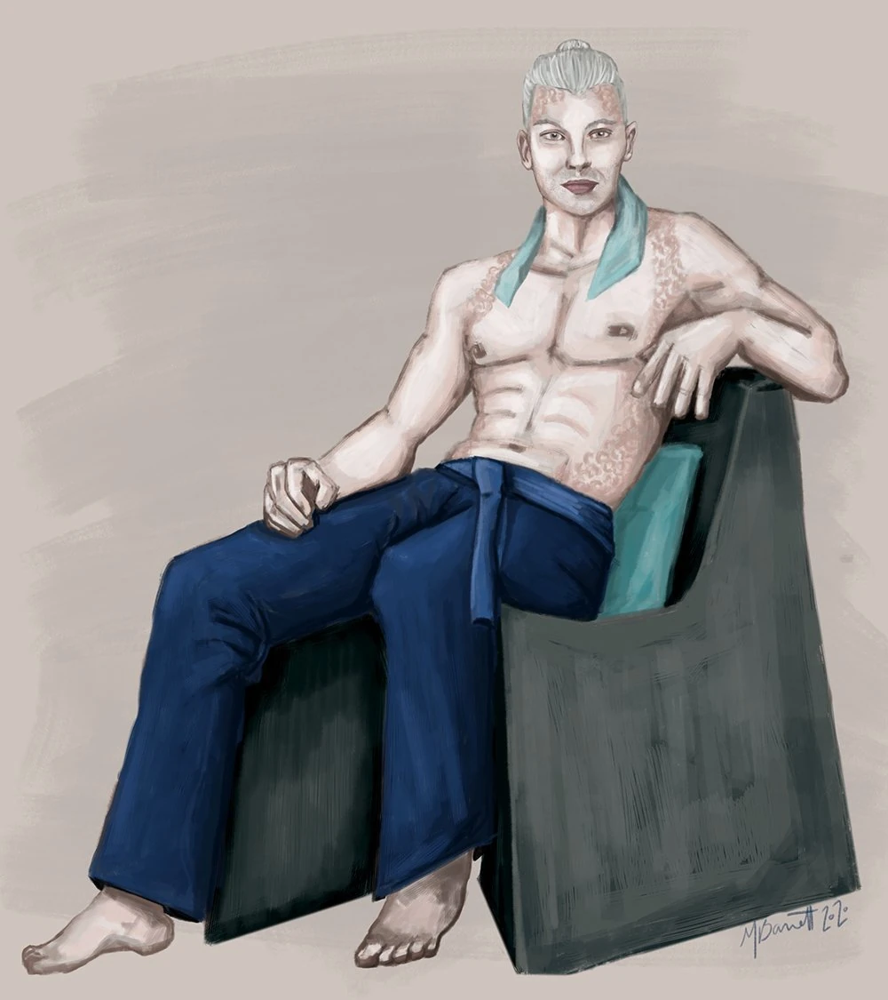

# Episode 34 Trial Runs pt. 1

- **Source:** https://clear-skies-rpg.fandom.com/wiki/Episode_34_Trial_Runs_pt._1
- **Retrieved:** 2026-11-16
- **Wiki page ID:** 667
**Episode 34 — Trial Runs pt. 1**

| Field | Value |
| --- | ----- |
| Air date | 11/02/2020 |
| Run length | 183min |
| Broadcast | Twitch [YouTube](https://www.youtube.com/watch?v=JJNW7Cif9-c) [Spotify Podcast](https://open.spotify.com/show/4XRHFGJ4s4EV7LufmohEnQ?si=_ryT3XVATmiTtDsrx3Yt8w) |
| Cast | Eric Campbell Revati Dhomse Gina DeVivo Sam de Leve Aki Xander Jeanneret Bonnie Gordon |
| Previous | [Episode 33 The Refit pt. 3](ep-33-the-refit-pt-3.md) |
| Next | [Episode 35 Trial Runs pt. 2](ep-35-trial-runs-pt-2.md) |

> "My choices are 'do I throw myself in front of the phaser, or not?'  And, usually, the answer is 'yes'."
>
> — Yeri Prahl

## Plot Synopsis
### Brief Overview 
Pending. [A few sentences only.]

### Pre-Break 
The episode opens with MCPO Theq crawling through the guts of [USS Ross](../ships/uss-ross.md) working on the refit. Dr. Debluch Marrone and ENS Dari are with him. Theq is enjoying the distraction of having work to do. As an EPS Conduit nearly explodes, Theq and Marrone calm it down.

Meanwhile, LTJG Lakat is working from her quarters. It is 0900; also present are Orwell and the (still unnamed) Murfle she acquired from the merchant Timok ([Episode 32 The Refit pt. 2](ep-32-the-refit-pt-2.md)). Orwell has been surprisingly uninterested in the Murfle, and strangely interested in the small artifact which she also acquired from Timok. There is a chirp at the door, but she ignores it to focus on Orwell. Lakat scans Orwell with her tricorder to get a clue about why he is interested in the artifact; she finds nothing out of the ordinary. There is a second chirp at the door. Lakat maintains her focus on Orwell for a moment; she is curious about whether the person is going be to insistent. The chirp does not repeat, and she pulls up a camera feed to see who it was. She sees LT Vrenn just as he rounds the corner. She quickly pokes her head out the door and calls to him.

He turns around and comes back to the door. He says that he came by to check up on her, since he's off duty. He mentions that CDR EXEO put him off-duty for the next six days ([Episode 33 The Refit pt. 3](ep-33-the-refit-pt-3.md)). She invites him in to discuss it. As he enters, she warns him to stay away from The Disc, since she doesn't know what it does. She asks for her pip back, and she recalls what happened the last time they saw each other ([Episode 32 The Refit pt. 2](ep-32-the-refit-pt-2.md)). She recovers herself, and she brings the topic back to why EXEO ordered him off-duty. She tends a small tomato-like plant while he speaks. Vrenn starts stumbling over his words. He mentions speaking to EXEO, and he comments briefly about the odd situation of his counselor also being his boss. They discuss EXEO's abilities, and the controversy around her. They also discuss humanity's failings. Lakat mentions that, while she was at Starfleet Academy, she dated a human (who was not a student). Vrenn espouses the virtues of ice hockey. Vrenn pauses a moment and redirects himself to his original purpose.

He tells Lakat that he had hesitated speaking to her about his issue. He says that sometimes he is unsure of whether something he is about to say will bother her, but that he believes it's his problem, not hers. He concludes by telling Lakat that EXEO said he should speak with her, because she is his best friend. He starts to worry if he made her uncomfortable, but she stops him. She tells him that he is her best friend, too. Vrenn starts talking. He tells her about spending too much time on the holodeck. So much time that it was affecting his health and beginning to affect his duties. He recounts the story of his mission during the Dominion War ([Episode 33 The Refit pt. 3](ep-33-the-refit-pt-3.md)). He speaks about being on a shuttle which crashed, and that the two shuttles behind him crashed as well as a result. He tells her about feeling responsible for the deaths of the Federation teams. He's been replaying the events in the holodeck to try and prevent the shuttle from crashing. He is almost never able to, but he can't let go of the idea that there might have been a way. He says that EXEO felt he should tell her about it.

He momentarily redirects the conversation by telling her about Theq's arrest on Narendra Station ([Episode 33 The Refit pt. 3](ep-33-the-refit-pt-3.md)). Lakat is delighted and jealous. Vrenn brings things back to the main subject. Lakat hesitatingly asks him what his plans were for the day. He says that he had planned to write a letter to EXEO. He wants her to let him pilot [USS Ross](../ships/uss-ross.md) for the upcoming trial runs even though she ordered him off-duty. Lakat begins to tell a story about how, when she was a child, she had terrible nightmares. She would wake up covered in sweat, and didn't sleep in her own bed very often. She starts to speak more, but then brings herself back. She says that she doesn't want to get too much into it, but that she learned that talking can help. She suggests that they go to the holodeck to replay his scenario with her present. He points out that he is not allowed in a holodeck at the moment. She implies that there are ways around that. Vrenn says that he doesn't want to get into more trouble with EXEO, and that he is afraid of losing [USS Ross](../ships/uss-ross.md). He suggests that they go flying together instead. Lakat agrees, and they start making plans..

Suddenly, he stops talking and points at The Disc on the table. The gem in the center is glowing. The two of them joke about the fear that it might be triggered by their feelings (or make them relive their feelings). Vrenn asks Lakat why she bought it, and she mentions that it gives off a never-before-seen energy signal. She shows him the tricorder scans. He points out that it is made of an unknown chemical [element](https://memory-alpha.fandom.com/wiki/Chemical_element). He says that they should spend the day investigating The Disc. Lakat is a little worried about disappointing Theq, but she and Vrenn decide to proceed, anyway. He suggests they take it to one of the science labs. Lakat grabs her tricorder, Orwell, the murfle, and the tomato-like plant. Vrenn notices the murfle for the first time, and is disgusted by it. Lakat chases him around the room with the murfle as he squeals. The two proceed to a science lab.

Meanwhile, AMB Olyn and Patience are returning to their office on Narendra Station from the meeting with Sorex ([Episode 33 The Refit pt. 3](ep-33-the-refit-pt-3.md)). They pause on the station's promenade, and ask the computer for the location of LTCDR Prahl. They head to his location on [USS Ross](../ships/uss-ross.md). They arrive at Prahl's quarters and ring the chime. When they open the door, they are surprised to see Prahl is shirtless and unshaven; he is wearing only his workout shorts. He remarks that they are the first person he's seen in five days. Olyn replies that they are not surprised; he responds that he likes it that way. Once inside, Olyn sees that Prahl has moved his furniture against the walls. There are blankets strewn about the floor, and stacks of empty glasses by the window. He offers them a drink, and they take water. Olyn asks him how he's been, and he simply replies "good". He says that he appreciates the down time. He asks about how they've been, and Olyn says they are unsure. Prahl says that must mean something serious has happened, that they are the only one who knows about it, and that they are looking to tell someone about it. Olyn says that he is the best person they could think of to tell; they think alike. Prahl notes that Olyn would have been a great security officer.

Olyn describes their conversation with AMB P'jeeno, and that it didn't end well ([Episode 33 The Refit pt. 3](ep-33-the-refit-pt-3.md)). Prahl says that he doesn't like P'jeeno; Prahl thinks he is hypocritical. Olyn says that P'jeeno has been talking to Sorex about that conversation. Prahl is very concerned. Olyn begins to say that Sorex made them an offer, but Prahl cuts them off. He reminds them that he is an officer in Starfleet, and obligated to report anything criminal or a threat to Starfleet personnel. Olyn says that they think the offer was neither; the offer was training on manipulating people. Prahl is incredulous that Sorex offered to teach Olyn how to be a spy. Olyn clarifies that the offer was to make them less reliant on honesty and open dialogue. Prahl says that neither he, nor his symbiont, are very familiar with Starfleet politics, but he is willing to give his advice. He says that Olyn should trust their instincts and strongly consider the offer. Olyn says that they are unsure about using manipulation to get their way; they strongly believe that diplomacy needs more honesty, not less. Prahl says that he agrees with them, but that he understands the importance of understanding his enemies. He thinks they should take the opportunity to learn about their opponents, and trust themselves to use the skills ethically. Prahl adds that he doesn't trust P'jeeno, and he likes the idea of Olyn manipulating him. Olyn says they don't want to stoop to P'jeeno's level, but Prahl counters that they shouldn't think of it that way. Olyn is protecting [USS Ross](../ships/uss-ross.md) and Starfleet, and they should trust that motivation. He warns that they shouldn't let Sorex drag them into any actual intrigue or spywork. Olyn says they are not interested in intrigue. Prahl says he isn't either, which is why he hasn't left the ship. Olyn says they are glad to see his face; he says that he is glad too. He says that Olyn and EXEO are the only people on the ship who like to talk to him. Olyn disagrees. Prahl says he's been using the down-time to try and break old habits. He needs to get used to the idea that CAPT Sull is going to make him standby while they walk into danger. Olyn says he is a valuable voice on the bridge; he says that he understands Sull likes him, but they still piss him off, sometimes.

Olyn returns to the original topic. They repeat that they are worried; Prahl says they should be. Olyn says they are most worried that they aren't the person they think they are; they're afraid they will like it too much. Prahl says that means they need to accept the offer; they need to know who they are in order to be happy, and in order to to their job well. He says they need to stay honest with themselves. Olyn says they need Prahl to watch them to make sure they don't go too far. Prahl says that he's already promised to do that as their Chief of Security. Olyn says they are asking him as a friend. Prahl promises Olyn to "call you out on your bullshit". On a lighter note, Olyn says he should consider a mouth-guard, because he clenches his jaw a lot; they don't want him to crack a tooth. Prahl seems genuinely concerned, and notes that he's been having jaw pain. Prahl has one more piece of advice: Olyn shouldn't forget that Sorex used to be a [Tal Shiar](https://memory-alpha.fandom.com/wiki/Tal_Shiar) agent. Olyn points out that Sorex once held a phaser to their back; they won't be forgetting it. Before they leave, Olyn compliments Prahl on his stubble. Prahl says he has no intention of growing it out. Olyn makes a comment about a beard working well for [CAPT Riker](https://memory-alpha.fandom.com/wiki/William_T._Riker). Prahl is unconvinced. Olyn and Patience leave.

Meanwhile, LTCDR M'Qrell walks through the empty halls of [USS Ross](../ships/uss-ross.md). She makes her way to the memorial wall on the Promenade. She touches the picture of the young Caitian boy that she placed there months ago (Episode 06), and then she makes her way to Narendra Station. The station is bustling with activity. She proceeds to "Timok's Shop of Artifacts and Wonders". Once inside, Timok grumpily tells her the shop is closed. M'Qrell says that she had heard that his shop was the place to find rare artifacts. Timok is surprised. In an aside to himself, he concludes that people are coming to shop because he is closing down. M'Qrell suggests that he expand his clearance sale "indefinitely". Timok is intrigued, and he invites her in. M'Qrell says that she is looking for an ingredient that is "hard to find". Timok asks if it that is because it's rare or because it's illegal. She starts to answer, but he cuts her off and activates a privacy field around the shop. M'Qrell says that she appreciates his discretion, and then she hands over a small scrap of paper with something written on it. When Timok reads the paper, he is visibly surprised. M'Qrell answers that it is "safe and for medical purposes only". Timok replies that he isn't concerned, he just wants money. Timok says that it is "possible" that he has the item. The two discuss his available quantity and price. He offers a "month's worth" in exchange for one bar of [latinum](https://memory-alpha.fandom.com/wiki/Latinum) and possible future commerce. M'Qrell counters with half a bar of latinum. Timok accepts, as long as she agrees to pay 1 bar in the future. M'Qrell agrees and leaves to go acquire latinum.

As M'Qrell proceeds to the currency exchange to acquire the latinum, she is stopped by CDR Sivek. He informs her that Timok's privacy field did not block Narendra Station security from hearing their conversation. They've been monitoring Timok for illicit activity. He "advises" M'Qrell not to proceed with her transaction. M'Qrell assures Sivek that she was only seeking medical items. Sivek tells her that, if she proceeds with acquiring illegal substances, he will arrest her. M'Qrell asks if that will be the case even if she intends to use them for medical purposes, and Sivek replies that concern is for the lawyers after he arrests her. The two stand across from each other in a tense moment. He gruffly tells her that she is "dismissed", and she walks away.

The scene moves to CDR EXEO and Sull as they are leaving a meeting with ADM Hebert. She informs them that she has a surprise, and "they" are arriving soon. She leads them off to look out the window of Narendra Station. A Federation courier ship arrives, and a contingent of [J'Shashia](../characters/jshashia.md)ns, led by [Dr. Yugoss](../characters/yugoss.md) enter the station. They look around with wide eyes and wonder. Yugoss spots EXEO and Sull, and quickly approaches them. He introduces them to his group. He is very excited, and asks if they could show his group around. They agree. Yugoss turns to the other [J'Shashia](../characters/jshashia.md)ns and the group proceeds to organize like a museum tour group. EXEO proceeds to the back of the group, and a young J'Shashian woman excitedly identifies her as a human. EXEO introduces herself, and says that she isn't quite human, but does present as one. The group starts to move as Nurelia excitedly asks EXEO about all of the species they see.

### Post-Break
The episode resumes in Main Engineering as the installation of the new sensors complete. Debluch Marrone compliments Theq as the rest of the engineering crew cheers. Theq activates a recording device and looks around at the cheering engineers. Aulyn Dari jumps into frame with an excited thumbs-up. Theq says he's going to "bake" this for EXEO. Marrone suggests that they all proceed to 10 Forward. Theq remarks that they also will need volunteers for the trial runs. He wants to let some of the crew of [USS Ross](../ships/uss-ross.md) have time off. The crowd heads to 10 Forward, and Theq gives a quick warning to Solun.

Meanwhile, Lakat and Vrenn proceed to Biology Lab 1. Lakat sets The Disc down, and Vrenn starts transferring power to the lab. Vrenn wonders if they should provide power to it. Lakat decides to scan it first. The computer confirms that it is made of an unknown metallic element; the computer is also unable to provide an approximate age. It also confirms that the "gem" is made of trillions of small silica pathways, which could contain "hundreds of millions of [teraquads](https://memory-alpha.fandom.com/wiki/Quad)" of information. The gem also appear to be providing its own power, and it appears to be "waking up". Lakat gives the gem a jolt of plasma energy, but nothing happens. Vrenn expresses slight boredom, and leaves to get them drinks. Lakat is slightly stumped, and she considers smashing it with a hammer. She tries comparing the structure of the gem with other structures in the known universe. About five minutes into the research, she notices the gem glows more brightly when she moves her hand near to it. She decides to see if the disc reacts to plants, and picks it up. When she does, it glows even brighter, and the color of the light changes.

She hears a familiar voice coming from behind her. It says "Hello, Cora. Won't you turn and look at me?" Lakat's hands start shaking, and she turns around. Her father stands there. He remarks that she chose to join Starfleet. She replies that she thinks it was the right choice. He says "it brought you here". She gets annoyed at the vagueness of such a statement. The figure answers that it is not actually her father, it's just taking his form. Lakat approaches the image, and it shifts into her eldest brother, Kereros. Lakat says that she doesn't want to see them (her family) anymore. The figure says that it can only appear as people from her past. It says it's name is Ao'tun. Lakat asks what face it could have if it was allowed to choose. It says "mine" and it shifts from her brother to a new image. It has pale skin and sunken eyes. The image is familiar to her, but she doesn't know why. It says that's it is a "collector of stories", and that it has collected her and Vrenn's memories. It says that it is damaged, and it cannot access any other "stories". It says that its task was to record people's lives. It isn't sure when it stopped working, or how long it was "asleep". Lakat asks whether her or Vrenn's story is better, but Ao'tun gives an equivocating answer. Vrenn returns with cream sodas to drink. He sees Ao'tun and asks who it is. Lakat explains, and then asks Ao'tun if it remembers Timok. It doesn't. She asks it to recall its last memory before her and Vrenn. It says that it can only remember looking at its creator, saying "he is me, and I am him". Ao'tun then glitches out and disappears. Lakat runs to the disc, which is still faintly glowing. Soon, the power drains entirely.

Lakat calls Theq to ask for his help. Theq is currently in 10 Foward, listening to Dr. Marrone teaching a crowd of engineers a vulgar Tellarite song. Solun is unusually irritated, and appears hastily dressed. Theq answers, and Lakat asks him to come to the lab immediately. He starts to leave. As he does, ENS Dari desparately asks him not to leave her with Marrone. He excuses himself and heads down.

Meanwhile, on Narendra Station, the contingent of J'Shashians are taking a break in the *Wasted Space*. Sull and EXEO are catching up with [Dr. Yugoss](../characters/yugoss.md). He says there hasn't been any Tholian activity since [USS Ross](../ships/uss-ross.md) left, and they've had no sign of the Crystalline Entity, either. He mentions that there is some residual energy on the planet at the site of the entity's emergence, and that another one may emerge from the same site (in a million years). Yugoss and EXEO start talking about her ring and the holoemitters on the station. ADM Hebert arrives and pulls Sull aside.

Hebert explains to Sull about M'Qrell getting into trouble with Sivek. She also says that she has new orders for [USS Ross](../ships/uss-ross.md). A new anomaly has been detected, and Starfleet wants USS Ross to investigate (USS Johnson is currently busy with negotiations on [Jateran](../locations/jateran.md)). They are ordered to leave in 24 hours. Hebert says that she is accepting a promotion to Vice Admiral. She asks Sull to consider following her if she is reassigned elsewhere. Sull says they are interested. Hebert says she would prefer to stay, but that Starfleet command doesn't like Vice Admirals posted on the frontier. She also mentions Jateran, and they discuss her concern that negotiations to join the Federation are proceeding too quickly. She leaves.

Sull returns to EXEO and Yugoss as he is mesmerized by the idea of standing on the outside of a starship (Episode 04). Sull snags EXEO and whispers to her about M'Qrell's situation, and about the 24 hour deadline to depart. EXEO volunteers to inform the crew, and Sull says Theq will have to inform Marrone (as punishment for his arrest). They turn back to Yugoss, and ask how long his group is staying on the station. He says they are only staying a few days. He also says that it would be good for the people of Jateran if [USS Ross](../ships/uss-ross.md) were to visit soon. Sull gets and idea, and they offer to provide them transportation back home. Yugoss excitedly dashes off to inform his team.

The scene moves to Lakat and Vrenn in the laboratory as Theq enters. EXEO's voice comes over the ship's intercomm to inform the crew to rig the ship for departure. Theq excuses himself, and leaves to get to work. Vrenn dashes out to talk to EXEO about flying the ship. Lakat is left alone with the disc. She puts it in her pocket and heads to the bridge.

Meanwhile, Olyn is sitting in their quarters when there is a chirp at the door. Sorex enters. He tells them that he is going to stay on Narendra Station. He sets a data rod on the table. He says it contains a special encrypted channel to communicate with him. He also says it has a copy of all the data which he stole from GEN Kargan. He offers to be Olyn's "eyes" on the station. Olyn says they wish they had a conversation with AMB P'jeeno before they left. Sorex notes there is still time. He offers them advice: to "play the game", and protect the truth. He asks if they understand him. Olyn says "no", but that they expect he will teach them. Sorex leaves.

The focus shifts to M'Qrell as she gets Sickbay ready for departure. Sorex enters, and he tells her he is staying on Narendra Station. She says that she has a favor to ask, but he cuts her off. He says they should "just shake hands". When they do, he palms an item to her. He thanks her for saving his life, and she thanks him for easing hers. He pulls her in close, and thanks her for being a lovely dancing partner. He smirks and disappears into the bustle of activity. M'Qrell can see the bounce in his step from having a purpose in his life again. She pockets the package that he gave her (the item she had been trying to get from Timok). She reflects that she isn't surprised he found out. Meanwhile, as Sorex enters the transporter room, he encounters CDR Prahl. Prahl gives him a harsh look and a warning. Sorex smiles and beams off the ship.

As Sull steps onto the bridge, they hear the warp core coming online. The ship starts to hum with life. YEO3 Azzmi is there dealing with a stack of PADDs related to the departure. Vrenn sprints off of the turbolift to EXEO. He pulls her aside, and asks to resume his duties. She pointedly asks him how much time had passed since their session. He deflects with comments about the relative nature of time, and Andorian antennae being good for processing trauma. She cuts him off and tells him to answer the question. He says that it has been 26 hours. She says that she ordered him to take a week off-duty, and Vrenn asks if he can fly the ship while off-duty. EXEO simply says "Vrenn" with a concerned tone in her voice, and he apologizes for taking up her time. Sull notices Vrenn, and asks if everything is okay. Vrenn dashes off. Sull takes a moment to walk to the spot where they had kissed the ship while the bridge was empty ([Episode 32 The Refit pt. 2](ep-32-the-refit-pt-2.md)). They return to the madness of departure preparations.

Lakat notices Vrenn standing at the lift doors and looking at the ensign at the helm station. He has a look on his face which alarms her. She calls him, saying "Jane to Zhyliss". He's a little surprised, since she never calls him by his first name. She tells him to take a rest, and they will watch "his baby" for him. She offers to let him listen via the communicator while they leave. He says that he's going to hang out with Solun. She asks him to let her know what they're wearing.

The ship departs the station. Olyn, sitting on the bridge, reflects about their "asset" on the station (Sorex). They have a flashback to their conversation with P'jeeno just before the ship left. Olyn enters and greets Nalee. Nalee says that P'jeeno ordered her not to admit them. Olyn asks that Nalee express to P'jeeno their desire to "clear the air". Nalee returns, and says that Olyn can enter. When they do, they see P'jeeno sitting with his back to the door. Olyn thanks him for letting them in. P'jeeno begins a speech about his childhood. When he was a child, his father executed his mother for being a Reman sympathizer, and that made him hate being a Romulan. When he grew up, he recognized the strengths of his people, but also understood that the rest of the galaxy had prejudices against them. He admits to having agendas and ambitions. He tells Olyn that he needs friends outside the Empire in order to accomplish his goals, which is why he's been doing them favors. He admits to not being fully honest with them, and says he will continue to be, because Romulus comes first. He forgives them for what they said ([Episode 32 The Refit pt. 2](ep-32-the-refit-pt-2.md)). Olyn apologizes, and he accepts. Olyn says he should speak with their father if he wants an ally with a voice in the federation. Olyn leaves.

The flash back ends, and focus returns to Olyn on the bridge. They look at the J'Shashians, who are also on the bridge. They are excitedly watching the ship depart. As the ship jumps to warp, they look down at the PADD in their hand. It has a short message from Narendra Station.

"Welcome to the game".

## Cast
-  Eric Campbell - Game Master
-  Revati Dhomse - Jane Lakat
-  Gina DeVivo - EXEO
-  Sam de Leve - Azeri Sull
-  Aki - Olyn Madzhin-Nil
-  Xander Jeanneret - Theq Lynadas
-  Bonnie Gordon - M'Qrell

## Non-Player Characters
-  Aulyn Dari
-  Debluch Marrone
-  Yeri Prahl
-  Zhyliss Vrenn
-  Sivek
-  Timok
-  April Hebert
-  Sorex
-  [Yugoss](../characters/yugoss.md)
-  Nurelia
-  Patience
-  Solun
-  Ao'tun
-  Azzmi Shanto
-  Nalee
-  P'jeeno

## Locations
-  Narendra Station

## Notable Lines 
> "I feel like everything I say, honestly, you should take with a grain of salt.  So like, I feel like that's where we are with our friendship right now, and you should know that."
>
> — Jane Lakat *(to Zhyliss Vrenn)*
> "My suspicion is that they went South the moment they got rid of ritual combat."
>
> — Zhyliss Vrenn *(about the human species)*
> "I am so freaking jealous.  I can't believe he got arrested before I did."
>
> — Jane Lakat *(about Theq Lynadas)*
> "All he does is talk about Reman rights, and all I do is see him walking around, acting like he's Praetor Shinzon"
>
> — Yeri Prahl *(about P'jeeno)*
> "My choices are 'do I throw myself in front of the phaser, or not?'  And, usually, the answer is 'yes'."
>
> — Yeri Prahl
> "That's what's gonna keep you on the straight and narrow."

> "There's got to be another phrase that works better than that."
>
> — Olyn Madzhin-Nil

> "Maybe?  You're the ambassador."

> "How many people are talking about my shop, exactly?"

> "Two?"
>
> — M'Qrell

> "I didn't expect to run into a ghost today."
>
> — Jane Lakat *(to the image of her father)*
> "The uniform suits you."

> "It's a little big on me."
>
> — Jane Lakat

> "I'm a collector of stories, and now I have your story."
>
> — Ao'tun *(to Jane Lakat)*
> "Wading into murky waters, now.  Why did you choose to wear all white?"
>
> — Olyn Madzhin-Nil *(to themselves)*
> "Thank you for saving my life."

> "Thank you for easing mine."
>
> — M'Qrell

> "It's gonna be okay.  We'll take care of your baby for you."
>
> — Jane Lakat *(to Zhyliss Vrenn)*
> "We have buttons, still."
>
> — Yugoss
