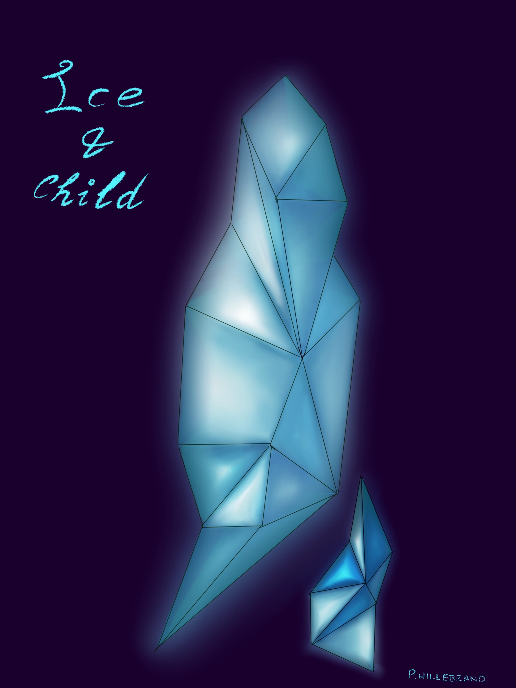

# Episode 35 Trial Runs pt. 2

- **Source:** https://clear-skies-rpg.fandom.com/wiki/Episode_35_Trial_Runs_pt._2
- **Retrieved:** 2026-11-16
- **Wiki page ID:** 680
**Episode 35 — Trial Runs pt. 2**

| Field | Value |
| --- | ----- |
| Air date | 11/09/2020 |
| Run length | 188min |
| Broadcast | Twitch [YouTube](https://www.youtube.com/watch?v=rX0bMz9R22M) [Spotify Podcast](https://open.spotify.com/show/4XRHFGJ4s4EV7LufmohEnQ?si=_ryT3XVATmiTtDsrx3Yt8w) |
| Cast | Eric Campbell Revati Dhomse Gina DeVivo Sam de Leve Aki Xander Jeanneret Bonnie Gordon |
| Previous | [Episode 34 Trial Runs pt. 1](ep-34-trial-runs-pt-1.md) |
| Next | [Episode 36 To the Rescue](ep-36-to-the-rescue.md) |

> "I like this better than hunting cloaked Romulans, sir.  It's nice."
>
> — Zhyliss Vrenn

## Plot Synopsis
### Brief Overview 
Pending. [A few sentences only.]

### Pre-Break 
The episode opens with [USS Ross](../ships/uss-ross.md) in orbit over [Jateran](../locations/jateran.md). CDR EXEO, CAPT Azeri Sull, and AMB Olyn Madzhin-Nil are with High Regent [Alu Zazz Keel](../characters/alu-zazz-keel.md). He is excitedly catching them up with developments on the planet since their last departure. Jateran is currently undergoing devastating climate change as a result of the birth of the [Crystalline Entity](https://memory-alpha.fandom.com/wiki/Crystalline_Entity). ([Episode 13 Food of the Gods pt. 3](ep-13-food-of-the-gods-pt-3.md)) However, technology provided by Starfleet is stabilizing the atmosphere, which is preventing the mass extinction that would have occurred otherwise. The former defense minister, [Keah Nobal](../characters/keah-nobal.md), is in prison, but still has her followers.

After 30 minutes of non-stop excited babbling, Keel leads them all to the main dining hall. Dr. [Yugoss](../characters/yugoss.md) greets them all as they sit down to eat a formal dinner. He apologizes for Keel's excitability, but the crew assure him that it's a pleasant change. Keel says that Yugoss has a special request. Yugoss nervously requests to join [USS Ross](../ships/uss-ross.md) as a crewmember. After a sarcastic exchange about the diminutive size of USS Ross, Sull and EXEO invite him aboard. Keel declares Yugoss the official "First Interplanetary Ambassador of Jateran". Yugoss is very nervous at the title and responsibilities, but Olyn reassures him. A dinner of warm moss-covered rocks and worms is served.

Meanwhile, on USS Ross, ENS Aulyn Dari is furious after days of repeatedly calibrating the new sensor suite. MCPO Theq Lynadas arrives, and preceeds to lead her in some techniques to handle her anger (they don't work). The crew have had to recalibrate the sensors every hour since the ship left Narendra Station. LTJG Jane Lakat is equally frustrated; she constantly gets false readings and malfunctions at her sensor station. However, the sensors are very powerful (when functioning). Lakat scans the microbial life near the site of the Crystalline Entity's emergence. LT Zhyliss Vrenn leans over from the helm station to have a look. Lakat notices that he is looking much better, and performing much better, after his week of rest. ([Episode 34 Trial Runs pt. 1](ep-34-trial-runs-pt-1.md)) She has also had no further activity from The Disc.

Theq calls Lakat to ask for a meeting on Holodeck 1. As she enters, she is hit by a wall of sound. Theq has transformed the holodeck into a dance hall. Out the windows she can see the surface of [Bolias](https://memory-alpha.fandom.com/wiki/Bolarus_IX). Theq is in a bright yellow jumpsuit; he twirls around and asks Theq to dance. Lakat hesitantly takes his hand. Theq begins to lead her in a dance. She, in a deadpan voice, informs him that this will not distract her from the sensor problems. Theq replies that the two of them need to work together better, and so he wishes to work on their rhythm; something has thrown off their "groove". Lakat asks him if dance is how Bolians resolve conflict; he affirms. Lakat begrudgingly agrees to learn the dance.

An hour later, Sull, EXEO, and Olyn enter the bridge shortly after Lakat returns to her station. Dr. Yugoss also walks on to the bridge, sporting a Starfleet communicator and a massive smile. LTCDR Yeri Prahl gives Sull the report. Sull notices that Lakat is *slightly* more relaxed, and they inform her that Yugoss will now report to her. She offers to show him the scans of the microbial life. They discuss the frequent mass extinctions on Jateran, and if it's related to the growth of Crystalline Entities. Lakat escorts Yugoss to his quarters. Olyn also leaves the bridge, reflecting on the note they sent to their father about AMB P'jeeno. [USS Ross](../ships/uss-ross.md) jumps to warp to proceed to their assigned destination (an anomaly).

EXEO walks over to Vrenn to give him a reassuring comment; he thanks her. YEO3 Azzmi Shanto walks up to Sull to hand them their drink of the day (hot cocoa with ginger and marshmallows). She hands them a PADD with a message from CDR Nigel Rogan. Sull moves to their ready room to open the message. It shows a picture of Rogan, his wife, and a baby. It says that baby Sull (short for Sully) was born 4 months prior. It also provides some updates on the goings-on of Starfleet Command. It says that the Federation Council is taking up a measure that would implement basic synthetic lifeforms as part of Starfleet. They will be deployed as a supplemental force for the Mars shipyards. Sull forwards the picture and message to EXEO, who emits an excited squeak. Sull moves to their replicator and creates a small photo album and a physical copy of the picture.

Sull reflects on the several weeks they spend with Rogan working on staffing USS Ross. In the memory, Rogan hands them a data PADD with a request from the [Daystrom Institute](https://memory-alpha.fandom.com/wiki/Daystrom_Institute). It mentions a certain "EXEO progam". Sull looks at the data, and they are impressed. They tell Rogan to pursue it. Rogan warns them that it will be controversial, but he agrees it's a good idea.

The scene jumps to 3 days later. Lakat wants to try out the new sensors again. Theq brings the suite online. There is a quick flashback to Theq and Lakat guiding the Science and Engineering departments in a dance in Theq holodeck program. The scene returns to a similar image of the departments moving in perfect harmony on the ship as the sensors power up. On the bridge, the sensors finally come online. Lakat calls Theq for a meeting, and he accepts. She enters his office, and she holds out The Disc. She explains where she got it and what happened with her and Vrenn. ([Episode 34 Trial Runs pt. 1](ep-34-trial-runs-pt-1.md)) She says that Ao'tun took the shape of her brother (she doesn't mention her father at all). The blood drains from Theq's face at the mention of the disc appearing as a brother. She emphasizes that it was not actually her brother, just an image. She hands the disc to Theq, but he refuses to touch it. He says they should run scans first. He asks if the problem with the disc is biological. Lakat suspiciously asks if he means she is the problem. He clarifies, and he says that he's asking if the disc is biological. She says that it might be. They do more scans, but discover nothing new. Theq suggests they work on a write-up to present to the rest of the senior staff.

The scene jumps another 3 days. Vrenn announces their arrival in the Bota-Eeloz System. The computer immediately announces high levels of radiation, and Sull orders the ship to yellow-alert. The sensors return basic details about the star at the center of the system. It is extremely large and bright, and its solar wind is causing havoc on the systems of [USS Ross](../ships/uss-ross.md). There are 3 microplanets and an interstellar comet. There is also an [Oort cloud](https://en.wikipedia.org/wiki/Oort_cloud) (a large field of icy objects normally located extremely far away from a star). The Oort cloud produces a halo-like effect around the star, which caused Narendra Station to nickname the system the "Sky-Crown System". The computer cannot explain how ice is able to survive so close to such a bright star.

Lakat scans the Oort cloud more closely. She detects unusual energy readings within the cloud. The ice formations are somehow completely shielded from the solar radiation of the star. The ice has a similar make-up to the (supposedly interstellar) comet.

### Post-Break
Lakat discovers the "ice" is made of an unknown frozen liquid. She also finds that the ice is multiphasic; it exists both in and out of normal space-time. Lakat scans the comet. It is headed directly towards the Oort cloud, and is entirely composed of the same multiphasic ice as the Oort cloud. Lakat calls Dr. Yugoss for assistance. When he arrives, he is awestruck at the sight of the giant star. Lakat explains the situation. Yugoss is equally mystified, and says that the nature of the ice isn't related to sub-space (his expertise). He looks a little nervous at not being able to directly help, but Sull reassures him.

Lakat does another scan of the Oort cloud with the high-resolution sensors. The sensors chirp an alarm, and Prahl announces that an object is approaching [USS Ross](../ships/uss-ross.md). Sull orders the ship to red-alert. Prahl reports that the object is the comet, which changed course and is now headed in USS Ross' general direction (though not on a collision course). On the viewscreen, a vapor cloud around the comet begins to stretch out towards USS Ross. Lakat checks the sensor data, and identifies an unknown energy pulse at the same time as the comet's course correction. Sensors also detected an identical energy pulse from the Oort cloud just before the pulse from the comet. Prahl announces that the vapor coming from the comet will impact USS Ross in 3 minutes.

Sull orders Vrenn to take USS Ross on an evasive course. Prahl announces the vapor from the comet is matching their new course. Sull orders Vrenn to increase speed. EXEO looks to Olyn. Olyn reaches out with their empathic powers to see if they pick up anything. They don't feel emotions, but they do sense a living presence. The vapor matches the ship's speed again. Sull orders Vrenn to take the ship to full impulse. Lakat's scans show that there is no correlation between the intensity of the energy signal and the speed of the vapor. lyn tries to use a similar technique to communicate that they used on the Space Flatworm, but it has no effect. ([Episode 30 Who We Are Meant to Be pt. 4](ep-30-who-we-are-meant-to-be-pt-4.md)) The vapor increases speed again; Vrenn announces 5 seconds to impact. EXEO sends an emergency communication to LTCDR M'Qrell.

Vrenn begins evasive maneuvers to dodge the vapor. He executes expert turns, but the vapor doesn't follow the laws of physics. It impacts the shields near the left nacelle, creating a brilliant light spectacle. An alarm goes off: "Intruder Alert". Internal scans show an energy pulse detected in main sickbay. Lakat scans the ship; she detects a huge spike in energy on the hull of the ship right over main sickbay, and large temperature fluctuations.

There is a quick montage of M'Qrell's activities over the last 12 days. She eats, she laughs, she plays racquetball, she sings to herself in her quarters, and she sips tea. Back in real time, M'Qrell watches as the bulkheads of sickbay start gathering frost. Environmental alarms go off. Her breath clouds up; her whiskers freeze. A vapor begins to gather on the windows to her office, and they begin to crack. M'Qrell orders an evacuation of main sickbay. She scans the cloud as she backs out of the room. The temperatures drop to sub-arctic levels. Her scans show multiphasic energy penetrating the bulkhead. The windows shatter as she leaves sickbay and shuts the door. The computer alerts that conditions in sickbay have become lethal.

M'Qrell contacts Theq to recalibrate the forcefields to handle multiphasic energy. He and Dari examine the shield emitters as Lakat reports that the comet is now keeping pace with USS Ross. The vapor is still contacting the hull, but it hasn't spread outside of sickbay. The temperature in the immediate vicinity of the vapor levels off at -119 degrees Celsius. EXEO and Prahl move to deck 12 to evacuate the spaces surrounding main sickbay. She blips into sickbay. On the bridge, Olyn feels the presence of more than one foreign lifeform on the ship. They alert Prahl.

Theq calls Sull to inform them that recalibrating the shields and forcefields will take time; he recommends separating the saucer section. Sull takes the idea under advisement, and orders Vrenn to take the ship to warp 1. Lakat detects that the connection to the vapor is broken. Olyn detects fear and alarm from the presence in main sickbay; fear that is bordering on anger. In sickbay, EXEO sees the vapor coalesce into a group of beings made up of translucent-blue glacial rocks connected by a glowing blue vapor. Each being is about five feet tall. She also hears a faint chime coming from them. EXEO asks them if the chime is their language. As the rocks move, the chime shifts. EXEO feeds the information to M'Qrell as she puts on an exo suit.

EXEO approaches the beings, and she introduces herself. Once closer, she sees spiral grooves cut into the surfaces of the rocks. The grooves shift and change as the tone of the chimes change. The being cluster around her and begin to move slightly; the effect is similar to body language. EXEO reduces her opacity to match the translucent nature of the rocks. With assistance from Olyn, she attempts to establish communication with the beings. She comes close, but cannot quite figure out what they're trying to say. EXEO begins to dance. Prahl arrives outside main sickbay with a security team armed with phasers (set to stun). On the bridge, Vrenn brings up internal views of sickbay, and the bridge crew watches EXEO dancing. 
Sull orders the ship to drop out of warp just outside the star system. The vapor cloud is no longer present outside the ship. M'Qrell runs off to replicate a set of tuning forks.

Meanwhile, Theq and Dari complete the recalibration of the shields. Theq creates a forcefield to isolate sickbay; the beings do not react. EXEO calls Sull to ask if there is a plan to reconnect the beings on the ship to the vapor cloud. Olyn request permission to enter sickbay, as well, and they begin to put on an exo suit. M'Qrell requests Sull drop the multiphasic forcefield long enough for her to enter sickbay. Theq drops the forcefield and M'Qrell hurries inside before the temperature in the hallway drops too much. M'Qrell approaches and rings one of the tuning forks (key of C). There is no reaction from the beings. She tries another note, but there is no response. Olyn enters sickbay, also wearing an exo suit. Olyn can sense confusion from the beings. Olyn, with help from M'Qrell, tries their hand at interpreting the beings' language. Olyn feels that the beings are not actually aware of their presence; they are aware that something is present, but they cannot directly perceive it.

Olyn wonders if something on USS Ross attracted the beings; EXEO says that the last thing they did before the vapor moved towards USS Ross was scan the Oort cloud. Olyn suggests using a tricorder to scan them and see if there is a reaction. M'Qrell does so. Olyn senses an acknowledgement from the beings, a feeling of "did you hear something". The chiming in the room changes pitch. M'Qrell says they should figure out how to use scans to communicate with them. Olyn suggests they bring in Lakat and Theq. EXEO request for Lakat, Yugoss, and Theq to head down to sickbay.

As everyone assembles in sickbay, Vrenn and Sull are on the bridge, looking at the light from the star on the viewscreen. Sull orders Vrenn to prepare to return to the vapor, but hold station for now. They ask Vrenn to examine the best way to do so without damaging the ship. Vrenn points out that multiphasic shields won't protect them from the powerful radiation from the star. Sull says they just need to be quick, then. Vrenn asks Sull for permission to speak freely; they assent. He says that he prefers the current situation to hunting Romulans; he says "scaring ice creatures is a nice change of pace". Sull agrees. Vrenn is pleasantly surprised that Sull doesn't reprimand him for saying something irrelevant, and he whispers "yeah, exploring!" to himself. Sull warns him that, if the comet tags them again, he'll hunt Romulans for the rest of his life.

Meanwhile, in sickbay, EXEO stands pleasantly in the center of the room, with the beings huddled around her. Lakat and Theq arrive on scene. They conclude that they might be able to communicate using metaphasic frequencies. He tells M'Qrell "lets dance". Several puns concerning "metaphor", "metaphasic", and "phaser" ensue. Theq decides to use a multiphasic energy pulse to cause the holoemitters to make EXEO multiphasic, but it won't last for long. EXEO experiences becoming multiphasic. The room begins to shift and become translucent. The beings become more opaque, and the chiming sound gets louder. Now that she is in phase with them, her computer starts to calculate how to communicate with chimes. In normal space, Olyn is flooded with emotions of surprise and wonderment. EXEO's program starts interpreting the effect of the metaphasic shift on EXEO as hiccups. She begins vocalizing the charms between hiccups; she introduces herself. Olyn senses more wonderment and excitement. EXEO continues. She apologizes for absconding with them, and explains that they thought the beings were intruders. The chimes respond to her; the computer interprets it as a response of curiosity and concern. EXEO says that they intend to return them, as soon as they figure out how to do so safely. Olyn gets more and more concrete emotions. The beings attempt to mimic EXEOs patters, and they include hiccups in their response, "We come in peace". EXEO says that she does as well, and welcomes them aboard USS Ross. The beings confer with each other, confused, and respond with one word "explorers". EXEO points to herself and says "explorers".

On the bridge, Sull orders Vrenn to take the ship back to the comet. EXEO tells the beings that she won't be able to stay much longer, and expresses that it was lovely to meet them. When the ship drops out of warp, the computer immediately warns of the increased radiation. On the surface of the comet, the same grooves as on the beings begin to appear. The vapor trail approaches the ship. Sull orders Vrenn to drop the multiphasic shields for 5 seconds. The ship computer alerts that radiation from the star is approaching lethal levels. The creatures turn to vapor and leave the hull. M'Qrell watches as the shards of her shattered windows fly back into place and knit back together. M'Qrell also realizes that the entire crew is going to need inoculation from the radiation. As M'Qrell walks into her office, she sees that all biological life in sickbay is dead. Her entire batch of plants, which she had been experimenting on with the substance provided by Sorex, is dead. ([Episode 34 Trial Runs pt. 1](ep-34-trial-runs-pt-1.md)) EXEO sees the dead plants, but doesn't understand the importance. She notes that Lakat could help M'Qrell with them. As M'Qrell stands sadly over the batch of plants, one of the nurses (ENS Leah Sky) runs back into the room with the rest of them, which they had grabbed before evacuating sickbay. M'Qrell is visibly relieved.

The comet changes course back towards the Oort cloud. The crew reflect on the last word sent by the beings, "explorers". It occurs to Sull that the Oort cloud is their home. The comet had been on an interstellar trajectory, heading back into the system from interstellar space. Sull reflects that this is their new life, outside of intrigue and war...

And this is just a trial run.

## Cast
-  Eric Campbell - Game Master
-  Revati Dhomse - Jane Lakat
-  Gina DeVivo - EXEO
-  Sam de Leve - Azeri Sull
-  Aki - Olyn Madzhin-Nil
-  Xander Jeanneret - Theq Lynadas
-  Bonnie Gordon - M'Qrell

## Non-Player Characters
-  [Alu Zazz Keel](../characters/alu-zazz-keel.md)
-  [Yugoss](../characters/yugoss.md)
-  Zhyliss Vrenn
-  Aulyn Dari
-  Yeri Prahl
-  Azzmi Shanto
-  Nigel Rogan

## Locations
-  [Jateran](../locations/jateran.md)
-  Bota-Eeloz System

## Notable Lines 
> "Thanks to Starfleet, we have atmospheric condensers and all sorts of wonderful technologies that are making this a completely habitable world despite the devastating effects that would absolutely have demolished all life on the surface of the world in just about 30 years or so.  So, thank you for that!"
>
> — Alu Zazz Keel *(Azeri Sull)*
> "Would you mind if I started a betting pool of who can out passive-agress the other, between you and Chief [Theq]?"

> "Only if you're betting in my favor."
>
> — Jane Lakat

> "The 'tight-assness' will increase as the pips increase."
>
> — Nigel Rogan *(about Starfleet promotions)*
> "I saw an echo of a memory.  It wasn't him, Theq.  I need you to know that."
>
> — Jane Lakat *(about Ao'tun appearing as her brother)*
> "You could have picked this one [the disc] instead of the bull testicles.  And you went with the bull testicles."

> "I did bake some pretty good pies out of them, though."
>
> — Theq Lynadas

> "They were ghost hunters."
>
> — M'Qrell *(about the ice beings)*
> "I like this better than hunting cloaked Romulans, sir.  It's nice.  Scaring ice creatures is a nice change of pace."

> "You know what?  It is that."
>
> — Azeri Sull

## Notes and Trivia
-  This episode debuted a new introductory sequence.
-  Eric stated on his personal livestream that the baby shown in this episode, Sully, was adopted by the Rogans about 8 months after the birth of their first child in Episode 01.
-  The mention of synthetic lifeforms being used in the Mars shipyards is a reference to the events shown in [Picard: "Maps and Legends"](https://memory-alpha.fandom.com/wiki/Maps_and_Legends_%28episode%29)
-  While returning from her multiphasic state, EXEO takes damage for the first time in *Clear Skies*.
-  The information that Leah Sky was the nurse who rescued M'Qrell's plants was provided in [Episode 36 To the Rescue](ep-36-to-the-rescue.md).
