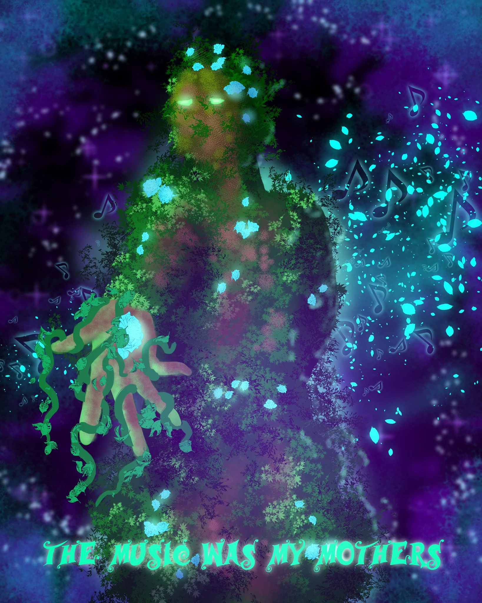

# Episode 37 By Any Other Name

- **Source:** https://clear-skies-rpg.fandom.com/wiki/Episode_37_By_Any_Other_Name
- **Retrieved:** 2026-11-16
- **Wiki page ID:** 694
**Episode 37 — By Any Other Name**

| Field | Value |
| --- | ----- |
| Air date | 11/23/2020 |
| Run length | 181 |
| Broadcast | Twitch [YouTube](https://www.youtube.com/watch?v=NE3n4ciJ2Gk) [Spotify Podcast](https://open.spotify.com/show/4XRHFGJ4s4EV7LufmohEnQ?si=_ryT3XVATmiTtDsrx3Yt8w) |
| Cast | Eric Campbell Revati Dhomse Gina DeVivo Sam de Leve Aki Xander Jeanneret Bonnie Gordon |
| Previous | [Episode 36 To the Rescue](ep-36-to-the-rescue.md) |
| Next | [Episode 38 The Play's the Thing](ep-38-the-plays-the-thing.md) |

> "Oh, that your frowns would teach my smiles such skill, captain.  We're safe."
>
> — EXEO

## Plot Synopsis
### Brief Overview 
Pending. [A few sentences only.]

### Pre-Break 
The episode opens one week after the events of [Episode 36 To the Rescue](ep-36-to-the-rescue.md). During the tow of USS Thunderchild back to Narendra Station, a [parrises squares](https://memory-alpha.fandom.com/wiki/Parrises_squares) tournament took place between the crews of [USS Ross](../ships/uss-ross.md), USS Thunderchild, and USS Johnson. USS Ross' crew won the tournament, with USS Thunderchild taking second place. Three crew members of USS Ross were injured, including LTCDR Yeri Prahl. Tests of the new high resolution sensor suite on USS Ross were finally completed, and the system is fully operational. Halfway through the journey to Narendra Station, USS Ross was given orders to return to duties in the [Shackleton Expanse](../locations/shackleton-expanse.md) while USS Johnson finished towing USS Thunderchild to the station.

USS Ross has been assigned to complete the task originally assigned to USS Johnson; it must build a new subspace relay station in the Shackleton Expanse. The scene resumes as USS Ross arrives at the location. It is a section of empty interstellar space about 2 weeks travel time from Narendra Station. LT Zhyliss Vrenn announces their arrival. LTJG Jane Lakat performs a scan of the area; she finds nothing of interest. She and Vrenn engage in some casual banter. She remarks that Prahl appears to be very relaxed. They both look at the security station on the bridge, where LT Roh Gerz is filling in for the injured Prahl. Lakat comments that the bridge feels so much more gentle without Prahl staring at them all. CAPT Azeri Sull loudly asks CDR EXEO who else on the bridge might stare ominously at Lakat and Vrenn. Vrenn turns around in his chair and asks EXEO and Sull if they could get Prahl a fruit basket; Lakat suggests a "get well soon" card. AMB Olyn Madzhin-Nil comments that they are both "terrible". Some of the other crew on the bridge snicker. Sull states that they are not responsible for what Vrenn and Lakat do on their off time. Vrenn asks if they will sign the card; Sull simply says that they sign a lot of things. YEO3 Azzmi Shanto calls out "Aye, sir!" from across the bridge. Lakat suggests that MCPO Theq Lynadas would make a good fruit basket. Vrenn says that Solun could also help, and his eyes light up with mischief. The crew returns to business.

Down in Shuttle Bay 1, Theq is getting his engineering crew ready to build the subspace relay. [worker bee](https://memory-alpha.fandom.com/wiki/Worker_bee) repair craft and [sphinx workpods](https://memory-beta.fandom.com/wiki/Sphinx_workpod) are being taken out of storage. ENS Aulyn Dari approaches Theq with a concerned look on her face. She informs him that the engineering crews are ready. Theq informs Dari that he has an idea to speed up construction; Theq calls EXEO, and she blips to Shuttle Bay 1. Theq asks for her to "watch over" the engineering crew from outside the ship as they build the relay. She agrees, and he says that he will put a holoemitter on a worker bee so she can observe.

Dari takes Theq aside and lets him know that she gets sick during spacewalks. She says that she will perform the work if ordered. Theq cuts her off before she can ask for accommodation, and assigns her to flying the worker bee that will broadcast EXEO. He adds that he doesn't consider her "problem" to be a weakness. He tells her that she is an excellent engineer; she sheepishly thanks him and walks away. EXEO smiles to Theq (she overheard the whole thing). She tells him that he has an excellent relationship with his staff. Theq replies that she is the reason for it; his counselling sessions have been very helpful. EXEO compliments the crews balance, and comments that they are working as if in a dance. ([Episode 36 To the Rescue](ep-36-to-the-rescue.md))

Meanwhile, LTCDR M'Qrell has been perfecting her batch of "medical tea leaves". ([Episode 34 Trial Runs pt. 1](ep-34-trial-runs-pt-1.md)) The first crop is done, and she harvests them. The process is successful, and she even creates a few extra "doses" to freeze and use later. She brews a cup and looks over the latest medical reports. She glances over to Phral in his sickbay bed. He looks at her inquisitively, and she just shakes her head; he cannot leave just yet. He waves at her to come over, and she walks out of her office to his bedside. He asks her if he angered her in some way. She says he has not. She says that she is fond of him, and she respects him. As a result, she is ordering him one more day of rest. She points out that he has not taken a single sick day or personal day since the ship left space-dock (over 6 months). He hands him a stack of PADDs and tells him to keep himself busy. He asks to take the rest in his quarters, instead. She says that she wants him to rest in sickbay, and implies she doesn't trust him. He says that, if she orders him to, he will take the rest. She emphasizes that she *requests* that he stay in sickbay 12 more hours. He gets up and starts to dress. She tells him that she will inform Sull that he left sickbay against her request. He says "sounds good". Just before walking out, he looks at her in the eye and says that he doesn't want a fruit basket. She calls after him "too bad, I've already signed the card!" M'Qrell adds a note to his file that he left against her recommendation, and forwards a copy to Sull. On the bridge, Azzmi sees the notification and chuckles to herself. M'Qrell suddenly realizes that she never "ordered" Prahl to rest in his quarters. She quickly starts making additional notes on the message to Sull. On the bridge, Azzmi watches in real time as the message is updated with a play-by-play recount of the situation (complete with paw print emoji).

The focus shifts to AMB Olyn Madzhin-Nil. They've been spending the week occupying themselves with unimportant busywork. They've also spent a lot of time nervously fiddling with the data rod from Sorex. ([Episode 34 Trial Runs pt. 1](ep-34-trial-runs-pt-1.md)) In present day, they get a notification on the bridge that they have messages in their office. They head down to their offices on the Promenade. As they near their offices, they are approached by Saurian ensign. She nervously asks to make a request from Olyn. She introduces herself as ENS Vexlis. She says that she is, on EXEO's orders, currently working on deciphering the language of the Ice Creatures, but she's not there on a work matter. ([Episode 35 Trial Runs pt. 2](ep-35-trial-runs-pt-2.md)) She says that she is putting on an [Earth play](https://en.wikipedia.org/wiki/A_Midsummer_Night%27s_Dream), and she'd like to know if EXEO wants to play [Helena](https://en.wikipedia.org/wiki/Helena_%28A_Midsummer_Night%27s_Dream%29). However, she is nervous about whether it's appropriate to ask the ship's Executive Officer that. Vexlis says that she is there to ask Olyn for advice, as EXEO's friend, on how to approach the subject, and also to asks if they will ask EXEO on her behalf.

Olyn replies that EXEO loves to interact with the crew, regardless of rank. They add that EXEO will be overjoyed at being offered the role. Olyn says that EXEO likes people who are straightforward and enthusiastic. Vexlis says that she is quite enthusiastic. Olyn suggests that Vexlis bring up the subject while working with EXEO on the language project. Vexlis asks again if it would be a breach of protocol to ask her XO such a question. Olyn says that bringing it up while on duty might be a slightly inappropriate, but not significantly so. Vexlis asks if EXEO is ever *not* on duty. Olyn reflects on the empathic feelings they've been getting from EXEO, recently. They haven't noticed any particular stress or exhaustion coming from her. Olyn points out to Vexlis that EXEO does take time off, but at different hours than most of the crew. Vexlis resolves to ask her, and thanks Olyn for the advice. She asks Olyn if they would be interested, as well. Olyn says they are, and volunteers to audition. Vexlis looks at her PADD and says she will send the list of uncast parts to Olyn. Olyn comments that some of the other members of the senior staff might be interested, though they recommend not asking Lakat. Vexlis thinks a moment, and she comments that Theq would make a great [Puck](https://en.wikipedia.org/wiki/Puck_%28A_Midsummer_Night%27s_Dream%29). Olyn agrees, and Vexlis excitedly rearranges the details on her PADD as she rushes off.

Olyn moves to their office and checks their messages. They have one message from an unknown sender. They open it, and Sorex's voice begins to play. In a smug voice, he says that there is a small possibility that the Klingon Empire might make a move against GEN Kargan shortly. He expects that there might be a conflict, and he will keep them posted on how things progress. The message ends. Olyn takes out and looks at the data rod that Sorex gave them. ([Episode 34 Trial Runs pt. 1](ep-34-trial-runs-pt-1.md)) Eventually, they place it in the port on their computer. They wait again, and then order the computer to open the file. It contains two messages from Kargan's personal account, which were supposed to have been deleted. Olyn locks the doors and darkens the windows to their office. They play the messages. The first contains orders sent to a Romulan ship giving them the location of IKS Borqu'. It also gives the Romulans data on IKS Qu'Vat, and its captain, Tagal. It also states that IKS Qu'Vat was ordered to retrieve IKS Borqu', but it doesn't specify why.

The other message is a video file of one half of a video conversation between [Sela](https://memory-alpha.fandom.com/wiki/Sela) and someone. It shows Sela's half of the conversation. She stands for a moment, listening to a (unheard) statement from, presumably, GEN Kargan. She replies:

> "These are not my concerns, General, and you are a fool to contact me from your stations relay.  It is inevitable that someone will discover this, and when they do, you will die a traitor.  Do not contact me directly like this, again.  I've already made mistakes cleaning up the messes of the [House of Duras](https://memory-alpha.fandom.com/wiki/House_of_Duras); I'm not going to make the same mistake twice.  I have my own problems here, in the Romulan Star Empire, especially now.  The landscape has changed, and things are shifting against me.  You handle this problem yourself.  Do not contact me on this frequency again."
>
> — Sela *(to (presumably) GEN Kargan)*

Olyn stares at their computer for several moments. Quietly, they start dictating a message to Starfleet Intelligence, marked Priority One.

The scene changes to the bridge as Sull watches EXEO and the engineering crews move out of Shuttle Bay 1 and into space. The worker bees and sphinx workpods slowly move out, covered in engineers taking free rides to the construction site. Azzmi hands subtly hands a data PADD to Lakat. Lakat looks at her PADD. It contains the routine scan data she requested, and a small note at the bottom, which says "can we talk later?". Lakat taps on her PADD, suggesting 10 Forward, which is accepted.

Suddenly, Lakat gets an alert from her console. At the same time, Dr. [Yugoss](../characters/yugoss.md) contacts her. He nervously announces that he's detected a subspace disturbance directly behind USS Ross. He says it might be the birth of a new particle fountain. Lakat checks the scan data. The computer is interpreting it as the formation of a new gravimetric eddy, the dangerous phenomenon common to the [Shackleton Expanse](../locations/shackleton-expanse.md). The lead engineering team is only 30 meters from running straight into it. Lakat alerts Sull. Sull orders Gerz to bring them back with the tractor beam, but they cannot get a lock. Sull orders Vrenn to "barnswallow" (fly the directly towards the lead ship and catching it in the shuttle bay. Before they finish the sentence, Vrenn already has the ship moving.

On the worker bee, EXEO sees the alert just as the shuttle impacts the anomaly. Theq manages to maintain control, but the shuttle, carrying EXEO, Theq, and two more engineers, vanishes.

### Post-Break
Lakat scans the area where the worker bee disappeared. The gravimetric eddy is completely gone. There is a small ion trail leading up to where the shuttle disappears. Sensors show no ships within several lightyears. Yugoss emerges from the turbolift and dashes onto the bridge. Lakat fills him in on everything they have. Sull fails to control their emotions and the bridge is flooded with Orion pheromones full of panic and dread. Lakat, used to war and violence, handles herself better than most, but still feels the panic. Azzmi screams and goes into a full mental breakdown. The rest of the bridge crew begin to gasp and whimper with fear. Lakat looks to Vrenn and sees sweat on his brow as he tries to fly the ship. In their office on the promenade, Olyn feels the spike of panic from the bridge. Lakat suggests bringing M'Qrell and Olyn to the bridge. Sull agrees and calls M'Qrell. M'Qrell can hear the panic in Sull's voice; something they've never heard before. Sull yells out "Kat, find them, now!", but there is still nothing on sensors.

Lakat turns to Yugoss, who is on the edge of a panic attack. He manages to stammer out that she needs to realign the master resonating subspace discriminator array. He repeats that he is certain the phenomenon was *not* a gravimetric eddy, but a disruption in subspace. Lakat grabs Yugoss by the shoulder and tries to calm him down. He hears the panic in Lakat's voice, and it manages to bring him down. Lakat cannot recall a time since the [Battle of Cardassia](https://memory-alpha.fandom.com/wiki/Battle_of_Cardassia) when she felt so scared. She begins the work as dictated by Yugoss. Once the realignment is complete, the sensors detect the remnants of a subspace anomaly. The anomaly only formed for a few miliseconds, and originated as a pulse of energy from EXEO's ring. Lakat just says "Redgrave". Sull demands an explanation, and Lakat brings up the data. It shows that, when EXEO's ring came into contact with the gravimetric eddy, it emitted a pulse which turned the eddy into an entry to subspace.

Olyn quietly takes their chair at the captain's side. They can feel the panic emanating from every corner of the bridge. M'Qrell enters the bridge, and is immediately struck by the force of dread from Sull's pheromones. M'Qrell's hair stands on end, and she tries to calm herself enough to program a hypospray. Azzmi, with tears streaming down her face, runs from her position on the bridge to Sull's chair and grabs their uniform. She shakes them roughly, while screaming "you have to get them back!" Olyn reaches over to gently grab Azzmi's arm. Azzmi lets go of Sull and throws her arms around Olyn, sobbing. M'Qrell moves up to Sull and injects the hypospray. Sull's body chemistry reacts, and the emotion on the bridge begins to settle. Azzmi recovers herself, and she apologizes to Sull.

Sull tells M'Qrell that they should get the engineering data on EXEO's ring, and they ask M'Qrell to accompany them. The two step into the turbolift, and they head to Holodeck 1. They activate the program which contains the data for EXEO's ring. The information appears, along with a copy of Redgrave's lab, and an unknown figure. It is a man in a red Starfleet uniform. M'Qrell immediately starts scanning him with her medical tricorder. He stumbles over to Sull, gasping for air, and grabs their shoulders. He declares that he'd been "stuck" inside the ship, and he thanks them for rescuing him. M'Qrell's tricorder shows readings off of every chart. Q finally breaks character and smiles at Sull. The two trade sarcastic banter about releasing genies from bottles.

Sull asks Q if he knows anything about their missing holographic officer. He says that he does, but he refuses to say what he knows. He says that he's been waiting for this moment. He's been waiting for them to bring EXEO's ring into contact with a subspace anomaly or gravimetric eddy or some other cosmological phenomenon. Sull manages to keep their emotions in check, this time, thanks to M'Qrell's hypospray. Q encourages the two of them to get to work solving the mystery; he says that he enjoys watching "lesser lifeforms" use "rudimentary science". Sull turns to M'Qrell and says they should get to work. Q hops up onto a console, lays down, and begins to watch.

Meanwhile, EXEO, Theq, and the rest of the shuttle's crew wake up at a crash site. The shuttle impacted onto solid ground. As they open their eyes, they are surrounded by a bright light. Theq looks at the worker bee shuttle. The front of it is completely smashed, and there appears to be somebody pinned between a console and the deck. Theq tries to call [USS Ross](../ships/uss-ross.md), but the the communicator can't make a connection. EXEO and Theq look around. They are within some kind of forest; they are completely surrounded by blue bioluminescent fungi. When they look up, they just see deep space. EXEO's ring is glowing brilliantly; its color is similar to the fungi. Theq runs over to help the trapped person. It is ENS Zaela Akarin. She had been piloting the shuttle, and she is trapped between her chair and the console. The other crewmember, LT John Shepard, is nowhere to be seen. As Theq and EXEO move around, small motes of light follow them around and react to their presence.

Theq tries to get into the shuttle to free Akarin. The door is stuck, and he asks EXEO for assistance. EXEO notes that she seems to be completely functional, despite not being anywhere near to her computer core. She and Theq connect to the shuttle's power grid and force the door open. Theq rushes inside. Akarin is completely limp and unconscious. Theq grabs a phaser and starts cutting through the console. EXEO notices that the motes of light begin swarming the shuttlecraft when Theq activates the phaser. She says something, and Theq turns off the phaser. The motes collect on the surface of the shuttle. EXEO looks for an alternative cutting tool and hands Theq a crow bar. Theq starts pulling the console and chair apart, while tending to Akarin's wounds.

EXEO steps out of the shuttle to look for LT Shepard. She heads into the forest. The motes of light continue to follow her. They start to coalesce in front of her, and they take a humanoid form. A human nervous system forms, and then bones, and skin, and clothing. EXEO calls Theq to inform him that the "spores" (i.e., motes of light) are becoming sentient. When the motes finish forming, Andrea Redgrave stares back at EXEO. She asks who EXEO is, and how she got there. EXEO answers that she is a commander aboard USS Ross. The figure of Redgrave asks how a Starfleet vessel found them. EXEO gives a brief explanation. They ask where EXEO came in possession of "that", and they point at the ring. EXEO says that "she" (Redgrave) gave it to her. EXEO asks why they have the form of Redgrave. They says that the question should be why Redgrave has *their* form. They say that they think the ring is the answer.

The figure asks if there are more people present. EXEO says that there are, and one of them is missing. The figure says they will help EXEO find him. They begin to walk, and the fungi move apart as the figure walks through. The figure says that they cannot understand how any of the current situation is possible, or how it is that EXEO is functioning. EXEO says that she is a hologram. The figure is curious, and says that they are somewhat familiar with that "strange technology". They say that Starfleet has been "here" before. EXEO asks where they are, and who the figure is. They say that they are the [jahSepp](https://memory-alpha.fandom.com/wiki/jahSepp), and that EXEO is within the [mycelial network](https://memory-alpha.fandom.com/wiki/Mycelial_network). The jahSepp says that they believed Starfleet would never return to the network, and that it was protected. EXEO apologizes for intruding. The jahSepp ask what EXEO knows of the network; they want to know if Starfleet's promise to stop all research into it.

EXEO suddenly realizes that she knows *everything* that Starfleet ever learned about the mycelial network, and the entire series of events surrounding [USS *Discovery*](https://memory-alpha.fandom.com/wiki/USS_Discovery), [Paul Stamets](https://memory-alpha.fandom.com/wiki/Paul_Stamets), and the [spore drive](https://memory-alpha.fandom.com/wiki/Spore_drive). It contradicts everything in her database of Starfleet history. Starfleet has no records of USS *Discovery* or of the spore drive. She also understands the ease with which the network can be corrupted, and its importance to all life in the universe. EXEO becomes aware that all of the contradictions surrounding Redgrave are based in the network. Redgrave has been there; EXEO's origin *is* the network. EXEO's ring is *powered* by spore technology from the mycelial network. She realizes that they are the first people to enter the network in over 100 years, and that she has no idea how to get back. She also realizes that she is a product of [mycelium spores](https://memory-alpha.fandom.com/wiki/Mycelium_spore) from the network.

EXEO has a moment of hesitation while she processes all of the new information. She tells the jahSepp that she remembers everything, now. Redgrave crossed over to EXEO's universe via the mycelial network. EXEO knows *how* she was created, but she still doesn't know *why*. She has a hard time believing that all of Redgrave's efforts are solely based on creating her. The jahSepp says "So we did take her form". They remember, now, that they copied the form of Redgrave from when she passed through the network. The jahSepp says that they didn't remember that, and they don't know how or why they forgot. EXEO points out that she has often had huge memory dumps of information based on specific key phrases.

Suddenly, there is a scream in the distance. The jahSepp announce that they have found the missing lieutenant. EXEO runs off in the direction of the shout. She finds him sprinting through the forest, chased by a cloud of spores. He screams that they had been breaking down his suit, and he was afraid they were going to consume him. The jahSepp says that they have stopped breaking down the material. EXEO thanks them. EXEO tells Shepard to accompany her back to the shuttle so they can get to USS Ross. At the mention of USS Ross, the jahSepp says that there is a "being" who communicates with them through the network. That being could identify which universe the crew came from. The jahSepp offers to take EXEO to where they speak to the being.

The jahSepp tells EXEO that she and all of her crew must swear to never reveal the existence of the mycelial network. EXEO promises, but she points out that others (Redgrave) are using the network, and using it without the jahSepp's knowledge. She asks if keeping the network a secret is for the best. The jahSepp says they aren't sure, but that they must never allow the network to be corrupted again. They say that, if the network dies, all life in every universe will die. The jahSepp says that they should gather the crew. They say that they will have to digest the shuttle, and they apologize. Shepard looks at EXEO, confused. EXEO says that they should focus on getting home, first.

The scene returns to USS Ross just after M'Qrell punches Q. He examines the huge bruise on his face with curiosity. M'Qrell starts to tend to the wound, but he slaps her hand away. He calls her a "feline", and she menacingly replies that she is not. Sull is examining the blueprints of the ring, and coordinating with Lakat. Dari rushes into the holodeck to ask how she can help. Sull says that the plan is to examine the sensor data, and then build "something" that will bring them back. Dari gruffly pushes past Sull to get to work, and then she catches herself and apologizes to Sull.

On the bridge, Lakat, Olyn, and Yugoss have been trying every form of sensor and empathic power available to detect the missing crewmembers. Olyn has no sense of their presence, and is uncomfortable about that. Yugoss says that they need to identify a unique energy signature attached to the missing shuttle. Then, they can track that signal through subspace. Olyn suggests tracking the ring. Lakat calls Sull to ask them to focus on identifying an energy signature from the ring that they can track. Sull and Dari are successful, and pass the information to Lakat. Lakat scans, and she discovers the signature on a planet only a short distance away at Warp 8. She informs Sull; Sull tells Vrenn to "gun it".

Back in the mycelial network, the crew walk through the forest. Theq is carrying Akarin. She clutches her abdomen, and repeatedly asks if the symbiont is alright. Theq's tricorder scan shows the symbiont is injured, but will survive with medical care. They crest a hill in the network, and jahSepp motions toward an area. They say that they've sent out a call.

USS Ross comes out of warp in an unknown system. It has only two planetary bodies. The farthest from the star is an uninhabitable hellscape of ice and acid rain. However, near one of the poles is a tiny pocket of breathable air which is teeming with plant life. Lakat brings up an image of the pocket on the viewscreen. Sull and Q arrive on the bridge. Vrenn and Lakat stare at the screen in wonder.

In the network, the crew begin to hear a melodic humming sound. It sounds like a woman's voice. EXEO asks jahSepp if they are doing it. They say it isn't; they call it "the one". Plant life begins to grow; vines and branches form a humanoid. The melody grows; it sounds like a nursery rhyme. It has a faint echoing quality, like a recording. The sound fills the network. It sounds of hope and love. The jahSepp tell them that the being will guide them to the proper path. EXEO asks what to call them; jahSepp says that they call themselves "Genesis". EXEO asks permission to stay in contact with them after she leaves; jahSepp says they are unsure. EXEO assures them that her ship is made of admirable people. They break down into spores.

Genesis stands over them. It observes that they are Starfleet officers. It reaches out to them. It says it knows the universe where they are from, and it can guide them back. It makes a comment that they, at least, don't travel in a "strange blue box". EXEO says the song is beautiful. Genesis says it was their mothers. The crew follow Genesis into the light.

On USS Ross, Lakat can suddenly detect the crew's life-signs and EXEO's ring. Sull orders CPO Amandeep Singh to transport them up. EXEO, Theq, Akarin, and Shepard get a vision of the impossible pocket of life as they emerge from the mycelial network. Then, they arrive on the transporter pad of USS Ross. Theq calls M'Qrell to inform her there is an injury. Yugoss loses his composure and grabs Lakat by the shoulders. He shouts "we did it" over and over again. Lakat laughs out loud, and says that she doesn't want to be the person to tell Prahl what he missed.

The scene cuts to Sull and Olyn meeting the rest of the away team. Sull quietly greets EXEO. EXEO staggers off the transporter pad, completely exhausted. Olyn can feel the exhaustion off of her. EXEO paraphrases one of Helena's lines from *A Midsummer Night's Dream*, and tells Sull they are safe. She puts her hands on Sull's cheeks. Sull gathers EXEO into a hug and weeps. Sull once again loses control of their pheromones and the room is flooded with emotions of relief and love. Dari runs up to Theq, says "bastard!", and punches him in the arm. He cries "I missed you, too" and grabs her in a tearful hug. Olyn is bombarded with everyone's emotions. EXEO reaches out from her hug and wraps a hand on Olyn's shoulder. Olyn gently brushes EXEO's hand off and quietly leaves the room. Once outside, they keel over as if they might be sick. They recover slightly and dash off towards their quarters.

The final scene of the episode is the officers of USS Ross gathered in the transporter room. They are a crew, and a family. The room has echoes of a far distant family, who still live on.

Lakat watches on the sensors as the clouds cover the small garden on the planet, which becomes hidden from the universe, once again.

## Cast
-  Eric Campbell - Game Master
-  Revati Dhomse - Jane Lakat
-  Gina DeVivo - EXEO
-  Sam de Leve - Azeri Sull
-  Aki - Olyn Madzhin-Nil
-  Xander Jeanneret - Theq Lynadas
-  Bonnie Gordon - M'Qrell

## Non-Player Characters
-  Yeri Prahl
-  Zhyliss Vrenn
-  Roh Gerz
-  Azzmi Shanto
-  Aulyn Dari
-  Vexlis
-  [Yugoss](../characters/yugoss.md)
-  Q
-  Zaela Akarin
-  John Shepard
-  jahSepp
-  Genesis
-  Amandeep Singh

## Locations
-  [Mycelial Network](https://memory-alpha.fandom.com/wiki/Mycelial_network)

## Ships
-  USS Thunderchild
-  USS Johnson

## Notable Lines 
> "Should I loom?  I'm not very good at looming, but I could loom."

> "I do love a good loom."
>
> — Azeri Sull

> "Chief Theq would be the perfect Puck."
>
> — Vexlis *(to Olyn Madzhin-Nil about casting *A Midsummer Night's Dream*)*
> "Be honest, captain, did you rub the holodeck three times before you released me?"
>
> — Q *(to Azeri Sull)*
> "This is, actually, the moment I have been waiting for.  You know, a lot of things have to come into play.  And, when you look at the grand variables of the universe, you ask yourself 'in order to get the desired result you have to watch these sapient creatures find a way to throw this unusual variable that should not, technically, exist in this universe into a subspace anomaly or an electromagnetic field?'  And you have to ask yourself 'when is that ever going to happen?' And the answer, of course, is: when people act irresponsibly and ride shuttle crafts out into space like they're surfboards."
>
> — Q
> "Captain, I wish I could punch this man, but I took an oath"
>
> — M'Qrell *(to Sull about Q)*
> "I was born from the blood of the universe?"

> "No.  The blood of *all* universes."
>
> — jahSepp

> "Wow.  That would be beautiful if this wasn't so painful."
>
> — Zaela Akarin
> "At least, you are not traveling in a strange blue box like the last ones."
>
> — Genesis *(to EXEO, Theq Lynadas, Zaela Akarin, and John Shepard)*
> "It's a beautiful song."

> "Thank you.  It was my mother's."
>
> — Genesis

> "Oh, that your frowns would teach my smiles such skill, captain.  We're safe."
>
> — EXEO *(to Azeri Sull)*

## Notes and Trivia
-  During the episode, Eric stated that USS Ross left space-dock on December 15, 2381 (stardate 58954.45), and that the current date is a few days after July 10, 2382 (stardate 59520.71). He acknowledged the efforts of individuals on the [Clear Skies fan discord](https://discord.gg/VMavaAH) to track the timeline.
-  Genesis is a character from *Shield of Tomorrow*. The "strange blue box" is a reference to the cross-over episode of *Shield of Tomorrow* and *Eric's TBD RPG*.
-  EXEO's statement to Sull as she steps off the transporter pad is a line said by Helena in *A Midsummer Night's Dream*.
