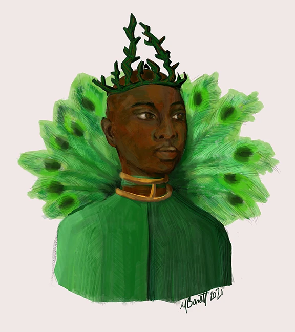
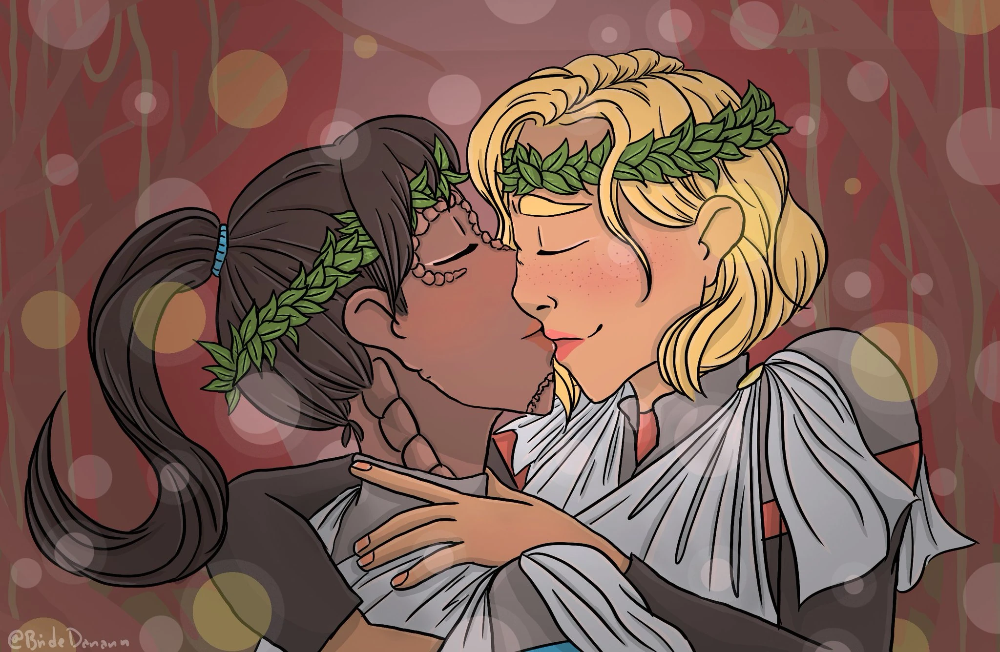

# Episode 38 The Play's the Thing

- **Source:** https://clear-skies-rpg.fandom.com/wiki/Episode_38_The_Play's_the_Thing
- **Retrieved:** 2026-11-16
- **Wiki page ID:** 705
**Episode 38 — The Play's the Thing**

| Field | Value |
| --- | ----- |
| Air date | 12/07/2020 |
| Run length | 220min |
| Broadcast | Twitch [YouTube](https://www.youtube.com/watch?v=wtCUtMdR3Bw) [Spotify Podcast](https://open.spotify.com/show/4XRHFGJ4s4EV7LufmohEnQ?si=_ryT3XVATmiTtDsrx3Yt8w) |
| Cast | Eric Campbell Revati Dhomse Gina DeVivo Sam de Leve Aki Xander Jeanneret Bonnie Gordon |
| Previous | [Episode 37 By Any Other Name](ep-37-by-any-other-name.md) |
| Next | [Episode 39 Off the Map pt. 1](ep-39-off-the-map-pt-1.md) |

> "Excuse me. I'm not Admiral April Hebert, I'm fairy number three."
>
> — April Hebert

## Plot Synopsis
### Brief Overview 
Pending. [A few sentences only.]

### Pre-Break 
[USS Ross](../ships/uss-ross.md) has spent the last few days surveying gaseous anomalies using its new high resolution sensors and technology obtained from the [J'Shashia](../characters/jshashia.md)ns. During this time of routine work, the crew has been spending time on enrichment activities. In only a few days, a Bajoran harvest festival will be celebrated on the Promenade. The festivities are being organized by LT Nadra Badim.

CAPT Sull is currently in their ready room with YEO3 Azzmi Shanto. Azzmi is reading to them the list of planned events for the festival. Azzmi mentions that she is going to be performing in a play, but she doesn't know the role yet. One of the crew, ENS Vexlis, is organizing a performance of [*A Midsummer Night's Dream*](https://en.wikipedia.org/wiki/A_Midsummer_Night%27s_Dream). ([Episode 37 By Any Other Name](ep-37-by-any-other-name.md)) Azzmi has been asked to find out if Sull wants to participate. Sull says that it would be "unseemly" if they were to pull rank and obtain a part when there is such a large crew aboard. They add that they don't think there are any roles in that play for them. Azzmi is acting very nervous that she agreed to perform. Sull tries to reassure her, and then asks for a cast list. Azzmi says that AMB Olyn Madzhin-Nil is performing, and she's been requested to ask the entire senior staff.

LTCDR Yeri Prahl comes in over the communicator and announces a priority one message from Narendra Station. On their way out, Sull tells Azzmi that she should ask Prahl to perform. Azzmi is visibly terrified by the idea, but agrees. When Sull enters the bridge, LT Zhyliss Vrenn calls out that Narendra Station is broadcasting a Yellow Alert. The station is under attack. Prahl says that ADM April Hebert is waiting on a call for Sull. Sull orders her brought up on the main screen. The image of Hebert is backed by flashing red lights (not yellow), but Hebert is surprisingly nonchalant.

Sull asks what is happening. Hebert says that GEN Kargan has been killed. A commander from a Klingon warship beamed an assault team aboard the station. At the same time, a log was broadcast to the entire station. This log proved that Kargan had been working with [Sela](https://memory-alpha.fandom.com/wiki/Sela). One of the Klingons took that log as sufficient evidence to challenge Kargan to a duel. Kargan lost; the commander is resting in sickbay with serious wounds. The yellow alert was broadcast as a precaution, but things have calmed down. AMB Jahl has apologized to Hebert for the commotion, and Hebert also received a message from [Chancellor Martok](https://memory-alpha.fandom.com/wiki/Martok). She adds that, since Klingon culture is uninterested in dead bodies, she has been tasked with disposing of Kargan's body.

Sull says that [USS Ross](../ships/uss-ross.md) is on its way to the station. Hebert says she is hopeful that the next Klingon administrator of the station is better than Kargan was. Hebert ends the communication. Sull orders Vrenn to plot a course. Sull asks the bridge out loud who might have been the one to uncover Kargan's duplicity. Olyn gives Sull a meaningful look, but doesn't say a word. Sull is openly lackadaisical about obtaining the information. EXEO is less so, and sends Prahl a copy of Hebert's reports so he can sift through them for the answer. Prahl finds it, and an image of CDR B'emir, captain of IKS Borqu', appears on the view screen. Olyn notes that officers of USS Ross have worked with the crew of IKS Borqu' in the past. (The Search for Skrag) Suddenly there is a live update to the reports from Narendra Station. The file for Commander B'emir is updated to state that she is a Captain. Then her file disappears entirely from the report. EXEO checks her own copies, and she sees that the personnel records for Captain B'emir have just been classified. EXEO gives a very impressed look to both Prahl and Sull.

The ship proceeds towards Narendra Station. They are 41 hours away. Sull asks LTJG Jane Lakat for a quick long-range scan of the area; Lakat finds nothing of interest other than a small gravimetric anomaly. Vrenn course corrects for it, and Lakat scans it as they fly past (just in case). EXEO waves Azzmi over to ask if she'd like to rehearse with her once their shift is over. Azzmi glances over to Lakat to make sure she isn't listening. She whispers to EXEO to ask how she knew. EXEO says that she is also in the play, and she has been given the cast list. EXEO asks Azzmi what part she wants to play (EXEO knows them all). Azzmi says that she got the part of [Snug, the Joiner](https://en.wikipedia.org/wiki/Snug_%28A_Midsummer_Night%27s_Dream%29). EXEO says they could rehearse right now, and Azzmi nervously agrees. She gives Lakat a glance and heads for the turbolift. EXEO comments that Azzmi seems agitated about something. Azzmi says it's the play, and the turbolift doors close. Meanwhile, Lakat has *absolutely* been eavesdropping on that conversation. Olyn feels a burst of confusion coming from Lakat. Lakat is now convinced that there is some romantic connection between Azzmi and EXEO. She begins to question if she's been misinterpreting all of Azzmi's actions that indicated she was interested in Lakat.

Down in Main Engineering, ENS Aulyn Dari walks up to MCPO Theq Lynadas. She is visibly agitated, and she asks him for some advice. Theq suggests they get a drink at 10 Forward. Dari says that she can't because "they" will be there. Theq suggests they use Holodeck 1 for the drink, instead. After Dari leaves, Theq calls LTCDR M'Qrell; he asks her to meet him and Dari in Holodeck 1. Theq notices LT Tuzk giving Dari a wide berth after seeing the expression on her face. Theq arrives at Holodeck 1 just a M'Qrell does. They meet outside; the program is already running, with Dari inside. Theq says that Dari has been having a lot of emotions that are affecting her performance. He is worried that he isn't the best about resolving personal conflicts. M'Qrell asks if Dari knows she is coming; he says that she is not. M'Qrell notes that it might be an intrusion; Theq is visibly nervous. He decides to go in first.

When he enters, he is surrounded by an arboreal paradise. There are bright flowers, soft dew, and the chirping of birdsong. He hears Dari scream "Fuck this!" He announces his presence and approaches her. She is wearing a toga and a furious look. She stares at a data PADD, and she is extremely frustrated. She growls at Theq that she doesn't "know what half of these fucking words mean". Theq suggests she calm down. Dari sees M'Qrell enter in the distance. She shrinks behind a tree and angrily asks Theq why M'Qrell is there. Theq says that he thought they were just getting a drink; Dari responds by shouting. Theq shouts back. M'Qrell announces that she is leaving, and Dari waves good-bye from behind the tree. M'Qrell tells her that she looks very nice in her Toga.

Dari whispers to Theq that she had asked him to the holodeck to convince her to back out of the play. Theq mentions that he's been working on the food. Dari asks if he will put her on his cooking team. Theq notes that she is a terrible cook. Dari responds that she is very good at telling Theq that he is very good. Dari says that "they" bullied her. Someone cornered her with a phaser to make her do the play. She complains about the archaic English in the script. Theq tells her about a Bolian artist who only spoke in burps. Finally, she asks him to help her run her lines. She says that she hasn't been cast, but she wants to read for [Demetrius](https://en.wikipedia.org/wiki/Demetrius_%28A_Midsummer_Night%27s_Dream%29). Theq gives her some advice about the futility of worrying, and she calms down.

The two begin to read through the lines together. Theq is terrible at it, but Dari is *magnificent*. She nails the performance of Demetrius perfectly. At one point, she breaks off to complain to Theq about why Demetrius is such a bastard (desiring Lysander's wife while Helena is clearly flirting with him). Theq cuts off her commentary and tells her to resume, because he needs to know what happens next. He says that she is amazing and he is too invested in the story to break off. Dari notices Theq's earnest enthusiasm and is surprised. She resumes reading.

The scene shifts to Olyn in their offices on the promenade. They start a secure call to Sorex. They observe that everything appears to have worked out for the best, more or less. Sorex agrees; he notes that he is unaware of who will replace Kargan. He adds that he's caught word that Martok is taking personal interest in assigning the next commander. Olyn comments that they like Martok. Sorex replies that Martok is not easily manipulated; [Gowron](https://memory-alpha.fandom.com/wiki/Gowron) was more fun. Olyn asks if there is anything else she needs to know. Sorex reminds them that Kargan had allies on the station. He says that Martok will probably appoint someone from his inner circle. Martok will want to keep Sela from using [Shackleton Expanse](../locations/shackleton-expanse.md) as a "back door" into the Klingon Empire. Sorex thinks the appointee will be a recently promoted general with a background in Klingon Intelligence and a positive opinion of the Federation (things that Kargan had none of).

Olyn regrets Kargans death, and points out that he wasn't entirely terrible. Sorex notes that dying in a duel means Kargan retained his honor. His name and family will not suffer disgrace. Sorex is not pleased about it. Olyn asks how P'jeeno has responded. Sorex says that he isn't sure, but he thinks P'jeeno was surprised that Sela's reach extended all the way to the station. Olyn wonders aloud if she still has influence on the Shackleton Expanse. Sorex says that his father, Mendak, returning to the Romulan Star Empire has probably made things on Romulus too problematic for Sela to worry about the expanse. Olyn is relieved. Sorex is not. Olyn asks if there is anything they can do. Sorex tells them that he intends to teach them skills, not for them to get involved directly. Olyn notes that they haven't told Sull anything about the situation; Sorex is surprised. He advises them to do so as soon as possible. Sorex says the situation was a win-win for everyone involved; he thinks that Sull will understand. After the call ends, Olyn puts their head in their hands. Patience gives them a curious and sympathetic look. Olyn gives her scritches and starts to idly flip through the script and cast of the upcoming play.

Meanwhile, M'Qrell is also scrolling through a PADD. She is marking off a list of names of people who've been asked to be in the play and what parts they've been assigned. She hasn't been asked, yet, and so she is keeping track of how many parts are left. Then, Lakat knocks on her door. Lakat had previously decided to avoid the entire Bajoran festival. However, since finding out Azzmi is in the play, she is now interested. She is seeking out M'Qrell as the most "dramatic" person she knows. Lakat says that M'Qrell seems like a person who would know plays well. She notes that M'Qrell's acting was very good during their mission in Paradise City. ([Episode 27 Who We Are Meant to Be pt. 1](ep-27-who-we-are-meant-to-be-pt-1.md)) She asks if M'Qrell is going to be in the play. M'Qrell says that she hasn't been asked, yet. M'Qrell asks if Lakat has been asked. Lakat says that she hasn't, yet, and that she probably would have said no. However, now she wants to audition for it, and she needs help. M'Qrell says that she thinks Lakat would be wonderful. She adds that Lakat is a very passionate person under her reserved demeanor, and that theater can be helpful in channeling those emotions. Lakat loses herself in thought a moment, and then starts to ask M'Qrell a question.

She says that she is going to construct a hypothetical situation, and that she needs M'Qrell's objective opinion, as a fellow scientist. M'Qrell grabs another cup of tea. Lakat begins to describe the situation. There is a "hypothetical" person who is extremely confident, brilliant, intelligent, and beautiful. She adds that this "hypothetical" person is so confident that they want to "defend cases" and "go up against entire courtrooms" in the future (she clearly means Azzmi Shanto). Lakat asks why this "hypothetical" person would asks someone else to help them with rehearsing a play. Why would someone ask someone else for help with something they are obviously good at? M'Qrell says that the "hypothetical" person might be confident in being themselves, but not in being someone else. Acting requires embodying another person. M'Qrell also suggests that "hypothetical" person might want to hone their skills in order to impress someone else (implying Lakat).

Lakat stares suspiciously at M'Qrell. She proposes that the "hypothetical" person might just be looking for an excuse to spend time with their rehearsal partner. M'Qrell sees Lakat's face fall at that thought. M'Qrell notes that the "hypothetical" person might have sought out a rehearsal partner who was also in the play, and that they didn't ask "someone else" (i.e., Lakat) because that someone else wasn't in the play. M'Qrell finally just asks directly if they are discussing Lakat. Lakat concludes out loud that the solution is for her to enter the play and prove to the "hypothetical" person that they are better than their rehearsal partner (EXEO). M'Qrell suggests that isn't the most healthy motivation to join the play, but she agrees that Lakat should join. She also suggests that Lakat put her (M'Qrell's) name in as a possible member. Lakat cuts her off, and says that they will be going together to ask; Lakat refuses to do it alone.

M'Qrell agrees to join, but only as "moral support", of course. Lakat asks M'Qrell to explain the play, since she knows nothing about it. She repeatedly gets the name of the play wrong.
M'Qrell says that it's about lovers, mischief, and magic. Lakat is interested at the word "lovers". She asks who are the lovers in the play. M'Qrell explains the roles. There is [Hermia](https://en.wikipedia.org/wiki/Hermia_%28A_Midsummer_Night%27s_Dream%29); the beautiful woman that both men are in love with. There is [wikipedia:Lysander (A Midsummer Night's Dream|Lysander](https://en.wikipedia.org/wiki/Lysander_%28A_Midsummer_Night%27s_Dream%7CLysander), who is in love with her. There is [Demetrius](https://en.wikipedia.org/wiki/Demetrius_%28A_Midsummer_Night%27s_Dream%29), who is in love with her and engaged to her. Hermia is in love with Lysander. Finally, there is [wikipedia:Helena (A Midsummer Night's Dream)](https://en.wikipedia.org/wiki/Helena_%28A_Midsummer_Night%27s_Dream%29), who is in love with Demetrius. M'Qrell starts an enthusiastic summary of the play, concluding with "And while this is happening there's another play being rehearsed in the forest, and a [man](https://en.wikipedia.org/wiki/Nick_Bottom) turns into an ass!" Lakat asks which part M'Qrell wants to play, and excitedly replies "the ass!", before correcting herself. Between the universal translator, not knowing the play, and not having a perfect knowledge of English, Lakat interprets that someone in the play is turned into buttocks. M'Qrell goes into more detail, explaining that the queen of the fairies, [Titania](https://en.wikipedia.org/wiki/Titania) falls in love with the ass. Lakat asks if the play has a villain. M'Qrell says that it's not a villain so much as a "mischevious essence". Lakat is very interested in that part.

The focus shifts to Sull, who is in 10 Forward reading a copy of *A Midsummer Night's Dream* and orders a drink of Solun's choosing. As Solun sets down the cup, Sull hears a voice that isn't Solun's ask them what they are reading. Sull looks up, and sees the face of Q plastered on a perfect facsimile of Solun. Q makes a disparaging remark about Shakespeare. Q asks Sull if they want to "see something". Sull agrees, and they are whisked away to the surface of an asteroid. On the surface, Sull sees a few dozen small green life-forms. Q notes that [USS Ross](../ships/uss-ross.md) used to have one of them in her warp core, and that they've multiplied. (Episode 03) Q says that it's time to "get real". He says that he appreciates Sull's effort in trying to appear unimpressed when he visits. He says that it takes the pressure off of him, as a Q. He adds that he is one of only a few Q who believe that life-forms like the Federation races are both necessary and delightful. Sull thanks him for visiting USS Ross, despite his lack of empathy for any other creature in the galaxy. He bashfully accepts the gratitude. He then states that the time of their association is coming to an end, and he has a report of how well they did.

He says that Dill is a creature from the [mycelial network](https://memory-alpha.fandom.com/wiki/Mycelial_network). He says that this encounter, along with their recent encounter with the network, helped the Q identify the origin of EXEO's technology. ([Episode 37 By Any Other Name](ep-37-by-any-other-name.md)) The Q hadn't been able to see it, which they didn't like. Q notes that, while Q are infinite, they can sometimes have a hard time seeing everything, because there is so much of it to see. He makes an off-hand comment that the Big Bang was something they would have stopped if they'd noticed it was about to happen, again. Q informs Sull that they are "back on track". The delay caused by Dill's appearance in their warp core has now been corrected. He notes that their friends in the "Time Shenanigans Department" (Daniels) were trying to figure out who wanted to delay USS Ross appearing in the [Shackleton Expanse](../locations/shackleton-expanse.md). The goal was to prevent them from birthing the Crystalline Entity, from preventing the Romulan civil war, and from revealing the various plots going on in the expanse. ([Episode 13 Food of the Gods pt. 3](ep-13-food-of-the-gods-pt-3.md)) However, USS Ross succeeded in accomplishing all of her tasks in the appointed times.

He mentions there are a few loose ends, such as EXEO. She is made of technology that doesn't belong in the universe right now, and something might need to be done about it. Sull doesn't respond immediately. They say they are waiting for him to do something; he replies that he is waiting for *them* to do something. The Q-continuum want him to remove EXEO from existence, and restore the timeline to one where she never existed. However, Q says that undoing the current timeline would mean all of their (including his) efforts to fix things would have gone to waste. The continuum have agreed to let Q have his way, on one conditions. When the time comes, Sull will have to confront Andrea Redgrave. Redgrave is more than what she seems, and she isn't playing "by the rules". He says that history is about to catch up with the Federation, and some of the decisions they've made about artificial life are going to bear fruit. EXEO could change the course of how things play out. Events of the next 15 years in the Federation might turn out quite differently. He informs Sull that there might be dark days on the horizon; he wants to make sure they know what's at stake. Their very existence might be affected by the decisions around EXEO. He then drops the goofy persona, and appears to genuinely apologize to Sull for having to give them bad news. He disappears and Sull returns to 10 Forward as Solun sets down their cup.

### Post-Break
The episode resumes with USS Ross arriving at Narendra Station. Three Klingon ships are stationed there. There is a [*K'vort* class](https://memory-alpha.fandom.com/wiki/Klingon_Bird-of-Prey), a [*Vor'cha* class](https://memory-alpha.fandom.com/wiki/Vor%27cha_class), and IKS Negh'Var. IKS *Negh'Var* is the namesake of the newest class of Klingon warships, the flagship of the Klingon navy, and the personal ship of Chancellor [Martok](https://memory-alpha.fandom.com/wiki/Martok). Vrenn is quietly ecstatic, and he begins whispering every fact he knows about IKS *Negh'Var* to himself. Lakat glances over at him and back at the ship. She is both intimidated and impressed. Vrenn mentions that IKS *Negh'Var* is the ship that attacked Deep Space 9 [https://memory-alpha.fandom.com/wiki/The_Way_of_the_Warrior_(episode)](https://memory-alpha.fandom.com/wiki/The_Way_of_the_Warrior_(episode)). Prahl is as infatuated with IKS *Negh'Var* as Vrenn is. Olyn turns to Sull and says that they should talk.

Olyn and Sull enter Sull's ready room. Olyn recalls the conversation they had in the baths on the holodeck, in which Sull took on the responsibility of uncovering Kargan's treachery ([Episode 32 The Refit pt. 2](ep-32-the-refit-pt-2.md)) In that conversation, Olyn had suggested using Sorex, and Sull had declined. However, Kargan's plot was uncovered, and not by Sull. Olyn explains that it was Sorex who uncovered the plot, and that they helped him do it (against Sull's wishes). ([Episode 33 The Refit pt. 3](ep-33-the-refit-pt-3.md)) Sull is mildly surprised, and also comments that Olyn doesn't seem happy about their involvement. Olyn explains that they don't like done something against Sull's wishes, and they don't like keeping secrets from Sull. Sull asks Olyn if they were trying to protect them. Olyn says that they were. Sull is a little amused at the idea of Olyn trying to protect them. They reassure Olyn that, as they are a diplomat and not under Sull's command, they are going to be involved in activities which are separate from Sull. Sull asks if there is anything else, and Olyn says that there is not. Olyn mentions that they don't often have conversations like this; Sull says that Olyn doesn't often do intelligence work without even including them. Sull switches topics, and says that the crew is trying to talk them into the role of [Thesus](https://en.wikipedia.org/wiki/Theseus%23Literature) in the play. The two begin to discuss the idea as they return to the bridge.

When they return to the bridge, Vrenn is info-dumping to Lakat everything he knows about IKS Negh'Var. Lakat points out that it only has one warp core. When he sees Sull return to the bridge, he announces that they are pulling into the station. The crew observes that USS Thunderchild is also present, and is currently being repaired. Sull turns to EXEO and sets down her ring. They say that they will see her on the station, and that they are head to sickbay to see the doctor.

Sull enters sickbay, and they ask M'Qrell for an aside. They ask her if she is planning on getting arrested this time on the station, too. ([Episode 34 Trial Runs pt. 1](ep-34-trial-runs-pt-1.md)) M'Qrell says that it won't happen again. Sull directly asks her "What's in the tea?" M'Qrell is evasive; she says that it contains *di-rapelli*(sp?) leaves and a special ingredient. She says that the ingredient is a family tradition and a special mix. She mentions that it would probably give Sull a headache. Sull asks if the special mix is purely sentimental or if it has a pharmacological affect. They state, bluntly, that if it's going to get M'Qrell arrested, they need to know what it is. M'Qrell points out that she didn't *actually* get arrested; Sull cuts her off to say that they will support her against station security, if necessary. M'Qrell again points out that she didn't get arrested (because she didn't obtain the ingredient). Sull accuses her of evading the question. They say that they want to know, and they are her captain. M'Qrell continues to evade; she only says that the tea is special to her, and necessary. Sull pointedly tells her that if she gets arrested, she should call them. As Sull leaves, they reflect on M'Qrell's statement that the tea is "necessary". They determine that M'Qrell is implying that it suppresses something within them which needs to be suppressed. She is apprehensive about what will happen to her if Sull prevents her from consuming the tea.

EXEO, Sull, and Olyn proceed to Narendra Station. They notice a lot of Klingons wearing the badge of the [House of Martok](https://memory-alpha.fandom.com/wiki/House_of_Martok). AMB Jahl is waiting for them; he strides up to Olyn and wraps them in a big hug. Sull, EXEO, and Jahl joke about the prospect of EXEO taking command from Sull by single combat. Jahl joyfully reports on the death of Kargan. He leads them onto the station. He says that the new Klingon co-commander of the station has arrived; he leads them to Hebert's office. Jahl (who is a nobleman in the House of Martok) is clearly thrilled with all of the banners and soldiers of the House of Martok present on the station.

When they arrive in Hebert's office, Jahl announces their presence. He introduces them to the three Klingons in the room: GEN Qolar (the new station commander), [Worf](https://memory-alpha.fandom.com/wiki/Worf) of the House of Martok, and Chancellor [Martok](https://memory-alpha.fandom.com/wiki/Martok). Martok steps forward and shakes Sull's hand. He turns to EXEO, greets her, and examines her closely. He says that he couldn't tell if she was a hologram or not, and smiles. Martok introduces Qolar to the crew. Qolar steps forward to greet Sull, EXEO, and Olyn. Qolar excuses himself to go look over his station. The three Klingons leave.

After they leave, Hebert, flanked by Sivek, who has been there the entire time, sighs. She comments that Worf is the only Klingon she's met that uses his inside-voice. Olyn simply says that he was "absolutely magnificent". Hebert apologizes to Sull for dragging them back to Narendra Station to have a five-minute meeting. Sull asks Hebert what she knows of Qolar. She says that he is a war hero from the Dominion war; he fought alongside Federation forces on multiple occasions. He was also hand-picked by Worf for the position of station commander. She says that she had hoped Worf would be the commander, but Qolar seems to be a good pick.

Hebert changes the topic of conversation. She asks Sull what they've been up to. Sivek asks to be excused now that the conversation has shifted to "irrelevancies". He leaves. Sull says that USS Ross is putting on a production of *A Midsummer Night's Dream*. Sull notes that they currently lack an actor for [Hippolyta](https://en.wikipedia.org/wiki/Hippolyta%23Shakespeare_Character). Hebert asks if Sull is inviting her to be in the play. Sull, EXEO, and Olyn all make statements encouraging her to do so. Hebert says that she will do it on two conditions. It has to be a small part; she will think of the second condition, later. Hebert asks if there is anything else to report. Sull notes that nothing of interest occurred, other than another visit from Q. Olyn is immediately interested, as they've not heard of these encounters before. Hebert expresses shock and surprise. She asks if Sull has been reporting the contact with Q to Starfleet Command. Sull says that it has been in all of their reports, and seems incredulous that Hebert didn't know. Hebert asks if Sull his Q's primary interest; Sull says that they are "hardly" the most interesting person on the ship. Olyn senses a spike of apprehension from EXEO at that statement. Sull relates their most recent encounter with Q. Olyn feels another spike of anxiety from EXEO at the mention of Dill.

Hebert decides to read the full reports, later. Olyn can sense that Hebert now views Sull in a new light. Members of the Q continuum have previously only visited Starfleet captains which were at the center of momentous events in Federation history. Hebert is a little taken aback. Olyn feels Sull keeping a very firm control on their emotions. Hebert decides to end the conversation so she can go practice her lines for the play. She also makes a sarcastic comment about Sull's crew not aggravating Sivek. EXEO, Sull, and Olyn steps out of Hebert's office.

As they leave, they catch a glimpse of Worf, Martok, and Qolar having a conversation on the way to the transporter pad.  Olyn takes a moment to watch Worf walk away, and then asks the computer for the location of CDR Sessan Tam, Executive Officer of USS Thunderchild.  ([Episode 36 To the Rescue](ep-36-to-the-rescue.md))  The computer reports that he is aboard USS Thunderchild and Olyn departs.  

EXEO stands still and stares meaningfully at Sull.  She asks if there is a problem with *Dill* (with great emphasis on the name).  She is clearly talking about herself, but not wanting to reveal anything to potential eavesdroppers.  Sull pointedly replies that Dill is from the [mycelial network](https://memory-alpha.fandom.com/wiki/Mycelial_network), and that certain people might believe that such things should not exist in this universe.  EXEO asks if Q had a recommendation of what should be done with such a "misplaced creature".  Sull reports that the Q continuum is not of one mind on the issue, but that the Q they met felt the same way as Sull (that there is no problem).  EXEO summarizes Sull's point as that they have a Q on their side to protect "Dill".  EXEO asks if Q said anything about the origins "Dill".  Sull relays that they will have to confront those origins at some point.  EXEO asks about the fate of those who released "Dill".  Sull says that their fate is unknown, but that "Dill" will be protected "at any cost".  EXEO suggests they get a drink; Sull agrees.

The next day, the Bajoran harvest festival has begun on the Promenade of USS Ross.  A full recreation of Bajor has been erected using the holoemitters.  A small amphitheater sits near the embassy.  ENS Vexlis, who is organizing the play, nervously walks up to EXEO.  She asks where Olyn is, and EXEO replies that they are on Narendra Station.  EXEO asks why Vexlis needs to speak to them.  Vexlis replies that they haven't cast anyone for the play yet, and it starts in 2 hours and 10 minutes.  EXEO reassures them that most of the crew members have already been practicing for the roles they wish to perform.  Vexlis relaxes slightly, and notes that it is going to be more of a 'stage reading' than a full production (people will have scripts).  Vexlis makes a nervous comment that an admiral is going to be performing.  EXEO instructs her to relish the opportunity to direct and command an admiral.  Vexlis is very nervous about that idea.  She collects herself and tells EXEO that LT Badim and ENS Alex Nozumi, the organizers of the festival, wish to speak to her.  EXEO says that she has time.  Vexlis leads EXEO along the promenade past celebrating and relaxing crew members.

Meanwhile, Theq is running around behind the scenes organizing all of the various Bajoran foods, including authentic [*hasperat*](https://memory-alpha.fandom.com/wiki/Hasperat).  As Lakat and the other potential cast members gather around, it becomes clear that there won't be auditions for any of the roles.  Crew members are milling about, asking which parts each other would like to play.  Lakat catches a glimpse of Azzmi holding a data PADD.  There is a collective gasp as someone announces an admiral's arrival.

Hebert and Sivek walk up to the group.  Olyn glances over to Prahl to see his reaction at seeing Sivek.  Prahl outwardly ignores the situation, but Olyn can sense strong emotions from him.  Sull greets Hebert and attempts to corral her.  Hebert interrupts Sull at one point to say that she isn't "Admiral April Hebert", she's fairy number 3.  Sull apologizes.  Sivek quirks an eyebrow in a very Vulcan manner.  Hebert suggests he go "relax", and he proceeds to one of the food stands.  Theq hands him some *hasperat*, and makes a joke about the time Sivek arrested him.  ([Episode 33 The Refit pt. 3](ep-33-the-refit-pt-3.md))

Roles are being decided upon.  Olyn walks up to EXEO to ask if anyone has taken the part of [Oberon](https://en.wikipedia.org/wiki/Oberon%23A_Midsummer_Night%27s_Dream).  Lakat, upon seeing Azzmi, starts to move towards her, but she hesitates.  She feels very exposed as a Cardassian in a very authentic recreation of Bajor.  She takes a moment to take in Azzmi's lovely appearance, and then turns around to go get her part.  She picks a role randomly, and it's [Puck](https://en.wikipedia.org/wiki/Puck_%28A_Midsummer_Night%27s_Dream%29).  EXEO hands her a PADD with her lines, and Lakat moves to stand next to Prahl.  He asks what role she chose, she looks at her PADD and reads out the name.  She asks who he chose; he says [Peter Quince](https://en.wikipedia.org/wiki/Peter_Quince).

She asks to run lines, but also says that she wants to have a meeting with him after the festival is over.  He asks about what, and she is evasive.  Prahl looks at her very seriously.  She says that the options are to run lines or discuss his ex (Sivek).  He remarks that she gets mean when someone corners her.  She agrees, and comments that he does, as well.  Prahl agrees with that.  He then demonstrates it by asking if she intends to use her words to talk to Azzmi, or if she is just going to try and win her over with a play.  Lakat replies that she is *absolutely* going with the play route.  He tells her good luck, since she chose Puck.

M'Qrell, on her way towards EXEO, takes a moment to speak to Sull.  She tells them that she sent them a private message, which they can read at their leisure.  She doesn't wait for a reply, and she moves to EXEO.  M'Qrell requests to be ["The Ass"](https://en.wikipedia.org/wiki/Nick_Bottom).  M'Qrell goes to sit next to Lakat and Prahl.  She notices Lakat's glances at Azzmi.  She makes a very poetic and wise statement about reason and love, and she walks away.  Lakat, confused, assumes it was a line from the play.  Sull walks up to EXEO with a prop crown on their head, and they takes the lines for [Thesus](https://en.wikipedia.org/wiki/Theseus%23Literature).

There is a gasp in the crowd as Solun steps forward.  They are dressed as [Hippolyta](https://en.wikipedia.org/wiki/Hippolyta%23Shakespeare_Character) in full "Amazonian" costume.  The crowd just begins to applaud.  Sivek quirks an eyebrow at Solun.  Solun announces their regret that they don't get to have a death scene, but that they will enjoy being someone's "arm candy".  When they realize that Sull is playing Theseus, they walk up to Sull and say simply "You have conquered me."  There is a quick cut to Stavek and T'Vek livestreaming the performance from their laboratory.  EXEO transforms her image to her costume of [wikipedia:Helena (A Midsummer Night's Dream)](https://en.wikipedia.org/wiki/Helena_%28A_Midsummer_Night%27s_Dream%29).  She walks up to Azzmi and hands her the lines for [Snug, the Joiner](https://en.wikipedia.org/wiki/Snug_%28A_Midsummer_Night%27s_Dream%29).  Azzmi says she is also playing Cobweb, one of 
[Titania](https://en.wikipedia.org/wiki/Titania)'s servants.  EXEO hands her those lines as well.

The play begins.  LT Badim is the director.  Vexlis is [Hermia](https://en.wikipedia.org/wiki/Hermia_%28A_Midsummer_Night%27s_Dream%29).  Vrenn is [wikipedia:Lysander (A Midsummer Night's Dream|Lysander](https://en.wikipedia.org/wiki/Lysander_%28A_Midsummer_Night%27s_Dream%7CLysander).  ENS Nozumi is one of the mechanicals.  LT Pyrrah Callum is the stage and effects manager.  LT Jaloryn is also stage managing.  Singh is [Titania](https://en.wikipedia.org/wiki/Titania).  It proceeds with light heartedness and mistakes and goofiness.  Only a short while in, Lakat realizes that she chose one of the single largest parts.  The crew enjoy the innuendo, the mischievousness, and the absurdity of the command staff play fighting.  At one point, Hebert flubs her only line, and she can't stop laughing at her inability to say it.  The crowd joins in and applauds her.  At the end of it, the lights dim and the spotlight shines down on Lakat as she reads the final lines of the play.  Lakat's anxiety has melted away from the joy and fun of the previous hours.  The lights go out to roaring applause.

When the lights come up for the bow, Sull sees GEN Qolar across the promenade.  He's been watching the entire time, apparently.  The crew starts applauding and cheering and handing out flowers.  Azzmi runs up to Lakat and throws herself into her arms.  Lakat picks her up and swirls her around as they kiss.  The sight of a Bajoran and a Cardassian kissing on stage draws the attention of the other Bajoran crew members.  They begin humming a Bajoran love song.  Azzmi pulls her face away from Lakat's and realizes that everyone is looking at them and she tries to hide her face.  Lakat grabs Azzmi's face in her hands and turns it to focus on her.  They start a hurried conversation about how good each other were in the play, before Lakat cuts Azzmi off and kisses her again.

A few feet away, Vrenn is sitting next to Theq while they watch Lakat and Azzmi.  He asks Theq what his antennae are doing; Theq reports back that they seem happy.  Theq is crying.  Vrenn stands up and says he is going to go look at IKS Negh'Var some more.  Lakat sees him out of the corner of her eye.  She breaks off a kiss and whips her head around.  She shouts out "Where do you think you're going?"  Vrenn sheepishly replies that there is a *Negh'Var* class ship and it's big and green and cool looking.  Lakat shouts out that she just gave the best performance of her life, and she demands a hug.  Vrenn runs up to give her a hug.

Meanwhile, Sull moves away from the main group.  They pull out the PADD with M'Qrells message and begin to read it.
> "Captain, after our conversation today, I see now why you were such an asset to Starfleet Intelligence.  I give this to you with full confidence that you will keep this private.  The ingredient in question at the end of the recipe is frowned up on by Starfleet.  Please know that I have never once administered this to anyone, patient or not.  If you know what this ingredient is used for, then please know that I use it as a necessity.  It has not, and will not, ever interfere with my work or my ability to perform my duties.  The recipe for my tea:  Di-rapelli leaves (an old rare herb that calms and subsides rage and anger), light cream, sugar, and nyphonsome[sp]."
>
> — M'Qrell
Sull reflects on their knowledge of the drug.  Nyphonsome is a synthetic drug that is illegal in the Federation with multiple uses.  It can be used to suppress telepathy.  It is sometimes used in interrogations.  And, in some species, it acts as a fatal neuro-toxin.  Sull's background in intelligence kicks in.  They raise an eyebrow at M'Qrell, who has been watching them closely, and puts the PADD away.  Qolar nods in Sull's direction, and he vanishes into the turbolift.  Sull looks out at their crew, and reflects that they can do anything.

They are ready for the future.

## Cast
-  Eric Campbell - Game Master
-  Revati Dhomse - Jane Lakat
-  Gina DeVivo - EXEO
-  Sam de Leve - Azeri Sull
-  Aki - Olyn Madzhin-Nil
-  Xander Jeanneret - Theq Lynadas
-  Bonnie Gordon - M'Qrell

## Non-Player Characters
-  Azzmi Shanto
-  Yeri Prahl
-  Zhyliss Vrenn
-  April Hebert
-  Aulyn Dari
-  Tuzk
-  Sorex
-  Q
-  Solun
-  Amandeep Singh
-  Jahl
-  Qolar
-  [Worf](https://memory-alpha.fandom.com/wiki/Worf)
-  [Martok](https://memory-alpha.fandom.com/wiki/Martok)
-  Sivek
-  Vexlis
-  Nadra Badim
-  Alex Nozumi
-  Pyrrah Callum
-  Jaloryn
-  Stavek (PC being played by Eric Campbell)
-  T'Vek  (PC being played by Eric Campbell)

## Locations
-  Narendra Station

## Ships
-  IKS Negh'Var
-  USS Thunderchild

## Notable Lines 
> "Make sure you ask him.  He really ought to be in it."

> "Prahl?  Yes, Captain.  May I say that you ordered me to do so, Captain?"
>
> — Azzmi Shanto

> "I don't know what half of these fucking words mean, sir!"

> "I think your universal translator might be a little on the fritz."
>
> — Theq Lynadas

> "What's with this energy?  I am very uncomfortable with what you have brought into the holodeck at this moment!  Why are we shouting!?"
>
> — Theq Lynadas *(to Aulyn Dari)*
> "I asked you here cuz I wanted your help talking me out of doing this."

> "The toga?  Cuz it's working, if you want my opinion."
>
> — Theq Lynadas

> "How many versions of English are there!?  This is the most ridiculous language I have ever seen in my life."
>
> — Aulyn Dari *(about Shakespeare)*
> "One of the most dangerous things that can happen to you is how comfortable you can make yourself when it comes to lying."
>
> — Sorex *(to Olyn Madzhin-Nil)*
> "Clearly the only thing to do is to enter the play and win them over.  Show them I'm better.  Duh.  Duh!  It's the Cardassian way."
>
> — Jane Lakat
> "And while this is happening there's another play being rehearsed in the forest, and a man turns into an ass!"

> "An ass?  Who are you going to go for?"
>
> — Jane Lakat

> "The ass!"

> "You know, I appreciate the follow-up.  I bet you're great on dates"
>
> — Azeri Sull *(to Q)*
> "You don't have an attention span that long, don't be ridiculous"
>
> — Azeri Sull *(to Q)*
> "Space is big.  But, sometimes, it's very small."
>
> — Azeri Sull *(to Olyn Madzhin-Nil about the possibility of meeting B'emir)*
> "That is the most Klingon of Klingon vessels that has ever Klingoned in the skies"
>
> — Zhyliss Vrenn *(about IKS *Negh'Var*)*
> "My XO hasn't managed to oust me in combat, just yet."
>
> — Azeri Sull *(to \Jahl)*
> "I swear.  Worf is the only Klingon I've ever met who understands that you can use your inside-voice when you're in an office."
>
> — April Hebert
> "He was absolutely magnificent."
>
> — Olyn Madzhin-Nil *(about Worf)*
> "Excuse me. I'm not Admiral April Hebert, I'm fairy number three."
>
> — April Hebert
> "I mean, we can either run lines or we can talk about your ex.  Which would you rather do?"
>
> — Jane Lakat *(to Yeri Prahl)*
> "You get mean when someone corners you.  You know that?"

> "Yeah, I do.  I think you do too."
>
> — Jane Lakat

> "Yeah, it's true I do.  So do you actually want to use your words to talk to your girlfriend over there?  Or are you gonna win her over in a play?"

> "Oh, no.  Absolutely not.  We're gonna win her over in a play."

> "Good luck, you chose Puck."

> "You have conquered me"
>
> — Solun *(to Azeri Sull before the play)*
> "You've got this, Shanto"
>
> — Azzmi Shanto *(psyching herself up for the play)*

## Notes and Trivia
-  At the end of the episode, Eric read out an open letter from the players on the [Streampunks](https://www.patreon.com/Streampunks) Discord RP server.
-  The "events of the next 15 years" includes the creation of the [Kelvin timeline](https://memory-alpha.fandom.com/wiki/Alternate_reality), and the events of [Star Trek:Picard](https://memory-alpha.fandom.com/wiki/Star_Trek:_Picard).
