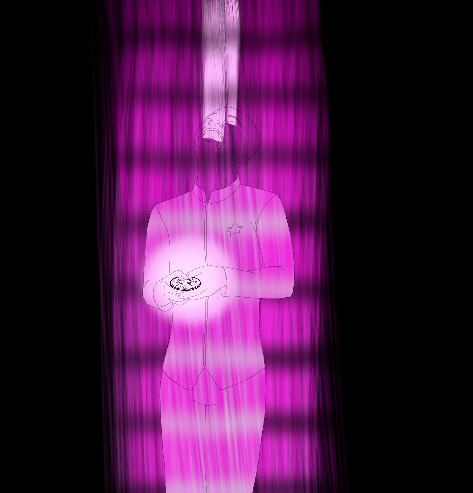

# Episode 39 Off the Map pt. 1

- **Source:** https://clear-skies-rpg.fandom.com/wiki/Episode_39_Off_the_Map_pt._1
- **Retrieved:** 2026-11-16
- **Wiki page ID:** 740
**Episode 39 — Off the Map pt. 1**

| Field | Value |
| --- | ----- |
| Air date | 01/11/2021 |
| Run length | 175min |
| Broadcast | Twitch [YouTube](https://www.youtube.com/watch?v=ahkkJ971VPo) [Spotify Podcast](https://open.spotify.com/show/4XRHFGJ4s4EV7LufmohEnQ?si=_ryT3XVATmiTtDsrx3Yt8w) |
| Cast | Eric Campbell Revati Dhomse Gina DeVivo Sam de Leve Aki Xander Jeanneret Bonnie Gordon |
| Previous | [Episode 38 The Play's the Thing](ep-38-the-plays-the-thing.md) |
| Next | [Episode 40 Off the Map pt. 2](ep-40-off-the-map-pt-2.md) |

> "Oh, there's no evidence that any of that is true, but wouldn't it be amazing?"
>
> — Yata

## Plot Synopsis
### Brief Overview 
The crew of [USS Ross](../ships/uss-ross.md) are getting restless after six weeks of routine work.  Lakat and Yata examine some strange data in the records of spatial anomalies which Yata found.  Olyn is feeling depressed and isolated, when Solun asks them to mediate a rivalry between two chefs on the promenade

The ship gets a new mission.  They are to proceed to the Kafidar System in the Shackleton Expanse, where they will check in on a small research station which has gone out of communication.  While travelling there, Lakat and Theq take another look at The Disc.  They decide to get Olyn to examine it with them, but when Olyn touches it the entire crew passes out.

EXEO and M'Qrell are the only crewmembers left conscious.  M'Qrell guesses that she is still awake due to the illegal substance in her tea.  They head to Olyn's position on the Holodeck, and discover them frozen in place, exploding with light.

The rest of the crew experience something completely different.  From their perspective, the crew blacked out, and now Olyn and EXEO have vanished from the ship.

Meanwhile, from Olyn's perspective, they wake up in a column of light facing Ao'tun.  Ao'tun explains the disc's purpose, and that something has gone wrong.  If they don't fix it, the entire crew could be lost forever.

### Pre-Break 
It is six weeks since the events of [Episode 38 The Play's the Thing](ep-38-the-plays-the-thing.md).  The exploits of [20th Fleet](../locations/20th-fleet.md) in the [Shackleton Expanse](../locations/shackleton-expanse.md) are starting to get noticed across Starfleet.  There are talks of a new [Praetor](https://memory-alpha.fandom.com/wiki/Praetor) rising to power within the Romulan Star Empire, but Starfleet Intelligence has been unable to obtain their identity.  USS Thunderchild is operation again, but there is talk of it being reassigned and replaced.  Since GEN Qolar assumed command of Klingon forces in the Shackleton Expanse, more ships have been assigned to his command; there are currently four [*K'vort*-class](https://memory-alpha.fandom.com/wiki/Klingon_bird-of-prey) birds-of-prey operating out of Narendra Station.  There has been an increasing amount of civilian merchants, explorers, and would-be colonists arriving at Narendra Station, and the station is nearly at capacity.

USS Ross has been conducting routine scientific surveys of gaseous anomalies for the last 46 hours.  The episode opens with LT Jane Lakat and Dr. Yata are in Cetacean Operations discussing the survey data.  Yata has been wildly speculating on the potential implications of the data for the fun of it.  Lakat has been getting restless.  Yata offers to show her something interesting, and he invites her into the tank.  He shows her a map of 7 spatial anomalies which occurred in a direct line behind an old flight path of USS Ross.  He advises caution in speculating, but he cannot explain why they have formed.

Lakat looks at all of the data of spatial anomalies in the expanse, and gets a chill up her spine.  Her unconscious mind is trying to tell her something about the situation, but she can't quite put her finger on it.  She decides to focus on the question of the 7 anomalies that Yata pointed out, but she is unable to identify any cause.

Meanwhile, CAPT Azeri Sull is sitting in their ready room with CDR EXEO and YEO3 Azzmi Shanto, doing PADD-work.  Sull and EXEO have also been increasingly restless over the last six weeks of routine assignments.  Sull has spent their time designing new captain's chairs for the bridge that allow for increasingly bizarre seating positions.  Azzmi announces the completion of their work for the day, but Sull suggests they start on tomorrow's work.  Azzmi leaves to go get it.

EXEO sits down across from Sull with a grave look on her face.  She asks Sull if her hair looks stupid.  Sull engaged in a long and dignified examination, and declares it ridiculous (it resembles the hair of the title character of [*Napoleon Dynamite*](https://en.wikipedia.org/wiki/Napolean_Dynamite)).  EXEO expresses her own restlessness.  Azzmi returns with more work, and Sull declares that they will engage in a "speed run".

Meanwhile, in Main Engineering, MCPO Theq Lynadas and ENS Aulyn Dari are busy running diagnostics on the EPS conduits, again.  The engineering crew aboard USS Ross have not been as unoccupied as the rest of the crew.  USS Ross requires constant monitoring and upkeep to maintain the two warp cores.  However, they have been getting a little stir-crazy, and have taken to racing the mag-boards inside the Jeffries Tubes.  Several have been injured.

Theq has been dealing with Sull's repeated request for assessing their captain's chair designs.  He's also been pointedly ignoring doing research on The Disc, which Lakat had given him.  ([Episode 35 Trial Runs pt. 2](ep-35-trial-runs-pt-2.md))  Dari and another officer approach him.  The other officer is LT Gregg Locke.  He explains that he discovered that every shuttle on USS Ross is missing an important component.  They will all have to be disassembled and repaired.  Dari says that she checked the records and they were fabricated and installed aboard USS Ross with the part missing.  Locke volunteers to lead the repairs.  Theq assigns him the unfortunate role of informing Sull of the situation.  He also assigns Dari the task of investigating; Dari is elated and determined that "someone's gonna burn".

Meanwhile, in sickbay, LTCDR M'Qrell is attending to ENS John Shepard, who was injured while racing a mag-board through the Jeffries Tubes.  She takes a moment to check her PADD to see if Sull has replied to her message about the illegal substance (nyphonsome (sp))with which she has been medicating herself.  ([Episode 38 The Play's the Thing](ep-38-the-plays-the-thing.md))  There is still no reply (she's been constantly checking for the past six weeks).  Another person walks into sickbay.  PO2 T'Miri walks in and calmly presents herself with a mag-board injury.  M'Qrell considers that she might need to demonstrate proper mag-boarding technique to the engineering crew.

Meanwhile, AMB Olyn Madzhin-Nil is alone in their offices with nothing to do.

::**CONTENT WARNING: Depression, isolation** Click "expand" to see the content.They are restless and depressed.  They are starting to think taking the post aboard USS Ross was a mistake.  They've avoided reaching out to Lakat since she is in such a good place.  They sit in their office, reading the same report for the fifth time.  Their mind turns to the unopened crate in the back of their office.  They brought it with them when they came aboard the ship, but they haven't had a cause to open it.  They reflect on how they've had a hard time relating to the crew, and all of the mistakes they've made since they arrived.  They feel lost and alone.  They don't know what to do, and they don't have anyone to reach out to.

There is a chirp at the door, and they can feel Solun's presence outside.  They've been avoiding 10 Forward, and Solun has certainly noticed.  Solun enters; they are wearing surprisingly drab clothing, a marked difference from their normal flamboyancy.  Solun points out Olyn's absence from 10 Forward, and Olyn says they haven't felt up to being around people, lately.  Solun remarks that even they can sometimes find it very difficult to socialize; Olyn is surprised.  Solun tells Olyn that they need Olyn's help; Olyn is incredulous.  Solun says they need a mediator between two chefs operating rival restaurants on the Promenade.  Things are getting heated between them.  Olyn seems confused, but agrees.  The two also agree to bring Theq in on the mediation.

Meanwhile, on the bridge, LTCDR Yeri Prahl announces a priority hail from Narendra Station.  Sull answers the hail and VADM April Hebert answers.  She explains that there is a small research station on a nearby planet.  They've missed three of their weekly check-ins, and USS Ross is ordered to investigate.  Sull takes the opportunity to ask after things on the station.  Hebert explains that Qolar is performing his duties extremely well.  Sull wonders why the Klingon Empire would send someone so competent to the middle of nowhere; Hebert says that Qolar requested the assignment, but she doesn't know why.  Sull orders the ship to warp.

Prahl brings up the tactical information on the research station.  It's a small collection of pre-fabricated pods, a standard setup for a small station.  It was established 7 months prior.  It is located on Kafidar-3, a class L planet.  It is frequently struck by storms.  The chief scientist is Dr. Ryan Kabbit, a famous, and adventurous, botanist.  Lakat enters the bridge.  When she sees that they are going to check in on Dr. Kabbit, she explodes with fangirl energy.  She offers to give everyone on the bridge her copy of his most recent book, and is excited to discuss it with them all once they've read it.

### Post-Break
On the way to the planet, Lakat visits Theq in his lab to check on the disc research.  He admits that he hasn't done any work on it.  Lakat says she is out of ideas of what to do with it.  Theq suggests they need someone who is neither a scientist nor an engineer.  Lakat thinks they need the person on the ship least likely to panic when meeting the ghosts of their past.  She suggests Olyn, and Theq calls them.  Olyn agrees to come, and to bring snacks.

A short time later, Olyn arrives with a charcuterie board and Patience.  Theq pulls out a metal briefcase, which contains the disc.  Lakat explains to Olyn her bizarre experience with the disc, but leaves out the bit about it taking the appearance of her father and brother.  Olyn is curious about why Lakat and Theq don't want to touch it, but they are both evasive.  Olyn lets it drop, for now.  Olyn examines the disc, and they recognize the language written on it.  It is the language of the [Progenitors](https://memory-alpha.fandom.com/wiki/Ancient_humanoid), a humanoid race which seeded the primordial environments of several planets of the galaxy with a genetic code that would direct the evolution of life to eventually create species similar to themselves.

Olyn explains who the Progentiors were to Lakat and Theq.  Olyn suggests someone should touch it again.  Lakat and Theq remain extremely apprehensive.  Olyn figures out that their reservation is the real reason they asked them to come.  They pick up the disc.  When they do, Lakat and Theq hear the faint sound of chimes.  However, Olyn feels an extreme pressure in their head.  The gem erupts with light, which extinguishes all of the holograms on the holodeck.  Theq and Lakat immediately pass out.

On the bridge, EXEO is currently in charge.  The ship dramatically drops out of warp and comes to a halt.  The sudden change in moment throws the tactical officer right over the handrail and across the bridge.  The ship goes to Yellow Alert.  EXEO asks for status reports, but everyone is unconscious.  She blips to Sull's quarters, where she finds them passed out on the floor.  She places them back into bed and begins interrogating the ship's systems.  She identifies the locus of the blackouts, and blips down to Holodeck 1.

When she arrives, her holographic form has a hard time maintaining integrity.  Lakat and Theq are passed out on the floor.  Olyn is standing rigid, their head thrown back and mouth open, holding the disc.  Bright light is pouring out of their mouth and eyes, and also out from the disc.  EXEO approaches Olyn but her form starts to disintegrate.  She backs away, and she throws the charcuterie board at Olyns hands, knocking the disc to the floor.  The disc stops glowing, and EXEO erects a forcefield around it.  However, Olyn is unchanged.

Meanwhile, Lakat and Theq do not experience passing out.  When Olyn picks up the disc, they see Olyn disappear from view.  Olyn is replaced by a large column of energy containing the vague outline of a humanoid.  Theq tries to scan it, but the tricorder returns meaningless data.  They call Sull.

When they do, Sull is already dealing with reports from the bridge that EXEO spontaneously vanished from her chair.  EXEO is nowhere aboard the ship.  Sull reflects for a moment on an event that occurred only 30 minutes prior:

Sull and Azzmi are in Sull's quarters.  Azzmi is giving a brief report on *nyphonsome(sp)*, the illegal substance in M'Qrell's tea.  Azzmi reports that it was used frequently in the Dominion War by interrogators to make subjects passive and pliable.  It has sometimes been used on Vulcan to control violent outbursts during *pon farr*.  There are reports that, when it wears off, people can become violently psychotic.  Sull asks her to gather all data about legality and regulation.  Azzmi asks if there is a reason behind the inquiry.  Sull just says that there is, and Azzmi leaves.

Sull's attention returns to the present.  They rush down to Holodeck 1 to meet up with Theq and Lakat.  They see the pillar of light where Olyn used to be.  Theq and Lakat fill them in.

Meanwhile, in EXEO's experience, she observes a noise emitting from Olyn.  It is a low thrum, sort of resembling a warp core.  The energy is radiating from Olyn in regular pulses.  EXEO tests how close she can get to Olyn without losing integrity.  She cannot get close enough to touch them.  EXEO blips to sickbay.  Once there, she finds M'Qrell slumped over her desk.  EXEO grabs a stimulant hypospray and begins injecting the doctors and nurses in sickbay, but none of them wake up.  Then, she hears a groan coming from M'Qrell's office.  M'Qrell begins to wake up.  EXEO notes M'Qrell's tea had spilled all over her desk; she takes note of the small, strange leaflets in the tea.

M'Qrell wakes up with a huge headache and extreme exhaustion.  She gives herself a stimulant hypospray, but it has no effect.  She tries to stand, but her legs give out from under her.  M'Qrell thinks, and concludes that her tea is probably responsible for why she is the only one still conscious.  She comes to the realization that she will need to take more of the tea in order to regain full consciousness, but she also understands that it will be very dangerous.  M'Qrell explains this to EXEO.  She leads EXEO to her stash of leaves containing *nyphonsome(sp)*, and she starts to make more tea.  She only describes it to EXEO as a "rare herb".  EXEO suggests that they replicate it to give to the entire crew; M'Qrell is adamant that they do not.  She considers the possibility that she might be able to isolate the reason it is keeping her awake, and create a similar effect without using the actual plant.  EXEO takes M'Qrell to the Jeffries Tubes and they take a mag-board down to Holodeck 1.

Meanwhile, in Olyn's experience, they wake up standing inside a column of light.  

::**CONTENT WARNING: Sensory Overload** Click "expand" to see the content.They hear trillions of voices all speaking at once.  They recognize that they are only seconds away from death.  Their mind cannot handle the overwhelming information and it is about to die.  They feel the succor of oblivion approaching, and they are in so much pain that they welcome it.

A hand reaches through the column of light and pulls them out of it.  The sounds fade, along with the memories of it.  Olyn doesn't remember the experience of being in the light, but they do know that they never want to do it again.  They collapse into the arms of Ao'tun.  Olyn knows Ao'tun's name, but they don't know why they know it.  Then they notice their surroundings.  They are not on USS Ross, but instead they stand on the surface of an unknown planet.  In the skies above float thousands of broken planets.  They begin to feel overwhelmed, but Ao'tun brings their focus back.  Ao'tun tells Olyn that they need to focus on one thing, and not trillions.

Olyn asks how they got here.  Ao'tun says that they do not know. Ao'tun explains that the disc is a record of every memory of everyone who has ever held it.

> "It is a message in a bottle, and it records.  It has travelled the galaxy, and it has captured the memories and thoughts of every being that has ever come into contact with it.  It is a remembrance.  So that, as every species passes out of existence, they are never forgotten.  It is meant to be a gift that we left behind.  And it is unleashed, now.  And if we don't find a way to stop it, you and your crew will be lost in it, forever."
>
> — Ao'tun

##  Cast
-  Eric Campbell - Game Master
-  Revati Dhomse - Jane Lakat
-  Gina DeVivo - EXEO
-  Sam de Leve - Azeri Sull
-  Aki - Olyn Madzhin-Nil
-  Xander Jeanneret - Theq Lynadas
-  Bonnie Gordon - M'Qrell

## Non-Player Characters
-  Azzmi Shanto
-  Aulyn Dari
-  Gregg Locke
-  John Shepard
-  T'Miri
-  Solun
-  Yeri Prahl
-  April Hebert
-  Zhyliss Vrenn
-  Ao'tun

## Locations
-  [ANY PLANET, SHIP, ETC LOCATION]

## Ships
-  [ANY SHIP (other than USS Ross)]

## Notable Lines 
> "Oh, there's no evidence that any of that is true, but wouldn't it be amazing?"
>
> — Yata
> "Lakat, you need to teach yourself to be excited by even the most minute, mundane things.  Otherwise, you will go insane."
>
> — Yata
> "Be careful what you wish for."

> "What's the worst that could happen?  All I'm asking for, Dr. Yata ... is just one strange spatial anomaly.  I mean, literally, I'm not asking for, like, the Borg or anything."
>
> — Jane Lakat

> "Captain, I need you to be honest with me.  Does my hair look stupid?"
>
> — EXEO *(to Azeri Sull)*
> "Each shuttle is missing an auxiliary ionic coupling controller."

> "But we need the auxiliary ionic coupling controller!"
>
> — Theq Lynadas

> "I mean, who needs functioning shuttles, right?  We're just fucking Starfleet, right?  Like, we're just risking our lives out here in the middle of nowhere, right?  It's not like we fly the captain out on one of these things.  It's not like important personnel are constantly getting on and off of these shuttles and they could EXPLODE!"
>
> — Aulyn Dari
> "It sounds to me like you might need to lose a little bit of your mind for a while.  Been spending a little too much time with it, I think."
>
> — Solun *(to Olyn Madzhin-Nil)*
> "General Qolar has helped me understand how much of a job Kargan wasn't doing."
>
> — April Hebert *(to Azeri Sull)*
> "Fashion is cyclical.  I've just arrived at the incorrect rotation."
>
> — EXEO
> "I enjoy being science taxi, captain."
>
> — Zhyliss Vrenn
> "So you have no interest in seeing the ghosts of your past, is what you're telling me."

> "Absolutely not, lieutenant, are you kidding me?  That is what I run away from every day, thank you."
>
> — Theq Lynadas

> "Also just bring any emotional kit that you might need."

> "She has four legs; she goes with me everywhere already."
>
> — Olyn Madzhin-Nil

> "You always gotta tell them to 'bring the kit' of some sort."
>
> — Theq Lynadas
> "Whatever you paid for this was not enough."
>
> — Olyn Madzhin-Nil *(to Jane Lakat about the disc)*
> "The entire crew is completely blacked out, and none of the hyposprays are working, and Olyn is possibly a warp core."
>
> — EXEO
> "You were not meant to be here, Olyn Madzhin-Nil, and now we have to get you out."
>
> — Ao'tun
> "It is a message in a bottle, and it records.  It has travelled the galaxy, and it has captured the memories and thoughts of every being that has ever come into contact with it.  It is a remembrance.  So that, as every species passes out of existence, they are never forgotten.  It is meant to be a gift that we left behind.  And it is unleashed, now.  And if we don't find a way to stop it, you and your crew will be lost in it, forever."
>
> — Ao'tun *(to Olyn Madzhin-Nil about the disc)*

## Notes and Trivia
-  The timeline of the [Progenitors](https://memory-alpha.fandom.com/wiki/Ancient_Humanoids) and their activities is not logically consistent within Star Trek lore.  Some instances[https://memory-alpha.fandom.com/wiki/The_Chase_(episode)](https://memory-alpha.fandom.com/wiki/The_Chase_(episode)) report them as living 4.5 billion years ago.  Others[https://memory-beta.fandom.com/wiki/Progenitors](https://memory-beta.fandom.com/wiki/Progenitors) equate them with a species that lived 10,000 years ago. Olyn Madzhin-Nil establishes The Disc as 100,000 years-old based on the age of their civilization, but scans indicate it is 100,000,000 years-old.
