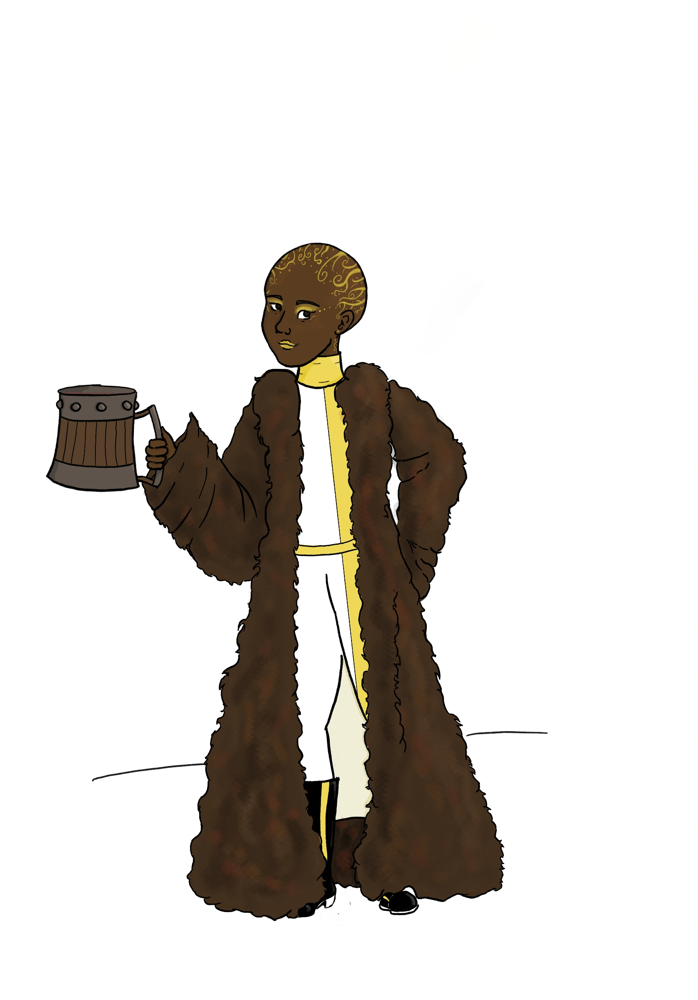

# Episode 41 The Only Thing Constant pt. 1

- **Source:** https://clear-skies-rpg.fandom.com/wiki/Episode_41_The_Only_Thing_Constant_pt._1
- **Retrieved:** 2026-11-16
- **Wiki page ID:** 762
**Episode 41 — The Only Thing Constant pt. 1**

| Field | Value |
| --- | ----- |
| Air date | 02/01/2021 |
| Run length | 183min |
| Broadcast | Twitch YouTube [Spotify Podcast](https://open.spotify.com/show/4XRHFGJ4s4EV7LufmohEnQ?si=_ryT3XVATmiTtDsrx3Yt8w) |
| Cast | Eric Campbell Revati Dhomse Gina DeVivo Sam de Leve Aki Xander Jeanneret Bonnie Gordon |
| Previous | [Episode 40 Off the Map pt. 2](ep-40-off-the-map-pt-2.md) |
| Next | [Episode 42 The Only Thing Constant pt. 2](ep-42-the-only-thing-constant-pt-2.md) |

> "It's good to be home.  Well, home-home.  The second home.  The second half of home.  Third half if you consider the saucer section as also attached to the main hull.  So it's like three homes.  Tri-home."
>
> — Zhyliss Vrenn

## Preshow Announcements
## Plot Synopsis
### Brief Overview 
[pending]
### Pre-Break 
Pending.
The episode begins 2 weeks after the events of [Episode 40 Off the Map pt. 2](ep-40-off-the-map-pt-2.md).  [USS Ross](../ships/uss-ross.md) is on its way back to Narendra Station.  The ship had resumed scanning gaseous anomalies after visiting Kafidar-3, but it received orders to return to Narendra Station.  VADM April Hebert had been rather cryptic about their purpose.

The scene starts with the ship about half an hour away from the station.  LT Zhyliss Vrenn announces that the ship is about to arrive.  CAPT Azeri Sull informs the crew that shore-leave won't be authorized, since they don't know how long the stop-over will be.  Vrenn and LT Jane Lakat immediately begin gossiping.  Sull whips a bouncy ball at the back of Vrenn's head, and they catch it before he turns around.  Vrenn whips around, confused, but Sull has a perfect poker face.  CDR EXEO stifles a giggle, and AMB Olyn Madzhin-Nil gives a psychic eye-roll.  Sull surreptitiously passes the ball to Olyn.  Olyn gives it to Patience.

The ship drops out of warp.  USS Thunderchild is docked, and the repairs on its warp nacelle are complete.  ([Episode 36 To the Rescue](ep-36-to-the-rescue.md))  No Klingon or Romulan vessels are present.  Sull makes a comment about other ships having all the fun; Olyn replies that they have an idea of something they could get up to.  Sull suggests they meet on the Promenade for a drink to discuss it.  Olyn is a little surprised, but they accept.  Olyn takes a moment to retrieve the bouncy ball from Patience, and they bounce it off the back of Vrenn's head.  Patience catches it in her mouth.  Vrenn turns around again, baffled at the sight of Patience holding the ball.

Down in main engineering, MCPO Theq is dealing with an anxious engineering department.  Returns to Narendra Station often involve flag officer inspections.  ENS Aulyn Dari is particularly perturbed.  She and CPO Amandeep Singh have been working overtime running a deep dive of USS Ross' systems to ensure they don't have a tracking device attached to them.  They are concerned about how [Ketikess](../ships/ketikess.md) found USS Ross in the middle of the [Shackleton Expanse](../locations/shackleton-expanse.md).  ([Episode 40 Off the Map pt. 2](ep-40-off-the-map-pt-2.md))  After a brief conversation, Theq dismisses Singh and Dari and proceeds to his office.  In his office, he continues work on a project to tap into The Disc.  He wants to get access to the memories in the disc (or at least the crew's shared experience) without having a biological interface.

Meanwhile, LTCDR M'Qrell is in her quarters packing her things.  She expects that she will be dismissed from USS Ross and turned into the authorities for possessing the Nyphonsome.

Sull confirms their date with Olyn.  Sull passes EXEO her ring, and the two leave the bridge for Hebert's office.  Vrenn takes a moment to ask LTCDR Yeri Prahl if there is an extra-dimensional being on the ship.  Prahl replies that there is, and orders him back to his station.  Vrenn, concerned, slowly returns to his chair.

The scene cuts to Sull and EXEO arriving at the transporter pad of Narendra Station.  CDR Sivek is waiting for them.  He takes them to Hebert's office.  On they way, they pass Timok's shop, which has a sign indicating that it is temporarily closed.  Sull asks Sivek Timok's whereabouts.  He replies that Timok is being questioned by the Klingon authorities on the station about illicit goods discovered in the Klingon areas of the ship.  He comments that GEN Qolar runs a "tight ship".

They arrive at Hebert's offices.  Hebert invites them all in, including Sivek.  Hebert invites them in and suggests drinks (Sull asks for cream soda).  Hebert informs them that USS Ross is being reassigned to the alpha quadrant.  It is to assist in the post-Dominion War reconstruction efforts and cooperative scientific endeavors.  It's a more prestigious assignment than [Shackleton Expanse](../locations/shackleton-expanse.md), and one that Hebert recommended them for.  She gives them a brief description of the current state of affairs in the area.  She specifically mentions a few topics.  There is the [Reunion Project](https://memory-beta.fandom.com/wiki/Reunion_Project), an effort to reform Cardassia around a democratic, liberal society and government.  The [Breen](https://memory-alpha.fandom.com/wiki/Breen) have retreated to their own space, but their moves are still inscrutable to Starfleet.  The [Tholian](https://memory-alpha.fandom.com/wiki/Tholians)s have also been spotted within the alpha quadrant outside of their territory.  The [Ferengi Trade Union](https://memory-alpha.fandom.com/wiki/Ferengi_Alliance) is also undergoing a powerful reformation.

She then brings up the second part of the briefing.  Sull, EXEO, and the crew of USS Ross are going to receive a special commendation from Starfleet.  The ceremony is that evening; full dress uniform is required.  Once the ceremony is over, USS Ross will depart for Starbase 621; maximum warp is authorized.  All of the families are going to be transferring over to Starbase 621.  Sull brings up the events surrounding The Disc.  They request that it remain aboard USS Ross for transport back to the Alpha Quadrant; Hebert agrees.

Hebert announces another bit of news for USS Ross.  Before heading to Starbase 621, the ship is ordered to head to [Starbase 1](https://memory-alpha.fandom.com/wiki/Starbase_1), in orbit over Earth, for some shore leave.  Also because USS Ross is going to get an upgrade there.  She also makes some cryptic statements about things which are going to be "made clear" after the ceremony.  Sull asks after Qolar.  Hebert makes some comments about his personality.  Sull requests permission to make an appointment with him; Hebert approves.  She dismisses them.

The scene shifts to YEO3 Azzmi Shanto and Sull in their ready room.  Sull is working furiously on administrative PADD-work in order to deal with the stress of uncertainty.  Azzmi is glowing a little bit.  Sull asks after her, and she says that Starbase 621 is only a week away from Bajor.  She's happy that she might have the option of visiting she provides information on Starbase 621.  There is a chirp at the door, and M'Qrell enters.  She asks for a private word; Azzmi excuses herself.  M'Qrell hands Sull a PADD with her resignation.  Sull hard-resets the PADD and hands it back.  M'Qrell says that she cannot continue to put the crew of USS Ross in legal and ethical jeopardy due to the substance she's taking (nyphonsome).  Sull dismisses the idea out of hand.  M'Qrell says that Sull doesn't grasp the gravity of the situation; Sull makes it very clear that they do.  They ask what M'Qrell's plan is after they resign from Starfleet in disgrace.  M'Qrell admits that she doesn't have one, but that "there's always a place that needs a doctor".  Sull questions why it's more ethical to let M'Qrell practice medicine while taking an illegal drug outside of Sull's watch, rather than within it.

M'Qrell assures Sull that the drug is completely safe and tested for her use.  M'Qrell says that she inherited a "very special gift" from her father.  She is "not fully Caitian".  Her father (who wasn't Caitian) had a telepathic gift.  In his species, this gift was only shown in males, but she inherited it anyway.  She has been on nyphonsome since she was 8 or 9 years old.  She asks if Sull remembers the Wall of Memories on the Promenade.  She says there is a little boy on the wall; she takes the drug because of him.  When she was very young, she had a great deal of anger and strength inside of her; she couldn't control it.  One day, when she was playing with other children, she accidentally killed a boy.  She telepathically linked with him after the accident, to see if he was okay.  She was connected at the time of his death.  The event changed her.  She was determined to never use her gifts again, but, as she aged, it grew more and more powerful.  She had it under control, but, during the Dominion War, she was again unable to control it.  At that time, she went back on the nyphonsome.

She continues to take the drug in her tea so that she doesn't accidentally telepathically link with the other crewmembers.  She cannot let anyone know what she truly is.  In her heart she is Caitian, but her "kind" doesn't belong in Starfleet.  Sull points out that the same thing was said about their kind, Orions.  Sull says that it seems M'Qrell takes the drug to protect her patients, and that she takes the drug for therapeutic reasons in a manner that is approved by medical professionals.  M'Qrell confirms that statement, and adds that she has modified the drug genetically so that it is specific to her.  Sull declares it a "paperwork" problem; i.e., that M'Qrell hasn't gotten official authorization to take the nyphonsome.  Sull says that they made a different choice (not taking a drug to suppress their pheromones), but that they both have a right to make the choice.  They request a full writeup from M'Qrell on the drug, it's use, and how she has modified it.  Sull declares that they will get her a therapeutic use exemption.  As M'Qrell leaves, Sull pulls her in for a hug.

Meanwhile, word has spread that the ship is being reassigned to the Alpha Quadrant, and that there is a ceremony that.  Some of the crew is excited, and some of them are disappointed at leaving "the frontier".  Some crewmembers are pointing out to others that even the "heart" of the Federation is near to large areas of unexplored space.  The officers of Cetacean Operations are particularly disappointed to be leaving the Shackleton Expanse (the Alpha Quadrant is much more heavily mapped).  Dr. Yata is particularly disappointed that they won't be researching the inter-stellar ecosystem that Ree gave them data on.  ([Episode 13 Food of the Gods pt. 3](ep-13-food-of-the-gods-pt-3.md))  He has requested that he be kept in the loop with any research.  He is anxious about leaving so many things undone in the Shackleton Expanse; EXEO reassures him that there are plenty of interesting things near Starbase 621 (like the [Badlands](https://memory-alpha.fandom.com/wiki/Badlands) and the [Bajoran wormhole](https://memory-alpha.fandom.com/wiki/Bajoran_wormhole)).

The focus shifts to Theq in his office, reading the PADD announcing their new orders.  Theq is going to have lots of opportunities for eating a wide variety of foods, and opportunities to attend engineering symposiums.  However, it's also near to where his brother, Reku Lynadas, died.  Dari engages him in a conversation about it.  She's a little uncertain.  He reassures her that it must be a good thing, since they've only accomplished good things in the Shackleton Expanse.  He reminds her that the ship is always home, no matter where they are.  He adds that he's very excited to wear his dress uniform again.  Dari expresses reservation about the event, but Theq informs her that she is going to attend.

The scene shifts to the promenade of Narendra Station.  Sull orders the local specialty, the M'ren, a drink known for being very strong.  Olyn says that they had asked Sull to speak about something that no longer seems relevant.  They'd been thinking about the information from Ree.  They were going to suggest finding an interesting place on it and going there.  They've been spending a lot of time figuring out what to do next, and as soon as they'd decided, the plan is irrelevant.  Sull's drink arrives.  They take a sip and remark on its strength.  Olyn expresses concern for Sull's ability to handle the drink.  Sull notices a wince from Olyn, and asks if they are okay.  After some prodding, Olyn explains that the incident with The Disc made them realize something, but it isn't appropriate to discuss at that moment.  Sull accepts the comment, and changes the topic to the new assignment.  They ask if Olyn intends to stay on USS Ross.  Olyn says that Sull has always been capable of handling diplomatic matters without them.  They've often felt like a bit of "extra fluff" on the ship.  They consider that they might be more useful in the Alpha Quadrant.  Sull disagrees with the notion of Olyn being extraneous.  They explain that they think Olyn is essential, and they want them to stay on the ship, in the seat on their left.  They ask if Olyn is going to stay to their left, but Olyn isn't sure.

At that moment, a delegation steps onto the promenade from the transporter pad.  High Regent [Alu Zazz Keel](../characters/alu-zazz-keel.md), of [Jateran](../locations/jateran.md), is leading a group of [J'Shashia](../characters/jshashia.md)ns around.  He is quite pleased and mesmerized at the bustling promenade.  Sull realizes that it can't be a coincidence that they just arrived on the station.  They excuse themselves, and ask Olyn to run interference with Keel while they sneak back to the ship to get ready.  Sull rushes off, leaving their M'ren nearly untouched.  The J'Shashia don't notice them, distracted by spotting Olyn.

### Post-Break
Olyn invites Jahl to be their date to the event.  Jahl says that he was already invited, and he is scheduled to give a speech.  

The scene cuts to the beginning of the event.  Theq rushes up to Dr. [Yugoss](../characters/yugoss.md) to share some data with him.  Yugoss is very excited to see it.  He asks if Yugoss is interested in staying aboard USS Ross when it leaves for the Alpha Quadrant.  Yugoss excitedly says that he is.  They then both realize they should consult the people with actual authority.  Yugoss is overwhelmed with gratitude.  Sull, EXEO, and M'Qrell are currently cornered by Keel.  He is excitedly info-dumping on everything that has been happening on [Jateran](../locations/jateran.md).  He finally finishes, and proceeds to lament their departure from the [Shackleton Expanse](../locations/shackleton-expanse.md).  He cautiously inquires if they can request to thwart their orders and stay longer.  EXEO takes the opportunity to lead him away from Sull and M'Qrell.

M'Qrell makes a joke to Sull about the importance of the di-rapelli(sp) leaves in her tea in addition to the nyphonsome (the di-rapelli leaves are an herbal relaxant similar to chamomile).  Sull inquires what might be available at the event for M'Qrell to imbibe for chemically relaxing purposes (since Caitians are allergic to alcohol).  M'Qrell suggests orange sherbet.  Sull and M'Qrell turn to see LT Jane Lakat and Azzmi entering together.  Prahl and Vrenn also enter.  Upon seeing Prahl, Sull looks for Sivek.  They notice Sivek is somewhat near the entrance, and they head for Prahl.  Vrenn excuses himself so he can go embarrass Lakat in front of her girlfriend, Azzmi.  Sull asks if Prahl dances.  He says that he doesn't.  M'Qrell suggests that dancing is much like fighting; Prahl deflects.  M'Qrell makes a pun, and she is unable to hold in her giggles. Prahl doesn't get it. 

Olyn and Jahl arrive together.  Olyn is wearing Jahl's coat, again.  Jahl leaves to go get them some drinks.  As Olyn approaches, Sull turns to Prahl and makes a joke about Olyn obtaining a Klingon cloak.  Prahl compliments the joke. M'Qrell is confused that he understood Sull's pun but not hers.  Sull grabs M'Qrell to go dancing.

The scene does a brief cut to Stavek and T'Vek furiously working in their lab on USS Ross while a live feed of the party is on a screen, just like they did for the play.  ([Episode 38 The Play's the Thing](ep-38-the-plays-the-thing.md))

Meanwhile, at the event, Jahl returns to Olyn.  He complains that the M'ren is not being served at the event.  He is insulted at the insinuation that Klingons couldn't handle it.  Olyn notes that AMB P'jeeno and his bodyguard, Vrotek are also present.  They excuse themselves from Jahl and make their way toward P'jeeno.  Vrotek eyes them as she walks over.  P'jeeno greets Olyn when they approach.  He says that he is surprised, and a little disappointed, at the departure of USS Ross.  He wonders if Olyn is also leaving; Olyn says they aren't sure.  He says he would regret their departure.  Olyn is pleased that he feels that way.  P'jeeno turns to Vrotek and asks if he agrees that Olyn's departure would be regrettable.  Vrotek nods.  P'jeeno makes a comment about himself and Vrotek trusting Olyn, and that it is uncommon for them to trust people outside the Romulan Star Empire.  He adds that power in the Empire is now firmly in the hand of the Romulan Senate, but he cautions that [Sela](https://memory-alpha.fandom.com/wiki/Sela) is still around.  They both express that they expect their governments will continue to distrust each other.  For his part, he makes an informal apology on behalf of the Empire for all of the damage the Empire has inflicted on the Federation since their first contact.

Olyn takes a moment to look at Vrotek.  They see Sorex standing only a few feet behind Vrotek.  He is perfectly blending into the crowd, speaking to two members of the crew of USS Ross, ENS Jeremiah Balm and Doctor Vohm (sp).  Sorex nods to Olyn when he sees them looking at him.  Olyn tells Vrotek that they appreciate the discomfort he feels being around so many people. They feel a bit of gratitude and curiosity from him.  Olyn excuses themselves, but not before recommending to P'jeeno and Vrotek that they get some popcorn.

Sorex walks up to Olyn and asks if M'Qrell is present.  He says that he needs to get a dance with her before the ship leaves.  He cracks a joke about coming up behind them with a favor.  He then tells them that they are the only person he trusts.  He says that Olyn will always have an asset in him, and that he intends to return to Romulus.  He says he will share any information he obtains about Sela; he has a score to settle with her for messing with his mind and trying to kill him.  He apologizes again for threatening them at his first meeting.  Olyn says that they with they were used to being at the whims of someone else's desperation.  They make a cryptic statement about EXEO having a conflict of interest related to that issue.  Sorex excuses himself to find M'Qrell.

At that moment, an object flies towards Sorex's head out of nowhere.  He catches her sundae glass expertly, and he hands it back.  He offers his hand, and M'Qrell takes it.  They move to the dance floor.  The focus shifts to Sull surveying the room and watching them dance.  EXEO strides up to them and makes a comment about wearing her curly hair.  ([Episode 40 Off the Map pt. 2](ep-40-off-the-map-pt-2.md)) She shifts into it.  They joke a bit, and then the ceremony begins.

Senior staff is seated at a table near the front.  Keel is the first speaker.  He gives a long, overly detailed speech about Jateran and [USS Ross](../ships/uss-ross.md).  Yugoss leans over and whispers to Theq that he hopes the boring speech isn't jeopardizing his chances of getting aboard USS Ross.  Hebert walks up the podium and starts her speech.  She starts into a sentimental speech about beginnings and endings, and the values of USS Ross' contributions.  She grants Sull and EXEO with the award of Starfleet's Commendation of Excellence.  The crowd erupts in applause.  Hebert also awards USS Ross and their crew with the Commendation of Exemplar.  USS Ross is now the diplomatic flagship of the Federation for the Alpha Quadrant.  The applause becomes uproarious.

The party returns.  Hebert walks up to the table and pours herself a M'ren.  She gives Sull some advice about Admiral Tagus Kor, their new commanding officer.  Sull and Hebert trade sarcastic compliments.  Hebert compliments EXEO as well.  They observe Theq and the engineering department perform the fully choreographed ballroom dance they've been working on for weeks.  ([Episode 35 Trial Runs pt. 2](ep-35-trial-runs-pt-2.md))  Vrenn storms up to the table, very drunk.  Sull engages him a bit, and then he departs, wobbling.

The focus shifts to M'Qrell and Sorex dancing.  He tells her that he will be returning to Romulus.  She wishes him the best, but tells him "don't be a stranger".  He notes that, if they run into each other, it won't be for good reasons.  She says that she will still be happy to see him.  He departs, and blends back into the crowd.  He makes quick eye contact with Sull, and nods.  Sull ignores him entirely.  EXEO taps them on the shoulder, and subtly points out Prahl and Sivek talking with each other.  Sull suggests that the two of them get close enough to overhear.  When they arrive, they hear Sivek admonishing Prahl for violating Trill prohibitions against re-association (meeting with people that a previous host knew well).  Prahl comments that he isn't engaging in re-association he is calling Sivek a bastard.  He says that he can feel what Sivek did to his previous host, Myrek Prahl, and he wants Sivek to know.  Sivek says that he understands what he did, and adds that Myrek understood what he was getting into, and how it would end.  Prahl just says "Not like that, not like that", and he leaves.

Sull says that they want to make sure Jahl gets a M'ren.  EXEO shifts into the appearance of the bartender.  The camera fades out on the end of a pleasant evening.

The ship spends the next ten days preparing to depart for the Alpha Quadrant.  Some of the crew decide to stay aboard Narendra Station, and some decide to depart with the ship.  Olyn is still undecided about whether or not they will stay.

One day, they invite Sull to come to their offices on the station.  Sull arrives.  Olyn begins a difficult conversation.  They say that they've had concerns over the past few months about their working relationship.  They bring up two specific incidents where they were strongly influenced by Sull's Orion pheromones.  ([Episode 15 Farther from Home pt. 2](ep-15-farther-from-home-pt-2.md))  It made them feel defenseless and scared.  Olyn says they often wonder about when the next time will be that Sull loses control.  Sull thinks to themselves, but Olyn interrupts.  They bluntly ask if Sull is in love with EXEO.  Sull is surprised and incredulous.  Olyn points out that Sull reacts to EXEO being in danger far more than with other crew members.  Sull stifles a laugh.  They apologize for laughing, and point out that they've had conversations about the risk their pheromones pose, but never one quite like this.  Sull says that they would be equally distressed if any other members of the crew got themselves into as much trouble as EXEO seems to.  They add that it would be very professionally inappropriate, and apologize for giving Olyn the impression.

Olyn is visibly flustered.  They say that they let their guard down around Sull, and they are afraid it might "undo" them.  They want to be helpful to Sull when they lose control, but they're afraid they might lose their own when Sull does.  They offer to try and help Sull if it's something they wanted, and they apologize if they've offended them.  Sull says that they aren't offended, but they understand if they can't stay.  Olyn asks permission to stay, and Sull is very relieved.

> "C'mon.  Save me from myself."

> "Aye, captain."
>
> — Olyn Madzhin-Nil

##  Cast
-  Eric Campbell - Game Master
-  Revati Dhomse - Jane Lakat (absent)
-  Gina DeVivo - EXEO (absent)
-  Sam de Leve - Azeri Sull
-  Aki - Olyn Madzhin-Nil
-  Xander Jeanneret - Theq Lynadas
-  Bonnie Gordon - M'Qrell

## Non-Player Characters
-  Zhyliss Vrenn
-  Patience
-  Aulyn Dari
-  Amandeep Singh
-  Yeri Prahl
-  Sivek
-  April Hebert
-  Azzmi Shanto
-  [Alu Zazz Keel](../characters/alu-zazz-keel.md)
-  Jahl
-  [Yugoss](../characters/yugoss.md)
-  Stavek (PC being played by Eric Campbell)
-  T'Vek (PC being played by Eric Campbell)
-  P'jeeno
-  Vrotek
-  Sorex
-  Jeremiah Balm
-  Vohm
-  Tagus Kor

## Locations
-  Narendra Station

## Ships
-  USS Thunderchild

## Notable Lines 
> "Have you been spending time with doctor M'Qrell, Olyn?"
>
> — Sull *(to Olyn about throwing things at crew members)*
> "It's good to be home.  Well, home-home.  The second home.  The second half of home.  Third half if you consider the saucer section as also attached to the main hull.  So it's like three homes.  Tri-home."
>
> — Zhyliss Vrenn
> "I understand, yes.  You have been taking an illegal substance without any sort of therapeutic use exemption or going through typical channels for said controlled substances for an indeterminate amount of time while also treating patients.  Do I have the shape of it, broadly?"
>
> — Azeri Sull *(to M'Qrell)*
> "There's always a place that needs a doctor."
>
> — M'Qrell
> "I am not fully Caitian.  My father had a very special gift."
>
> — M'Qrell *(to Sull)*
> "In my heart I am Caitian.  I was raised Caitian.  It is why I joined Starfleet, and why I became a doctor."
>
> — M'Qrell
> "My kind does not belong in Starfleet."

> "Well they said that about me for decades, and we're not doing that, are we?"
>
> — Azeri Sull

> "I think you have to stop running.  You're safe.  And you're making a choice about your body. And if that requires a little bit of paperwork, and a little bit of wrangling, and a little bit of handling bureaucracy, well goodness what do I have Shanto for?"
>
> — Azeri Sull *(to M'Qrell)*
> "I made a different choice, but we both have the right to make it.  These pheromones could be suppressed easily enough, but I don't.  You do.  We should both be able to make that choice.  Otherwise, what's the point of infinite diversity in infinite combinations?"
>
> — Azeri Sull *(to M'Qrell)*
> "Ensign, all that we can do is look back on what we've accomplished while we've been out here.  And, I'd say that's a heck of a lot, huh?"
>
> — Theq Lynadas *(to Aulyn Dari)*
> "Remember, we're a big ol' ship that moves.  And no matter where we are in space, we're at home."
>
> — Theq *(to Aulyn Dari)*
> "I don't know exactly what force it is out there that seems to want to make me feel displaced at every moment of every day."
>
> — Olyn Madzhin-Nil *(to Azeri Sull)*
> "Don't partake of the food of whimsical gods."
>
> — Azeri Sull
> "I appreciate the flattery, but I don't' know what I'm doing, and you do.  I'd be lost all to hell and I don't want to be, thank you.  It's much easier to captain and have people fear you if you look like you know what's going on.  And I don't know what's going on, and as long as you know what's going on, I get to pretend and then lean over to my left.  Will I have you to my left?"
>
> — Azeri Sull *(to Olyn Madzhin-Nil)*
> "I don't know what vice admirals do; it's all manner of vice"
>
> — Azeri Sull
> "Thank you.  This would be, if allowed monumentous - monumen**tal** for my people.  And for me, professionally, and spiritually and just "ly" all over the place."
>
> — Yugoss *(to Theq Lynadas)*
> "Oh God, I'm going to go embarrass my best friend in front of her girlfriend, excuse me."
>
> — Zhyliss Vrenn
> "Dancing is a lot like a fight, but with rhythm."

> "Yes.  In training we call that 'kata', and that's where I keep it, doctor."
>
> — Yeri Prahl

> "You don't want to 'kata' rug?"

> "You don't drink, isn't that right?"

> "Me?"
>
> — Olyn Madzhin-Nil

> "Yes."

> "We have gotten drunk together on multiple occasions, ambassador.  Or do you not remember?"

> "Have we?  Well then, this will be an extraordinarily entertaining first time for me, again."

> "I became an ambassador because I have the ability to recognize our own sins."
>
> — P'jeeno *(to Olyn Madzhin-Nil)*
> "You know, I thought about being funny and greeting you tonight by coming up from behind you like I had a weapon in my hand.  But, somehow, I felt that perhaps that would not amuse you."
>
> — Sorex *(to Olyn Madzhin-Nil)*
> "I have a score to settle with her.  She gave me a family and took that family away.  She played with my mind, and she used me.  And then, like so many Tal Shiar agents, she tried to kill me."
>
> — Sorex *(about Sela)*
> "I've gotten used to being at the whims of someone's desparation.  Well, that's a lie.  I wish I were used to being at the whims of someone's desperation.  Because that would make all of this so much easier."
>
> — Olyn Madzhin-Nil
> "If you ever need to make a break for it, I'm sure I could turn into a goose or something."
>
> — EXEO *(to Azeri Sull)*
> "We're a flagship now."

> "Does that have any significant change on our operations or technologies?"
>
> — Stavek

> "No.  It is a completely arbitrary designation."

> "What a spectacular waste of time."

> "Indeed.  We're better off studying."

> "I'm not re-associating with you.  I came over here to tell you you were a bastard, sir."
>
> — Yeri Prahl *(to Sivek)*
> "EXEO is a beautiful, unique, irreplaceable being.  Yes, it fills me with dread to know that someone that perfectly unique and extraordinary might be imperiled.  But I assure you, I am equally distressed whenever any of you put yourself into unnecessary trouble."
>
> — Azeri Sull *(to Olyn Madzhin-Nil)*
> "I spent a lot of time in my life learning to control myself around pheromoned[sic] creatures, because that's what I had to do to survive what felt often like an onslaught.  And I find that it's easy to let my guard down around you, and sometimes I fear that that might undo me."
>
> — Olyn Madzhin-Nil *(to Azeri Sull)*
> "Help.  We're a diplomacy ship, now.  I don't want to have to be expected to **talk**."
>
> — Azeri Sull *(to Olyn Madzhin-Nil)*

## Notes and Trivia
-  Sull's request for cream soda is a reference to [Lark Sage](https://shield-of-tomorrow.fandom.com/wiki/Lark_Sage).
-  The M'ren is a reference to [Mala Ren](https://shield-of-tomorrow.fandom.com/wiki/Mala_Ren)
