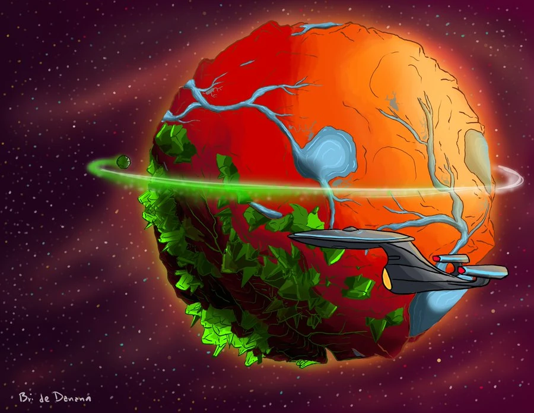

# Jateran

- **Source:** https://clear-skies-rpg.fandom.com/wiki/Jateran
- **Retrieved:** 2026-11-16
- **Wiki page ID:** 343

| Field | Value |
| --- | ----- |
| Type | Terrestrial |
| Status | Habitable |
| Native species | [J'Shashia](../characters/jshashia.md) |
| Affiliation | [J'Shashia](../characters/jshashia.md) |

**Jateran** is a class-M planet located in the Nios sector in the [Shackleton Expanse](shackleton-expanse.md).

## Description:
It is the homeworld of the [J'Shashia](../characters/jshashia.md)ns, who number about 1.7 billion. It is a large terrestrial world, nearly the size of Saturn. Its surface gravity is comparable to Earth. It has a nitrogen-oxygen atmosphere. Its average surface temperature is 35 degrees Celsius. It has a purple sky, and the plant-life has a largely purple coloration. It has a large number of crystals in its crust, and large mountain ranges which can be seen from space.

It has some small surface oceans, with very high salinity. Even the surface water far from the oceans has elevated salinity compared to Earth. Under the surface are vast oceans of fresh water.

The J'Shashia occupy only one hemisphere of the planet, known as the "Eastern" hemisphere. The Western side of the planet has very little life, and resembles a class-L world. At the extreme "Western" pole, there is no life at all, not even microbial.

Jateran underwent two mass extinctions in the previous 100,000 years.  The J'Shashian species survived both of them.

In 2381, a [Crystalline Entity](https://memory-alpha.fandom.com/wiki/Crystalline_Entity) emerged from the "Western" crust of Jateran, with the help of [USS Ross](../ships/uss-ross.md). The result was devastating climate change, which would have destroyed all surface life on the planet if not for technologies provided by Starfleet ([Episode 35 Trial Runs pt. 2](../episodes/ep-35-trial-runs-pt-2.md)).  The J'Shashian's top scientist believed another entity would grow there over the next 2 million years, and that the (geologically) frequent mass extinctions were connected to the entities growth.

## Notes:
-  Eric Campbell never states by what measure Jateran is "close to the size of Saturn" (by mass or by volume). Interestingly, if Jateran has gravity similar to Earth, then both are true. [Saturn](https://attic.gsfc.nasa.gov/huygensgcms/Saturn.htm) has a surface gravity (if it had a surface) of 1.07 times Earth. Therefore, Jateran must have similar mass *and* volume to Saturn. This also means the density of Jateran is less than water; Jateran would float.
-  Two mass extinctions within 100,000 years is extremely frequent compared to Earth.
