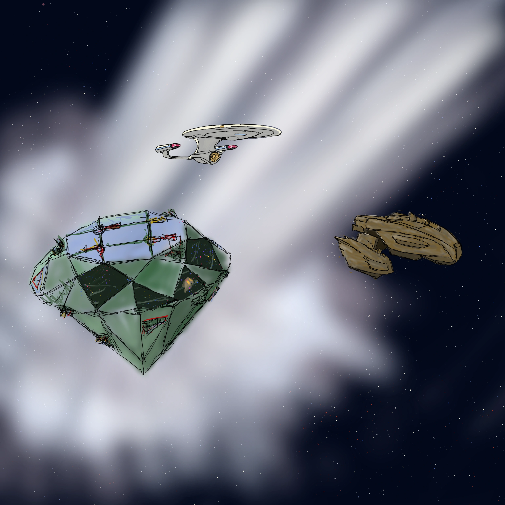

# Space Ring Observer

- **Source:** https://clear-skies-rpg.fandom.com/wiki/Space_Ring_Observer
- **Retrieved:** 2026-11-16
- **Wiki page ID:** 344

| Field | Value |
| --- | ----- |
| Type | Space Station |
| Affiliation | [J'Shashia](../characters/jshashia.md) |
| Status | In Service |

Space Ring Observer is a small space station built by the [J'Shashia](../characters/jshashia.md) to explore a particle fountain in the Jotaym system. It is the J'Shashians first deep space station.

In 2381, it entered a decaying orbit around the particle fountain and the crew entered stasis pods. A few months later, [USS Ross](../ships/uss-ross.md) rescued the inhabitants from an incursion by Gorn pirates, and towed the station away from the fountain.
