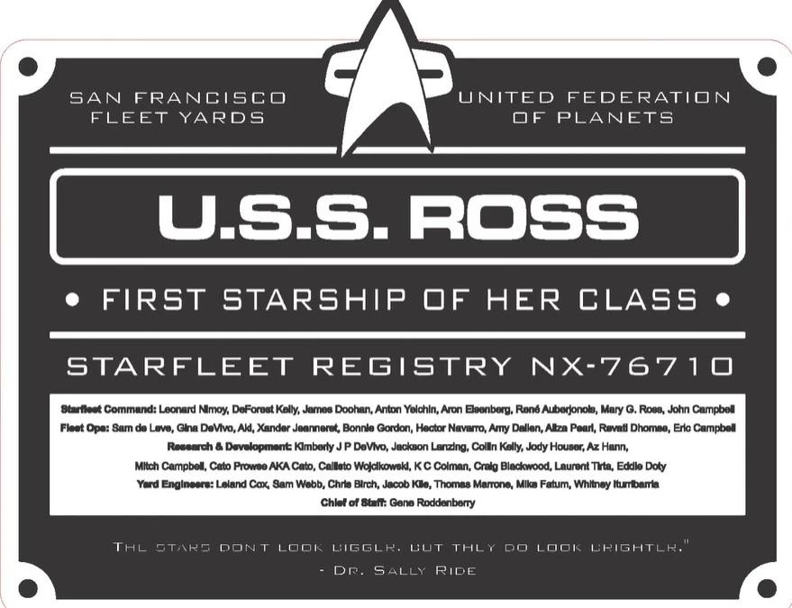
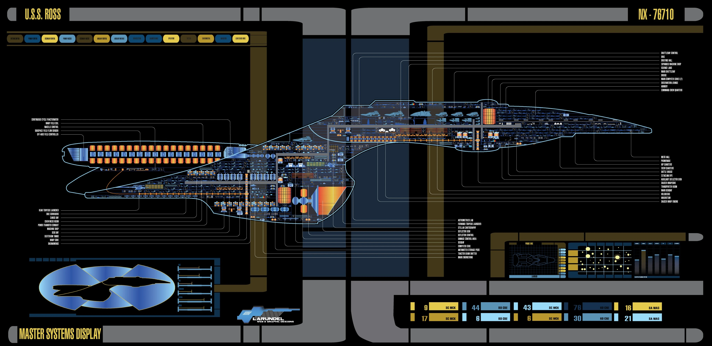
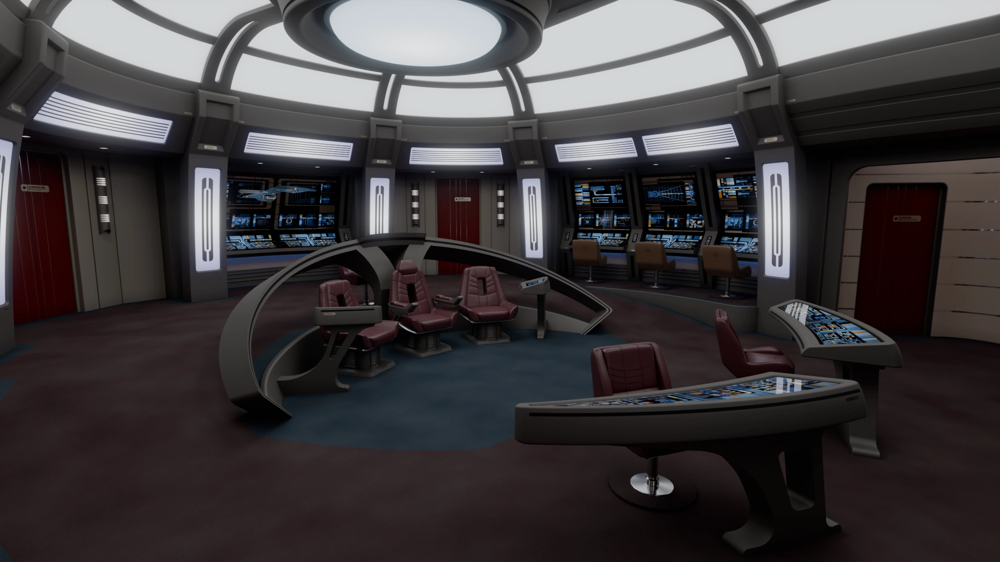

# USS Ross

- **Source:** https://clear-skies-rpg.fandom.com/wiki/USS_Ross
- **Retrieved:** 2026-11-16
- **Wiki page ID:** 105

| Field | Value |
| --- | ----- |
| Class | Ross-class (first of her class) |
| Registry | NX-76710 |
| Affiliation | Starfleet |
| Status | Operational |

The **USS *Ross* (NX-76710)** is a one-of-a-kind, variant Galaxy Class prototype starship based on experimental engineering technologies. It is currently assigned to [20th Fleet](../locations/20th-fleet.md).  The *Ross* was launched from [San Francisco Fleet Yards](https://memory-alpha.fandom.com/wiki/San_Francisco_Fleet_Yards), Earth in early 2381, and began a two-month long journey to the [Shackleton Expanse](../locations/shackleton-expanse.md), which would serve as a shakedown period. (Episode 01, Episode 02)

The USS Ross is named for [Mary G. Ross](https://en.wikipedia.org/wiki/Mary_G._Ross), the first known Native American female engineer. Ross's focus was "preliminary design concepts for interplanetary space travel, manned and unmanned earth-orbiting flights, the earliest studies of orbiting satellites for both defense and civilian purposes."

The senior design engineer was Dr. Debluch Marrone, who spent six years on the project.

## Personnel
### Senior Staff
| Name | Rank | Role | Species |
| --- | --- | --- | --- |
| Azeri Sull | Captain | Captain | Orion |
| EXEO | Lieutenant Commander | Executive Officer | Photonic |
| M'Qrell | Lieutenant Commander | Chief Medical Officer | Caitian |
| Jane Lakat | Lieutenant | Chief Science Officer | Cardassian |
| Theq Lynadas | Master Chief Petty Officer | Chief Engineer | Bolian |
| Olyn Madzhin-Nil | Civilian | Diplomatic Corps Liasion | Deltan |
| Yeri Prahl | Lieutenant Commander | Chief Tactical Officer | Trill |
| Zhyliss Vrenn | Lieutenant | Navigation Officer | Andorian |

### Auxiliary Crew 
| Name | Rank | Role | Species |
| --- | --- | --- | --- |
| Amandeep Singh | Chief Petty Officer | Transporter Chief | Human |
| Aulyn Dari | Ensign | Engineer | Andorian |
| Azzmi Shanto | Yeoman, 3rd class | Fleet Liason Officer | Bajoran/Betazoid |
| Roh Gerz | Lieutenant | Backup Security Officer | Bolian |
| Ryan Kale | Ensign | Life Support Tech | Human |
| Solun | Civilian | Bartender | Vulcan |
| Stavek | Civilian | Scientist | Vulcan |
| Talen | Lieutenant Junior Grade | Backup Science Officer | Benzite |
| T'Vek | Civilian | Scientist | Vulcan |
| Dr. Yata | Civilian | Head of Cetacean Ops | Odanian |
| [Dr. Yugoss](../characters/yugoss.md) | Civilian | Subspace Science | J'Shashian |

*Main article: Sup Crew*

## Technical Data

### Description
The *Ross* has 42-decks and a complement of 600 Starfleet Officers and Enlisted with 1,900 civilian crew and passengers. It has a massive promenade specifically for diplomatic functions. It looks to be a cross between a Sovereign Class and a Galaxy Class. The ship is 663.2 meters in length, has a beam of 398.9 meters, and has a draught of 146.8 meters. She has a 4,409,556.7 metric tonne mass.

Her propulsion systems include two Yoyodyne Propulsion M/ARC Warp Cores, two Yoyodyne Propulsion Warp Field Coil Nacelles, seven Yoyodyne Propulsion Warp Field Flat Coils, and three Charon Yards Heavy Impulse Engines. Her armarments include eleven Mk. 12 Phase Arrays and seven Variable Payload Launch Tubes. Her sensor systems include six DYN 58 Multi-Band Lateral Sensor Suites, four GBG Directional Sensor Arrays, and one NDM-09 Omni-Phase Deflector Array.

The saucer section is slightly different, not as wide and a little more circular. The neck doesn’t end the way it does on a normal Galaxy class, instead stretching down the length of the body, and the nacelles and warp engine are all updated looking. There’s also a peculiar under piece where normally a captain’s yacht may be located, instead resides the ejection hatch for the secondary warp core. There is saucer separation capabilities, and within the saucer section itself there is a secondary warp core.

In Cetacean ops, there are 22 Odanian officers.

In 2381, she underwent a refit at Narendra Station.  She received high resolution sensors.

### Directory
#### Command & Control

| Area | **Deck** |
| --- | --- |
| Battle Bridge | 12 |
| Damage Control | 21 |
| Captain's Ready Room | 01 |
| Main Bridge | 01 |
| Observation Lounge | 02 |

#### Crew Services
| Area | Deck |
| --- | --- |
| Arboretum | 11 |
| Cetacean Ops | 13 |
| Holodecks 1-4 | 11 |
| Holodecks 5, 6 | 27 |
| Promenade Deck | 08 |
| Ten Forward Lounge | 10 |

#### Medical Facilities
| Area | Deck |
| --- | --- |
| Main Sickbay Complex | 12 |
| Sickbay 2 | 20 |
| Sickbay 3 | 31 |
**Transporters**
| Area | Deck |
| --- | --- |
| Transporter Rooms 1-4 | 12 |
| Transporter Room 5 | 21 |
| Transporter Room 6 | 28 |

#### Engineering Facilities
| Area | Deck |
| --- | --- |
| Antimatter Storage | 39 |
| Main Deuterium Tank | 28 |
| Main Engineering | 32 |
| Secondary Engineering | 18 |
| Nacelle Control - Port | P-1 |
| Nacelle Control - Starboard | S-1 |

#### Scientific Facilities
| Area | Deck |
| --- | --- |
| Biology Lab 1 | 15 |
| Deflector Control | 30 |
| Deflector Control (Secondary) | 18 |
| Long-Range Sensor Control | 14 |
| Stellar Cartography | 17 |

#### Tactical/Security Facilities
| Area | Deck |
| --- | --- |
| Armory | 04 |
| Brig | 08 |
| Main Phaser Control | 15 |
| Main Torpedo Bay - Fore | 23 |
| Main Torpedo Bay - Aft | 27 |

#### Auxiliary Craft Operations
| Area | Deck |
| --- | --- |
| Main Shuttle Bay | 04 |
| Auxiliary Craft Maintenence | 06 |
| Shuttle Bay 2,3 | 12 |

#### Cargo Handling
| Area | Deck |
| --- | --- |
| Cargo Bay 1 | 36 |
| Cargo Bay 2 | 26 |
| Cargo Bay 3,4 | 17 |
| Tractor Beam Control - Fore | 40 |
| Tractor Beam Control - Aft | 40 |

### Embarked Crafts
-  Shuttlepod Type 18
-  Workbee
-  Sphinx Workpod
-  Personnel Shuttle Type 8
-  Personnel Shuttle Type 11 (USS Cypress)
-  Danube-Class Runabout (USS San Antonio)
-  Argo-Class Reconnaissance Transport (USS Abigail)
